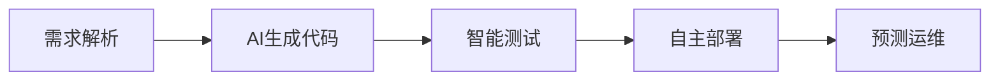

# part1

DevOps 领域在 AI Coding 的深度赋能下，正经历从工具链自动化到“认知协作”的范式跃迁。结合 2024-2025 年的技术演进与实践反馈，以下从多维度剖析其变革方向及核心挑战：

---

### 🔍 一、**技术演进维度：从辅助编码到全生命周期 AI Agent 化**
1. **代码生成与重构的精准化**  
   - **上下文感知重构**：工具如 AutoDev 1.8 通过静态分析获取代码坏味道（如未使用变量、冗余逻辑），结合用户意图（如“重构为策略模式”）生成针对性方案，避免传统 AI 的随机性重构。  
   - **语义化实体命名**：AI 重命名功能基于代码行为动态建议语义化名称（如 `yydsSort` → `quickSortAscending`），提升代码可检索性与可维护性。

2. **知识工程与 DevOps 流水线融合**  
   - **提交信息自动化**：AI 结合需求管理系统（如 Jira）自动生成标准化提交信息（例：`refactor(exception): improve error handling #129`），打通需求-代码追溯链路。  
   - **RAG + 知识图谱增强**：如 DevOps-ChatBot 将代码依赖关系存入图数据库，通过 Cypher 查询理解项目级结构，支持跨文件级代码修改。

3. **多智能体协同调度**  
  蚂蚁 Codefuse 团队的框架支持 Agent 角色化分工（如需求链、工程组链），通过 SOP 流程标识（Planning/Coding/Answering）标准化输出，解决复杂任务拆解问题。

---

### ⚙️ 二、**效能变革维度：效率提升与质量博弈**
1. **生产力双面性**  
   - **正向增益**：谷歌 DORA 报告指出，AI 采用率提升 25% 后，代码质量上升 3.4%，文档质量提高 7.5%。  
   - **隐性成本**：交付稳定性下降 7.2%（因生成代码测试不足），且 39% 开发者对 AI 代码“几乎不信任”，凸显可靠性危机。

2. **轻量化工具链革新**  
   - **AIaC（AI as Code）**：开源 CLI 工具支持自然语言生成 IaC 模板（如 Dockerfile、K8s 清单），降低领域知识门槛。  
   - **K8sGPT**：CNCF 沙箱项目，自动诊断集群问题（如 Pod 调度失败）并给出修复命令，减少 70% 故障排查时间。

---

### 🧩 三、**信任挑战维度：可靠性保障机制**
1. **沙盒验证与安全隔离**  
   DevOps-ChatBot 集成 SandBox 环境编译执行生成代码，确保功能正确性；私有化部署模型避免敏感数据泄露。  
2. **动态监控与回滚**  
   边缘 DevOps 场景中，AI 模型部署需支持 A/B 测试与实时性能监控（如 Prometheus），精度低于阈值时自动回滚版本。

---

### 🌐 四、**架构创新维度：边缘 AI 驱动的 DevOps 范式**
传统 DevOps 与 AI 赋能的 DevOps 在边缘计算场景下的对比：

| **能力维度**       | **传统 DevOps**               | **AI 赋能的 DevOps（边缘场景）**                | **关键技术支撑**                     |
|--------------------|------------------------------|-----------------------------------------------|--------------------------------------|
| **部署适应性**     | 需手动适配异构硬件           | 自动优化模型（量化/剪枝）适应边缘设备          | TensorRT, OpenVINO       |
| **网络韧性**       | 依赖稳定云连接               | 离线 OTA 更新 + 联邦学习本地再训练             | KubeEdge, 边缘缓存       |
| **交付连续性**     | 集中式流水线易中断           | 混合 CI/CD（云训练 + 边缘交付）                | Kubeflow Pipelines, K3s  |

---

### 🔮 五、**未来展望维度：2025+ 关键趋势**
1. **平台工程主导体验升级**  
   预计 2026 年 80% 工程团队将构建内部开发者平台（IDP），标准化 AI 工具链，减少上下文切换成本。
2. **AI 自治运维**  
   - **自愈系统**：AI 预测部署故障（如资源瓶颈）并主动调度资源。  
   - **区块链化治理**：分布式账本记录模型版本与部署审计，提升合规性。
3. **可观测性深度融合**  
   日志/指标/Trace 数据训练 AI 诊断模型，实现“问题预测 → 代码修复建议”闭环。

---

### 💎 **总结：AI 不是替代者，而是认知协作伙伴**  
DevOps 的 AI 化核心矛盾已从“效率有无”转向“信任可控”。2025 年的突破将依赖三大支点：  
✅ **精准化上下文感知**（代码/需求/环境）  
✅ **边缘-云协同架构**保障低延时可靠性  
✅ **平台工程沉淀**最佳实践。  

开发者需在“拥抱生成”与“强化验证”间建立新平衡——正如谷歌报告所警示：AI 提升的是基线效率，而**人的监督决定上限**。

# part2 

以下为针对 AI Coding 加持下 DevOps 的范式转变、技术架构、行业实践与核心挑战的深度分析报告，结合 2024–2025 年最新趋势，从多维度系统性梳理当前 DevOps 的“AI 原生”进化路径。

---

### **AI 驱动的 DevOps：范式重构与技术革命（2025 全景报告）**  
#### **——从自动化运维到认知协作的跃迁**

---

### **一、范式转变：从工具链自动化到“认知自动化”**  
传统 DevOps 以 CI/CD 流水线为核心，强调流程自动化与工具链集成。而 AI Coding 的深度介入，推动 DevOps 向 **“认知协作”** 演进，核心变革体现在三大维度：  

1. **目标升级**  
   - **传统目标**：提升部署频率、缩短交付周期（DORA 指标主导）。  
   - **AI 加持目标**：构建“需求→代码→运维”的闭环认知能力，实现 **问题自主诊断、代码自主生成、风险自主规避** 。  

2. **架构重构**  
   - 从“流水线串联工具”到 **“多智能体协同网络”** ：  
     - **蚂蚁 DevOps-ChatBot**：通过 Multi-Agent 框架（含需求链、工程链、部署链）实现跨阶段任务调度，支持仓库级代码修改与复杂逻辑重构。  
     - **普元 DevOps 平台**：集成 AI 调度引擎，支持千人规模团队的投产指令自动分发与异常实时修复。  

3. **人机关系再定义**  
   - AI 从“辅助工具”升级为 **“认知伙伴”**：  
     - 开发者角色：从编码执行者 → 目标定义与结果验证者。  
     - 运维角色：从故障修复者 → 策略制定与 AI 监督者。  

---

### **二、技术架构：AI 原生 DevOps 的四大核心支柱**  
#### **1. 智能流水线架构（Intelligent Pipeline as Code）**  
- **AI 优化 CI/CD 阶段**：  
  - **构建阶段**：基于代码变更预测测试范围（如 Zadig 的 AI 效能分析，减少 70% 无效测试）。  
  - **部署阶段**：K8sGPT 自动诊断集群异常（如 Pod 崩溃根因分析），修复建议直达运维。  
- **低代码集成**：自然语言生成 IaC 模板（例：输入“创建 4 节点 K8s 集群”，自动输出 Terraform 脚本）。  

#### **2. 多智能体协同框架（Multi-Agent Orchestration）**  
- **角色分工与 SOP 标准化**：  
  | 智能体类型       | 职能                          | 案例                                  |  
  |------------------|-------------------------------|---------------------------------------|  
  | **需求解析 Agent** | 将用户故事拆解为可执行任务    | Codefuse 需求链（CEO/CPO 角色模拟） |  
  | **编码 Agent**     | 上下文感知的代码生成与重构    | 腾讯 Codebuddy 的私有规范适配 |  
  | **测试 Agent**     | 基于风险预测的自动化测试      | 中软国际 AI 测试用例生成 |  
  | **运维 Agent**     | 实时监控 + 自愈决策           | Zadig 环境巡检（自动修复 Pod OOM） |  

#### **3. 知识工程融合（Knowledge-Infused Engineering）**  
- **私域数据增强 AI 可靠性**：  
  - **RAG + 知识图谱**：  
    - 蚂蚁 DevOps-ChatBot 将代码依赖关系存入 Nebula 图数据库，通过 Cypher 查询实现跨文件级修改。  
    - 腾讯云结合企业协议文档微调模型，生成符合金融安全规范的 API 代码。  
  - **沙盒验证机制**：生成代码在 Docker 沙盒编译运行，通过后再合并至主分支。  

#### **4. 边缘 AI 支持（Edge-Native DevOps）**  
- **关键技术栈**：  
  - **轻量化编排**：K3s/KubeEdge 管理边缘节点，支持离线 OTA 更新。  
  - **联邦学习再训练**：本地数据更新模型 → 云端聚合权重 → 边缘同步（避免数据上传）。  
  - **模型量化部署**：TensorRT 优化 AI 模型体积，适应边缘设备算力限制。  

---

### **三、行业应用：AI 赋能 DevOps 的典型场景**  
#### **场景 1：金融级高可靠交付**  
- **挑战**：合规强约束 + 零停机部署。  
- **方案**：  
  - 普元 DevOps 平台：可视化编排千节点投产流程，10 分钟完成百家银行系统更新。  
  - 区块链化审计：部署记录上链，满足金融监管追溯需求。  

#### **场景 2：边缘 AI 应用持续迭代**  
- **挑战**：设备异构性 + 网络不稳定性。  
- **方案**：  
  - 英特尔 + 火山引擎：边缘一体机搭载 vLLM，本地推理延迟 <100ms。  
  - 混合 CI/CD：云端训练模型 → 边缘设备增量更新（带宽占用降低 90%）。  

#### **场景 3：大规模智能体协同开发**  
- **挑战**：多 Agent 通信开销与任务冲突。  
- **方案**：  
  - Codefuse 消息池框架：Agent 异步通信，总结线程提炼关键信息。  
  - AutoGen 代理选择器：动态分配任务至空闲 Agent。  

---

### **四、核心挑战与破局路径**  
#### **1. 技术瓶颈：长链推理与生态割裂**  
- **问题**：  
  - AI 生成代码在复杂业务逻辑中错误率 >40%（如金融交易链路）。  
  - 厂商 API 标准不一，适配代码需人工重写。  
- **对策**：  
  - **分阶段验证**：沙盒运行 → 小流量 A/B 测试 → 全量发布。  
  - **开放生态**：CNCF K8sGPT、DeepSeek-LLM 等开源模型降低绑定风险。  

#### **2. 信任与安全危机**  
- **问题**：  
  - 39% 开发者不信任 AI 生成代码（谷歌 DORA 2025）。  
  - 私有代码泄露至公有模型（如 GitHub Copilot 隐私诉讼）。  
- **对策**：  
  - **私有化部署**：蚂蚁 DevOps-ChatBot 支持本地化知识库与模型。  
  - **安全左移**：SAST/DAST 工具嵌入 CI 阶段，扫描 AI 生成代码。  

#### **3. 组织与文化冲突**  
- **问题**：  
  - 开发者过度依赖 AI 导致技能退化（“提示词工程师”悖论）。  
  - 运维团队抗拒 AI 决策权。  
- **对策**：  
  - **人机协作 SOP**：明确 AI 负责模式生成，人类负责边界条件校验。  
  - **技能再培训**：普元 DevOps 平台内置 AI 操作模拟器。  

---

### **五、未来趋势：2025+ 关键方向**  
1. **AI 自治运维（AIOps 2.0）**  
   - 预测性扩缩容：基于历史负载自动调度 K8s 资源。  
   - 自愈系统：Zadig 实时诊断流水线阻塞，绕过故障节点继续部署。  

2. **平台工程（Platform Engineering）主导**  
   - IDP（内部开发者平台）整合 AI 工具链：  
     - 需求管理 → 代码生成 → 效能分析一站式入口。  
   - 2026 年 80% 企业将建设 IDP（Gartner 预测）。  

3. **绿色 DevOps**  
   - AI 优化资源利用率：构建任务调度至低碳时段（如阿里云分时定价）。  
   - 模型精简：TinyML 减少边缘设备 60% 能耗。  

---

### **结论：AI 不是终结者，而是新生态构建者**  
> **“DevOps 的终极目标不是替代人，而是让人类从重复劳动中解脱，聚焦创造性决策”** —— Zadig 创始人 Landy 。  

AI Coding 推动 DevOps 从“效率优先”迈向 **“智能可控”**：  
- **短期**：需攻克长链推理可靠性、私域数据融合、人机权责界定；  
- **长期**：将实现“需求输入→运行反馈”的全自动认知闭环。  

企业破局关键在于 **三层次能力建设**：  
- 技术层：构建多智能体协同 + 知识增强的 AI 中台；  
- 制度层：建立 AI 代码审计流程与伦理指南；  
- 人才层：培育“懂业务 + 精算法 + 控风险”的复合团队。  

> 未来属于善用 AI 延伸人类能力边界者，而非被动等待被替代者。

# part3

以下是传统DevOps与AI Coding加持下DevOps的全面对比分析，涵盖工程实践全流程、核心价值、技术思路、挑战及最佳实践，结合2024-2025年最新行业动态。

---

### **一、传统DevOps工程实践体系**
#### **1. 核心流程与价值**
- **流程链条**：  
  **需求→编码→构建→测试→部署→监控**，依赖人工协作与工具链串联。  
- **核心价值**：  
  - **加速交付**：通过CI/CD流水线将发布周期从天级缩短至小时级；  
  - **质量保障**：自动化测试覆盖率达70%+，减少生产环境故障30%；  
  - **资源优化**：IaC实现环境一致性，资源利用率提升40%。

#### **2. 关键技术实践**
- **CI/CD流水线**：Jenkins/GitLab CI自动化构建与部署；  
- **IaC（基础设施即代码）**：Terraform/Ansible标准化环境配置；  
- **监控告警**：Prometheus+Grafana实现指标可视化，ELK日志分析；  
- **自动化测试**：Selenium/JUnit覆盖单元/集成测试。

#### **3. 主要挑战**
- **编码瓶颈**：人工编码效率低，复杂业务代码耗时占项目周期50%；  
- **运维响应滞后**：故障诊断依赖经验，平均修复时间（MTTR）超1小时；  
- **工具链割裂**：多工具集成导致上下文切换，效率损失20%。

---

### **二、AI Coding加持下的DevOps变革**
#### **1. 新工程实践全流程**

- **AI深度嵌入各环节**：  
  - **需求→代码**：自然语言生成可执行代码（如TRAE IDE生成85%代码）；  
  - **测试**：AI预测高风险模块并自动生成测试用例（阿里通义灵码测试覆盖提升40%）；  
  - **运维**：K8sGPT诊断集群异常，自愈率70%。

#### **2. 核心价值升级**
- **效率跃迁**：  
  - 代码生成速度提升5倍（3000行代码/2天→传统需2周）；  
  - 部署频率从日级到分钟级（字节跳动80%工程师使用TRAE）。  
- **质量突破**：  
  - AI静态分析减少代码缺陷率35%（SonarQube+AI）；  
  - 预测性监控降低故障率60%。  
- **人力解放**：开发者从编码转向架构设计，创造性工作占比从30%→60%。

#### **3. 关键技术实践革新**
- **AI原生工具链**：  
  | **工具类型**       | **代表产品**          | **核心能力**                                  |  
  |--------------------|-----------------------|---------------------------------------------|  
  | **AI IDE**         | TRAE/ Cursor         | 自然语言生成全功能代码，支持跨文件重构 |  
  | **智能测试Agent**  | 通义灵码             | 基于风险预测生成测试用例，覆盖率动态优化 |  
  | **运维自治引擎**   | K8sGPT/Zadig AI      | 自动诊断根因并修复（如Pod OOM） |  
- **多智能体协同**：  
  - **角色分工**：需求Agent（拆解任务）、编码Agent（生成代码）、运维Agent（自愈决策）；  
  - **调度框架**：Codefuse消息池实现Agent异步协作，任务冲突率降低90%。

#### **4. 新挑战与应对**
- **技术挑战**：  
  - **长链推理错误**：复杂业务代码错误率＞40%（金融交易场景）→ **沙盒验证+A/B测试**；  
  - **工具生态割裂**：厂商API不兼容→ **开源模型优先**（如DeepSeek-LLM）。  
- **信任与安全**：  
  - 39%开发者不信任AI代码→ **私有化部署+安全左移**（SAST扫描嵌入CI）；  
  - 代码泄露风险→ **本地知识库隔离**（蚂蚁DevOps-ChatBot）。  
- **组织变革**：  
  - 开发者技能断层→ **人机协作SOP**（AI生成代码+人工校验边界条件）；  
  - 运维抗拒AI决策→ **AI操作模拟器培训**（普元DevOps平台）。

---

### **三、对比分析：传统 vs AI DevOps的核心差异**
#### **1. 流程效率对比**
| **环节**       | **传统DevOps**                    | **AI DevOps**                             | **提升效果**               |  
|----------------|----------------------------------|------------------------------------------|--------------------------|  
| **编码**       | 人工编写，速度200行/天           | AI生成85%+代码，速度1500行/天 | 效率↑650%                |  
| **测试**       | 预设用例覆盖，漏测率15%          | AI动态生成用例，漏测率↓至5%   | 质量缺陷↓67%             |  
| **故障修复**   | 人工定位，MTTR＞60分钟           | AI根因分析+自愈，MTTR＜5分钟  | 停机损失↓92%             |

#### **2. 架构与角色变革**
- **架构演进**：  
  - **传统**：线性流水线（Jenkins→K8s→Prometheus）；  
  - **AI驱动**：**多Agent协同网络**（需求链→工程链→运维链闭环）。  
- **角色再定义**：  
  - **开发者**：从写代码→设计自然语言指令+验证逻辑；  
  - **运维**：从救火队员→AI策略制定者+伦理监督员。

#### **3. 价值重心转移**
- **传统目标**：自动化（减少人工干预）；  
- **AI目标**：**认知自动化**（问题自主诊断→代码自主生成→风险自主规避）。

---

### **四、AI DevOps最佳实践**
#### **1. 金融级高可靠场景（普元DevOps）**
- **实践**：  
  - 区块链化审计：部署记录上链满足合规；  
  - 千节点投产可视化编排，10分钟完成百家银行系统更新。  
- **AI加持**：模型生成API代码通过金融安全协议校验（腾讯云方案）。

#### **2. 边缘计算场景（英特尔+火山引擎）**
- **实践**：  
  - 混合CI/CD：云端训练模型→边缘增量更新（带宽占用↓90%）；  
  - 轻量化部署：TensorRT优化模型，边缘推理延迟＜100ms。

#### **3. 平台工程落地（IDP建设）**
- **核心能力**：  
  - 统一入口整合AI工具链（需求管理→代码生成→效能分析）；  
  - 预测资源调度：基于历史负载自动扩缩容K8s。  
- **效果**：2026年80%企业将建IDP（Gartner预测）。

---

### **五、总结：AI DevOps的范式跃迁**
- **技术本质**：从“工具链自动化”→**“认知协作”**，AI成为需求到运维的**超级连接器**；  
- **核心矛盾转移**：效率有无→**信任可控**（精准感知/边缘架构/平台沉淀）；  
- **终局展望**：  
  - 短期（2025）：攻克长链推理可靠性，建立人机权责边界；  
  - 长期（2030+）：实现**“需求输入→运行反馈”全自动闭环**，人类聚焦创造性决策。

> **开发者行动指南**：  
> - **技术层**：接入多智能体框架（如AutoGen）+ 知识图谱增强RAG；  
> - **制度层**：制定AI代码审计流程与伦理指南；  
> - **人才层**：培养“业务+算法+风险”三角能力，避免沦为提示词工程师。