好的，我们来尝试用 Mermaid 语法生成这些图表的代码，并配上相应的上下文和说明。请注意，Mermaid 对于复杂图形的布局和样式控制可能有限，生成的效果可能与手绘或专业绘图工具略有差异，但能清晰表达核心概念。

---

**第一章：DevOps 的诞生与核心价值**

**1. 图1.1：传统瀑布模型 vs. 敏捷迭代 vs. DevOps 持续交付流程对比**

*   **图的上下文和说明：**
    此图并列展示了三种主要的软件开发与交付模式：传统的瀑布模型、敏捷迭代模型以及 DevOps 的持续交付模型。它旨在直观对比它们在流程结构、反馈循环和交付节奏上的核心差异。
    *   **瀑布模型** 显示了其严格的线性顺序阶段，从需求到维护，每个阶段完成后才能进入下一个。
    *   **敏捷迭代模型** 则通过循环结构强调了短周期的迭代开发和增量交付。
    *   **DevOps 持续交付模型** 描绘了一个持续的、自动化的闭环流程，突出了从规划到监控再到反馈的无缝集成和持续流动。

*   **Mermaid 代码：**

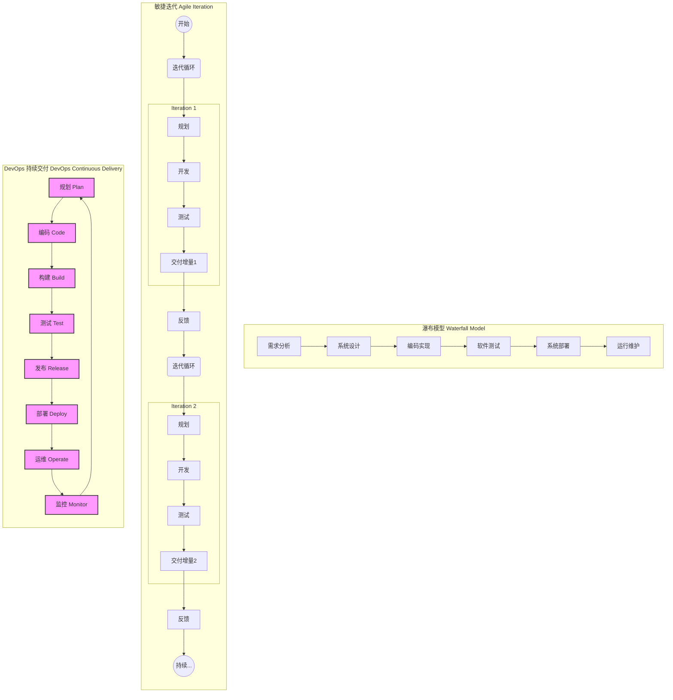

---

**2. 图1.2：开发与运维之间的“墙”**

*   **图的上下文和说明：**
    该图形象地描绘了在传统IT组织中，开发（Dev）团队与运维（Ops）团队之间存在的隔阂，通常被称为“开发与运维之墙”。左侧代表开发团队，其主要目标是快速交付新功能；右侧代表运维团队，其核心职责是保障生产环境的稳定。中间的“墙”象征着沟通障碍、目标冲突和流程上的脱节，这些因素共同阻碍了高效的软件交付。

*   **Mermaid 代码：**

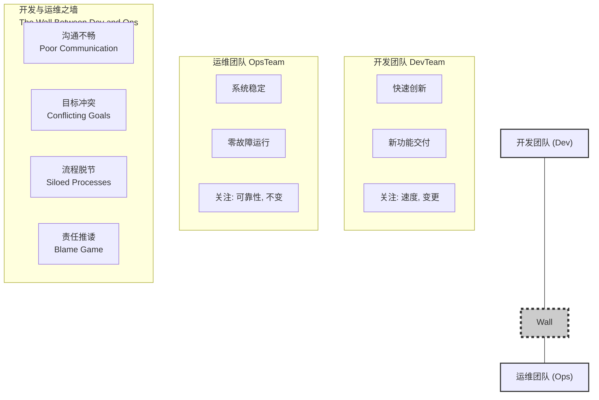
*(Mermaid 对于直接绘制“墙”的视觉效果有限，这里用一个节点和虚线来象征性表示，并通过文本强调。)*

---

**3. 图1.3：DevOps 的三大支柱 (或核心要素)**

*   **图的上下文和说明：**
    此图展示了构成 DevOps 理念的三个核心要素或支柱：文化（Culture）、流程/实践（Process/Practices）和工具（Tools）。它强调 DevOps 的成功实施并非仅仅依赖于某一个方面，而是这三者相互作用、紧密结合的成果。有效的 DevOps 转型需要在组织文化、工作流程和技术工具上进行协同变革。

*   **Mermaid 代码 (方案一：维恩图概念，用节点连接表示)：**

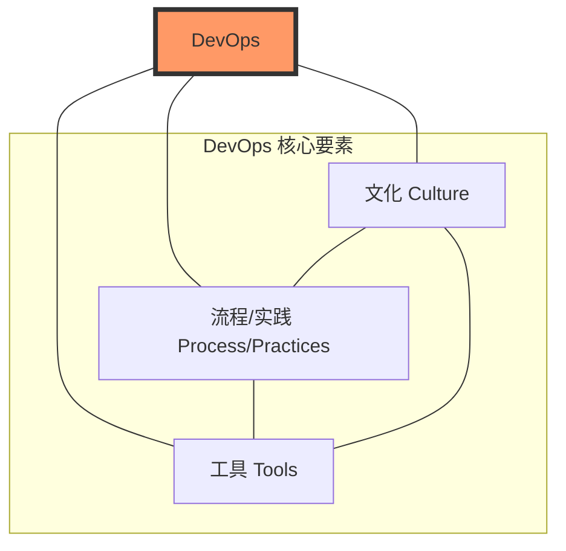
*   **Mermaid 代码 (方案二：饼图，如果更倾向于表示构成比例，但Mermaid的饼图更侧重数据)：**
    *(Mermaid 的标准饼图主要用于展示数据比例，可能不太适合纯概念性的三大支柱。上面的节点连接图更能表达相互关联性。如果一定要用饼图概念，可以这样理解：)*

    *Mermaid 的 `pie` 图例*
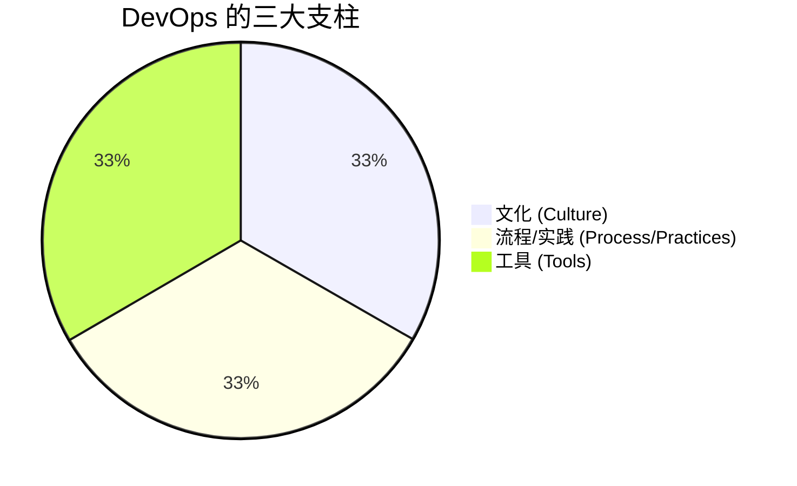
    *(这个饼图仅为示意，实际应用中，三大支柱的重要性是均等的，并非严格的数字比例。)*

---

**第二章：DevOps 的核心原则与关键实践**

**4. 图2.1：CALMS DevOps 模型**

*   **图的上下文和说明：**
    CALMS 模型是概括 DevOps 核心原则的一个常用框架。该图列出了 CALMS 所代表的五个关键要素：
    *   **C**ulture (文化)：强调共享责任、协作和信任。
    *   **A**utomation (自动化)：尽可能自动化重复性任务。
    *   **L**ean (精益)：消除浪费，优化价值流。
    *   **M**easurement (度量)：基于数据进行决策和改进。
    *   **S**haring (分享)：共享知识、经验和工具。
    这些原则共同指导着 DevOps 的实践和转型过程。

*   **Mermaid 代码：**

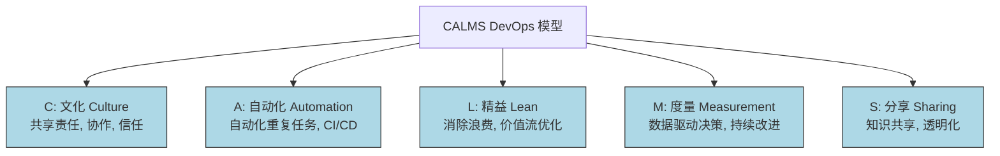

---

**5. 图2.2：典型的 CI/CD 流水线示意图**

*   **图的上下文和说明：**
    该图清晰地展示了一条典型的持续集成（CI）与持续交付/部署（CD）流水线。它从开发者提交代码开始，依次经过自动化构建、单元/集成测试、制品存储。随后，构建产物会自动部署到测试环境进行验收测试，通过后可能经过手动审批（持续交付）或直接部署到预发布/生产环境（持续部署）。整个过程强调自动化、快速反馈和持续流动，监控贯穿始终。

*   **Mermaid 代码：**

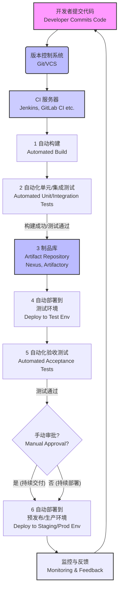

---

**6. 图2.3：测试金字塔 (Test Pyramid)**

*   **图的上下文和说明：**
    测试金字塔是一种指导自动化测试策略的模型。它强调不同类型测试的数量和执行频率：
    *   **底部 (Unit Tests - 单元测试)：** 数量最多，运行速度最快，反馈最及时，主要验证小代码单元的正确性。
    *   **中间层 (Integration/Service Tests - 集成/服务测试)：** 数量适中，验证模块间或服务间的交互。
    *   **顶部 (End-to-End/UI Tests - 端到端/UI测试)：** 数量最少，运行速度最慢，成本最高，但能模拟真实用户场景验证整个系统的功能。
    遵循金字塔原则有助于构建健壮、高效的自动化测试体系。

*   **Mermaid 代码：**
    *(Mermaid 没有直接的金字塔形状，这里用堆叠的矩形或流程图的层次感来近似表达。)*

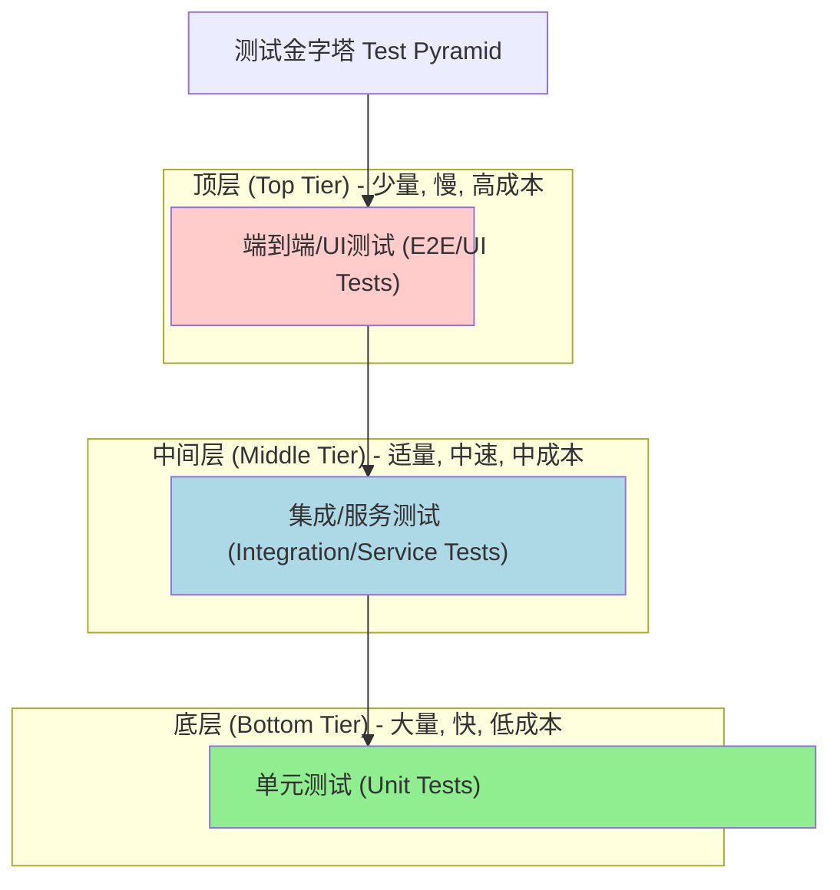

---

**7. 图2.4：基础设施即代码 (IaC) 概念图**

*   **图的上下文和说明：**
    此图阐释了基础设施即代码（Infrastructure as Code, IaC）的核心概念。开发者或运维工程师使用代码（如 Terraform 的 HCL 或 Ansible 的 YAML）来定义和描述基础设施的期望状态。这些代码通过 IaC 工具（如 Terraform、Ansible）执行后，会自动在云平台或本地数据中心创建、配置和管理相应的基础设施资源。这种方式实现了基础设施的版本控制、自动化和可重复性。

*   **Mermaid 代码：**

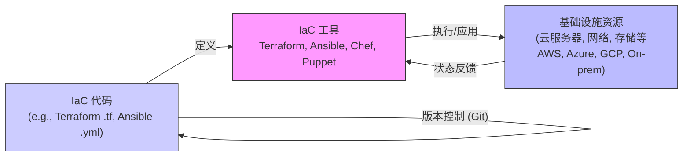

---

**8. 图2.5：微服务架构 vs. 单体架构**

*   **图的上下文和说明：**
    该图对比了单体架构（Monolithic Architecture）和微服务架构（Microservices Architecture）在结构上的主要区别。
    *   **单体架构** 将应用的所有功能模块（如用户界面、业务逻辑、数据访问）紧密耦合在一个大的代码库和部署单元中。
    *   **微服务架构** 则将应用拆分为一组小型的、独立部署的服务，每个服务围绕特定的业务能力构建，并通过轻量级通信机制（如 API）进行交互。每个微服务可以拥有自己独立的数据库。

*   **Mermaid 代码：**

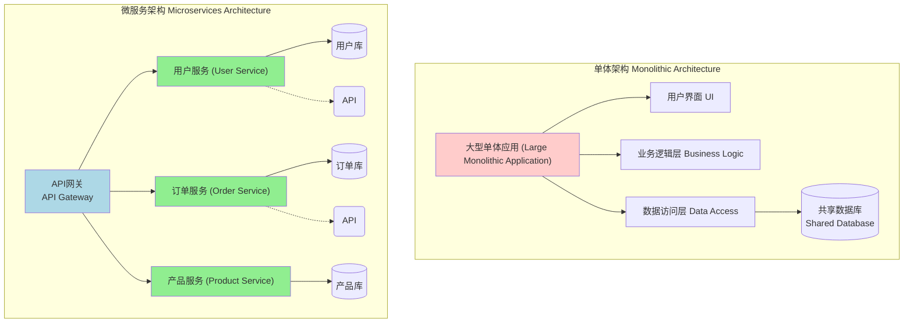

---

**第三章：DevOps 对应用开发各阶段的深远影响**

**9. 图3.1：DevOps 全生命周期无限循环图**

*   **图的上下文和说明：**
    此图以无限循环符号 (∞) 直观地展示了 DevOps 所覆盖的应用开发全生命周期。它从规划（Plan）开始，依次经过编码（Code）、构建（Build）、测试（Test）、发布（Release）、部署（Deploy）、运维（Operate）和监控（Monitor）。关键在于，监控阶段收集的反馈会重新输入到规划阶段，形成一个持续改进、永不间断的闭环，体现了 DevOps 的核心理念：持续迭代和优化。

*   **Mermaid 代码：**

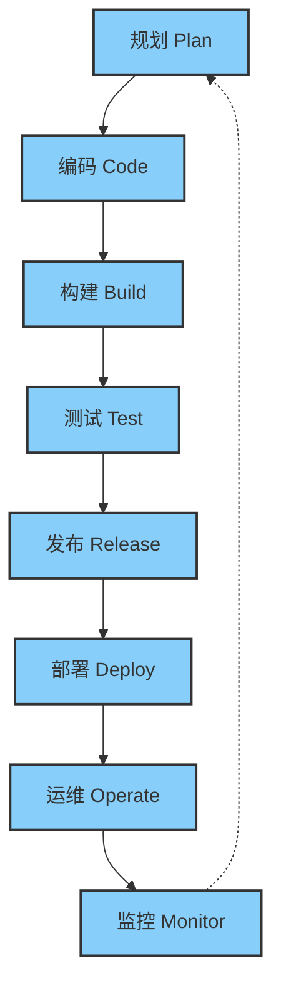
*(Mermaid 中绘制完美的无限符号有难度，这里用节点连接形成的循环来表示，并通过布局强调反馈。)*

---

**10. 图3.2：蓝绿部署 (Blue-Green Deployment) 示意图**

*   **图的上下文和说明：**
    蓝绿部署是一种旨在降低发布风险、实现零停机更新的策略。该图展示了其核心流程：
    1.  **初始状态：** 生产流量（由路由器/负载均衡器引导）指向当前活动的“蓝色”环境（运行旧版本V1）。同时，一个与蓝色环境完全相同的“绿色”环境被准备好，用于部署新版本V2。
    2.  **切换阶段：** 当新版本V2在绿色环境部署并测试通过后，路由器/负载均衡器将所有生产流量切换到绿色环境。此时，绿色环境成为新的活动生产环境。
    3.  **回滚保障：** 蓝色环境（旧版本V1）会保留一段时间。如果新版本V2出现问题，可以快速将流量切回蓝色环境，实现快速回滚。

*   **Mermaid 代码：**

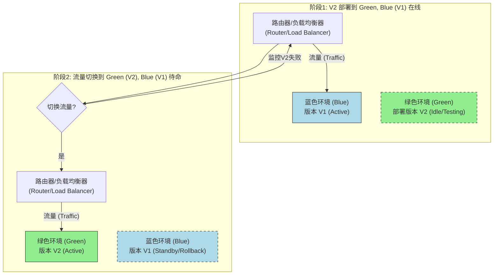

---

**11. 图3.3：金丝雀发布 (Canary Release) 示意图**

*   **图的上下文和说明：**
    金丝雀发布是一种渐进式将新版本软件推送给用户的策略，旨在小范围验证新版本的稳定性并收集早期反馈，从而降低全面发布带来的风险。
    1.  **初始阶段：** 大部分用户流量（例如95%）继续访问稳定的旧版本（V1）。一小部分特定用户或随机选择的用户流量（例如5%，即“金丝雀”用户）被导向部署了新版本（V2）的服务器。
    2.  **监控与扩展：** 持续监控新版本V2在金丝雀用户群中的表现（如错误率、性能指标、用户反馈）。如果表现良好，则逐步增加导向新版本V2的流量比例，并扩大用户范围。
    3.  **全面铺开或回滚：** 如果新版本持续稳定，最终会将所有流量都切换到新版本V2。如果在任何阶段发现问题，则可以快速将金丝雀流量切回旧版本V1，并停止扩大发布。

*   **Mermaid 代码：**

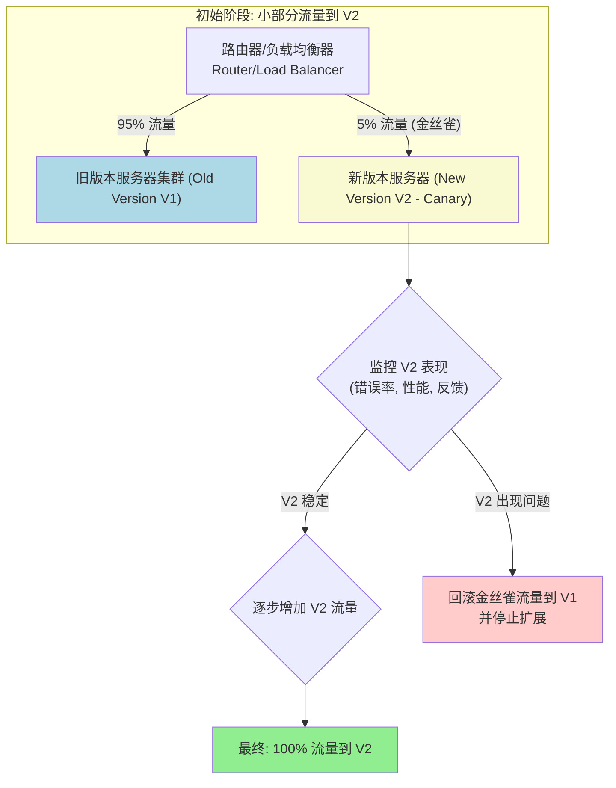

---

**第四章：DevOps 带来的核心收益**

**12. 图4.1：DevOps 核心收益概览 (思维导图式)**

*   **图的上下文和说明：**
    此思维导图概览了实施 DevOps 所能带来的多方面核心收益。中心节点为“DevOps 核心收益”，由此延伸出三个主要分支：
    *   **技术收益：** 关注于IT交付能力和运营效率的提升，如更快的交付频率、更低的变更失败率等。
    *   **业务收益：** 强调对业务目标的积极影响，如加速产品上市、提升客户满意度和增强创新能力。
    *   **文化与组织收益：** 涉及团队协作、员工满意度和组织氛围的改善。
    每个主要分支下再列举具体的收益点，清晰展现 DevOps 的综合价值。

*   **Mermaid 代码 (使用 `mindmap` 类型，如果解析器支持良好)：**

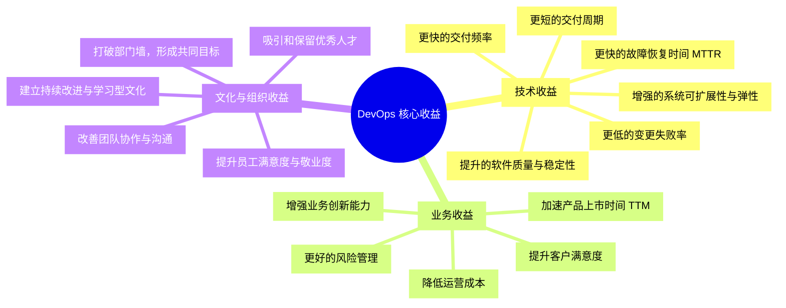
*(如果 `mindmap` 不被当前 Mermaid 解析器完全支持，可以使用 `graph` 类型模拟树状结构。)*

---

**第五章：逐步适应 DevOps：实践路径、常见困难与建议**

**13. 图5.1：DevOps 成熟度模型 (阶梯图)**

*   **图的上下文和说明：**
    DevOps 成熟度模型通常以阶梯或分级的方式，描绘了一个组织在采纳和深化 DevOps 实践过程中可能经历的不同阶段。此图展示了一个典型的分级模型：
    *   **级别1 (初始/混乱)：** 缺乏标准化流程，依赖个人英雄，开发与运维严重割裂。
    *   **级别2 (可重复/已定义)：** 开始引入一些基本工具和流程，部分自动化，但仍在孤岛中。
    *   **级别3 (已管理)：** DevOps 实践被更广泛采纳，有明确的流程和度量，CI/CD 初具规模。
    *   **级别4 (已优化/持续改进)：** DevOps 文化深入人心，高度自动化，关注端到端价值流优化，基于数据驱动持续改进。
    组织可以参照此类模型评估自身现状，并规划向更高成熟度级别迈进的路径。

*   **Mermaid 代码：**

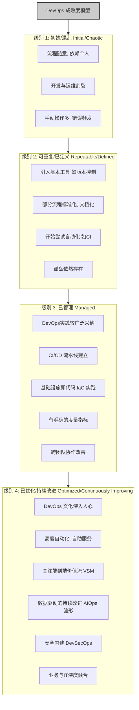

---

**第六章：DevOps 的未来展望**

**14. 图6.1：DevSecOps 集成流程图**

*   **图的上下文和说明：**
    此图在典型的 CI/CD 流水线基础上，展示了 DevSecOps 如何将安全（Security）活动和工具无缝集成到 DevOps 的各个阶段，实现“安全左移”和“安全右移”。
    *   **规划/设计阶段：** 引入威胁建模。
    *   **编码阶段：** 使用 IDE 安全插件，进行静态应用安全测试（SAST）。
    *   **构建阶段：** 进行软件成分分析（SCA）以检测开源组件漏洞。
    *   **测试阶段：** 执行动态应用安全测试（DAST）和交互式应用安全测试（IAST）。
    *   **发布/部署阶段：** 进行配置安全扫描。
    *   **运维/监控阶段：** 部署运行时应用自我保护（RASP），进行持续漏洞扫描和安全监控。
    目标是在不牺牲速度的前提下，构建更安全的软件交付生命周期。

*   **Mermaid 代码：**

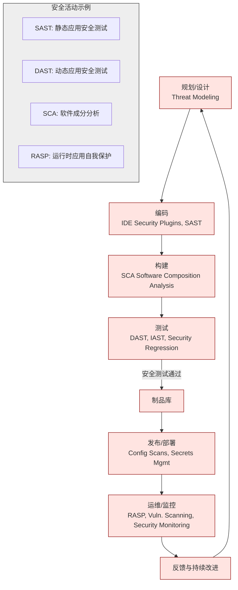

---

**15. 图6.2：GitOps 工作流程示意图**

*   **图的上下文和说明：**
    GitOps 是一种以 Git 作为声明式基础设施和应用配置的唯一真实来源（Single Source of Truth）的运维模式。该图展示了其核心工作流程：
    1.  **声明期望状态：** 开发者或运维人员通过向 Git 仓库提交代码（如 Kubernetes YAML, Terraform HCL）来声明系统的期望状态。
    2.  **变更检测：** GitOps Operator（如 ArgoCD, FluxCD）持续监控 Git 仓库的变更。
    3.  **状态比较：** 当检测到 Git 中的期望状态与集群中的实际运行状态不一致时，Operator 会识别出差异。
    4.  **自动同步：** Operator 自动执行必要的动作（如部署、配置更新），使集群的实际状态与 Git 中声明的期望状态保持一致。
    整个过程通过 Git 的版本控制实现了可追溯、可审计和自动化的运维。

*   **Mermaid 代码：**

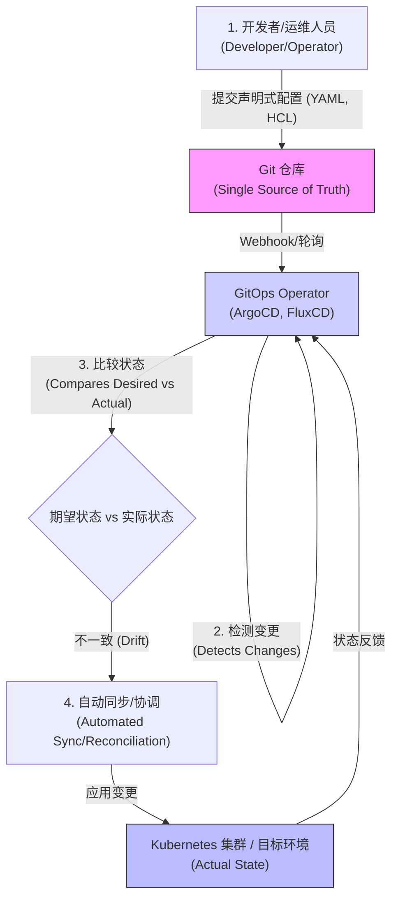

---

希望这些 Mermaid 代码和说明能帮助您将图表整合到报告中！您可以将这些代码块复制到支持 Mermaid 的编辑器或在线工具中进行渲染和调整。