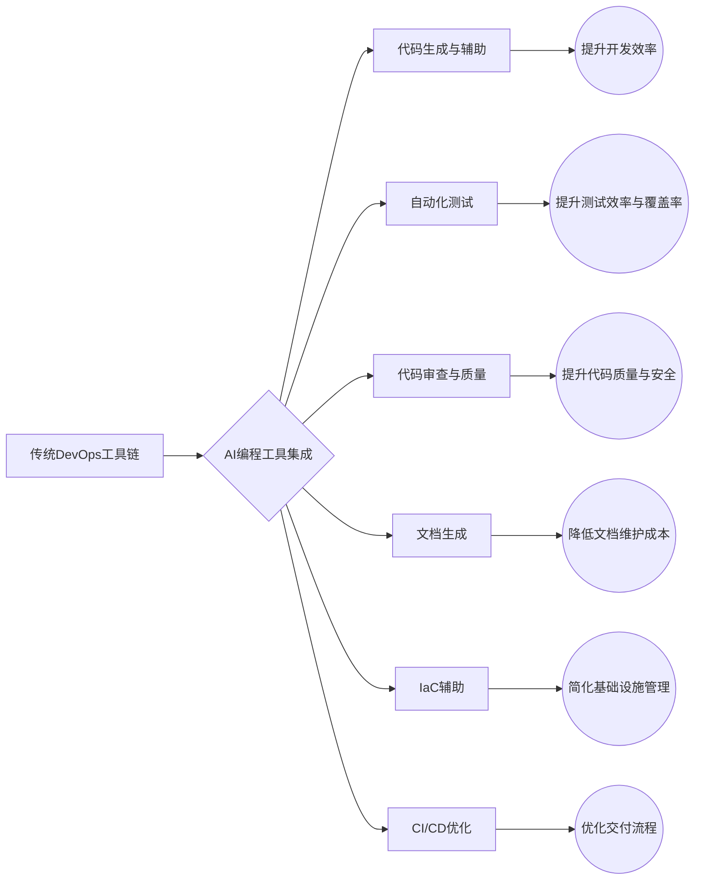
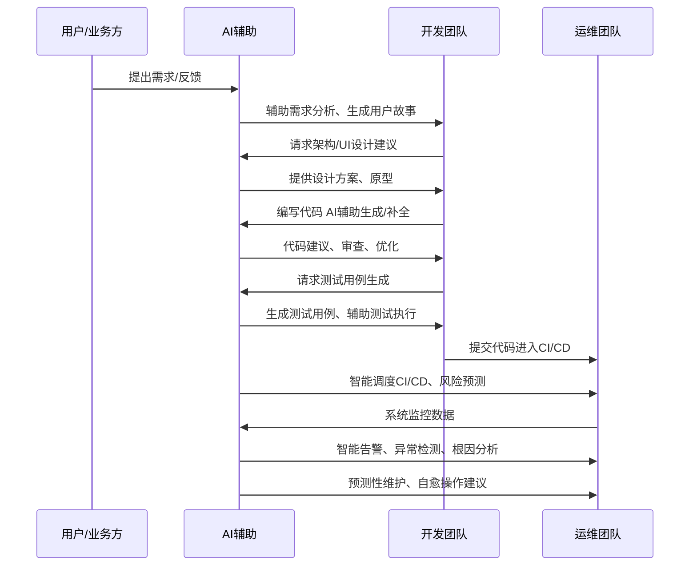
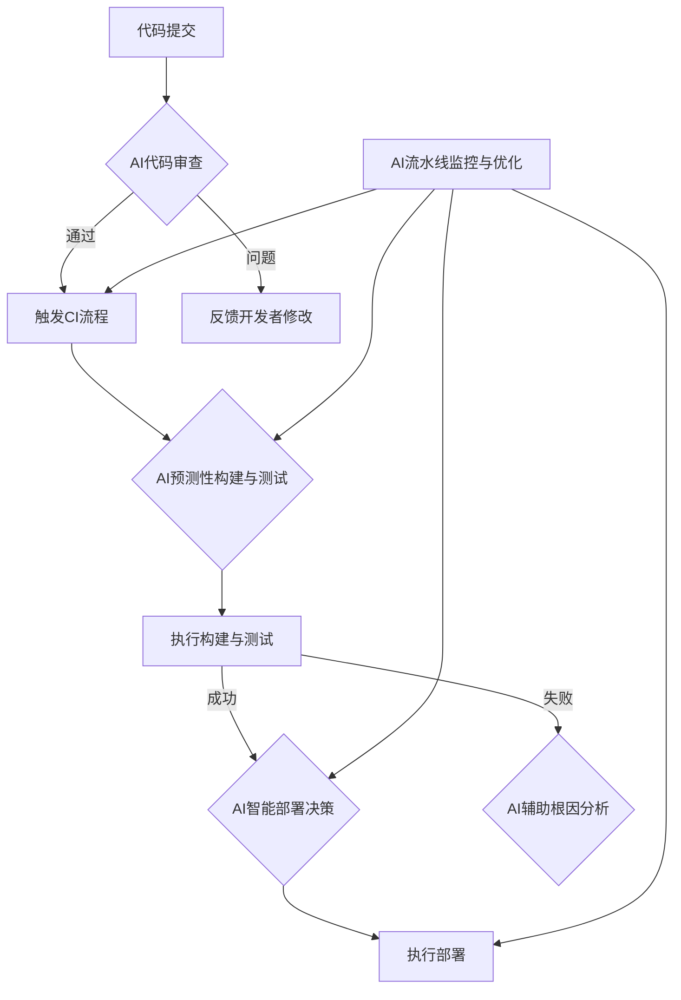
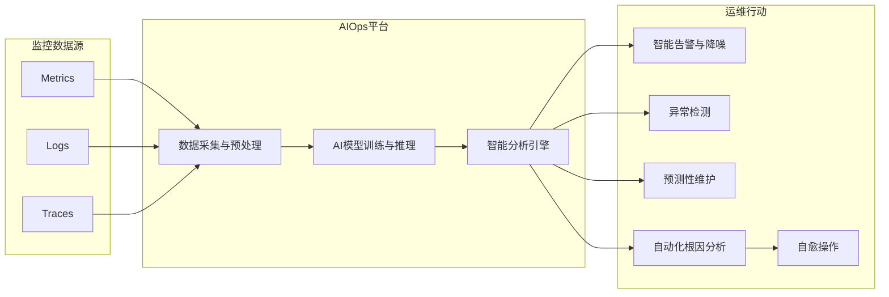
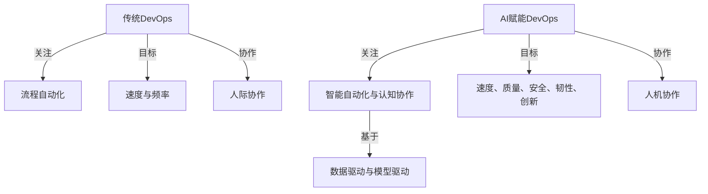
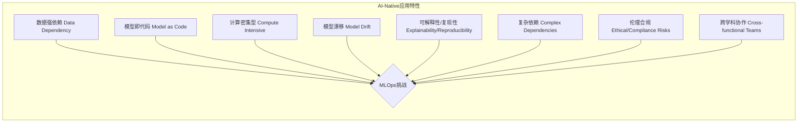
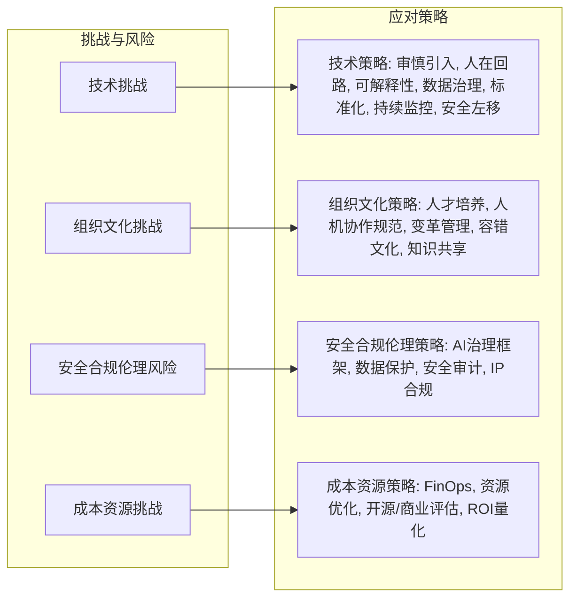
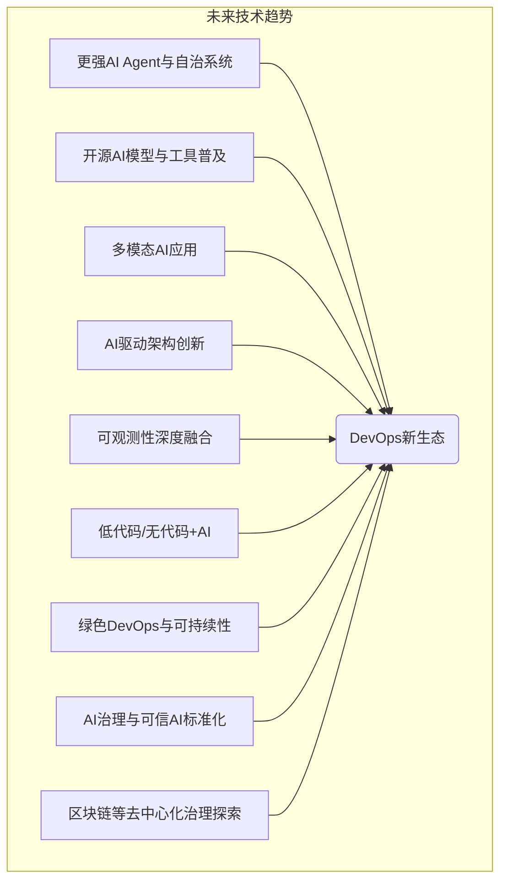

## 引言：AI浪潮下的DevOps变革

2024年，以大语言模型（LLM）和生成式AI（GenAI）为代表的人工智能技术浪潮，正以前所未有的深度与广度渗透各行各业，软件工程领域尤其首当其冲。DevOps，作为连接开发（Dev）与运维（Ops）、追求高效交付与稳定运行的核心实践与文化理念，正经历着一场由AI，特别是AI编码（AI Coding）技术引发的深刻变革。这不仅是工具层面的简单升级，更是思维范式、协作模式、工作流程、开发者角色乃至组织形态的系统性重塑。

传统的DevOps依赖自动化脚本和预定义规则，在提升软件交付速度和质量方面取得了显著成就。然而，在面对日益复杂的系统架构、快速变化的市场需求以及不断增长的客户期望时，其局限性也逐渐显现。AI的融入，尤其是AIOps（AI for IT Operations）和AI辅助编码工具（如Cursor, GitHub Copilot、Windsurf等）的崛起，正在通过引入智能自动化、预测性分析、机器学习能力以及认知协作，从根本上改变DevOps的运作方式。AI不再仅仅是辅助工具，而是演变为驱动DevOps流程优化、效率提升乃至范式创新的核心引擎，推动DevOps从“自动化”向“智能化”乃至“自治化”的智变跃迁。

这场变革的核心在于，AI将开发者从重复性的、低价值的任务中解放出来，使其能够更专注于创新活动和战略决策。AI编程工具能够实时生成代码片段、辅助代码审查、自动生成测试用例，甚至参与到更复杂的任务如基础设施即代码（IaC）的编写和CI/CD流水线的优化中。同时，AIOps通过智能监控、预测性维护和根本原因分析，极大地提升了系统的可靠性和运维效率。

本报告旨在全面剖析AI，特别是AI编码技术，如何深度赋能并重构现代DevOps的各个环节。我们将深入探讨AI在DevOps生命周期中的具体应用、AI增强的DevOps与传统方法的对比、所带来的核心价值与实际效益、面临的主要挑战与潜在风险，并展望其未来的发展趋势与企业的应对策略。通过这份报告，我们期望为企业和开发者提供一个清晰的路线图，以更好地理解和把握AI时代DevOps的变革机遇，构建面向未来的、更加智能、高效和可靠的软件工程体系。

---

## 一、AI编程对DevOps的根本性影响

AI编程，特别是基于大型语言模型（LLM）的AI编码助手，正从根本上改变DevOps的实践方式和核心理念。这种影响不仅体现在工具链的革新，更深入到思维模式、角色定义和整个软件开发生命周期的重塑。

### 1.1 AI编程工具重塑DevOps生态

AI编程工具，如Cursor, GitHub Copilot、Windsurf等，正在成为DevOps工具链中不可或缺的一环。它们通过以下方式重塑DevOps生态：

* **代码生成与辅助**：AI能够根据自然语言描述或上下文自动生成代码片段、函数甚至整个模块，显著提高编码效率。它们还能提供代码补全、语法纠错、重构建议等，降低开发门槛。
* **自动化测试**：AI可以辅助生成单元测试、集成测试用例，甚至进行探索性测试，提高测试覆盖率和效率。
* **代码审查与质量保障**：AI工具能够分析代码的潜在缺陷、安全漏洞、性能瓶颈，并提供修复建议，辅助人工审查，提升代码质量。
* **文档生成与维护**：AI可以根据代码自动生成技术文档、API文档，并辅助维护文档的实时性。
* **基础设施即代码（IaC）辅助**：AI能够帮助编写和验证Terraform、Ansible等IaC脚本，简化基础设施的配置和管理。
* **CI/CD流程优化**：AI可以分析CI/CD流水线的瓶颈，智能调度构建和部署任务，甚至预测潜在的部署风险。

这些工具的普及使得DevOps流程更加顺畅、高效，并促进了开发、测试、运维等不同角色之间的协作。

### 1.2 从自动化到智能化的思维转变

传统DevOps的核心在于“自动化”，即通过脚本和工具链将重复性任务自动化，以提高效率和一致性。AI的引入则将DevOps推向了“智能化”的新阶段。这种转变体现在：

* **从规则驱动到数据驱动**：传统自动化依赖预设规则，而智能化则依赖从大量数据中学习和推理。例如，AIOps可以通过分析历史监控数据预测故障，而不是仅仅依赖阈值告警。
* **从被动响应到主动预测**：AI能够基于模式识别和趋势分析，预测潜在问题（如性能瓶颈、安全漏洞、部署失败风险），从而实现主动预防和干预。
* **从任务执行到认知协作**：AI不再仅仅是执行命令的工具，而是能够理解上下文、进行推理、提供建议，甚至与开发者进行自然语言交互的“认知伙伴”。开发者可以向AI提问、寻求解决方案，共同完成复杂任务。
* **持续学习与自适应优化**：AI系统能够从新的数据和反馈中持续学习，不断优化其模型和决策能力，使得DevOps流程能够自适应地应对变化。

这种思维转变要求DevOps团队不仅关注工具和流程的自动化，更要关注数据的收集、治理和利用，以及人与AI的协同工作模式。

### 1.3 开发者角色的重新定义与技能重塑

AI编程的普及正在深刻影响开发者的角色和所需技能：

* **从代码编写者到代码策划者/审查者**：开发者将更多地扮演“提示工程师”（Prompt Engineer）的角色，通过精确的自然语言指令引导AI生成代码，并将主要精力从逐行编写转移到对AI生成代码的审查、调试和集成上。
* **关注点上移**：开发者可以从繁琐的底层编码细节中解放出来，更专注于业务逻辑、系统架构设计、用户体验和创新性工作。
* **系统思维与跨领域能力增强**：随着AI承担更多编码任务，开发者需要具备更强的系统性思维，理解整个软件交付链路，并可能需要掌握更多与AI、数据科学相关的知识。
* **人机协作与沟通能力**：有效地与AI工具协作，理解其能力边界和潜在偏见，以及清晰地向AI表达需求，将成为核心技能。
* **持续学习与适应新技术**：AI技术发展迅速，开发者需要保持开放心态，持续学习新的AI工具和编程范式。

虽然AI可以提高生产力，但并不会完全取代开发者。相反，它将开发者提升到更高层次的抽象和创造性工作中，要求开发者具备新的技能组合，成为AI的驾驭者和协作者。

### 1.4 软件开发生命周期（SDLC）的智能化重构

AI正在对传统的软件开发生命周期（SDLC）的各个阶段进行智能化重构：

* **需求分析与规划**：AI可以辅助分析用户反馈、市场趋势，甚至生成初步的产品需求文档和用户故事。
* **设计**：AI可以根据需求生成初步的架构设计方案、UI/UX原型，并辅助进行技术选型。
* **编码**：AI编码助手直接参与代码编写、重构和优化。
* **测试**：AI驱动的自动化测试工具能够生成更全面的测试用例，进行智能化的缺陷检测和回归测试。
* **部署（CI/CD）**：AI可以优化CI/CD流水线，例如通过智能分析历史构建数据来预测构建失败的风险，或者根据当前系统负载和资源状况智能决策部署策略，实现更安全的蓝绿部署或金丝雀发布。
* **运维与监控（AIOps）**：AI在运维阶段的应用尤为突出，包括智能告警、异常检测、根因分析、预测性维护和自愈能力，大幅提升系统稳定性和运维效率。
* **安全（DevSecOps）**：AI可以用于静态代码分析（SAST）、动态应用安全测试（DAST）、依赖项漏洞扫描，甚至实时威胁检测和响应，将安全性更早、更智能地融入SDLC。

通过在SDLC的每个环节引入智能，AI不仅提升了各阶段的效率和质量，更促进了各环节之间的无缝集成和信息流动，使得整个软件交付过程更加敏捷、可靠和富有洞察力。这种智能化重构是DevOps理念的自然延伸和深化，旨在构建一个能够快速响应变化、持续交付价值并具备自适应能力的软件工程体系。

---

## 二、AI赋能的DevOps核心实践框架

AI的融入正在催生一系列新的DevOps核心实践，这些实践共同构成了一个更为智能、高效和自适应的框架。这个框架不仅优化了现有流程，还引入了全新的能力，推动DevOps向更高阶的成熟度演进。

### 2.1 智能化CI/CD流水线设计与优化

持续集成/持续交付（CI/CD）是DevOps的基石。AI正在通过以下方式使其更加智能化：

* **智能代码审查与合并**：AI可以在代码提交阶段自动进行初步审查，识别潜在的缺陷、风格问题和安全漏洞，甚至提供自动修复建议，加速代码合并流程。
* **预测性构建与测试**：通过分析历史构建数据和代码变更，AI可以预测哪些构建可能失败，哪些测试用例最相关，从而优化构建顺序和测试选择，减少不必要的等待时间。
* **智能部署策略**：AI可以根据实时监控数据、系统负载和风险评估，动态选择最优的部署策略（如蓝绿部署、金丝雀发布、滚动更新），并智能调整发布节奏，最大限度降低部署风险。
* **流水线性能分析与优化**：AI能够监控CI/CD流水线各阶段的耗时和资源消耗，识别瓶颈，并提供优化建议，例如调整并行任务数、优化缓存策略等。
* **失败根本原因分析**：当CI/CD流水线失败时，AI可以辅助快速定位根本原因，缩短故障排除时间。

### 2.2 平台工程（Platform Engineering）：DevOps的自然进化与AI的融合

平台工程旨在通过构建内部开发者平台（IDP），为开发团队提供标准化的工具、服务和自动化流程，从而降低认知负荷，提升开发体验和效率。AI的融入进一步增强了平台工程的能力：

* **智能化服务目录与推荐**：AI可以根据项目需求、技术栈和历史使用情况，智能推荐合适的平台服务和工具。
* **自然语言交互接口**：开发者可以通过自然语言与IDP交互，例如“帮我创建一个新的微服务项目，使用Java和Spring Boot，并配置好CI/CD流水线”，AI驱动的平台可以理解并执行这些指令。
* **自动化资源调配与优化**：AI可以根据应用负载和性能指标，自动调配和优化底层资源（如计算、存储、网络），实现成本和性能的最佳平衡。
* **个性化开发者体验**：AI可以学习开发者的偏好和工作模式，提供个性化的工具配置、文档指引和问题解决方案。
* **知识库与智能问答**：整合AI能力的平台可以构建强大的知识库，并通过智能问答系统快速解答开发者的疑问。

平台工程与AI的结合，使得DevOps的“自服务”理念得到极致发挥，开发者能够更便捷地获取所需资源和能力，专注于业务价值创造。

### 2.3 DevSecOps：AI驱动的安全左移与深度实践

DevSecOps强调将安全融入DevOps的每个阶段。AI技术为实现更早、更智能、更自动化的安全保障提供了强大支持：

* **AI辅助静态应用安全测试（SAST）**：AI模型能够更准确地识别代码中的安全漏洞，减少误报和漏报，并提供修复建议。
* **AI增强动态应用安全测试（DAST）**：AI可以模拟更复杂的攻击场景，智能生成测试输入，发现传统DAST难以发现的漏洞。
* **智能化依赖项扫描与管理**：AI可以分析开源组件的漏洞信息、许可证合规性，并预测潜在的供应链风险。
* **提示词注入检测与防御**：针对基于LLM的应用，AI可以帮助检测和防御提示词注入等新型攻击。
* **自动化安全配置与合规性检查**：AI可以辅助生成和验证安全配置（如网络策略、IAM角色），确保符合安全基线和合规要求。
* **智能威胁检测与响应**：在运行时，AI可以通过分析日志和行为模式，实时检测异常活动和潜在攻击，并辅助进行快速响应和溯源。

AI使得安全不再是流程的瓶颈，而是内建于开发过程中的一种能力，真正实现了“安全左移”和“安全右移”的闭环。

### 2.4 AIOps：可观测性与监控的智能化升级

AIOps（AI for IT Operations）利用AI和机器学习技术来自动化和改进IT运维任务。它是DevOps在运维侧的智能化延伸，核心在于提升系统的可观测性和自主性：

* **智能告警与降噪**：AI可以区分重要告警和噪音，对告警进行聚合和关联分析，减少告警风暴，帮助运维人员聚焦关键问题。
* **异常检测与模式识别**：AI能够从海量的监控数据（日志、指标、追踪）中自动学习正常行为模式，并实时检测偏离正常模式的异常情况。
* **预测性维护与容量规划**：通过分析历史趋势和当前状态，AI可以预测潜在的硬件故障、性能瓶颈和资源耗尽，提前进行维护和容量规划。
* **自动化根因分析（RCA）**：当故障发生时，AI可以通过关联分析不同来源的监控数据，快速定位问题的根本原因，缩短MTTR（平均修复时间）。
* **业务影响分析**：AI可以将技术层面的故障与业务指标关联起来，评估故障对业务的实际影响，帮助确定修复优先级。

### 2.5 GitOps与基础设施即代码（IaC）的AI增强

GitOps以Git作为声明式基础设施和应用的唯一真实来源，通过版本控制和自动化流程管理基础设施和应用部署。IaC则是将基础设施配置代码化的实践。AI可以进一步增强这两者的能力：

* **AI辅助IaC代码生成与验证**：AI编码工具可以帮助开发者编写Terraform、CloudFormation、Ansible等IaC代码，并根据最佳实践和安全策略进行验证。
* **智能化变更影响分析**：在提交IaC变更前，AI可以分析变更可能对现有环境造成的影响和风险，提供预警。
* **自动化漂移检测与修复**：AI可以持续监控实际基础设施状态与Git中声明状态的差异（漂移），并辅助生成修复代码或自动执行修复。
* **优化资源配置建议**：基于对IaC代码和实际使用情况的分析，AI可以提供优化资源配置（如实例类型、存储大小）的建议，以降低成本或提升性能。
* **自然语言生成IaC**：未来，开发者或许可以通过自然语言描述期望的基础设施状态，由AI自动生成相应的IaC代码。

### 2.6 AI Agent与自愈系统架构的实现

AI Agent是能够自主感知环境、做出决策并执行动作的智能实体。在DevOps领域，AI Agent可以用于构建更高级的自愈系统：

* **自主监控与诊断**：AI Agent可以持续监控系统状态，一旦检测到异常或潜在问题，能自主进行深入诊断，分析问题原因。
* **智能决策与规划**：基于诊断结果和预设的策略库（Playbooks），AI Agent可以自主决策采取何种修复措施，并规划执行步骤。
* **自动化执行修复**：AI Agent可以自动执行修复操作，如重启服务、回滚部署、调整资源配置、隔离故障节点等。
* **学习与进化**：通过记录和分析每次故障处理的过程和结果，AI Agent可以不断学习和优化其诊断和修复能力，变得越来越智能。

自愈系统旨在最大限度地减少人工干预，实现系统故障的自动检测、自动诊断和自动修复，从而提高系统的韧性和可用性。

### 2.7 MLOps与DevOps的深度融合

MLOps（Machine Learning Operations）是将DevOps原则应用于机器学习模型生命周期管理的实践。随着AI应用的普及，MLOps与传统DevOps的融合变得越来越重要：

* **统一的工具链与流程**：将模型开发、训练、部署、监控与应用开发、部署、监控的工具链和流程进行整合，实现端到端的自动化。
* **数据版本控制与流水线**：像管理代码一样管理数据和模型，建立可复现的数据处理和模型训练流水线。
* **模型即代码（Model as Code）**：将模型训练脚本、配置文件、依赖项等纳入版本控制，确保模型的可追溯性和可复现性。
* **持续集成/持续训练/持续部署（CI/CT/CD） for ML**：实现模型的自动化构建、测试、训练、验证和部署。
* **模型监控与再训练**：持续监控已部署模型的性能（如准确率、漂移情况），当模型性能下降时自动触发再训练或告警。

DevOps为MLOps提供了成熟的自动化和协作框架，而MLOps则将AI/ML的特性（如数据依赖、实验性、模型漂移）纳入考量，二者的深度融合是成功交付和运维AI应用的关键。

### 2.8 AI治理框架的建立与FinOps的整合

随着AI在DevOps中的广泛应用，AI治理和成本管理（FinOps）成为不可忽视的方面：

* **AI模型的可解释性与透明度**：确保AI决策过程的可理解性，特别是在关键的自动化操作中，需要知道AI为何做出某个决策。
* **数据隐私与安全**：在AI模型训练和推理过程中，严格保护敏感数据，遵守相关法规。
* **偏见与公平性**：审计和减轻AI模型中可能存在的偏见，确保其决策的公平性。
* **版本控制与审计追踪**：对AI模型、训练数据、关键决策进行版本控制和审计追踪，确保可追溯性和问责制。
* **FinOps左移**：将成本意识和优化实践融入DevOps早期阶段。AI可以辅助进行：
  * **智能成本预测与预算管理**：基于历史数据和当前配置，预测AI模型训练和推理、以及AI增强的DevOps工具链的成本。
  * **自动化资源优化**：AI可以动态调整GPU等昂贵资源的使用，根据负载自动启停实例，选择性价比最高的资源配置。
  * **成本异常检测**：监控云支出，及时发现成本异常飙升并分析原因。

建立完善的AI治理框架和整合FinOps实践，是确保AI赋能的DevOps可持续、可信和经济高效发展的保障。

---

## 三、传统DevOps与AI赋能DevOps的全面对比

AI的融入并非简单地对传统DevOps进行增量改进，而是在多个维度上带来了质的飞跃。理解这两者之间的差异，有助于企业更好地规划其DevOps演进路径。

### 3.1 核心理念、生命周期与思维范式对比

| 特性               | 传统DevOps                                              | AI赋能DevOps (AI-Enhanced DevOps)                          |
| :----------------- | :------------------------------------------------------ | :--------------------------------------------------------- |
| **核心理念** | CALMS (Culture, Automation, Lean, Measurement, Sharing) | CALMS +**Intelligence** (智能驱动、认知协作)         |
| **驱动力**   | 自动化 (Automation-driven)                              | 智能化、自治化 (Intelligence & Autonomy-driven)            |
| **思维范式** | 流程为中心，规则驱动                                    | 数据为中心，模型驱动，人机协作                             |
|                    | 强调工具链的串联与效率                                  | 强调知识的积累、洞察的发现与智能决策                       |
| **生命周期** | 线性、阶段性优化                                        | 迭代、自适应、全生命周期智能渗透                           |
|                    | 自动化主要集中在CI/CD和测试                             | AI贯穿需求、设计、编码、测试、部署、运维全过程             |
| **协作模式** | 人与人之间的协作，依赖标准化流程和工具                  | 人与AI的认知协作，AI作为智能助手和决策伙伴                 |
| **关注焦点** | 提升交付速度和频率，减少手动错误                        | 在速度和频率基础上，更强调质量、安全、韧性、创新和用户体验 |

**传统DevOps** 更侧重于通过工具和流程自动化来打破开发与运维之间的壁垒，实现快速、可靠的软件交付。其思维范式是以预定义的规则和脚本来驱动自动化，核心在于“让机器按指令工作”。

**AI赋能DevOps** 则在自动化的基础上引入了“智能”。它不仅仅是执行预设任务，更能从数据中学习、进行预测、自主决策，并与人类进行更深层次的认知协作。其思维范式转变为以数据和模型为中心，强调通过智能洞察来优化整个价值流。AI不再仅仅是工具，而是成为DevOps生态系统中的一个主动参与者和“认知引擎”。关注

### 3.2 工程实践与价值创造对比

| 方面                 | 传统DevOps                                     | AI赋能DevOps                                                    |
| :------------------- | :--------------------------------------------- | :-------------------------------------------------------------- |
| **编码**       | 手动编码为主，辅以静态分析工具                 | AI辅助编码、代码生成、自动重构、智能代码审查                    |
| **测试**       | 自动化测试脚本编写，依赖人工设计测试用例       | AI生成测试用例、智能模糊测试、预测性测试选择                    |
| **CI/CD**      | 预设流水线，固定触发条件和部署策略             | 智能化流水线调度、风险预测、自适应部署策略                      |
| **运维 (Ops)** | 基于阈值的监控告警，手动故障排除               | AIOps：智能告警降噪、异常检测、预测性维护、自动化根因分析、自愈 |
| **安全 (Sec)** | 安全检查后置或部分左移，依赖人工审计和工具扫描 | DevSecOps+AI：AI驱动的SAST/DAST、实时威胁检测、自动化安全修复   |
| **可观测性**   | 依赖日志、指标、追踪的收集与人工分析           | AI增强的可观测性：智能模式发现、关联分析、自然语言查询          |
| **基础设施**   | 手动或脚本化IaC管理                            | AI辅助IaC生成与优化、漂移检测与自动修复                         |
| **价值创造**   | **效率提升**：减少重复劳动，加快交付速度 | **效率跃迁**：数量级提升开发和运维效率                    |
|                      | **质量改进**：通过自动化测试减少缺陷     | **质量内生**：AI辅助设计、编码、测试，从源头提升质量      |
|                      | **稳定性增强**：标准化部署，减少人为错误 | **韧性与自愈**：预测性维护，自动化故障恢复                |
|                      | **成本节约**：主要通过减少人力成本       | **成本优化（FinOps）**：AI驱动的资源智能调度与成本控制    |
|                      | **有限的创新**：开发者更多关注交付任务   | **创新加速**：解放开发者，使其更专注于高价值创新活动      |
| **工程师角色** | 专注于特定领域（开发、测试、运维），执行者角色 | 系统思考者、AI工具管理者、提示工程师、人机协作促进者            |

AI赋能的DevOps在几乎所有工程实践环节都引入了更高阶的智能。例如，在编码阶段，AI不仅能补全代码，还能生成整个函数或模块；在运维阶段，AIOps不仅能告警，还能预测故障并自动执行修复。这种深度的智能化带来了显著的价值跃迁，从简单的效率提升演变为质量、韧性、成本和创新能力的全面增强。

### 3.3 挑战、风险与应对策略对比

| 方面               | 传统DevOps                               | AI赋能DevOps                                                             |
| :----------------- | :--------------------------------------- | :----------------------------------------------------------------------- |
| **技术挑战** | 工具链集成复杂性、自动化脚本维护成本高   | **AI模型质量与可靠性**：生成代码的正确性、幻觉问题                 |
|                    |                                          | **LLM不确定性与可解释性**：黑箱决策难以追溯                        |
|                    |                                          | **数据质量与偏见**：训练数据影响模型表现和公平性                   |
|                    |                                          | **集成复杂性**：AI工具与现有系统集成，API管理                      |
| **组织文化** | 部门协作障碍、文化转型阻力               | **技能差距**：需要新的AI相关技能（如提示工程、模型管理）           |
|                    |                                          | **人机协作模式磨合**：信任建立、职责划分                           |
|                    |                                          | **变革管理**：对现有流程和角色的冲击，引发焦虑和抵触               |
| **安全风险** | 传统应用安全漏洞、配置错误               | **提示词注入（Prompt Injection）**、数据泄露（训练数据、输入输出） |
|                    |                                          | **模型窃取与对抗性攻击**                                           |
|                    |                                          | **AI生成代码引入新漏洞**                                           |
|                    |                                          | **供应链安全**：依赖的AI模型或平台可能存在风险                     |
| **成本风险** | 工具采购和维护成本                       | **GPU资源消耗**：模型训练和推理成本高昂                            |
|                    |                                          | **AI工具订阅费用**、API调用费用                                    |
|                    |                                          | **人才招聘与培训成本**                                             |
| **伦理法律** | 相对较少                                 | **知识产权**：AI生成代码的版权归属                                 |
|                    |                                          | **责任界定**：AI决策失误导致的后果由谁承担                         |
|                    |                                          | **算法偏见与歧视**                                                 |
| **应对策略** | 加强培训、选择合适的工具、逐步推进自动化 | **审慎引入与验证**：充分测试AI工具，建立质量门禁                   |
|                    |                                          | **统一治理与可观测性**：建立AI治理框架，监控模型表现               |
|                    |                                          | **加强安全投入**：针对AI特有风险进行防护                           |
|                    |                                          | **FinOps实践**：精细化成本管理和优化                               |
|                    |                                          | **持续学习与人才培养**：提升团队AI素养                             |
|                    |                                          | **建立伦理审查机制**                                               |

虽然AI带来了巨大潜力，但也引入了新的、更复杂的挑战和风险。传统DevOps的挑战主要围绕工具链和组织协作，而AI赋能DevOps则面临AI模型本身带来的不确定性、安全漏洞、高昂成本以及伦理法律等问题。应对这些挑战需要更全面的治理框架、更强的技术能力和更深入的组织变革。

**案例研究对比 (示意)**

* **传统DevOps案例 (如早期Netflix)**：通过自建工具链（如Asgard）和微服务架构，实现了快速部署和高可用性，但仍需大量工程师进行监控和故障排除。
* **AI赋能DevOps案例 (如现代大型科技公司)**：
  * **IBM**：利用Watson AIOps进行智能事件管理和异常检测，减少了85%的事件噪音，并将问题识别时间从几小时缩短到几分钟。
  * **Airbnb**：使用AI进行代码审查、测试优化和个性化部署，提升开发效率和系统稳定性。
  * **Facebook (Meta)**：广泛应用AI于代码推荐、缺陷预测、自动化测试和AIOps，支持其超大规模系统的快速迭代和稳定运行。
  * **LinkedIn**：利用AI进行智能告警、容量规划和自动化修复，提升了网站的可靠性和用户体验。

这些案例表明，AI赋能的DevOps能够在传统DevOps的基础上，实现更高水平的自动化、智能化和效率提升。

---

## 四、支持AI应用开发的专业化DevOps实践

随着AI技术的飞速发展，越来越多的应用本身就是基于AI/ML模型构建的（即AI-native应用）。这类应用的开发、部署和运维对传统的DevOps实践提出了新的要求。因此，发展一套专门支持AI应用开发的专业化DevOps实践（通常称为MLOps，但在此更强调与DevOps的融合视角）至关重要。

### 4.1 AI-native应用的特殊需求与挑战

AI-native应用与传统软件应用在生命周期、依赖关系和运维特性上存在显著差异，带来了独特的挑战：

* **数据依赖性强**：AI模型的性能高度依赖于训练数据的质量和数量。数据预处理、特征工程、数据标注、数据版本控制和数据漂移检测成为关键环节。
* **模型即代码（Model as Code）与实验性**：模型本身（包括其架构、参数、训练脚本）需要像代码一样进行版本控制和管理。模型开发过程充满实验性，需要快速迭代和追踪大量实验配置与结果。
* **计算资源密集**：模型训练（尤其是深度学习模型）通常需要大量的GPU等计算资源，推理阶段也可能对延迟和吞吐量有较高要求。资源调度、优化和成本控制是重要考量。
* **模型漂移与持续学习**：部署后的模型性能可能会随着时间的推移和数据分布的变化而下降（模型漂移）。需要建立监控机制，及时发现并触发模型的再训练和重新部署，实现持续学习。
* **可解释性与可复现性**：理解模型为何做出特定预测（可解释性）以及能够复现模型的训练和推理结果（可复现性）对于调试、审计和合规至关重要。
* **复杂的依赖关系**：AI应用不仅依赖代码，还依赖特定版本的数据集、模型、依赖库（如TensorFlow, PyTorch）以及硬件环境（如CUDA版本）。
* **伦理与合规风险**：AI应用可能涉及偏见、隐私泄露、知识产权等伦理和法律问题，需要在开发和部署过程中加以考虑。
* **跨学科团队协作**：AI应用的开发通常需要数据科学家、机器学习工程师、软件工程师和运维工程师等不同背景的专业人士紧密协作。

### 4.2 容器化和云原生AI应用部署策略

容器化（如Docker）和云原生技术（如Kubernetes）为解决AI应用部署和运维的复杂性提供了强大的支持，是专业化DevOps实践的核心组成部分：

* **环境一致性与可移植性**：容器将应用代码、模型、依赖库和运行时环境打包在一起，确保了从开发、测试到生产环境的一致性，简化了部署，并实现了跨云和本地环境的可移植性。
* **资源隔离与管理**：Kubernetes等容器编排平台能够有效地管理和调度GPU等稀缺资源，实现资源的隔离、共享和按需分配。
* **弹性伸缩与高可用性**：云原生架构支持AI应用的弹性伸缩，根据实时负载自动调整推理服务的实例数量，确保高可用性和性能。
* **标准化部署与版本控制**：通过Helm Charts或Kustomize等工具，可以标准化AI应用的部署描述，并将其纳入Git版本控制，实现GitOps驱动的模型部署。
* **服务发现与负载均衡**：Kubernetes提供了内置的服务发现和负载均衡机制，简化了AI推理服务的暴露和访问。
* **批处理与流式推理**：云原生平台可以支持不同类型的AI推理负载，包括大规模的批处理任务（如模型批量预测）和低延迟的流式实时推理。
* **Serverless AI推理**：利用Knative、Kubeflow Serving或云厂商提供的Serverless平台（如AWS SageMaker Serverless Inference, Google AI Platform Prediction），可以实现AI推理服务的按需付费和自动扩缩容，进一步降低运维成本和复杂度。
* **模型服务化框架**：使用如TensorFlow Serving, TorchServe, NVIDIA Triton Inference Server等专门的模型服务化框架，可以高效地将训练好的模型部署为生产级API服务，它们通常与容器和Kubernetes紧密集成。

**部署策略示例：**

1. **模型打包**：将训练好的模型文件、推理代码和所有依赖项打包成Docker镜像。
2. **镜像存储**：将Docker镜像推送到容器镜像仓库（如Docker Hub, AWS ECR, Google GCR）。
3. **Kubernetes部署**：编写Kubernetes Deployment和Service YAML文件（或Helm Chart），定义推理服务的副本数、资源请求（CPU, GPU, 内存）、健康检查、服务暴露方式等。
4. **GitOps流程**：将Kubernetes配置文件提交到Git仓库，通过ArgoCD或Flux等GitOps工具自动同步到Kubernetes集群，实现声明式部署。
5. **监控与日志**：集成Prometheus、Grafana进行性能监控，ELK/EFK Stack进行日志收集和分析。
6. **持续部署与回滚**：当新版本的模型或代码准备好后，更新Docker镜像和Kubernetes配置，通过GitOps触发滚动更新或蓝绿部署。如果出现问题，可以快速回滚到上一个稳定版本。

### 4.3 AI应用开发的安全性和合规性集成

AI应用的特殊性也带来了新的安全和合规挑战，需要在DevOps流程中专门应对：

* **数据安全与隐私保护**：
  * 在数据采集、存储、处理和训练过程中，实施严格的访问控制和加密措施。
  * 对敏感数据进行脱敏、匿名化或使用差分隐私等技术。
  * 遵守GDPR、CCPA等数据保护法规。
* **模型安全**：
  * **对抗性攻击防护**：部署能够检测和防御针对模型的对抗性攻击（如在输入中添加微小扰动导致模型误判）的机制。
  * **模型窃取防护**：保护模型知识产权，防止未经授权的复制和滥用。
  * **后门攻击检测**：确保模型训练数据和过程中没有被植入恶意后门。
* **代码与依赖项安全**：
  * 对AI应用的Python/R等代码进行静态和动态安全扫描。
  * 定期扫描和更新机器学习库（TensorFlow, PyTorch, scikit-learn等）及其依赖项，防范已知漏洞。
* **提示词工程安全 (for LLM-based apps)**：
  * **输入验证与过滤**：对用户输入进行严格校验，防止提示词注入、越狱等攻击。
  * **输出审查**：对LLM的输出进行审查，防止生成有害、不当或泄露敏感信息的内容。
* **基础设施安全**：确保模型训练和推理环境（如Kubernetes集群、GPU服务器）的安全性，遵循最小权限原则。
* **可解释性与审计**：
  * 使用LIME、SHAP等工具提高模型决策的可解释性，便于排查问题和满足合规要求。
  * 记录模型训练过程、数据血缘、部署变更和推理日志，以备审计。
* **偏见与公平性测试**：
  * 在模型开发和测试阶段，评估模型在不同人群或数据子集上的表现，识别和减轻潜在的偏见。
  * 确保AI应用的决策符合公平性原则。
* **合规性自动化**：将安全和合规性检查（如数据隐私扫描、偏见检测、许可证合规性）集成到CI/CD流水线中，实现自动化验证。

通过将这些安全和合规措施深度集成到支持AI应用开发的DevOps流程中，可以构建更可信、更负责任的AI系统。

---

## 五、主要挑战、风险与应对策略

尽管AI为DevOps带来了革命性的潜力，但在实践过程中，企业和团队也会面临诸多挑战和风险。充分认识这些问题并制定有效的应对策略，是成功实施AI赋能DevOps的关键。

### 5.1 技术挑战与风险

* **AI生成代码的质量与可靠性**：
  * **挑战**：AI生成的代码可能存在逻辑错误、性能瓶颈、不符合编码规范或包含“幻觉”（hallucinations，即生成看似合理但实际错误的内容）。过度依赖AI可能导致开发者对代码的理解和掌控力下降。
  * **风险**：引入难以发现的Bug，影响系统稳定性和可维护性；产生技术债务。
* **大型语言模型（LLM）的不确定性与可解释性**：
  * **挑战**：LLM的决策过程通常是“黑箱”，难以完全解释其生成特定代码或提出特定建议的原因。其输出具有一定的随机性和不确定性。
  * **风险**：在关键决策点（如自动化修复、安全策略生成）依赖不可解释的模型可能导致灾难性后果；难以调试和优化模型行为。
* **数据质量与偏见**：
  * **挑战**：用于训练AI模型（尤其是AIOps模型或定制化编码助手）的数据质量直接影响模型性能。训练数据中存在的偏见可能被模型学习并放大。
  * **风险**：模型产生错误或带有偏见的预测/建议，导致不公平的结果或系统性错误。
* **集成复杂性与工具链碎片化**：
  * **挑战**：将新的AI工具（如AI编码助手、AIOps平台）集成到现有的DevOps工具链和工作流程中可能非常复杂。市场上AI工具众多，标准不一，可能导致工具链进一步碎片化。
  * **风险**：集成成本高，维护困难；数据孤岛，难以实现端到端的智能分析和自动化。
* **模型漂移与持续维护**：
  * **挑战**：部署后的AI模型（尤其是AIOps和MLOps中的模型）性能可能会随时间推移和环境变化而衰减（模型漂移）。需要持续监控、评估和再训练模型。
  * **风险**：模型失效导致自动化决策错误，影响系统稳定性和效率。
* **技术债务的潜在增加**：
  * **挑战**：快速引入AI生成但未经充分审查的代码，或过度依赖特定AI工具可能引入新的技术债务。
  * **风险**：长期维护成本增加，系统演进困难。

### 5.2 组织与文化挑战

* **技能差距与人才短缺**：
  * **挑战**：团队成员可能缺乏使用和管理AI工具所需的技能，如提示工程、数据分析、模型评估、AI伦理等。市场上具备这些综合技能的人才也相对稀缺。
  * **风险**：AI工具无法得到有效利用，投资回报率低；项目进展缓慢。
* **人机协作模式的磨合与信任建立**：
  * **挑战**：开发者需要适应与AI助手共同工作的模式，学会信任AI的建议，同时保持批判性思维。AI的“黑箱”特性可能阻碍信任的建立。
  * **风险**：AI工具被闲置或滥用；人机冲突导致效率下降。
* **变革管理与文化阻力**：
  * **挑战**：引入AI可能改变现有的工作流程、角色职责，甚至威胁到某些岗位的安全感，从而引发组织内部的焦虑和抵触情绪。
  * **风险**：AI赋能DevOps的推行受阻，无法发挥预期效果。
* **知识鸿沟与知识管理**：
  * **挑战**：过度依赖AI可能导致团队成员对系统底层逻辑和细节的理解减弱。AI模型中蕴含的“知识”如何有效管理和传承也是一个问题。
  * **风险**：关键知识流失，团队解决复杂问题的能力下降。
* **对失败的容忍度**：
  * **挑战**：AI系统并非完美，尤其在早期阶段可能会犯错。组织需要建立对AI尝试和失败的一定容忍度，并从中学习改进。
  * **风险**：对AI的期望过高，一次失败可能导致整个项目的停滞。

### 5.3 安全、合规与伦理风险

* **提示词注入与恶意利用 (Prompt Injection)**：
  * **挑战**：攻击者可能通过精心构造的输入（提示词）来操纵LLM的行为，使其执行非预期操作、泄露敏感信息或生成有害内容。
  * **风险**：数据泄露、系统被控、声誉受损。
* **数据隐私与机密性**：
  * **挑战**：在与AI工具交互（尤其是云端AI服务）或使用内部数据训练模型时，可能涉及敏感代码、配置信息或业务数据的传输和处理。
  * **风险**：违反数据保护法规（如GDPR, CCPA），商业机密泄露。
* **AI生成内容引入新漏洞**：
  * **挑战**：AI生成的代码或配置可能无意中引入新的安全漏洞。
  * **风险**：增加系统的攻击面。
* **供应链安全风险**：
  * **挑战**：依赖第三方AI模型、平台或库可能引入其自身的安全漏洞或后门。
  * **风险**：整个系统面临来自供应链的威胁。
* **知识产权与版权问题**：
  * **挑战**：AI模型可能使用受版权保护的数据进行训练，其生成的代码或内容的版权归属尚不明确。
  * **风险**：法律纠纷，使用受限。
* **责任界定与问责制**：
  * **挑战**：当AI系统（如自动化部署、自愈系统）做出错误决策并导致损失时，责任难以界定。
  * **风险**：缺乏问责机制，难以从错误中学习和改进。
* **算法偏见与歧视**：
  * **挑战**：AI模型可能因训练数据或算法设计中的偏见而产生歧视性结果，例如在代码审查或问题分配中对特定人群不利。
  * **风险**：损害公平性，引发社会和法律问题。

### 5.4 成本与资源挑战

* **GPU等计算资源的高昂成本**：
  * **挑战**：训练和运行先进的AI模型（尤其是LLM和深度学习模型）需要大量昂贵的GPU资源。
  * **风险**：AI项目预算超支，投资回报不确定。
* **AI工具的订阅与API调用费用**：
  * **挑战**：许多商业AI工具采用订阅模式或按API调用量计费，大规模使用可能导致高昂的运营成本。
  * **风险**：成本失控，难以规模化推广。
* **人才招聘与培训成本**：
  * **挑战**：具备AI和DevOps双重技能的人才薪资较高，对现有团队进行AI技能培训也需要投入。
  * **风险**：人力成本显著增加。
* **数据存储与管理成本**：
  * **挑战**：AI应用通常需要处理和存储大量数据（训练数据、模型、日志等），带来额外的存储和管理开销。
  * **风险**：存储成本持续增长。

### 5.5 应对策略与最佳实践

面对上述挑战和风险，企业可以采取以下策略和实践：

* **技术层面**：
  * **审慎引入与充分验证**：从小处着手，选择合适的AI工具进行试点，对AI生成的内容进行严格的测试和人工审查，建立质量门禁。
  * **“人在回路”（Human-in-the-Loop）**：在关键决策点保留人工审核和干预环节，尤其是在AI系统成熟度不高或风险较高的场景。
  * **关注可解释性与透明度**：尽可能选择或构建具有一定可解释性的AI模型，记录决策过程，便于调试和审计。
  * **数据治理与偏见缓解**：建立完善的数据收集、清洗、标注和管理流程，定期审计数据和模型以发现和减轻偏见。
  * **标准化与平台化**：通过平台工程提供标准化的AI工具和服务，避免工具链过度碎片化，降低集成和维护成本。
  * **持续监控与反馈循环**：对AI模型的性能进行持续监控，建立反馈机制，及时进行模型更新和再训练。
  * **安全左移与深度防御**：将AI安全考虑融入DevOps生命周期的早期阶段，采用多层防御策略应对AI特有的安全威胁。
* **组织与文化层面**：
  * **投资于人才培养与技能提升**：提供AI相关的培训和学习资源，鼓励团队成员学习新技能，培养跨学科的“AI+DevOps”人才。
  * **建立清晰的人机协作规范**：明确AI与人类在各项任务中的职责分工和协作流程，促进信任和高效协同。
  * **加强变革管理与沟通**：向团队清晰传达引入AI的目标、价值和影响，积极回应疑虑，争取广泛支持。
  * **鼓励实验与容错文化**：营造允许尝试和从失败中学习的环境，推动AI应用的迭代创新。
  * **知识共享与最佳实践沉淀**：建立知识库，分享AI工具使用经验和成功案例。
* **安全、合规与伦理层面**：
  * **建立AI治理框架**：制定AI应用的伦理准则、安全策略和合规流程，明确责任主体。
  * **加强数据安全与隐私保护**：采用加密、脱敏等技术保护敏感数据，遵守相关法律法规。
  * **定期进行安全审计与风险评估**：针对AI系统进行专门的安全测试和风险评估。
  * **关注并遵守知识产权法规**：了解所使用AI工具和模型的数据来源和许可协议。
* **成本与资源层面**：
  * **实施FinOps实践**：将成本意识融入AI应用的整个生命周期，精细化管理云资源和AI服务支出。
  * **优化资源利用**：采用按需分配、弹性伸缩、资源共享等策略，提高GPU等昂贵资源的利用率。
  * **评估开源与商业工具**：根据实际需求和预算，在开源AI工具和商业解决方案之间进行权衡。
  * **量化AI投入的ROI**：设定明确的业务目标和衡量指标，评估AI赋能DevOps带来的实际价值。

通过系统性地识别风险、制定周全的应对策略，并结合持续的监控和改进，企业可以更安全、更有效地利用AI来增强其DevOps能力，最终实现预期的业务价值。

---

## 六、未来发展趋势与结论

AI赋能的DevOps正处在快速发展的初期，其未来充满了令人兴奋的可能性。随着AI技术的不断进步和应用场景的持续深化，我们可以预见以下主要发展趋势，并基于此提出相应的组织变革建议，最终共同构建一个更加智能、高效、可信和自适应的DevOps新生态。

### 6.1 技术发展方向与趋势

* **更强大的AI Agent与自治系统**：
  * 未来的AI Agent将不仅仅是执行预设任务的工具，而是具备更强自主学习、推理、规划和协作能力的“数字同事”。它们能够在整个SDLC中承担更复杂的角色，例如自主设计和优化CI/CD流水线、主动进行代码重构和性能优化、甚至在一定程度上自主响应业务需求变化。
  * AIOps将向“AIOps 2.0”或“自治运维”演进，系统不仅能预测和诊断故障，更能自主完成大部分修复工作，实现高度的自愈和自适应能力。
* **开源AI模型与工具的普及**：
  * 随着Llama、Mistral等高质量开源大语言模型的涌现，以及相关开源工具（如LangChain, Ollama, vLLM）的成熟，企业将有更多机会构建和定制符合自身需求的AI编码助手和DevOps智能工具，降低对商业闭源方案的依赖，提升灵活性和可控性。
  * 社区驱动的AI模型和工具创新将加速，形成更加开放和繁荣的生态。
* **多模态AI在DevOps中的应用**：
  * 未来的AI工具可能不仅仅处理文本（代码、日志、文档），还能理解和生成图像（如架构图、UI设计稿）、语音（如通过语音指令与AI交互）等多种模态的信息，为DevOps带来更丰富的交互方式和更全面的洞察力。
  * 例如，开发者可以通过绘制草图让AI生成前端代码，或者通过语音描述问题让AI辅助排查故障。
* **AI驱动的架构创新与演进**：
  * AI可能会参与到软件架构的设计和演化中，例如根据业务需求和非功能性需求（如性能、可扩展性、成本）智能推荐或生成合适的架构模式（如微服务、事件驱动、Serverless）。
  * AI也可以分析现有系统的架构，识别潜在的瓶颈和风险，并提出重构建议。
* **可观测性的深度融合与智能洞察**：
  * AI将进一步提升系统的可观测性，不仅能从日志、指标、追踪中提取信息，更能将这些信息与代码变更、部署事件、业务指标等关联起来，提供更深层次的、面向业务的智能洞察。
  * 自然语言查询（NLQ）将成为与可观测性数据交互的主要方式，使非专业人员也能轻松获取所需信息。
* **低代码/无代码平台与AI的结合**：
  * AI将进一步降低软件开发的门槛，通过与低代码/无代码平台的深度融合，使业务人员也能参与到应用的构建和迭代中，实现真正的“全民开发”。
  * DevOps流程需要适应这种更广泛的参与者和更快速的迭代周期。
* **绿色DevOps与可持续性**：
  * AI可以帮助优化IT基础设施的能源消耗，例如通过智能调度工作负载、优化代码执行效率、预测和管理数据中心能耗，助力实现绿色计算和可持续发展目标。
  * FinOps与GreenOps的结合将更加紧密。
* **AI治理与可信AI的标准化**：
  * 随着AI在DevOps中扮演越来越重要的角色，对AI的治理（包括安全性、公平性、透明度、可解释性、问责制）将变得至关重要。相关的标准、法规和最佳实践将逐步建立和完善。
  * “可信AI”将成为评估AI赋能DevOps方案的核心指标。
* **区块链等去中心化技术在治理中的探索**：
  * 在某些特定场景下，区块链等去中心化技术可能被探索用于增强AI模型和数据的溯源、审计和权限管理，提升透明度和可信度，例如在多方参与的开源模型训练或联邦学习场景。

### 6.2 组织变革与实施建议

为了抓住AI赋能DevOps带来的机遇并有效应对挑战，企业需要在组织层面进行相应的变革和调整：

* **拥抱持续学习与技能重塑文化**：
  * 鼓励并投入资源支持团队成员学习AI相关知识和技能（如提示工程、数据素养、AI伦理）。
  * 营造允许实验、容忍失败、快速迭代的学习型组织文化。
* **重新定义角色与职责**：
  * 随着AI承担更多重复性任务，开发者、测试工程师、运维工程师的角色将向更高价值的活动（如系统设计、创新、AI工具管理、人机协作优化）转变。
  * 可能出现新的角色，如AI DevOps工程师、AIOps专家、提示工程师、AI治理专员等。
* **构建跨职能的融合团队**：
  * 打破传统部门壁垒，组建包含软件工程师、数据科学家、ML工程师、运维专家、安全专家和业务分析师的跨职能团队，共同推进AI在DevOps中的应用。
* **建立以数据为中心的思维模式**：
  * 将数据视为核心资产，建立完善的数据收集、治理和分析体系，为AI模型的训练和DevOps决策提供高质量的数据支持。
* **渐进式引入与价值驱动**：
  * 避免一步到位的大规模变革。从痛点最明显、最容易产生价值的场景入手，小范围试点AI工具和实践，逐步积累经验，验证效果后再推广。
  * 始终以业务价值为导向，确保AI的投入能够带来实际的效率提升、质量改进或成本节约。
* **强化AI治理与风险管理**：
  * 建立专门的AI治理委员会或工作组，制定AI应用的伦理准则、安全策略和合规流程。
  * 定期对AI系统进行风险评估和审计，确保其安全、可靠、公平和透明。
* **选择合适的合作伙伴与生态系统**：
  * 积极与AI技术提供商、咨询机构和开源社区合作，获取外部专业知识和资源支持。
  * 关注行业最佳实践和新兴趋势，保持开放和学习的心态。
* **领导层的支持与推动**：
  * AI赋能DevOps是一项系统性工程，需要高层领导的充分理解、坚定支持和持续投入，以克服转型过程中的阻力。

### 6.3 结论：构建可信、智能、自适应的DevOps新生态

AI，特别是AI编码技术，正在以前所未有的力量重塑DevOps的版图。它不仅仅是工具的革新，更是思维范式、协作模式、价值创造方式乃至组织文化的深刻变革。从自动化到智能化，再到未来的自治化，AI正驱动DevOps迈向一个全新的发展阶段。

通过将AI深度融入软件开发生命周期的各个环节——从智能编码辅助、自动化测试、智能化CI/CD，到平台工程的AI增强、AIOps驱动的智能运维、AI加持的DevSecOps，再到MLOps与DevOps的融合以及AI治理框架的建立——企业能够显著提升开发效率、保障软件质量、增强系统韧性、优化资源成本，并最终加速业务创新和价值交付。

然而，这条通往未来的道路并非没有挑战。AI生成代码的质量风险、模型的不确定性、数据安全与隐私、技能差距、高昂的成本以及伦理合规等问题，都需要我们审慎对待，并制定有效的应对策略。这要求我们不仅要拥抱技术创新，更要关注组织文化的适配、人才能力的培养以及治理体系的构建。

展望未来，AI Agent的崛起、开源AI生态的繁荣、多模态AI的应用以及AI驱动的架构创新等趋势，将进一步拓展AI赋能DevOps的边界。成功的关键在于以人为本，将AI视为增强人类智慧和能力的强大伙伴，而非简单的替代品。通过构建人机协同、数据驱动、持续学习的机制，我们能够逐步克服挑战，最大限度地发挥AI的潜力。

最终，我们的目标是构建一个**可信、智能、自适应的DevOps新生态**。在这个生态中，AI与人类开发者紧密协作，软件系统能够更快速、更可靠、更安全地响应变化，持续创造价值，并以更可持续的方式运行。这不仅是技术演进的必然趋势，也是企业在数字化浪潮中保持竞争力的核心要素。拥抱AI，重塑DevOps，正是通往这一未来的关键路径。
