# 第一章 DevOps 导论

在当今快速迭代的数字化时代，软件已成为驱动业务创新和增长的核心引擎。然而，传统的软件开发与交付模式在应对市场快速变化、满足用户持续需求方面显得力不从心。DevOps 作为一种旨在打破传统壁垒、提升软件交付效率和质量的文化理念、实践方法及工具集合应运而生，并迅速成为行业主流趋势。本章将深入探讨 DevOps 的诞生背景、核心理念、演进历程以及它所带来的革命性价值。

## 1.1 DevOps 的定义与核心理念

DevOps 一词由 Development（开发）和 Operations（运维）组合而成，其核心目标是打破开发团队和运维团队之间的传统壁垒，促进他们之间的沟通、协作与整合。它不仅仅是一系列技术和工具的堆砌，更是一场深刻的文化变革和思维模式的转变。

**DevOps 的核心定义：**
DevOps 是一系列文化理念、实践方法和自动化工具的集合，旨在通过自动化的方式实现软件的快速、可靠交付和持续优化，从而更快地为客户和业务创造价值。其核心在于人（文化）、流程（实践）和技术（工具）的协同作用：
*   **文化（Culture）：** 强调共享责任、信任、透明沟通、持续学习和以客户为中心。
*   **实践（Practices）：** 包括持续集成（CI）、持续交付/部署（CD）、基础设施即代码（IaC）、监控与日志、自动化测试等一系列技术和管理实践。
*   **工具（Tools）：** 利用各种自动化工具链来支持 DevOps 实践的落地，覆盖从代码管理、构建、测试、部署到监控的整个生命周期。

**DevOps 的三大支柱 (或核心要素):**

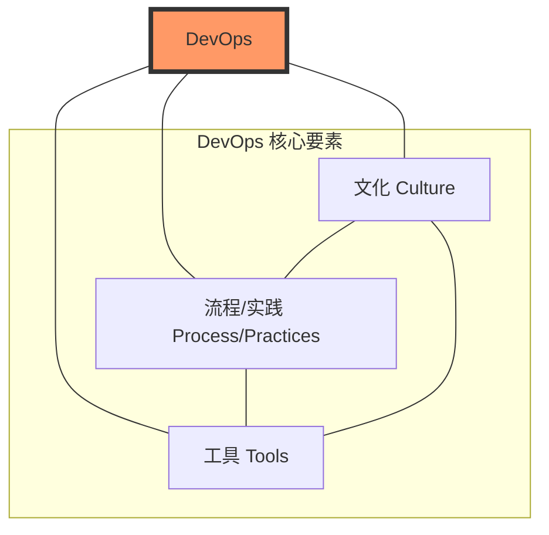

**核心价值主张：**
DevOps 的核心价值在于通过协作、自动化和持续改进，加速高质量软件的交付。其目标包括：
*   **加速价值流动 (Velocity/Flow)：** 缩短从代码提交到生产上线的周期（Lead Time），更快响应市场需求。
*   **提升质量与可靠性 (Quality & Reliability)：** 通过自动化测试、持续反馈、渐进式发布等手段，构建韧性系统，减少故障，提升用户满意度。
*   **增强协作与信任 (Collaboration/Culture)：** 打破部门墙，建立共享目标、共同责任、透明沟通的“你构建，你运行”文化。
*   **优化资源效率 (Efficiency)：** 自动化重复劳动，按需弹性伸缩资源，降低运维成本。
*   **赋能创新与实验 (Experimentation)：** 低风险发布支持快速试错，数据驱动决策，加速创新迭代。

> **核心价值公式：DevOps价值 = f(速度, 质量, 文化, 效率, 创新)**

DevOps 的核心原则通常可以用 **CALMS** 模型来概括：
*   **C**ulture (文化)：信任、协作、共享责任、持续学习、包容失败。
*   **A**utomation (自动化)：一切可自动化的都应自动化。
*   **L**ean (精益)：识别并消除价值流中的浪费，小批量交付，持续优化。
*   **M**easurement (度量)：数据驱动决策，监控关键指标。
*   **S**haring (分享)：知识共享、工具共享、经验教训共享。

## 1.2 DevOps 的起源与演进历程

DevOps 的诞生是软件行业应对日益增长的复杂度、追求更高效率和质量的必然结果。

**传统软件交付之痛：瀑布模型与孤岛困境**
在 DevOps 理念普及之前，瀑布模型（Waterfall Model）长期占据主导地位。该模型将软件开发过程划分为线性、顺序的阶段（需求分析 → 系统设计 → 编码实现 → 测试 → 部署 → 维护）。

*   **僵化的流程与漫长的交付周期：** 瀑布模型反馈延迟、变更成本高昂，风险后期集中爆发。
*   **开发与运维的“墙”：** 开发（Dev）追求快速交付新功能，运维（Ops）追求系统稳定，目标冲突、信息断层、工具链割裂、责任推诿现象普遍存在，形成了所谓的“开发与运维之间的墙”。

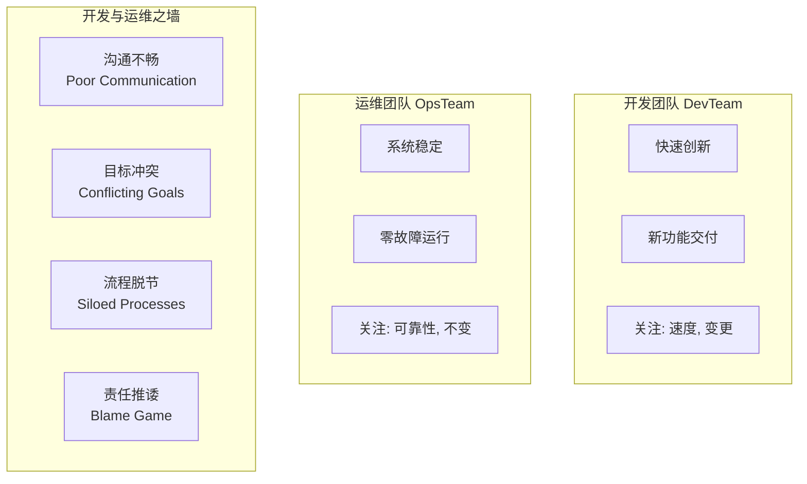

*   **业务响应迟钝：** 冗长的交付周期使软件上线即可能过时，丧失竞争优势。

**敏捷的崛起及其局限性**
为了应对瀑布模型的挑战，敏捷（Agile）开发方法应运而生，强调迭代、协作、快速反馈和持续改进。敏捷极大地提升了开发团队的响应速度，但其成功主要集中在软件开发阶段，开发与运维之间的“墙”依然存在，形成了“敏捷开发，瀑布运维”的局面，交付的“最后一公里”问题凸显。

**DevOps 的应运而生**
DevOps 运动起源于 2007-2009 年间的一系列讨论和活动：
*   **关键人物与事件：**
    *   比利时IT顾问 Patrick Debois 在2007年亲身体验开发与运维的冲突，开始思考“敏捷基础设施”。
    *   2008年，Andrew Clay Shafer 提出“敏捷基础设施”议题。
    *   2009年，Flickr 的 John Allspaw 和 Paul Hammond 发表了“每天10次以上部署：Flickr的开发与运维协作”的演讲，展示了高效协作的成功案例。
    *   同年，Patrick Debois 在比利时根特组织了第一届 DevOpsDays 大会，正式创造并推广了“DevOps”一词。
*   **灵感来源：** DevOps 借鉴和融合了多种成熟的管理思想和实践，包括精益制造（Lean Thinking）、敏捷思想（Agile Thinking）和IT服务管理（ITSM，如ITIL）。

**传统瀑布模型 vs. 敏捷迭代 vs. DevOps 持续交付流程对比**

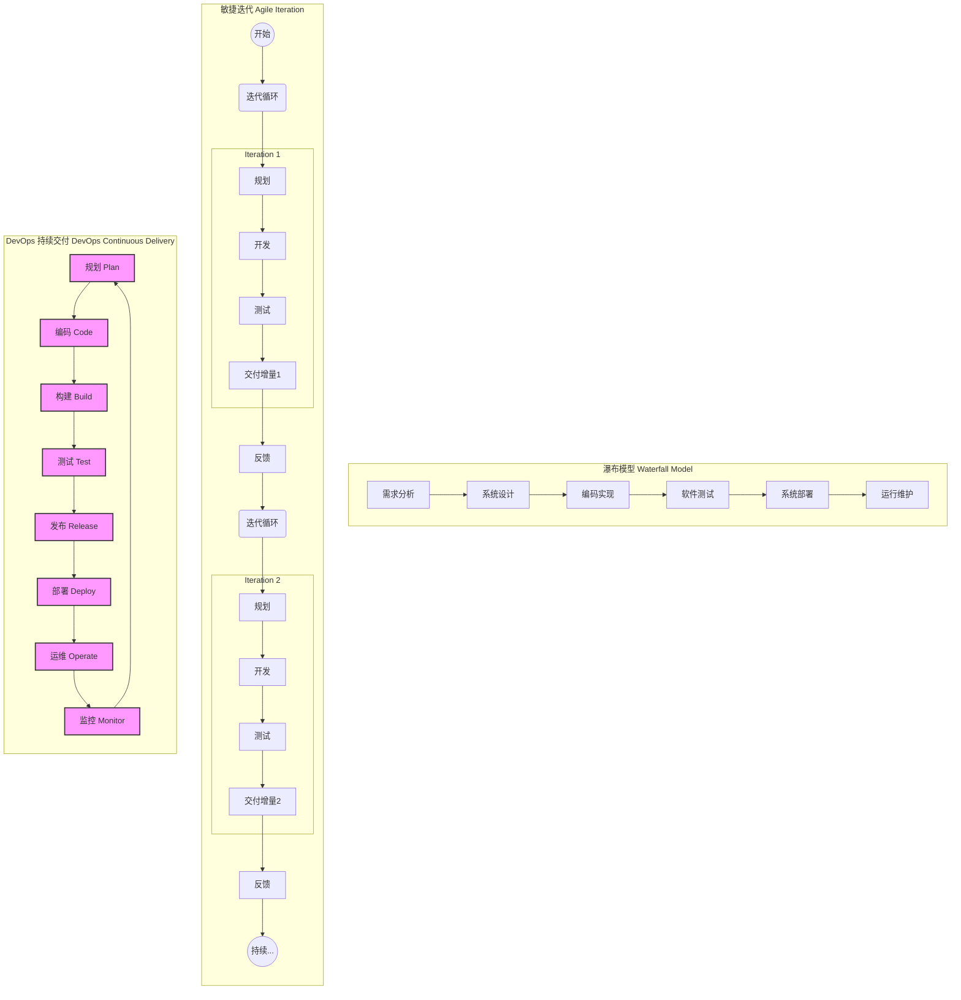

## 1.3 为何选择 DevOps？解决的痛点与目标

企业采纳和实施 DevOps 的根本驱动力在于其能够解决传统模式的痛点，并带来显著的业务价值和竞争优势。

**解决的痛点：**
*   **交付周期长，响应慢：** 传统模式下，新功能上线或问题修复耗时久，无法快速响应市场变化和用户需求。
*   **质量与速度的矛盾：** 追求速度往往牺牲质量，反之亦然，难以兼顾。
*   **变更的恐惧：** 手动操作多，发布风险高，导致团队对变更持保守态度。
*   **部门孤岛与沟通不畅：** 开发、运维、测试等团队间目标不一致，协作困难，效率低下。
*   **高昂的失败成本：** 问题发现晚，修复成本高，系统不稳定导致业务损失。

**DevOps 的目标与带来的收益：**
*   **加速价值交付 (Velocity)：** 显著缩短交付周期，提高发布频率，更快地将新功能和改进推向市场。
*   **提升软件质量与可靠性 (Quality & Reliability)：** 内置质量，自动化测试，降低发布风险，提升系统稳定性，减少生产事故。
*   **促进团队协作与沟通 (Collaboration)：** 打破隔阂，促进知识共享和共同承担责任，提升整体效率和员工满意度。
*   **降低风险与成本 (Risk & Cost Reduction)：** 自动化减少人为错误，小批量发布降低风险，早期发现问题降低修复成本，优化运营成本。
*   **增强业务敏捷性与创新能力 (Business Agility & Innovation)：** 支持快速试验新想法，获取市场反馈，驱动业务持续创新。

**量化效益标杆 (参考 DORA 报告及业界实践)：**

| 指标                | 传统模式         | DevOps高效组织     | 提升潜力 |  
|---------------------|------------------|---------------------|---------|  
| 部署频率 (Deployment Frequency) | 数月/次          | 数天/小时/分钟/次   | 数十至数百倍 |  
| 变更前置时间 (Lead Time for Changes) | 数周/月          | 分钟/小时           | 数十至数百倍 |  
| 服务恢复时间 (Mean Time To Restore - MTTR) | 小时/天级        | 分钟级              | 数倍至数十倍 |  
| 变更失败率 (Change Failure Rate) | 较高 (如15%-40%) | 较低 (如0%-15%)     | 显著降低 |  

通过拥抱 DevOps，企业能够构建起高效、可靠的软件交付能力，从而在激烈的市场竞争中赢得先机，实现可持续发展。

---
# 第二章：DevOps 核心原则与文化基础

DevOps 不仅仅是一套工具或流程的集合，其核心在于深刻的文化变革和一套指导性的原则。这些原则和文化共同构成了 DevOps 成功的基石，使得组织能够打破传统壁垒，实现高效协作，并持续交付价值。

## 2.1 CALMS 模型：DevOps 的五个支柱

CALMS 模型是理解和实施 DevOps 的一个重要框架，它代表了五个关键方面：文化（Culture）、自动化（Automation）、精益（Lean）、衡量（Measurement）和分享（Sharing）。

*   **文化 (Culture)**：这是 DevOps 的核心。强调建立一种开放、信任、协作和共担责任的文化。鼓励跨团队沟通，打破开发（Dev）和运维（Ops）之间的壁垒，以及其他相关团队（如测试、安全）之间的隔阂。领导层的支持和榜样作用至关重要。
*   **自动化 (Automation)**：尽可能地自动化重复性任务，以减少人为错误、提高效率和一致性。这包括构建、测试、部署、配置管理等各个环节。自动化使得团队能够更专注于价值创造活动。
*   **精益 (Lean)**：借鉴精益制造的思想，专注于消除浪费、优化流程、小批量交付和持续改进。通过识别和消除价值流中的瓶颈和不必要的步骤，提升整体效率和响应速度。
*   **衡量 (Measurement)**：通过收集和分析关键指标来理解系统性能、流程效率和客户满意度。数据驱动的决策有助于识别改进机会，验证变更效果，并确保与业务目标一致。例如 DORA 指标（部署频率、变更前置时间、变更失败率、平均恢复时间）。
*   **分享 (Sharing)**：鼓励知识、经验、工具和最佳实践在组织内部的共享。通过透明的沟通和协作平台，促进团队间的学习和共同成长，打破信息孤岛。

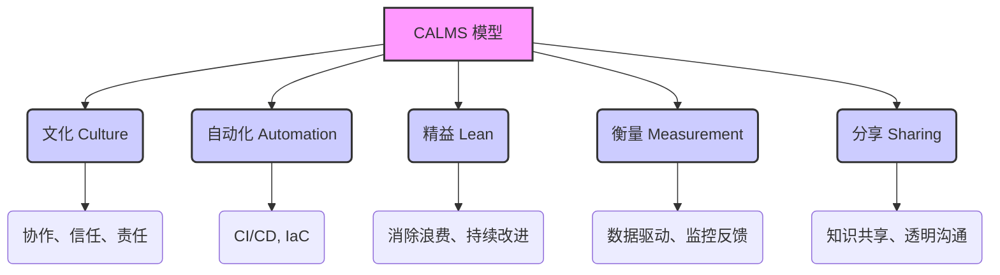

## 2.2 DevOps 三步工作法 (The Three Ways)

由 Gene Kim 等人在《DevOps Handbook》中提出的“三步工作法”是指导 DevOps 实践的核心原则，旨在创建快速、可靠和可持续的价值交付流程。

### 2.2.1 第一工作法：系统思维 (The Principles of Flow)

第一工作法强调从全局视角看待价值交付流程，从业务需求到客户价值实现，确保整个系统的顺畅流动。核心在于：

*   **理解和可视化价值流**：识别从需求提出到价值交付给最终用户的所有步骤。
*   **减少批量大小 (Small Batch Sizes)**：通过小批量、高频率的交付，降低风险，加速反馈，提高灵活性。
*   **限制在制品 (WIP - Work In Progress)**：避免过多的并行任务，减少上下文切换，提高专注度和吞吐量。
*   **消除瓶颈和浪费**：识别并解决流程中的瓶颈，消除不必要的等待、返工和手动操作。
*   **构建质量**：将质量内建于流程的每个阶段，而不是在最后进行检查。

目标是最大化工作从左到右（从开发到运维再到客户）的流动速度，减少交付周期。

### 2.2.2 第二工作法：放大反馈回路 (The Principles of Feedback)

第二工作法强调创建快速、持续和高质量的反馈回路，以便尽早发现和解决问题，并从错误中学习。核心在于：

*   **快速反馈**：在流程的每个阶段建立反馈机制，例如自动化测试、监控告警、代码审查等。
*   **放大信号**：确保问题和风险能够被及时发现并传递给相关人员，避免问题被掩盖或延迟处理。
*   **从源头解决问题**：鼓励团队在问题发生的地方立即解决，而不是将其传递到下游。
*   **知识共享和学习**：通过反馈促进团队学习和改进，将经验教训融入未来的工作中。

目标是缩短和放大从右到左（从客户和运维到开发）的反馈循环，使团队能够快速响应变化和问题。

### 2.2.3 第三工作法：持续实验与学习的文化 (The Principles of Continual Experimentation and Learning)

第三工作法强调建立一种鼓励冒险、实验、从失败中学习并持续改进的文化。核心在于：

*   **鼓励承担风险和创新**：允许团队进行小范围的实验，探索新的方法和技术。
*   **从失败中学习**：将失败视为学习和改进的机会，而不是惩罚的原因。进行“无指责事后分析”（Blameless Post-mortems）。
*   **分配时间进行改进**：鼓励团队投入时间进行流程优化、技能提升和工具改进（例如，通过“改进日”或“黑客马拉松”）。
*   **重复和练习**：通过不断的练习和重复，将最佳实践内化为团队的习惯。
*   **制度化改进**：将学习到的经验和改进措施固化到标准流程和工具中。

目标是创造一种高信任度的文化，支持动态的、纪律严明的科学实验，从而不断提升组织的能力和韧性。

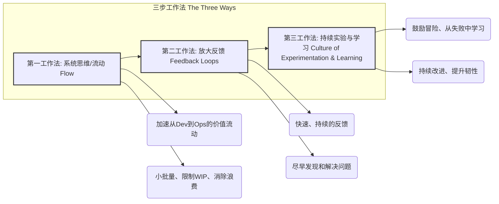

## 2.3 协作与信任的文化基石

DevOps 的成功在很大程度上依赖于建立一种强大的协作与信任文化。这不仅仅是口号，而是需要通过具体的实践和行为来培养。

*   **共同的目标和责任 (Shared Goals and Responsibilities)**：开发、运维和其他团队需要对应用的整个生命周期共同负责，共享成功的喜悦和失败的教训。目标应该是一致的，即为客户提供稳定、高质量的服务。
*   **打破组织孤岛 (Breaking Down Silos)**：传统的组织结构常常导致开发和运维之间存在“墙”，信息不畅，目标冲突。DevOps 倡导跨职能团队，鼓励不同角色的人员紧密合作，共同解决问题。
*   **透明沟通 (Transparent Communication)**：开放、诚实和及时的沟通是建立信任的基础。使用共享的工具和平台，确保信息对所有相关人员可见。
*   **心理安全 (Psychological Safety)**：创造一个环境，让团队成员敢于提出问题、承认错误、尝试新事物，而不用担心受到指责或惩罚。这是创新和持续改进的前提。
*   **赋能与授权 (Empowerment and Ownership)**：赋予团队成员决策权和自主权，让他们对自己的工作负责。这能激发积极性和创造力。
*   **持续学习与改进 (Continuous Learning and Improvement - Kaizen)**：将持续改进（改善）作为一种常态。鼓励团队不断反思、学习新技能、优化流程，追求卓越。
*   **尊重与同理心 (Respect and Empathy)**：团队成员之间以及不同团队之间需要相互尊重，理解对方的挑战和视角。这有助于建立更强的合作关系。

文化的转变是一个持续的过程，需要领导层的坚定支持、所有成员的积极参与以及对新工作方式的不断适应和优化。没有强大的文化基础，即使拥有最先进的工具和流程，DevOps 的潜力也难以充分发挥。


---
# 第三章：DevOps 的关键实践与技术栈

DevOps 的成功实施依赖于一系列关键实践和支撑技术栈的协同工作。这些实践旨在打破孤岛、自动化流程、提升效率和质量，并最终加速价值交付。本章将详细探讨各项核心实践及其相关的技术选型。

## 3.1 持续集成 (Continuous Integration - CI)

持续集成是一种软件开发实践，团队成员频繁地将其代码更改集成到共享的主干（通常是 Git 仓库的 master/main 分支）。每次集成都会通过自动化的构建和测试来验证，从而尽早发现和修复集成错误。

**核心目标：**
*   **快速反馈：** 尽早发现和定位错误，减少修复成本。
*   **减少集成问题：** 频繁小批量集成，避免“集成地狱”。
*   **提高代码质量：** 自动化测试保障代码质量。
*   **加速交付：** 更快地将新功能和修复推向市场。

**关键活动：**
*   开发人员定期（每天多次）提交代码到共享代码库。
*   CI 服务器自动检测代码变更。
*   自动执行构建过程（编译、打包）。
*   自动运行单元测试、集成测试等。
*   生成构建和测试报告，及时反馈给开发团队。

**典型 CI 服务器/工具：**
*   Jenkins
*   GitLab CI/CD
*   GitHub Actions
*   Azure DevOps Pipelines
*   CircleCI
*   Travis CI
*   Bamboo

**CI 流程示例 (Mermaid 图)：**
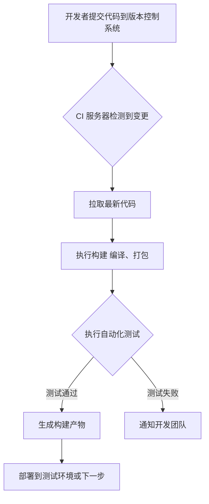

## 3.2 持续交付与持续部署 (Continuous Delivery & Continuous Deployment - CD)

**持续交付 (Continuous Delivery)** 是持续集成的延伸，确保所有通过自动化测试的代码更改都可以随时部署到生产环境。这意味着构建产物已经通过了所有必要的测试阶段（包括单元测试、集成测试、验收测试等），并且可以由业务决策者一键部署到生产。

**持续部署 (Continuous Deployment)** 更进一步，将通过所有测试阶段的代码更改自动部署到生产环境，无需人工干预。这是 DevOps 的理想状态之一，要求高度的自动化和对测试流程的信任。

**核心区别：**
*   **持续交付：** 强调“能够”随时部署，但部署到生产环境通常需要人工批准。
*   **持续部署：** 强调“自动”部署到生产环境，无需人工干预。

**核心目标：**
*   **快速、可靠的发布：** 频繁、小批量地发布新功能和修复。
*   **降低发布风险：** 自动化流程减少人为错误。
*   **缩短交付周期：** 从代码提交到生产部署的时间大大缩短。
*   **提高客户满意度：** 更快地响应市场需求和客户反馈。

**典型 CD 工具 (通常与 CI 工具集成)：**
*   Jenkins (配合部署插件)
*   GitLab CI/CD
*   GitHub Actions
*   Azure DevOps Pipelines
*   Spinnaker
*   Argo CD (针对 Kubernetes)
*   Flux (针对 Kubernetes)

**CI/CD 流水线示例 (Mermaid 图)：**
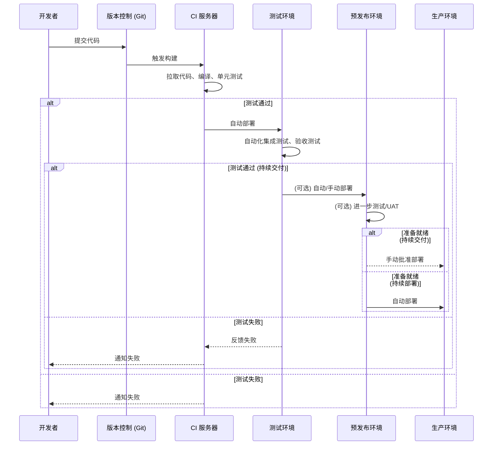

## 3.3 基础设施即代码 (Infrastructure as Code - IaC)

基础设施即代码 (IaC) 是一种通过代码（而非手动流程）来管理和配置计算基础设施（如服务器、网络、存储、数据库等）的实践。IaC 使用声明式或命令式语言来定义基础设施的状态，并允许版本控制、自动化和可重复性。

**核心目标：**
*   **自动化：** 消除手动配置，减少人为错误。
*   **可重复性：** 确保环境的一致性（开发、测试、生产）。
*   **版本控制：** 像应用程序代码一样管理基础设施配置，可追踪变更、回滚。
*   **可扩展性：** 快速、可靠地扩展或复制环境。
*   **成本效益：** 通过自动化和优化资源使用来降低成本。

**IaC 的两种主要方法：**
*   **声明式 (Declarative)：** 定义期望的最终状态，工具负责实现该状态（例如，Terraform, AWS CloudFormation, Azure Resource Manager, Kubernetes YAML）。
*   **命令式 (Imperative)：** 定义一系列需要执行的命令来达到期望状态（例如，Ansible (部分场景), Chef, Puppet, Shell 脚本）。

**典型 IaC 工具：**
*   **Terraform:** 跨云平台和本地环境的声明式 IaC 工具。
*   **AWS CloudFormation:** AWS 平台的声明式 IaC 服务。
*   **Azure Resource Manager (ARM) Templates / Bicep:** Azure 平台的声明式 IaC 服务。
*   **Google Cloud Deployment Manager:** Google Cloud 平台的声明式 IaC 服务。
*   **Ansible:** 命令式（也可声明式）的配置管理和应用部署工具，常用于 IaC。
*   **Chef:** 命令式的配置管理工具。
*   **Puppet:** 声明式的配置管理工具。
*   **Pulumi:** 使用通用编程语言（如 Python, Go, TypeScript）定义云基础设施。

**IaC 流程示例 (Mermaid 图)：**
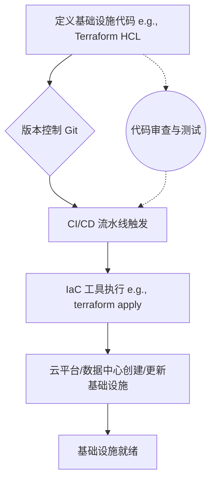

## 3.4 版本控制 (Version Control - e.g., Git)

版本控制系统 (VCS) 是跟踪和管理文件（尤其是源代码）变更的工具。它允许多人协作开发，记录每次修改的历史，并能在需要时恢复到之前的版本。Git 是目前最流行和广泛使用的分布式版本控制系统。

**核心目标：**
*   **协作：** 支持多人同时在同一项目上工作，合并各自的更改。
*   **历史追踪：** 记录每个文件的所有变更，包括谁、何时、为何修改。
*   **分支与合并：** 允许创建独立的分支进行新功能开发或实验，而不影响主线代码，完成后再合并回主线。
*   **可恢复性：** 能够轻松回滚到任何历史版本。
*   **代码审查：** 结合 Pull Request/Merge Request 流程，促进代码审查。

**Git 的核心概念：**
*   **仓库 (Repository)：** 存储项目文件及其历史记录的地方。
*   **提交 (Commit)：** 将代码更改保存到仓库的快照。
*   **分支 (Branch)：** 代码库的一个独立开发线路。
*   **合并 (Merge)：** 将一个分支的更改集成到另一个分支。
*   **拉取请求/合并请求 (Pull Request/Merge Request)：** 在将代码合并到主分支前，进行代码审查和讨论的机制。

**典型版本控制平台 (基于 Git)：**
*   GitHub
*   GitLab
*   Bitbucket
*   Azure Repos

**Git 工作流示例 (Mermaid 图 - 简化的功能分支工作流)：**
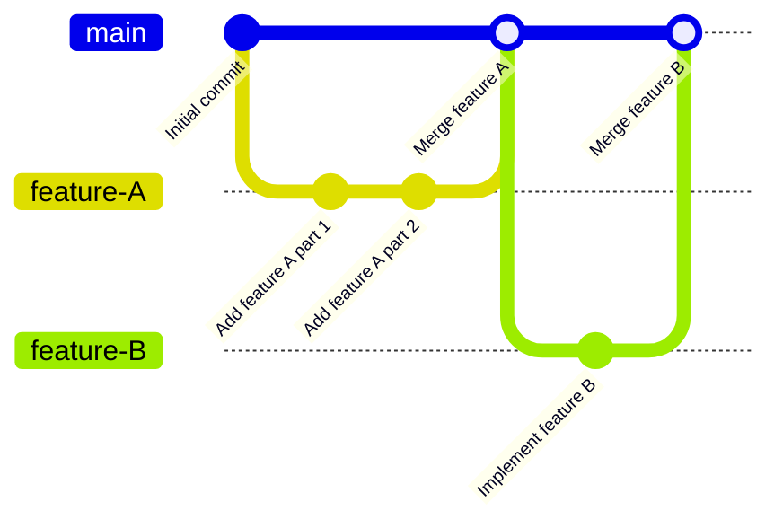

## 3.5 自动化测试 (Automated Testing)

自动化测试是使用软件工具来执行预先编写的测试用例，验证应用程序是否按预期工作的过程。它是 DevOps 的基石，确保代码质量，加速反馈循环，并支持频繁发布。

**核心目标：**
*   **提高质量：** 尽早发现缺陷，减少手动测试的遗漏。
*   **加速反馈：** 快速验证代码更改的影响。
*   **降低成本：** 减少手动测试所需的时间和资源。
*   **增强信心：** 确保代码更改不会破坏现有功能。
*   **支持 CI/CD：** 是实现持续集成和持续交付的关键。

**测试类型：**
*   **单元测试 (Unit Tests)：** 测试最小的可测试代码单元（如函数、方法、类）。
*   **集成测试 (Integration Tests)：** 测试多个组件或模块协同工作的情况。
*   **端到端测试 (End-to-End Tests)：** 从用户角度测试整个应用程序流程。
*   **API 测试：** 测试应用程序接口 (API) 的功能、可靠性、性能和安全性。
*   **性能测试 (Performance Tests)：** 评估系统在不同负载下的响应能力和稳定性。
*   **安全测试 (Security Tests)：** 识别和修复应用程序中的安全漏洞。
*   **UI 测试 (User Interface Tests)：** 验证用户界面的功能和可用性。

### 3.5.1 测试金字塔 (Test Pyramid)

测试金字塔是一个模型，指导测试策略中不同类型测试的比例。它强调拥有大量快速、廉价的单元测试作为基础，较少量的集成测试，以及更少量的昂贵且执行缓慢的端到端/UI 测试。

**测试金字塔结构 (Mermaid 图)：**
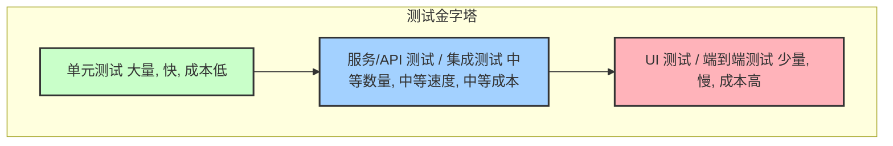
**核心理念：**
*   **单元测试是基础：** 覆盖大部分代码逻辑，快速反馈。
*   **集成测试验证交互：** 确保组件间协同工作正常。
*   **UI/E2E 测试关注用户流程：** 验证关键用户场景，但数量应受控。

### 3.5.2 测试左移 (Shift-Left Testing)

测试左移是一种将测试活动尽可能早地融入软件开发生命周期 (SDLC) 的实践。目标是在开发早期发现和修复缺陷，而不是等到开发后期或测试阶段。

**核心理念：**
*   **尽早测试，频繁测试：** 从需求和设计阶段就开始考虑可测试性，开发人员编写单元测试和集成测试。
*   **开发人员参与测试：** 开发人员对代码质量负有更大责任。
*   **自动化是关键：** 通过自动化测试实现早期和频繁的测试。
*   **持续反馈：** 快速将测试结果反馈给开发团队。

**测试左移对 SDLC 的影响 (Mermaid 图)：**
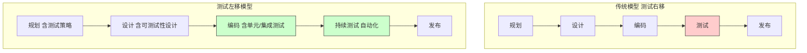

**典型自动化测试工具/框架：**
*   **单元测试：** JUnit (Java), NUnit (.NET), pytest (Python), unittest (Python), Jest (JavaScript), Mocha (JavaScript), Go testing package (Go)
*   **集成/API 测试：** Postman, RestAssured (Java), Requests (Python), Supertest (JavaScript)
*   **UI/E2E 测试：** Selenium, Cypress, Playwright, Puppeteer, Appium (移动端)
*   **性能测试：** JMeter, LoadRunner, Gatling, k6
*   **安全测试：** OWASP ZAP, SonarQube (静态代码分析也含安全扫描), Snyk

## 3.6 监控与日志管理 (Monitoring and Log Management)

监控是在应用程序和基础设施运行时，持续收集、分析和展示性能指标、健康状况和事件数据的过程。日志管理则涉及收集、存储、聚合、搜索和分析应用程序和系统生成的日志文件。

**核心目标：**
*   **主动发现问题：** 在影响用户之前检测到性能下降或故障。
*   **快速故障排除：** 提供诊断问题所需的数据和上下文。
*   **容量规划：** 了解资源使用情况，预测未来需求。
*   **性能优化：** 识别瓶颈，改进系统性能。
*   **安全审计：** 检测可疑活动和安全事件。
*   **业务洞察：** (结合业务指标) 了解用户行为和系统对业务的影响。

**监控的关键方面 (GOLDEN Signals - Google SRE)：**
*   **延迟 (Latency)：** 服务处理请求所需的时间。
*   **流量 (Traffic)：** 系统承受的负载，如每秒请求数。
*   **错误 (Errors)：** 请求失败的速率。
*   **饱和度 (Saturation)：** 服务有多“满”，衡量系统中最受约束的资源的利用率。

**日志管理的关键活动：**
*   **收集 (Collection)：** 从各种来源（服务器、应用、网络设备）收集日志。
*   **聚合 (Aggregation)：** 将分散的日志集中存储。
*   **存储 (Storage)：** 有效存储大量日志数据，通常需要考虑保留策略。
*   **搜索与分析 (Search & Analysis)：** 提供强大的查询和分析功能，以便快速定位问题和提取洞察。
*   **告警 (Alerting)：** 基于日志中的特定模式或事件触发告警。

**典型监控工具：**
*   **Prometheus:** 开源监控和告警系统，常与 Grafana 结合使用。
*   **Grafana:** 开源的数据可视化和仪表盘工具。
*   **Datadog:** SaaS 监控和分析平台。
*   **New Relic:** SaaS 应用性能管理 (APM) 和监控平台。
*   **Dynatrace:** AI 驱动的全栈监控平台。
*   **Zabbix:** 开源的企业级监控解决方案。
*   **Nagios:** 开源的监控系统。

**典型日志管理工具 (ELK/EFK Stack)：**
*   **Elasticsearch:** 分布式搜索和分析引擎，用于存储和查询日志。
*   **Logstash:** 数据收集管道，用于收集、转换和发送日志到 Elasticsearch。
*   **Kibana:** 数据可视化和仪表盘工具，用于探索 Elasticsearch 中的日志。
*   **Fluentd / Fluent Bit:** 开源数据收集器，常作为 Logstash 的替代品 (EFK: Elasticsearch, Fluentd, Kibana)。
*   **Splunk:** 商业日志管理和分析平台。
*   **Graylog:** 开源日志管理平台。

**监控与日志系统架构示例 (Mermaid 图)：**
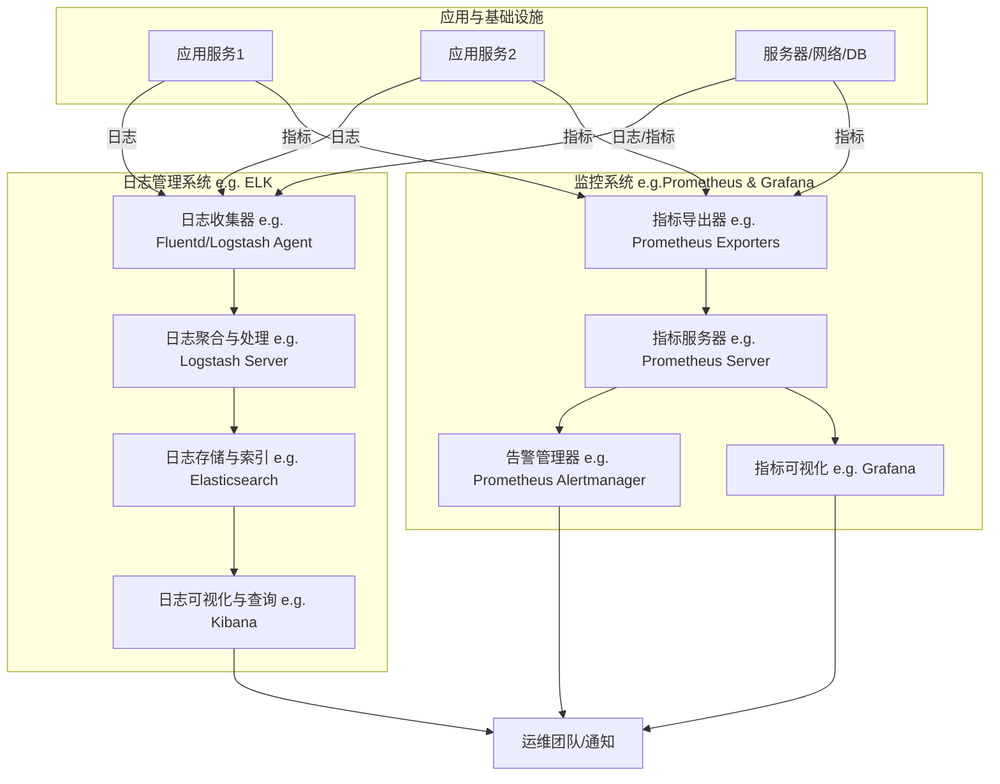

## 3.7 微服务架构 (Microservices Architecture)

微服务架构是一种将大型单体应用程序拆分为一组小型、独立、可独立部署的服务的架构风格。每个服务都围绕特定的业务能力构建，并拥有自己的数据存储。服务之间通过轻量级通信机制（通常是 HTTP API）进行交互。

**核心目标：**
*   **独立部署与扩展：** 每个服务可以独立开发、部署、扩展和升级，不影响其他服务。
*   **技术异构性：** 不同的服务可以使用最适合其功能的技术栈。
*   **故障隔离：** 一个服务的故障不会直接导致整个应用程序崩溃。
*   **团队自治：** 小型、专注的团队可以负责一个或多个微服务。
*   **提升可维护性和可理解性：** 单个服务代码库更小，更易于理解和维护。

**与单体架构对比 (Mermaid 图)：**
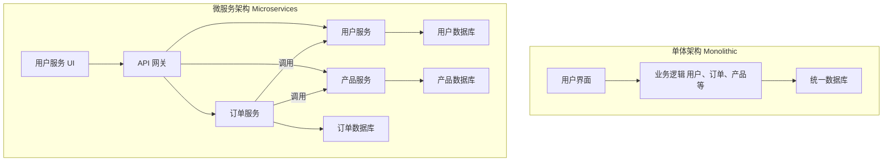

**挑战：**
*   **分布式系统复杂性：** 服务间通信、数据一致性、分布式事务等。
*   **运维复杂性：** 需要管理和监控大量独立的服务。
*   **测试复杂性：** 端到端测试和集成测试更具挑战。
*   **服务发现与注册：** 需要机制来定位和调用服务。

**相关技术/模式：**
*   **API 网关 (API Gateway)：** 作为所有客户端请求的单一入口点，处理路由、认证、限流等。
*   **服务发现 (Service Discovery)：** (e.g., Consul, Eureka, Kubernetes DNS) 允许服务动态发现彼此。
*   **配置中心 (Configuration Center)：** (e.g., Spring Cloud Config, Consul KV, Apollo) 集中管理微服务的配置。
*   **断路器 (Circuit Breaker)：** (e.g., Hystrix, Resilience4j) 防止级联故障。
*   **分布式追踪 (Distributed Tracing)：** (e.g., Jaeger, Zipkin) 跟踪跨多个服务的请求。

## 3.8 容器化与编排 (Containerization & Orchestration - e.g., Docker, Kubernetes)

**容器化 (Containerization)** 是一种轻量级的操作系统级虚拟化技术，它将应用程序及其所有依赖项（库、配置文件、运行时等）打包到一个称为“容器”的标准化单元中。容器在主机操作系统上作为隔离的进程运行，共享主机的内核。

**Docker** 是目前最流行的容器化平台。

**核心优势：**
*   **环境一致性：** “在我机器上能跑”的问题得到解决，确保开发、测试、生产环境一致。
*   **快速部署：** 容器启动速度远快于虚拟机。
*   **可移植性：** 容器可以在任何支持容器运行时的机器上运行。
*   **资源效率：** 相比虚拟机，容器更轻量，资源开销更小。
*   **隔离性：** 容器之间相互隔离，一个容器的问题不会影响其他容器。

**容器编排 (Container Orchestration)** 是自动化部署、管理、扩展和联网容器化应用程序的工具和实践。当应用程序由大量容器组成时，编排工具变得至关重要。

**Kubernetes (K8s)** 是目前最流行和功能最强大的开源容器编排平台。

**核心功能：**
*   **服务发现与负载均衡：** 自动发现容器，并在它们之间分配流量。
*   **自动装箱 (Bin Packing)：** 根据资源需求自动将容器调度到集群节点上。
*   **自我修复 (Self-healing)：** 自动重启失败的容器，替换不健康的节点上的容器。
*   **水平扩展 (Horizontal Scaling)：** 根据负载自动增加或减少容器实例数量。
*   **存储编排：** 管理容器的持久化存储。
*   **密钥与配置管理：** 安全地管理敏感信息和应用程序配置。
*   **批量执行与回滚：** 自动化部署和回滚应用程序更新。

**Docker 与 Kubernetes 关系 (Mermaid 图)：**
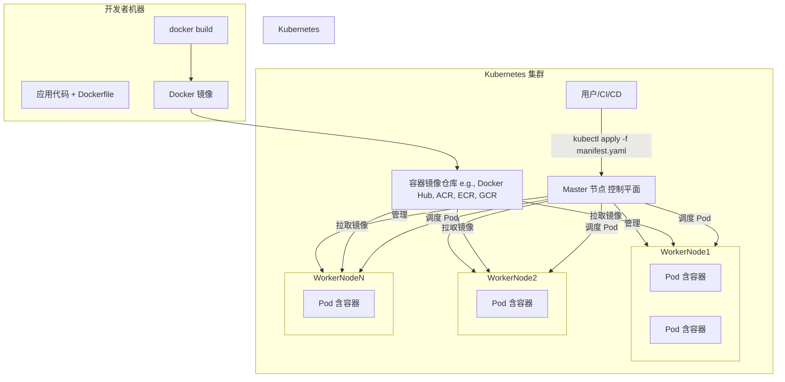

**其他容器编排工具：**
*   Docker Swarm
*   Apache Mesos (with Marathon)
*   Amazon ECS (Elastic Container Service)
*   Azure Kubernetes Service (AKS) - (Managed Kubernetes)
*   Google Kubernetes Engine (GKE) - (Managed Kubernetes)

## 3.9 配置管理 (Configuration Management)

配置管理 (CM) 是确保计算机系统、服务器和软件在其生命周期内保持一致状态的过程。它涉及定义期望的配置、应用这些配置、监控配置漂移并进行纠正。

**核心目标：**
*   **一致性：** 确保所有环境（开发、测试、生产）的配置一致。
*   **自动化：** 自动化配置应用和变更过程，减少手动错误。
*   **可审计性：** 跟踪配置变更，了解系统当前状态和历史状态。
*   **可靠性：** 通过标准化的配置减少系统故障。
*   **效率：** 快速部署和更新系统配置。

**与 IaC 的关系：**
IaC 通常侧重于基础设施的初始供应和定义（例如，创建虚拟机、网络、负载均衡器），而配置管理工具则更侧重于在这些已供应的基础设施上安装和配置软件、管理操作系统设置、确保系统符合特定状态。
两者经常协同工作，例如 Terraform 供应基础设施，然后 Ansible/Chef/Puppet 在其上配置应用程序。

**配置管理工具的特点：**
*   **幂等性 (Idempotency)：** 多次应用相同的配置操作，结果始终一致，不会产生副作用。
*   **声明式或命令式：** 定义期望状态或执行步骤。
*   **代理或无代理 (Agent-based / Agentless)：** 是否需要在被管理节点上安装代理软件。

**典型配置管理工具：**
*   **Ansible:** 无代理，基于 SSH，使用 YAML 定义 Playbook，易于上手。
*   **Chef:** 基于代理，使用 Ruby DSL 定义 Recipe 和 Cookbook，功能强大。
*   **Puppet:** 基于代理，使用自定义的声明式语言 (Puppet DSL) 定义 Manifest，成熟稳定。
*   **SaltStack (Salt):** 基于代理，速度快，支持远程执行和配置管理。
*   **Terraform (部分场景):** 虽然主要是 IaC 工具，但其 `provisioner` 功能也可以执行一些配置任务。
*   **Kubernetes ConfigMaps & Secrets:** 用于管理容器化应用的配置和敏感数据。

**配置管理流程示例 (Mermaid 图 - 以 Ansible 为例)：**
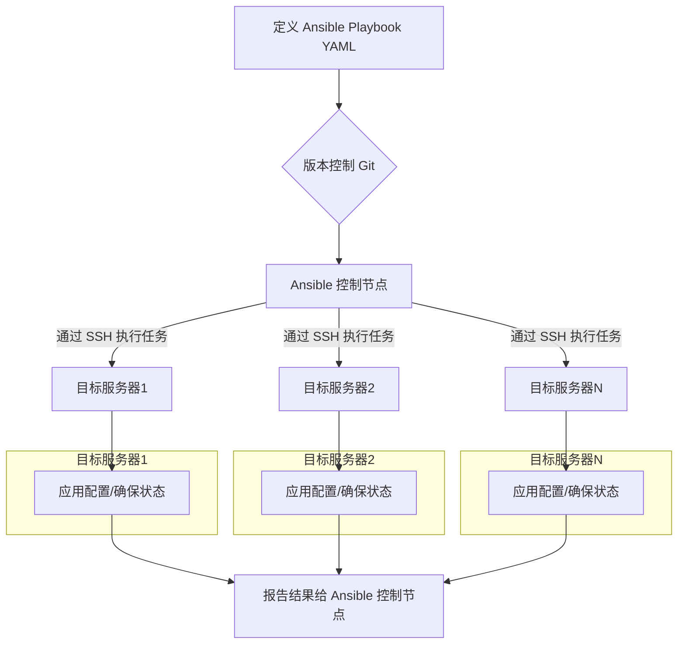

本章详细介绍了 DevOps 的各项关键实践及其相关的技术栈。这些实践并非孤立存在，而是相互关联、相互支持，共同构成了 DevOps 的核心能力。选择和实施适合自身组织和业务需求的技术栈是成功落地 DevOps 的重要一步。


---
# 第四章：DevOps 对应用开发生命周期的影响

DevOps 并非仅仅是工具或流程的集合，它更是一种文化和方法论，深刻地改变了应用开发生命周期 (SDLC) 的每一个阶段。通过强调协作、自动化、快速反馈和持续改进，DevOps 使得软件交付更快、更可靠、质量更高。本章将探讨 DevOps 如何影响从规划到运维的各个 SDLC 阶段。

**传统 SDLC 与 DevOps SDLC 对比 (Mermaid 图)：**
```mermaid
graph TD
    subgraph "传统 SDLC (瀑布模型或部分敏捷)"
        P1[规划] --> D1[设计] --> C1[编码] --> T1[测试] --> DE1[部署] --> O1[运维]
        direction LR
    end

    subgraph "DevOps SDLC (持续迭代)"
        P2[持续规划与反馈] <--> C2[编码与构建]
        C2 <--> T2[持续测试]
        T2 <--> R2[持续发布与部署]
        R2 <--> O2[持续运维与监控]
        O2 <--> P2
        direction LR
    end

    style P1 fill:#FFC0CB,stroke:#333,stroke-width:2px
    style D1 fill:#FFC0CB,stroke:#333,stroke-width:2px
    style C1 fill:#FFC0CB,stroke:#333,stroke-width:2px
    style T1 fill:#FFC0CB,stroke:#333,stroke-width:2px
    style DE1 fill:#FFC0CB,stroke:#333,stroke-width:2px
    style O1 fill:#FFC0CB,stroke:#333,stroke-width:2px

    style P2 fill:#ADD8E6,stroke:#333,stroke-width:2px
    style C2 fill:#ADD8E6,stroke:#333,stroke-width:2px
    style T2 fill:#ADD8E6,stroke:#333,stroke-width:2px
    style R2 fill:#ADD8E6,stroke:#333,stroke-width:2px
    style O2 fill:#ADD8E6,stroke:#333,stroke-width:2px
```

## 4.1 规划与设计阶段 (Planning & Design)

在 DevOps 文化中，规划与设计阶段更加强调协作、透明度和快速迭代。开发、运维和业务团队从项目初期就共同参与，确保需求理解一致，并尽早考虑可运维性、可扩展性和安全性。

**DevOps 的影响：**
*   **跨职能协作：** 打破部门墙，Dev、Ops、QA、安全甚至业务方早期介入，共同定义需求、用户故事和验收标准。运维团队可以早期提供关于基础设施、部署和监控的输入。
*   **价值驱动与小批量：** 采用敏捷和精益原则，将大型项目分解为小而可管理的用户故事或功能，优先交付高价值特性，快速验证市场反馈。
*   **基础设施和运维的早期考虑：** 基础设施即代码 (IaC) 和配置管理使得基础设施的规划和设计与应用设计并行。自动化部署和监控策略在设计阶段就被纳入考量。
*   **设计可测试性与可监控性：** 在设计应用架构时，就考虑如何进行自动化测试，以及如何有效地监控应用性能和健康状况。
*   **版本控制一切：** 不仅代码，需求文档、设计文档、架构图、IaC 脚本等也纳入版本控制，确保可追溯和协作。
*   **工具支持：**
    *   **项目管理与协作工具：** Jira, Confluence, Trello, Azure Boards, GitLab Issues。
    *   **版本控制：** Git (GitHub, GitLab, Bitbucket)。
    *   **设计工具 (支持协作)：** Figma, Miro。

## 4.2 编码阶段 (Coding)

编码阶段在 DevOps 中更加注重代码质量、集成频率和开发效率。

**DevOps 的影响：**
*   **频繁提交与集成：** 开发者将代码小批量、高频率地提交到共享代码库 (如 Git)，触发持续集成 (CI) 流程。
*   **代码质量内建：**
    *   **单元测试：** 开发者编写单元测试，确保代码模块的正确性。
    *   **代码规范与静态分析：** 使用工具 (如 SonarQube, ESLint, Checkstyle) 自动检查代码风格、潜在 bug 和安全漏洞。
    *   **代码审查 (Code Review)：** 通过 Pull Request/Merge Request 机制，团队成员相互审查代码，提升代码质量，分享知识。
*   **分支策略：** 采用如 Gitflow 或 GitHub Flow 等分支策略，规范开发流程，支持并行开发和稳定发布。
*   **IDE 集成：** 现代 IDE 集成了版本控制、测试运行、静态分析等功能，提升开发效率。
*   **基础设施即代码 (IaC) 编写：** 运维人员或具备相关技能的开发人员编写 IaC 脚本 (Terraform, Ansible)，与应用代码一同管理。
*   **工具支持：**
    *   **IDE：** VS Code, IntelliJ IDEA, Eclipse。
    *   **版本控制：** Git。
    *   **代码质量工具：** SonarQube, ESLint, Prettier。

## 4.3 构建阶段 (Building)

构建阶段在 DevOps 中是高度自动化的，确保代码能够可靠、一致地编译、打包并生成可部署的产物。

**DevOps 的影响：**
*   **自动化构建：** CI 服务器 (Jenkins, GitLab CI, GitHub Actions) 自动拉取最新代码，执行编译、依赖管理、代码打包等任务。
*   **构建脚本化：** 使用构建工具 (Maven, Gradle, npm, Webpack, Dockerfile) 定义构建过程，确保可重复性和一致性。
*   **依赖管理：** 严格管理项目依赖，确保构建环境的纯净和可复现 (如使用 Nexus, Artifactory 管理二进制依赖，npm/pip 管理包依赖)。
*   **构建产物版本化与存储：** 构建生成的二进制文件、Docker 镜像等产物被版本化，并存储在专门的仓库 (Artifactory, Docker Hub, ECR, GCR) 中，供后续部署使用。
*   **快速反馈：** 构建失败时，CI 系统会立即通知开发团队，以便快速修复。
*   **工具支持：**
    *   **CI 服务器：** Jenkins, GitLab CI, GitHub Actions, Azure Pipelines。
    *   **构建工具：** Maven, Gradle (Java); npm, yarn, Webpack (JavaScript); pip, setuptools (Python); Docker (容器构建)。
    *   **构建产物仓库：** JFrog Artifactory, Sonatype Nexus, Docker Hub, Amazon ECR, Google Container Registry。

## 4.4 测试阶段 (Testing)

测试在 DevOps 中是持续的、自动化的，并且“左移”到开发流程的早期阶段，以确保快速反馈和高质量交付。

**DevOps 的影响：**
*   **自动化测试金字塔：** 大量单元测试、适量集成/API 测试、少量端到端/UI 测试，确保测试效率和覆盖率。
*   **持续测试：** 测试作为 CI/CD 流水线的一部分自动执行。每次代码提交都会触发相关测试。
*   **测试左移：** 开发人员在编码阶段就编写和运行单元测试、组件测试。QA 更多地参与需求分析、测试策略制定和探索性测试。
*   **并行测试：** 利用云资源或容器化环境并行执行测试用例，缩短测试时间。
*   **测试数据管理：** 关注测试数据的生成、维护和隔离。
*   **多种测试类型自动化：** 包括功能测试、性能测试、安全测试 (DAST/SAST)、兼容性测试等。
*   **测试结果可视化与反馈：** 测试报告清晰展示测试结果，失败的测试会阻塞流水线并通知相关人员。
*   **工具支持：**
    *   **单元测试框架：** JUnit, TestNG, NUnit, pytest, Jest, Mocha。
    *   **集成/API 测试工具：** Postman, RestAssured, Karate DSL。
    *   **UI 自动化工具：** Selenium, Cypress, Playwright, Appium。
    *   **性能测试工具：** JMeter, Gatling, k6, LoadRunner。
    *   **安全测试工具：** OWASP ZAP, SonarQube (SAST), Snyk, Veracode。
    *   **测试管理平台：** TestRail, Xray, Zephyr。

## 4.5 发布阶段 (Releasing)

发布阶段在 DevOps 中更加频繁、可靠且风险更低。持续交付 (CD) 确保软件始终处于可发布状态，而持续部署 (CD) 则可以自动化整个发布过程。

**DevOps 的影响：**
*   **自动化发布流程：** CD 流水线自动化了从构建到部署到生产（或预生产）的整个过程。
*   **版本控制与发布管理：** 清晰的版本号策略 (如 Semantic Versioning)，发布说明 (Release Notes) 自动化生成。
*   **制品库管理：** 发布的构建产物存储在制品库中，确保部署的是经过测试和验证的版本。
*   **审批流程 (可选)：** 对于持续交付，可能仍需要人工审批才能最终部署到生产环境，但审批流程也应高效。
*   **变更管理集成：** 与变更管理系统 (如 Jira Service Management, ServiceNow) 集成，记录和追踪发布。

### 4.5.1 灰度发布策略 (Canary Releases, Blue-Green Deployments)

为了降低发布风险，DevOps 广泛采用各种灰度发布策略：
*   **蓝绿部署 (Blue-Green Deployment)：**
    *   维护两个相同的生产环境：蓝色环境（当前运行版本）和绿色环境（新版本）。
    *   流量首先指向蓝色环境。新版本部署到绿色环境并进行测试。
    *   测试通过后，将流量从蓝色环境切换到绿色环境。
    *   如果出现问题，可以快速切回蓝色环境。
    *   **优点：** 快速回滚，零停机部署。
    *   **缺点：** 需要双倍资源，数据库兼容性可能复杂。
    *   **Mermaid 图：**
        ```mermaid
        graph TD
            LB[负载均衡器] --> EnvBlue[蓝色环境 v1]
            LB -.-> EnvGreen[绿色环境 v2 - 待命]

            subgraph 部署新版本v2
                direction LR
                DeployV2[部署 v2 到绿色环境] --> TestV2[在绿色环境测试 v2]
            end
            TestV2 -- 成功 --> SwitchTraffic[切换流量到绿色环境]
            SwitchTraffic --> LB2[负载均衡器]
            LB2 --> EnvGreenUpdated[绿色环境 v2 - 在线]
            LB2 -.-> EnvBlueOld[蓝色环境 v1 - 待命/下线]

            SwitchTraffic -- 失败/回滚 --> RollbackTraffic[切换流量回蓝色环境]
            RollbackTraffic --> LB
        ```

*   **金丝雀发布 (Canary Release)：**
    *   将新版本逐步引入生产环境，首先只对一小部分用户（金丝雀用户）开放。
    *   监控新版本的性能和用户反馈。
    *   如果表现良好，逐步扩大新版本的用户范围，直到所有用户都使用新版本。
    *   如果出现问题，可以快速回滚，只影响少量用户。
    *   **优点：** 风险低，真实用户反馈，逐步验证。
    *   **缺点：** 管理更复杂，可能需要更长的发布周期。
    *   **Mermaid 图：**
        ```mermaid
        graph TD
            LB[负载均衡器]
            subgraph 生产环境
                ServerPool_v1[大部分服务器 v1]
                ServerPool_Canary_v2[少量服务器 v2 - 金丝雀]
            end
            LB -- 95% 流量 --> ServerPool_v1
            LB -- 5% 流量 --> ServerPool_Canary_v2

            Monitor[监控金丝雀实例表现] --> Decision{表现良好?}
            Decision -- 是 --> IncreaseTraffic[逐步增加 v2 流量, 减少 v1 流量]
            IncreaseTraffic --> AllV2[最终所有流量到 v2]
            Decision -- 否 --> RollbackCanary[回滚金丝雀实例 / 停止向 v2 导流]
        ```

*   **其他策略：**
    *   **A/B 测试：** 将不同版本的特性推送给不同用户群，以比较效果，常用于 UI 或功能优化。
    *   **特性开关 (Feature Toggles/Flags)：** 在代码中预埋开关，控制特定功能是否对用户可见，可以在不重新部署的情况下启用或禁用功能，降低发布风险，支持按需发布。

**工具支持：**
*   **CD 工具：** Jenkins, GitLab CI, GitHub Actions, Spinnaker, Argo CD, FluxCD。
*   **负载均衡器/服务网格：** Nginx, HAProxy, AWS ELB/ALB, Istio, Linkerd (支持流量切换和灰度)。
*   **特性开关管理工具：** LaunchDarkly, Optimizely, Unleash。

## 4.6 部署阶段 (Deployment)

部署阶段在 DevOps 中是高度自动化、可重复且可靠的。

**DevOps 的影响：**
*   **自动化部署：** 使用 IaC 和配置管理工具 (Terraform, Ansible, Chef, Puppet, Kubernetes) 自动化基础设施的准备和应用的部署。
*   **零停机部署 (Zero-Downtime Deployment)：** 结合灰度发布策略，确保在部署过程中服务不中断。
*   **环境一致性：** IaC 和容器化 (Docker) 确保开发、测试、预生产和生产环境的一致性，减少“在我机器上能跑”的问题。
*   **一键部署/按需部署：** 理想情况下，部署可以一键触发或按计划自动执行。
*   **回滚策略自动化：** 如果部署失败，自动化流程可以快速回滚到上一个稳定版本。
*   **基础设施即代码 (IaC)：** 基础设施的创建和更新也通过代码进行管理和自动化。
*   **容器编排：** Kubernetes 等工具自动化容器的部署、扩展和管理。
*   **工具支持：**
    *   **IaC 工具：** Terraform, AWS CloudFormation, Azure ARM Templates。
    *   **配置管理工具：** Ansible, Chef, Puppet, SaltStack。
    *   **容器化与编排：** Docker, Kubernetes, Docker Swarm, Amazon ECS。
    *   **CD 工具：** (同发布阶段)

## 4.7 运维阶段 (Operations)

运维阶段在 DevOps 中不再是孤立的“救火队”，而是与开发紧密协作，共同为系统的稳定性、性能和可靠性负责。

**DevOps 的影响：**
*   **主动监控与告警：** 建立全面的监控体系 (Prometheus, Grafana, Datadog, ELK Stack)，实时收集应用和基础设施的指标、日志、追踪数据，并设置智能告警，主动发现和预警问题。
*   **自动化运维任务：** 例如，自动扩展、自动修复、补丁管理、备份恢复等。
*   **基础设施即代码 (IaC) 和配置管理：** 运维人员使用代码管理基础设施和配置，提高效率和一致性。
*   **站点可靠性工程 (SRE) 原则：** 引入 SRE 实践，如错误预算 (Error Budgets)、服务等级目标 (SLOs)、事后分析 (Post-mortems)，以数据驱动的方式提升系统可靠性。
*   **Dev 与 Ops 协作：** 运维团队参与开发过程，开发团队也参与线上问题的处理和值班 (On-call)，共同承担责任。
*   **ChatOps：** 将运维操作和通知集成到聊天平台 (Slack, Microsoft Teams)，提高协作效率和透明度。
*   **混沌工程 (Chaos Engineering)：** 主动在生产环境中注入故障，以测试系统的弹性和恢复能力。
*   **工具支持：**
    *   **监控工具：** Prometheus, Grafana, Datadog, New Relic, Zabbix, ELK Stack (Elasticsearch, Logstash, Kibana), Fluentd。
    *   **告警管理：** Alertmanager, PagerDuty, Opsgenie。
    *   **IaC/配置管理工具：** (同部署阶段)
    *   **自动化平台：** Ansible Tower, Rundeck。

## 4.8 监控与反馈阶段 (Monitoring & Feedback)

监控与反馈是 DevOps 持续改进循环的关键闭环。通过收集和分析数据，团队可以了解系统运行状况、用户行为，并将其反馈到规划、开发和运维的各个环节。

**DevOps 的影响：**
*   **全方位监控：** 不仅监控基础设施和应用性能 (APM)，还监控业务指标、用户体验、部署流水线效率等。
*   **实时反馈：** CI/CD 流水线提供快速的构建和测试反馈。生产环境的监控数据实时反馈给开发和运维团队。
*   **数据驱动决策：** 基于监控数据和分析结果来优化性能、改进用户体验、规划容量、修复缺陷。
*   **日志聚合与分析：** 集中管理和分析日志，快速定位问题，洞察系统行为。
*   **分布式追踪：** 在微服务架构中，跟踪请求在各个服务间的调用链路，帮助诊断性能瓶颈和故障。
*   **用户反馈收集：** 整合用户反馈渠道 (如应用商店评论、客服系统、社交媒体)，并将其纳入产品改进流程。
*   **持续学习与改进文化：** 定期回顾监控数据、事故报告 (Post-mortems)，识别改进点，推动流程和技术的优化。
*   **DORA 指标：** 关注 DevOps 领域公认的四个关键指标 (部署频率、变更前置时间、变更失败率、平均恢复时间)，衡量和改进 DevOps 效能。
*   **工具支持：**
    *   **监控与 APM：** (同运维阶段)
    *   **日志管理：** (同运维阶段)
    *   **分布式追踪：** Jaeger, Zipkin, OpenTelemetry。
    *   **数据分析与可视化：** Grafana, Kibana, Tableau, Power BI。
    *   **反馈收集工具：** UserVoice, Zendesk, Intercom。

通过将 DevOps 原则和实践融入整个 SDLC，组织能够构建出更具弹性、响应更迅速、交付更高效的软件开发和运维体系，最终实现业务价值的持续快速交付。


---
# 第五章：DevOps 的核心收益

DevOps 的实施为组织带来了多方面的显著收益，这些收益不仅体现在技术层面，更深刻地影响着业务成果和组织文化。全面理解这些核心收益，有助于企业更好地制定 DevOps 转型策略并衡量其成效。

## 5.1 技术收益 (Technical Benefits)

技术收益是 DevOps 实践最直接和最容易被感知的成果，它们共同指向了更快、更可靠、更高质量的软件交付。

### 5.1.1 提升交付频率与缩短交付周期 (Increased Delivery Frequency and Reduced Lead Time)
通过自动化构建、测试和部署流程，DevOps 使得软件交付的频率从过去的数月甚至数年一次，提升到数周、数天甚至每天多次。持续集成（CI）和持续交付/部署（CD）是实现这一目标的关键实践。更短的交付周期（Lead Time for Changes）意味着从代码提交到生产环境部署的时间大大缩短，能够更快地响应市场变化和用户需求。

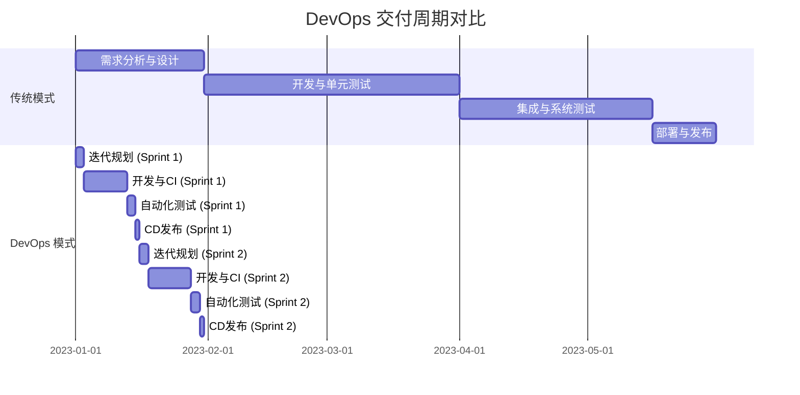

### 5.1.2 降低变更失败率 (Lower Change Failure Rate)
DevOps 强调小批量、高频率的变更。通过自动化的测试、逐步的灰度发布（如蓝绿部署、金丝雀发布）以及强大的监控反馈机制，可以显著降低生产环境中变更引入的风险。当发生问题时，由于变更是小范围的，定位和回滚也更加容易和迅速。

### 5.1.3 加快故障恢复时间 (Faster Mean Time to Recover - MTTR)
尽管目标是减少故障，但故障在复杂的系统中仍然可能发生。DevOps 通过自动化的回滚机制、强大的监控和告警系统、以及清晰的故障处理流程，能够显著缩短从故障发生到系统恢复的平均时间（MTTR）。快速恢复能力保障了业务的连续性。

### 5.1.4 提升软件质量与稳定性 (Improved Software Quality and Stability)
“质量内建”是 DevOps 的核心思想之一。通过将测试左移（Shift-Left Testing），在开发早期就引入各种自动化测试（单元测试、集成测试、端到端测试等），并结合代码审查、静态代码分析等实践，可以更早地发现和修复缺陷，从而提升最终交付软件的质量和运行稳定性。

## 5.2 业务收益 (Business Benefits)

技术收益最终会转化为实实在在的业务价值，帮助企业在激烈的市场竞争中获得优势。

### 5.2.1 加速产品上市时间 (Faster Time to Market)
DevOps 通过缩短开发周期和提高交付频率，使得新功能和产品能够更快地推向市场，抓住市场机遇，领先竞争对手。

### 5.2.2 提升客户满意度 (Increased Customer Satisfaction)
更快的交付、更高的质量、更稳定的服务，以及对用户反馈的快速响应，都直接提升了客户的体验和满意度。满意的客户更有可能成为忠实用户并进行口碑传播。

### 5.2.3 增强业务创新能力 (Enhanced Business Innovation)
DevOps 降低了实验的成本和风险。团队可以更频繁地尝试新的想法，通过快速迭代和收集用户反馈来验证假设，从而鼓励创新并更快地找到有价值的业务增长点。

### 5.2.4 降低运营成本 (Reduced Operational Costs)
自动化减少了大量手动操作，提高了资源利用率（例如通过 IaC 和容器化）。同时，更少的故障和更快的恢复也减少了因服务中断造成的损失和修复成本。

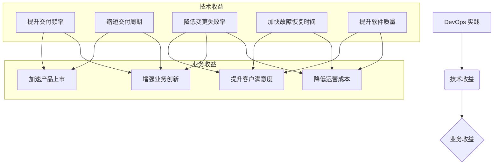

## 5.3 文化与组织收益 (Cultural and Organizational Benefits)

DevOps 不仅仅是工具和流程的变革，更是一场深刻的文化转型，它对组织的运作方式和员工的工作体验产生积极影响。

### 5.3.1 改善团队协作与沟通 (Improved Team Collaboration and Communication)
DevOps 打破了开发（Dev）和运维（Ops）之间的传统壁垒，以及与其他相关团队（如测试、安全、业务）的隔阂。通过共享目标、共同承担责任、透明化的流程和频繁的沟通，促进了跨职能团队的紧密协作。

### 5.3.2 提升员工满意度与敬业度 (Increased Employee Satisfaction and Engagement)
DevOps 通过自动化消除了许多重复和繁琐的手动任务，让工程师能够专注于更有价值和创造性的工作。赋权、信任以及对学习和成长的鼓励，也使得员工更有成就感和归属感，从而提升整体的满意度和敬业度。

### 5.3.3 建立持续改进与学习型文化 (Fostering a Culture of Continuous Improvement and Learning)
DevOps 强调从失败中学习，通过反馈循环不断优化流程和实践。鼓励实验、拥抱变化、分享知识，使得组织能够持续适应和进化，形成一个积极向上的学习型文化。

总结来说，DevOps 的核心收益是全方位的，它通过技术革新驱动业务增长，并通过文化转型提升组织效能和员工福祉，最终帮助企业在快速变化的市场中保持竞争力和持续发展。


---
# 第六章：DevOps 的实施路径与挑战

成功实施 DevOps 转型并非一蹴而就，它需要清晰的路径规划、对潜在挑战的认知以及持续的努力。本章将探讨 DevOps 的实践路径、成熟度模型、常见的困难与挑战，并提供关键的成功要素与专家建议。

## 6.1 DevOps 实践路径与成熟度模型

组织在采纳 DevOps 时，通常会经历一个逐步演进的过程。理解这一过程并辅以成熟度模型进行评估，有助于组织系统地推进转型。

### 6.1.1 评估现状与设定目标 (Assess Current State and Set Goals)
实施 DevOps 的第一步是全面评估组织当前的开发、测试、部署和运维流程、技术栈、团队技能以及文化现状。识别痛点、瓶颈和改进机会。基于评估结果，设定清晰、可衡量、可实现、相关且有时限（SMART）的 DevOps 转型目标。例如，目标可以是缩短交付周期、降低变更失败率、提升系统稳定性等。

### 6.1.2 从试点项目开始 (Start with Pilot Projects)
选择一个或少数几个具有代表性但风险相对可控的项目作为试点，推行 DevOps 实践。试点项目的成功经验可以增强团队信心，暴露潜在问题，并为后续大规模推广提供宝贵的经验和模式。选择合适的工具链，并组建跨职能的试点团队。

### 6.1.3 逐步推广与扩展 (Gradual Rollout and Scaling)
在试点项目取得成功后，逐步将 DevOps 实践推广到更多的项目和团队。这个过程需要持续的沟通、培训和支持。根据不同团队和项目的特点，灵活调整实践方式和工具选择。建立内部的 DevOps 知识库和社区，促进经验分享和学习。

### 6.1.4 DevOps 成熟度模型概览 (Overview of DevOps Maturity Models)
DevOps 成熟度模型（DMM）提供了一个框架，用于评估组织在 DevOps 实践方面的成熟程度，并指导其持续改进。常见的成熟度模型通常包含以下几个级别：

*   **初始级 (Initial/Ad Hoc):** 流程混乱，缺乏标准化，高度依赖个人英雄主义。
*   **可重复级 (Repeatable/Opportunistic):** 部分流程开始标准化，有一些自动化工具的零星应用，但主要在项目或小团队内部。
*   **已定义级 (Defined/Systematic):** 组织层面有明确的 DevOps 流程和标准，工具链得到一定程度的集成，跨团队协作开始形成。
*   **可管理级 (Managed/Measured):** 通过度量指标来监控和管理 DevOps 流程的效率和效果，持续进行数据驱动的改进。
*   **优化级 (Optimized/Continuous Improvement):** DevOps 成为组织文化的一部分，持续创新和优化，自动化和智能化水平高，能够快速适应变化并引领行业最佳实践。

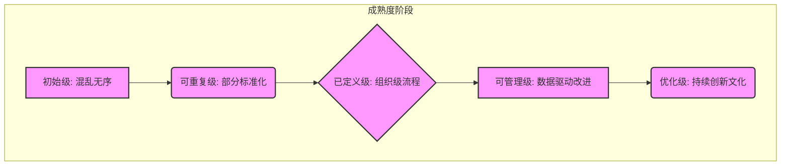

## 6.2 常见困难与挑战 (Common Difficulties and Challenges)

在 DevOps 转型过程中，组织往往会遇到各种各样的困难和挑战。

### 6.2.1 文化阻力与思维转变 (Cultural Resistance and Mindset Shift)
这是 DevOps 实施中最常见也是最大的挑战。传统的部门墙、孤岛文化、对失败的恐惧、以及不愿意改变旧有工作方式等，都会阻碍 DevOps 的推行。打破这些文化障碍，建立信任、协作和共享的文化至关重要。

### 6.2.2 技能差距与人才培养 (Skill Gaps and Talent Development)
DevOps 需要员工具备跨领域的技能，例如开发人员需要了解运维知识，运维人员也需要掌握自动化和编码能力。组织需要投入资源进行培训，弥补技能差距，并吸引和培养具备 DevOps 思维和技能的人才。

### 6.2.3 工具链选择与集成复杂性 (Toolchain Selection and Integration Complexity)
市场上有大量的 DevOps 工具，选择合适的工具并将其集成为一个高效的工具链是一项复杂的任务。需要考虑工具的兼容性、可扩展性、成本以及与现有系统的集成。避免“工具驱动”的 DevOps，而应以解决实际问题为出发点。

### 6.2.4 遗留系统与技术债务 (Legacy Systems and Technical Debt)
许多组织拥有庞大而复杂的遗留系统，这些系统往往难以适应 DevOps 的快速迭代和自动化要求。技术债务的累积也会拖慢 DevOps 的进程。需要制定策略逐步改造或替换遗留系统，并积极偿还技术债务。

### 6.2.5 度量与证明价值 (Measurement and Proving Value)
如何有效地度量 DevOps 的成效并向管理层证明其价值，是一个持续的挑战。需要建立合适的度量指标体系（如 DORA 指标），并持续跟踪和分析数据，以展示 DevOps 带来的改进。

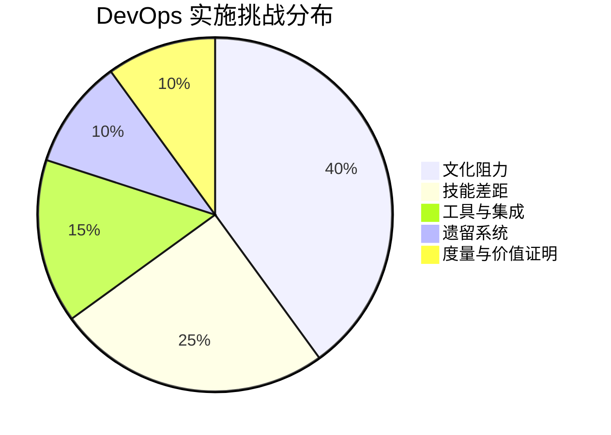

## 6.3 关键成功要素与专家建议 (Key Success Factors and Expert Advice)

为了成功实施 DevOps 并克服上述挑战，以下是一些关键的成功要素和专家建议：

*   **高层领导的支持与承诺:** 自上而下的支持是推动文化变革和资源投入的保障。
*   **以价值为导向，从小处着手:** 明确 DevOps 转型的业务价值，并从能够快速产生可见成果的试点项目开始。
*   **赋能团队，鼓励实验:** 给予团队自主权，鼓励他们尝试新的工具和方法，并从失败中学习。
*   **持续沟通与透明化:** 在整个组织内就 DevOps 的目标、进展和挑战进行持续和透明的沟通。
*   **投资于自动化:** 尽可能自动化重复性的任务，以提高效率和减少人为错误。
*   **建立反馈循环:** 建立快速、有效的反馈机制，以便及时发现问题并进行调整。
*   **关注持续学习与改进:** DevOps 不是一次性的项目，而是一个持续学习和改进的旅程。
*   **选择合适的合作伙伴:** 如果内部资源不足，可以考虑寻求经验丰富的 DevOps 咨询伙伴的帮助。

通过周密的规划、坚定的决心和持续的努力，组织可以成功克服挑战，充分释放 DevOps 的潜力，实现技术和业务的双重突破。


---
# 第七章：DevOps 的未来展望

DevOps 作为一个不断演进的理念和实践集合，其未来发展将更加聚焦于智能化、安全性、业务融合以及可持续性。随着技术的不断进步和业务需求的日益复杂，DevOps 将持续吸收新的思想和工具，以应对未来的挑战和机遇。

## 7.1 DevSecOps：安全融入 DevOps (Security Integrated into DevOps)

DevSecOps 强调将安全实践（Security）无缝集成到 DevOps 的整个生命周期中，实现“安全左移”（Shift Left Security）和“安全右移”（Shift Right Security）。这意味着从需求、设计、编码、测试、部署到运维的每个阶段都要考虑安全性，而不是将其作为事后的附加项。

*   **核心理念：** 安全是每个人的责任，自动化安全测试、持续安全监控、威胁建模、安全编码规范等将成为标准实践。
*   **关键技术：** SAST（静态应用安全测试）、DAST（动态应用安全测试）、IAST（交互式应用安全测试）、RASP（运行时应用自我保护）、安全编排与自动化响应（SOAR）。

```mermaid
graph LR
    A[DevOps 生命周期] --> B(安全左移);
    A --> C(安全右移);

    subgraph DevOps 生命周期
        P[规划] --> D[开发] --> T[测试] --> R[发布] --> O[运维]
    end

    subgraph 安全左移
        S1[威胁建模]
        S2[安全编码]
        S3[SAST/DAST]
    end

    subgraph 安全右移
        S4[持续监控]
        S5[RASP]
        S6[事件响应]
    end

    D --> S1 & S2 & S3;
    O --> S4 & S5 & S6;

    classDef devops fill:#lightgrey,stroke:#333,stroke-width:2px;
    classDef security fill:#lightblue,stroke:#333,stroke-width:2px;
    class A,P,D,T,R,O devops;
    class B,C,S1,S2,S3,S4,S5,S6 security;
```

## 7.2 AIOps：智能化运维 (AI for IT Operations)

AIOps 利用人工智能（AI）和机器学习（ML）技术来自动化和增强 IT 运维能力。通过分析海量的运维数据（日志、指标、追踪等），AIOps 可以实现智能告警、异常检测、根因分析、预测性维护和自动化修复，从而提高运维效率和系统可靠性。

*   **核心能力：** 大数据分析、模式识别、预测分析、自动化决策。
*   **应用场景：** 智能监控告警、自动化故障排除、容量规划与优化、安全事件检测与响应。

## 7.3 Serverless 架构与 DevOps (Serverless Architecture and DevOps)

Serverless 架构（如 AWS Lambda, Azure Functions, Google Cloud Functions）允许开发者构建和运行应用程序，而无需管理底层服务器基础设施。这进一步简化了运维工作，使得开发团队可以更专注于业务逻辑的实现。DevOps 实践（如 CI/CD、IaC）对于 Serverless 应用的开发和部署同样至关重要，但工具和流程需要适应 Serverless 的特点。

*   **优势：** 降低运维复杂性、按需付费、弹性伸缩。
*   **挑战：** 冷启动、函数编排、本地测试与调试、厂商锁定。

## 7.4 GitOps：以 Git 为核心的运维 (Git-centric Operations)

GitOps 是一种以 Git 作为声明式基础设施和应用程序配置的唯一真实来源（Single Source of Truth）的运维模式。所有的变更都通过 Git 提交和审查，并通过自动化的流程同步到生产环境。这使得基础设施和应用的管理更加透明、可追溯和可审计。

*   **核心原则：** 声明式配置、版本化控制、自动化同步、持续对账。
*   **典型工具：** Argo CD, Flux CD。

```mermaid
sequenceDiagram
    participant Dev as 开发者
    participant Git as Git 仓库
    participant CI as CI/CD 流水线
    participant K8s as Kubernetes 集群
    participant Agent as GitOps Agent (e.g., Argo CD)

    Dev->>Git: 提交代码/配置变更
    Git->>CI: 触发流水线 (构建, 测试, 推送镜像)
    CI-->>Git: 更新部署清单 (声明式配置)
    Agent->>Git: 拉取最新清单
    Agent->>K8s: 应用变更 (与期望状态同步)
    K8s-->>Agent: 当前状态
    Agent-->>Git: （可选）状态反馈
```

## 7.5 价值流管理 (Value Stream Management - VSM)

VSM 关注从业务需求提出到价值交付给最终用户的整个端到端流程。它通过可视化、度量和优化价值流，帮助组织识别瓶颈、减少浪费、提高交付效率和质量。DevOps 是实现 VSM 的关键使能器，VSM 则为 DevOps 实践提供了更广阔的业务视角和度量框架。

*   **关注点：** 流动效率、交付周期、交付吞吐量、交付质量。
*   **工具平台：** VSM 平台提供价值流映射、数据采集、分析和可视化能力。

## 7.6 平台工程 (Platform Engineering)

平台工程旨在构建和维护一个内部开发者平台（Internal Developer Platform - IDP），为开发团队提供自助式的工具、服务和自动化能力，从而降低认知负荷，提升开发体验和效率。IDP 可以看作是 DevOps 工具链和最佳实践的封装和产品化。

*   **目标：** 提升开发者生产力、标准化技术栈、加速应用交付。
*   **核心组件：** CI/CD、IaC、监控、日志、安全、服务目录等。

## 7.7 BizDevOps：业务与技术的深度融合 (Deep Integration of Business and Technology)

BizDevOps 强调业务团队、开发团队和运维团队之间更紧密的协作和目标对齐。通过将业务指标和反馈直接融入 DevOps 流程，使得技术决策能够更好地服务于业务目标，实现更快的业务价值交付和持续创新。

*   **核心思想：** 业务驱动开发、数据驱动决策、跨职能团队共同为业务成果负责。

## 7.8 可持续性与绿色 DevOps (Sustainability and Green DevOps)

随着对环境问题的日益关注，可持续性也成为 DevOps 发展的一个新方向。绿色 DevOps 旨在通过优化资源利用、减少能源消耗、采用更环保的技术和实践，来降低 IT 基础设施和软件开发过程对环境的影响。

*   **实践方向：** 优化云资源使用、采用节能硬件、设计高效算法、减少不必要的计算和存储。

DevOps 的未来充满了可能性。通过不断拥抱变化、学习新技术、深化文化变革，组织将能够持续利用 DevOps 的力量，在数字化时代保持领先地位。


---
# 第八章：结论

经过对 DevOps 的深入探索，从其核心理念、文化基石、关键实践、技术栈，到其对应用开发生命周期的深远影响、带来的核心收益、实施路径与挑战，以及未来的发展趋势，我们可以清晰地看到 DevOps 不仅仅是一套工具或流程的集合，更是一种深刻的文化变革和思维模式的转变。它旨在打破传统IT组织中的壁垒，促进协作，加速价值交付，并最终驱动业务的成功。

## 8.1 DevOps 的核心价值回顾

DevOps 的核心价值在于其能够帮助组织实现：

*   **速度 (Velocity):** 通过自动化和持续交付，显著提升软件交付的频率和速度，更快地响应市场变化和客户需求。
*   **质量 (Quality):** 通过持续测试、持续集成和“质量内建”的文化，提升软件的稳定性和可靠性，减少缺陷和故障。
*   **效率 (Efficiency):** 通过自动化重复性任务、优化流程、减少浪费，提高团队和组织的整体运作效率。
*   **协作 (Collaboration):** 打破开发、运维、测试、安全乃至业务团队之间的孤岛，建立共享目标和责任的协作文化。
*   **创新 (Innovation):** 通过降低实验成本、鼓励快速迭代和从失败中学习，为业务创新提供更强大的技术支撑和文化土壤。

这些价值的实现，最终会转化为实实在在的业务成果，如更快的上市时间、更高的客户满意度、更强的市场竞争力和更低的运营成本。

## 8.2 文化与思维转变的重要性

在整个 DevOps 转型过程中，技术和工具固然重要，但文化和思维的转变才是其成功的基石和最艰巨的挑战。CALMS 模型（文化、自动化、精益、度量、分享）和三步工作法（流动、反馈、持续学习与实验）为我们指明了方向。建立信任、透明、赋权、鼓励学习和容忍建设性失败的文化氛围，是 DevOps 精神得以生根发芽的土壤。

领导层的支持、跨部门的沟通、以及每一位团队成员的积极参与，都是推动这种文化和思维转变不可或缺的因素。这需要耐心、决心和持续的努力。

## 8.3 持续学习与改进的征程

DevOps 不是一个终点，而是一个持续学习、持续实验和持续改进的旅程。技术在不断发展，业务需求在不断变化，市场环境也在不断演进。因此，DevOps 的实践也需要与时俱进，不断吸收新的理念（如 DevSecOps, AIOps, GitOps, Platform Engineering）和工具，优化现有的流程和方法。

建立有效的反馈循环，通过度量来驱动改进，鼓励团队不断探索和创新，是保持 DevOps 实践活力的关键。拥抱变化，将每一次挑战都视为学习和成长的机会。

## 8.4 行动号召：拥抱 DevOps，驱动未来

DevOps 已经从一个新兴趋势发展成为现代软件开发和IT运维的主流模式。它为组织提供了一条在快速变化的数字时代保持竞争力、实现可持续发展的有效路径。

无论您的组织处于哪个发展阶段，现在都是开始或深化 DevOps 转型的最佳时机。评估现状，设定清晰的目标，从小处着手，逐步推广，并始终将文化建设放在首位。

拥抱 DevOps，不仅仅是采用新的工具和技术，更是拥抱一种新的工作方式、一种新的协作精神和一种持续追求卓越的文化。让我们共同踏上这段激动人心的旅程，用 DevOps 的力量驱动创新，塑造更加美好的技术未来和业务未来。

```mermaid
graph TD
    A[DevOps 核心价值] --> B(速度);
    A --> C(质量);
    A --> D(效率);
    A --> E(协作);
    A --> F(创新);

    G[文化与思维转变] --> H{CALMS 模型};
    G --> I{三步工作法};
    G --> J[信任、透明、赋权];

    K[持续学习与改进] --> L(拥抱变化);
    K --> M(度量驱动);
    K --> N(技术演进);

    O[行动号召] --> P(评估现状);
    O --> Q(设定目标);
    O --> R(从小处着手);
    O --> S(文化先行);

    subgraph 核心价值体现
        B
        C
        D
        E
        F
    end

    subgraph 文化基石
        H
        I
        J
    end

    subgraph 持续征程
        L
        M
        N
    end

    subgraph 立即行动
        P
        Q
        R
        S
    end

    A --> G;
    G --> K;
    K --> O;
```