# 第一章：什么是 DevOps？

想象一下，在传统的软件开发公司里，开发团队（写代码的人）和运维团队（维护软件上线运行的人）常常像是两个独立的部门，他们有不同的目标，沟通也不总是那么顺畅。开发团队希望快速推出新功能，而运维团队则希望系统稳定，少出问题。这种隔阂常常导致软件交付缓慢，问题频出。

DevOps 就是为了解决这些问题而诞生的！

传统开发与运维的隔阂，就像下面这样：

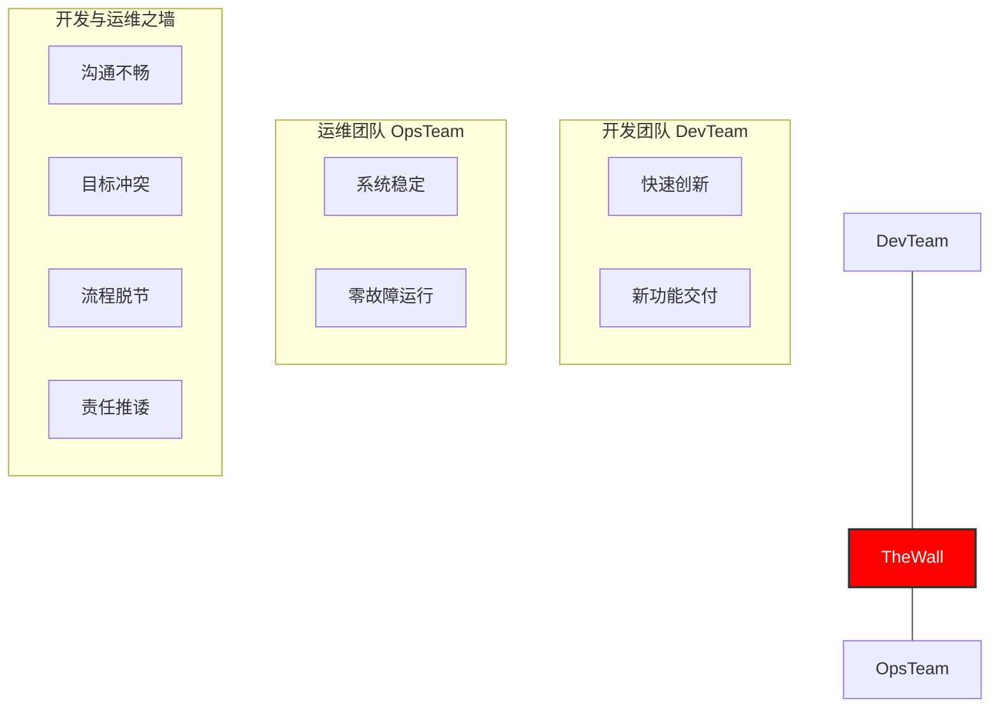

DevOps 的目标就是打破这堵墙，让双方更好地协作。

## 1.1 DevOps 简介：它解决了什么问题？

DevOps 这个词是 “Development”（开发）和 “Operations”（运维）的组合。简单来说，**DevOps 是一种文化理念、一系列实践方法和一些自动化工具的集合，目的是让开发团队和运维团队更好地协作，从而更快、更可靠地交付高质量的软件。**

**DevOps 主要解决以下痛点：**

*   **交付太慢：** 新功能上线或修复问题要等很久。
*   **质量和速度难平衡：** 想要快，质量可能就差；想要质量好，速度可能就慢。
*   **害怕变更：** 每次发布新版本都心惊胆战，怕搞砸了。
*   **团队各做各的：** 开发、测试、运维团队之间沟通不畅，互相不理解。
*   **出问题了修复慢：** 系统出故障了，要花很长时间才能恢复。

DevOps 的目标就是通过打破壁垒，让大家朝着一个共同的目标努力：**更快地为用户创造价值。**

## 1.2 核心理念：协作、自动化、持续改进

DevOps 的核心不仅仅是工具，更重要的是一种思维方式和工作文化。我们可以用几个关键词来概括它的核心理念：

*   **协作 (Collaboration)：** 这是最重要的！开发、运维、测试等所有相关人员需要紧密合作，共享信息，共同承担责任。不再是“你的事”、“我的事”，而是“我们的事”。
*   **自动化 (Automation)：** 把那些重复的、手动的、容易出错的工作交给机器去做。比如自动编译代码、自动测试、自动部署软件。这样不仅快，还能减少人为失误。
*   **精益 (Lean)：** 借鉴了制造业的思想，就是要消除浪费，小步快跑。一次只做少量的工作，快速交付，快速得到反馈，然后不断优化。
*   **度量 (Measurement)：** 用数据说话。通过监控和收集数据，了解我们的工作效率怎么样，软件质量怎么样，用户满意度怎么样，然后根据数据来做决策和改进。
*   **分享 (Sharing)：** 知识、经验、工具、甚至失败的教训，都应该在团队和组织内部共享。这样大家才能一起学习，一起进步。

这些理念可以用一个叫 **CALMS** 的模型来记住，它代表了 DevOps 的几个关键方面：

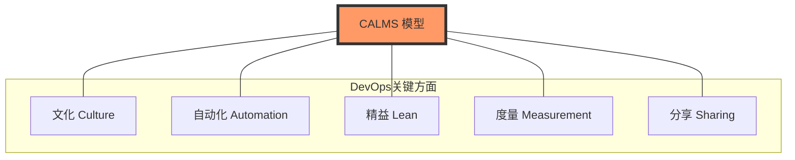

*   **C**ulture (文化)
*   **A**utomation (自动化)
*   **L**ean (精益)
*   **M**easurement (度量)
*   **S**haring (分享)

还有一个重要的指导原则叫做 **“三步工作法”**：
1.  **流动 (Flow)：** 确保工作能够顺畅地从开发团队流向运维团队，最终交付给用户，中间不要有太多等待和阻塞。
2.  **反馈 (Feedback)：** 建立快速的反馈渠道。比如，代码一提交，马上就能知道测试有没有通过；软件一上线，马上就能知道用户用得怎么样。这样就能尽早发现问题，尽早修复。
3.  **持续学习与实验 (Continuous Learning and Experimentation)：** 鼓励大家尝试新的方法，从成功和失败中学习，不断改进工作方式和产品。

这“三步工作法”可以用下图简单表示：

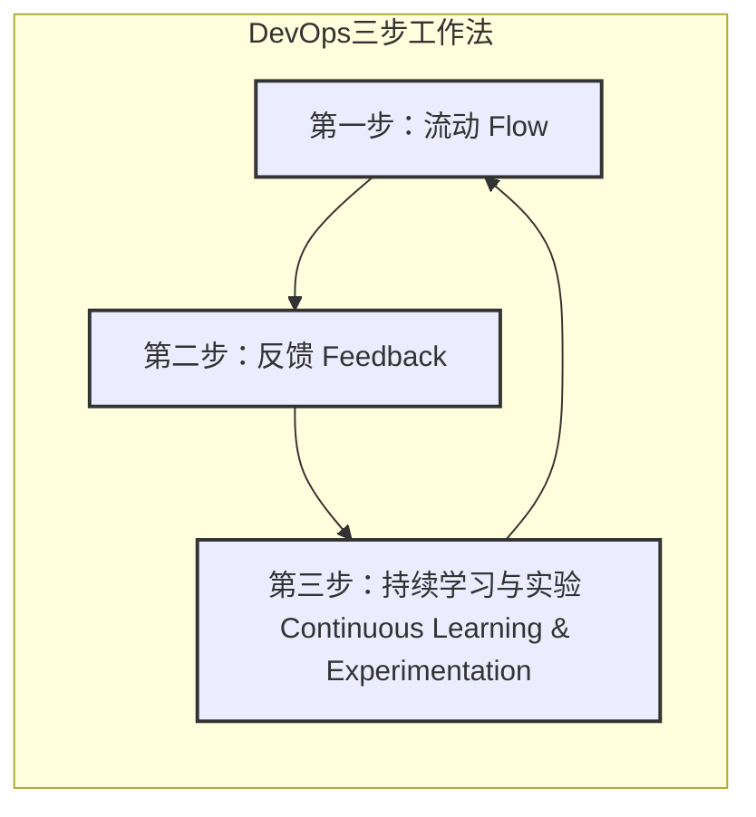

## 1.3 为什么我们需要 DevOps？

在一个变化飞快的时代，公司需要快速响应市场和用户的需求。DevOps 能帮助我们：

*   **更快地把产品推向市场：** 抓住商业机会。
*   **提升软件的质量和稳定性：** 让用户用得更放心。
*   **提高团队的工作效率：** 让工程师们更专注于有价值的工作。
*   **增强团队的幸福感：** 减少不必要的压力和冲突。
*   **最终，提升公司的竞争力。**

简单来说，DevOps 就像是给软件开发和交付过程装上了一个高效的引擎，并让所有参与者都朝着同一个方向努力。它不是一个一蹴而就的事情，而是一个持续改进的过程。

---

# 第二章：DevOps 的关键实践

理解了 DevOps 的核心理念后，我们来看看在实际工作中，有哪些关键的实践方法可以帮助我们落地 DevOps。这些实践通常会借助一些自动化工具来完成。

## 2.1 持续集成 (CI)：让代码集成更轻松

想象一下，一个项目有很多开发人员同时在写代码。如果大家都是埋头写很久，最后才把代码合在一起，很容易出现各种冲突和问题，解决起来非常头疼，这就是所谓的“集成地狱”。

**持续集成 (Continuous Integration, CI)** 就是一种让开发人员更频繁地（比如每天好几次）把自己写的代码合并到主代码库中的实践。每次合并后，会自动运行构建（比如编译代码）和测试，来确保新的代码没有破坏原有的功能。

一个典型的 CI 流程如下：

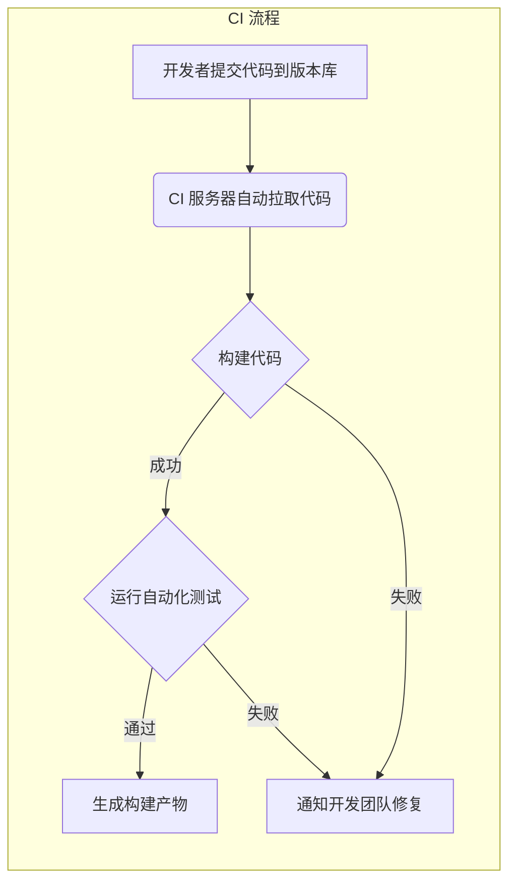

**CI 的好处：**
*   **尽早发现问题：** 代码一有问题，马上就能知道，修复起来也更容易。
*   **减少集成麻烦：** 每次只集成一小部分代码，比一次性集成大量代码简单多了。
*   **提高代码质量：** 自动测试能保证代码的基本质量。
*   **让发布更频繁：** 因为代码总是处于一个相对稳定的状态。

**常用 CI 工具：** Jenkins, GitLab CI, GitHub Actions 等。

## 2.2 持续交付与持续部署 (CD)：软件发布更快更稳

CI 解决了代码集成的问题，那么代码集成后如何快速又安全地交到用户手里呢？这就是持续交付和持续部署要解决的问题。

*   **持续交付 (Continuous Delivery)：** 这是 CI 的延伸。它意味着，任何时候，只要我们的代码通过了所有的自动化测试，它就处于一个“可以发布”的状态。也就是说，我们可以一键就把最新的软件版本部署到生产环境（用户实际使用的环境），但通常这个“一键”还是需要人来按一下，做最终的决定。

*   **持续部署 (Continuous Deployment)：** 这个更进一步。它意味着，只要代码通过了所有自动化测试，就会自动地、不需要人工干预地部署到生产环境。这要求我们对自动化测试有极高的信心。

持续交付与持续部署的流程可以这样理解：

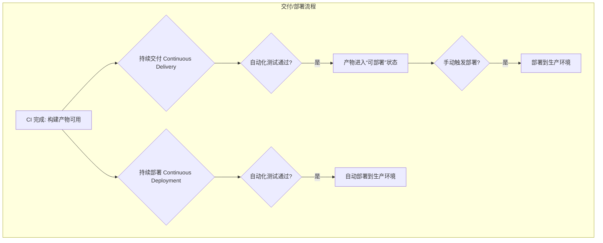

**CD 的好处：**
*   **发布更快：** 大大缩短了从写完代码到用户用上新功能的时间。
*   **发布更可靠：** 自动化流程减少了人为失误。
*   **降低发布风险：** 每次只发布一小部分改动，出问题也好回滚。

**常用 CD 工具：** 通常和 CI 工具集成在一起，比如 Jenkins, GitLab CI, GitHub Actions, Spinnaker, Argo CD 等。

## 2.3 基础设施即代码 (IaC)：像管理代码一样管理服务器

以前，我们要准备一台服务器（比如网站运行需要的计算机环境），可能需要运维人员手动去配置操作系统、安装软件、设置网络等等，非常繁琐，也容易出错，而且每次配置可能还不一样。

**基础设施即代码 (Infrastructure as Code, IaC)** 就是用写代码的方式来定义和管理我们的服务器、网络、存储等基础设施。我们可以写一些配置文件（比如用 Terraform 或 Ansible 这样的工具），描述我们想要什么样的环境，然后让工具自动去创建和配置。

基础设施即代码的工作方式：

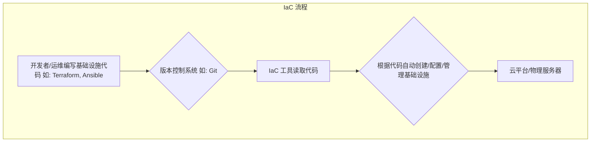

**IaC 的好处：**
*   **自动化：** 不用手动操作了，省时省力还不容易错。
*   **环境一致：** 无论是开发环境、测试环境还是生产环境，都能保证配置是一样的。
*   **可追踪：** 基础设施的配置也像代码一样有了版本历史，可以追踪改动，也可以回滚。
*   **可重复：** 需要再来一套同样的环境？运行一下代码就行了。

**常用 IaC 工具：** Terraform, Ansible, AWS CloudFormation, Azure Resource Manager 等。

## 2.4 版本控制 (Git)：团队协作的基础

版本控制系统 (Version Control System, VCS) 是用来追踪和管理文件（尤其是代码）变化的工具。它允许多个人在同一个项目上协作，记录下每一次修改，并且可以在需要的时候回到之前的任何一个版本。

**Git** 是目前最流行的版本控制系统。

一个简化的 Git 工作流程可能如下：

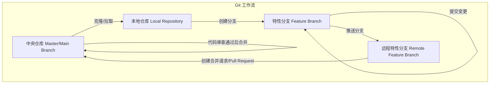

**版本控制的好处：**
*   **团队协作：** 大家可以同时工作，然后把各自的修改合并起来。
*   **历史记录：** 知道谁在什么时候改了什么，为什么改。
*   **分支管理：** 可以在不影响主代码的情况下，拉出一个分支去开发新功能或修复 bug，完成后再合并回去。
*   **轻松回滚：** 如果改错了，可以方便地回到之前的某个版本。

**常用 Git 平台：** GitHub, GitLab, Bitbucket 等，它们提供了代码托管、协作和代码审查等功能。

## 2.5 自动化测试：保证软件质量

为了确保我们写的软件能正常工作，并且修改代码后不会把原来的功能搞坏，我们需要进行测试。

**自动化测试** 就是用程序来代替人工执行测试用例。它是 DevOps 中非常重要的一环，因为只有测试能够自动化，我们才能放心地进行频繁的集成和部署。

**常见的自动化测试类型：**
*   **单元测试：** 测试代码中最小的功能单元（比如一个函数）。
*   **集成测试：** 测试多个模块组合在一起时是否能正常工作。
*   **端到端测试：** 模拟真实用户的使用场景，测试整个系统的流程。

**自动化测试的好处：**
*   **提高质量：** 更早发现 bug。
*   **快速反馈：** 代码一改，马上知道有没有问题。
*   **减少人工：** 把测试人员从重复的测试中解放出来，去做更有价值的事情。
*   **增强信心：** 自动化测试通过了，我们对发布的版本就更有信心。

## 2.6 监控：了解系统运行状况

软件发布上线后，我们还需要时刻关注它的运行状态，确保它能稳定地为用户提供服务。

**监控 (Monitoring)** 就是收集、分析和展示关于系统运行的各种数据（比如服务器的 CPU 使用率、内存占用、网络流量、应用程序的响应时间、错误日志等）。当出现问题或者潜在风险时，监控系统会发出告警，通知相关人员及时处理。

**监控的好处：**
*   **主动发现问题：** 在用户发现之前就定位并解决问题。
*   **快速排障：** 通过日志和指标数据，帮助我们快速找到问题的原因。
*   **了解系统瓶颈：** 知道系统的哪些部分压力比较大，需要优化。
*   **数据驱动决策：** 根据监控数据来做容量规划、性能优化等决策。

**常用监控工具：** Prometheus, Grafana, Zabbix, Datadog, ELK Stack (Elasticsearch, Logstash, Kibana) 等。

这些关键实践相互关联，共同构成了 DevOps 的技术基础，帮助团队实现更快、更好、更可靠的软件交付。

---

# 第三章：DevOps 如何改变软件开发？

在了解了 DevOps 是什么以及它的一些关键实践之后，我们来看看 DevOps 是如何影响和改进传统的软件开发生命周期 (Software Development Life Cycle, SDLC) 的。

## 3.1 传统软件开发流程的痛点

想象一下传统的软件开发，可能像一个接力赛，每个环节的人做完自己的事，再交给下一个人：

1.  **需求分析：** 产品经理提出要做什么功能。
2.  **设计：** 架构师和设计师设计软件的蓝图。
3.  **开发：** 程序员根据设计写代码。
4.  **测试：** 测试人员检查软件有没有 bug。
5.  **部署：** 运维人员把软件安装到服务器上让用户使用。
6.  **维护：** 软件上线后，运维人员负责保持它正常运行，开发人员修复 bug。

这种模式被称为“瀑布模型”，因为每个阶段都像瀑布一样，一级一级往下流，一个阶段完成了才能到下一个阶段。如下图所示：

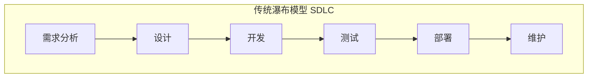

这种方式有很多问题：

*   **沟通不畅：** 开发团队 (Dev) 和运维团队 (Ops) 常常是分开的，他们有不同的目标和工具，沟通起来很费劲，甚至会互相指责（“开发写的代码有问题！”“运维的环境不行！”）。
*   **反馈缓慢：** 用户要等很久才能看到最终产品，如果产品不符合需求，修改起来成本很高。
*   **交付周期长：** 从开始到最终上线，可能要几个月甚至更久。
*   **风险高：** 最后集成和部署的时候，才发现一堆问题，手忙脚乱。
*   **创新受阻：** 因为发布太慢，尝试新东西的风险也大。

## 3.2 DevOps 如何优化开发流程

DevOps 就像给这个接力赛引入了新的规则和工具，让整个过程更流畅、更高效。

DevOps 强调**协作、自动化和快速反馈**，它把传统的 SDLC 变成了一个持续的、循环的流程，而不是线性的瀑布。

**DevOps 下的 SDLC 看起来更像一个无限循环的符号，代表持续的流动和改进：**

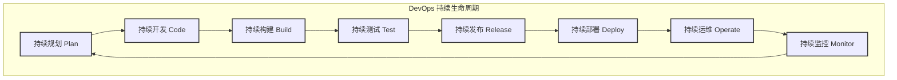

*   **持续规划 (Continuous Planning)：** 团队一起快速规划小的功能迭代。
*   **持续开发与集成 (Continuous Development & Integration)：** 开发人员频繁提交代码，代码自动构建和测试 (CI)。
*   **持续测试 (Continuous Testing)：** 自动化测试贯穿整个过程，保证质量。
*   **持续交付/部署 (Continuous Delivery/Deployment)：** 测试通过的代码可以快速、自动地部署到生产环境 (CD)。
*   **持续监控与反馈 (Continuous Monitoring & Feedback)：** 软件上线后，持续监控其运行状态，收集用户反馈，这些信息又会回到规划阶段，形成一个闭环。

*   **持续规划 (Continuous Planning)：** 团队一起快速规划小的功能迭代。
*   **持续开发与集成 (Continuous Development & Integration)：** 开发人员频繁提交代码，代码自动构建和测试 (CI)。
*   **持续测试 (Continuous Testing)：** 自动化测试贯穿整个过程，保证质量。
*   **持续交付/部署 (Continuous Delivery/Deployment)：** 测试通过的代码可以快速、自动地部署到生产环境 (CD)。
*   **持续监控与反馈 (Continuous Monitoring & Feedback)：** 软件上线后，持续监控其运行状态，收集用户反馈，这些信息又会回到规划阶段，形成一个闭环。

**DevOps 带来的改变：**

*   **打破部门墙：** 开发、测试、运维不再是孤立的团队，而是紧密协作，共同为产品的成功负责。
*   **自动化一切可自动化的：** 从代码构建、测试、部署到基础设施管理，都尽可能自动化，减少人工错误，提高效率。
*   **小步快跑，频繁发布：** 不再是一次性发布一个巨大的版本，而是把大的功能拆分成小的模块，快速开发、测试、发布。这样用户能更快用到新功能，团队也能更快得到反馈。
*   **质量内建：** 测试不再是开发完成后的一个独立阶段，而是从一开始就融入到开发过程中。
*   **快速响应变化：** 由于发布周期短，团队能更快地响应市场变化和用户需求。

## 3.3 开发 (Dev) 和运维 (Ops) 的协作

DevOps 的核心就是 **Dev (开发)** 和 **Ops (运维)** 的协作。

*   **共同的目标：** 双方不再只关心自己的 KPI（比如开发关心代码量，运维关心系统稳定性），而是共同关注如何快速、高质量地交付价值给用户。
*   **共享的工具和流程：** 比如，开发人员也会关心代码在生产环境如何运行，运维人员也会参与到早期的设计和测试中。
*   **责任共担：** 软件上线后出了问题，不再是运维一个人的事，开发也要一起参与解决。
*   **文化融合：** 鼓励开放沟通、相互信任和持续学习。

通过这种方式，DevOps 使得软件开发过程更加敏捷、高效和可靠，最终能够更好地满足用户需求，提升业务价值。

---

# 第四章：DevOps 能带来什么好处？

我们已经了解了 DevOps 是什么，以及它的一些关键实践和对软件开发流程的改进。那么，一个团队或公司费心费力地去推行 DevOps，到底能得到哪些实实在在的好处呢？

简单来说，DevOps 能帮助我们**更快、更好、更稳定**地交付软件，从而提升竞争力。

我们可以用一个简单的图来概括 DevOps 的核心好处：

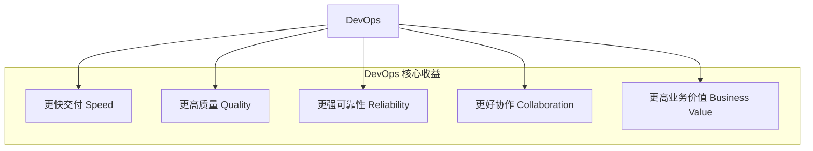

## 4.1 更快的交付速度 (Speed)

这是 DevOps 最显著的好处之一。

*   **频繁发布：** 通过自动化和持续交付/部署，我们可以更频繁地发布新功能或修复。以前可能几个月才发布一次，现在可能一天发布好几次。
*   **缩短上市时间 (Time to Market)：** 新的想法、新的产品能更快地交到用户手中，抢占市场先机。
*   **快速迭代：** 能够根据用户反馈快速调整产品方向，小步快跑，不断优化。

想象一下，你的竞争对手还在慢吞吞地准备一个大版本，而你已经通过 DevOps 快速上线了好几个小功能，不断吸引和满足用户，优势自然就体现出来了。

**总结一下，更快的交付速度意味着：**

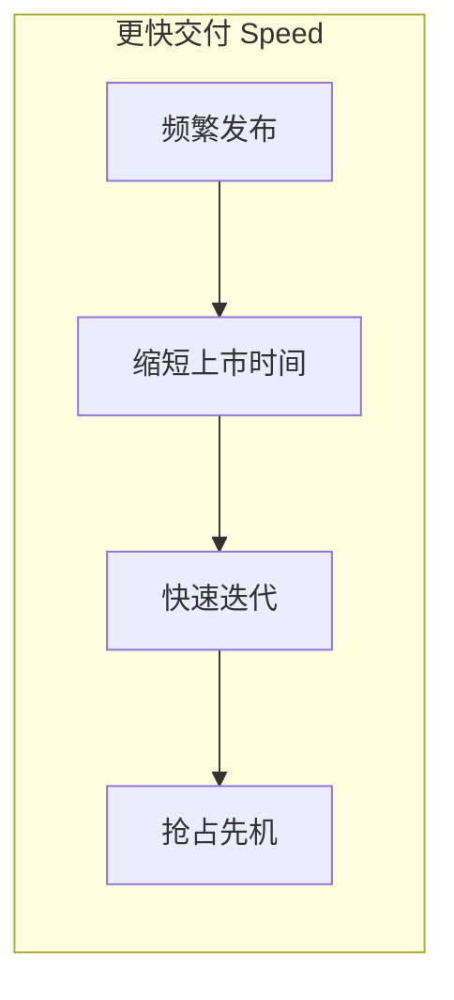

## 4.2 更高的软件质量 (Quality)

速度快了，质量会不会下降呢？DevOps 恰恰相反，它能帮助提升软件质量。

*   **持续测试：** 自动化测试在开发的每个阶段都在运行，能尽早发现和修复 bug。
*   **减少人为错误：** 自动化的构建、测试和部署流程，比人工操作更可靠，减少了因疏忽导致的错误。
*   **更稳定的发布：** 每次发布的内容更少，风险更小。即使出了问题，也更容易定位和回滚。
*   **代码质量提升：** 持续集成和代码审查等实践，有助于提升整体代码质量。

**总结一下，更高的软件质量意味着：**

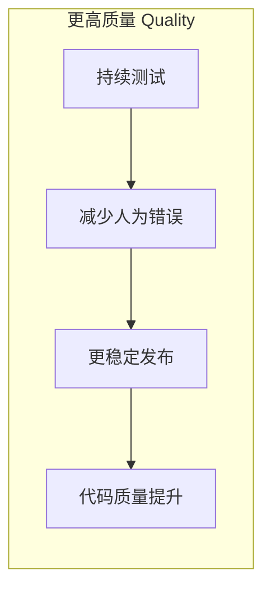

## 4.3 更可靠的系统运行 (Reliability)

软件发布上线后，能稳定运行不出问题，对用户体验至关重要。

*   **基础设施即代码 (IaC)：** 确保开发、测试和生产环境的一致性，减少了“在我电脑上明明是好的”这类问题。
*   **持续监控和告警：** 能够实时了解系统运行状况，在问题扩大前及时发现并处理。
*   **快速故障恢复：** 如果系统出现故障，DevOps 流程和工具能帮助团队更快地恢复服务。

**总结一下，更可靠的系统运行意味着：**

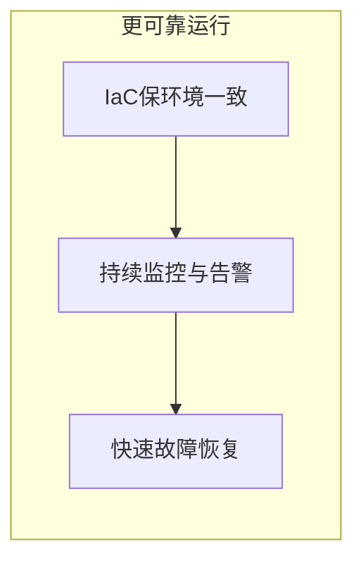

## 4.4 更好的团队协作和员工满意度 (Collaboration & Satisfaction)

DevOps 不仅仅是工具和流程，更是一种文化。

*   **打破部门隔阂：** 开发、测试、运维等团队不再是孤岛，而是紧密协作，共同为目标努力。
*   **减少重复劳动：** 自动化解放了团队成员，让他们可以专注于更有创造性和价值的工作。
*   **提升员工技能：** 鼓励学习和尝试新技术，员工能得到成长。
*   **增强主人翁意识：** 团队对整个产品生命周期负责，更有成就感和归属感。

当团队成员心情舒畅、合作愉快时，工作效率和创造力自然会更高。

**总结一下，更好的团队协作和员工满意度意味着：**

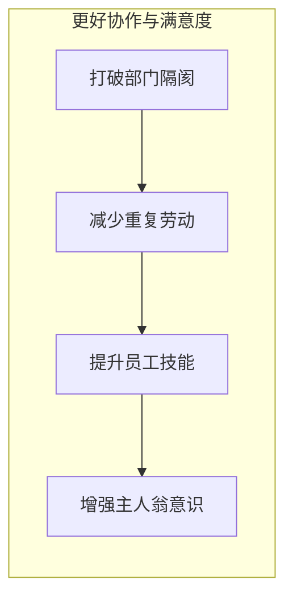

## 4.5 提升业务价值 (Business Value)

最终，所有的技术改进都是为了服务于业务目标。

*   **更快的价值交付：** 新功能更快上线，意味着能更快地为用户创造价值，更快地获得收益。
*   **降低成本：** 自动化减少了人工成本，高效的流程减少了浪费。
*   **增强创新能力：** 快速迭代和试错的能力，让企业敢于尝试新的商业模式和产品。
*   **提升客户满意度：** 更快获得新功能、更稳定的服务、更少的问题，自然会带来更高的客户满意度。

**总结一下，提升业务价值意味着：**

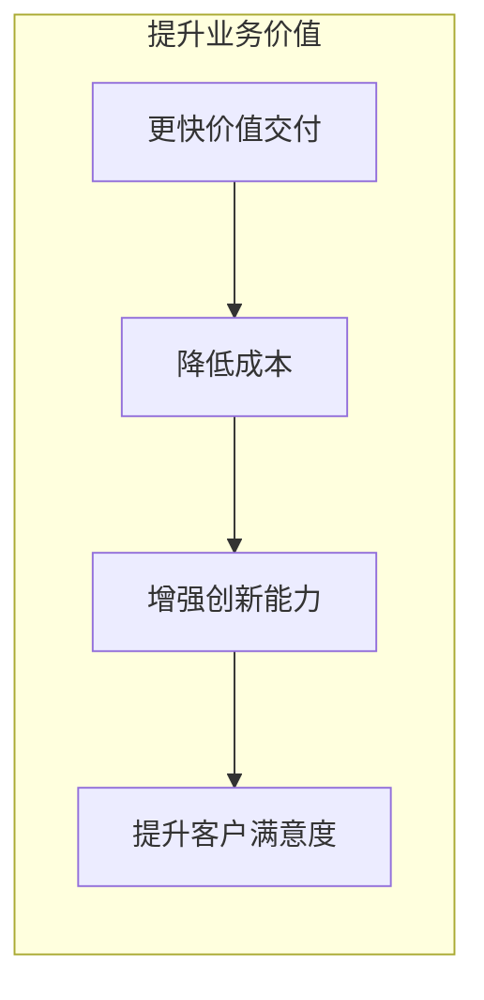

总而言之，DevOps 通过一系列文化、流程和工具的变革，能够帮助组织在快速变化的市场中保持竞争力，实现可持续的业务增长。

---

# 第五章：实施 DevOps 会遇到哪些挑战？

DevOps 听起来很美好，能带来很多好处。但在实际推行 DevOps 的过程中，并不是一帆风顺的，我们可能会遇到各种各样的挑战。了解这些挑战，可以帮助我们更好地准备和应对。

我们可以将这些挑战总结如下：

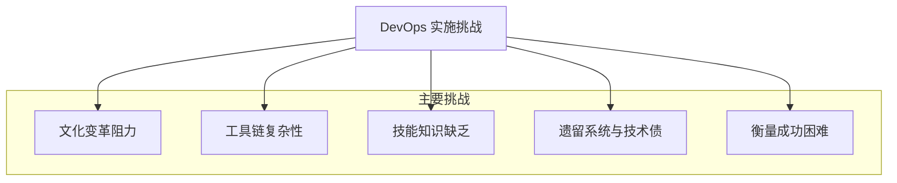

## 5.1 文化变革的阻力 (Resistance to Cultural Change)

这是最常见也是最大的挑战之一。DevOps 不仅仅是引入新工具或新流程，更重要的是**思维方式和工作文化的转变**。

*   **习惯的力量：** 人们往往习惯于旧的工作方式，不愿意改变。比如，开发和运维团队习惯了各做各的，让他们紧密协作可能会感到不适应。
*   **害怕担责：** DevOps 强调共同负责，有些人可能害怕承担额外的责任或担心犯错。
*   **部门壁垒：** 传统的组织架构可能强化了部门之间的隔阂，打破这些壁垒需要时间和努力。
*   **缺乏信任：** 如果团队之间缺乏信任，协作就很难进行。

**文化变革的阻力主要表现为：**

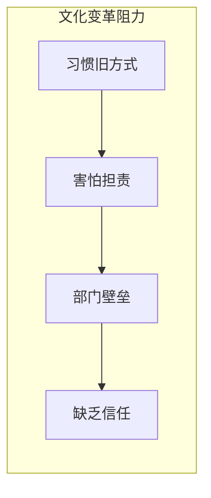

**工具选择和集成的复杂性主要表现为：**

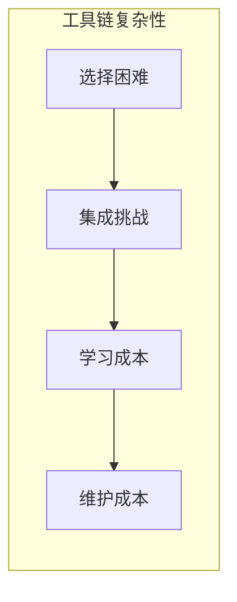

**技能和知识的缺乏主要表现为：**

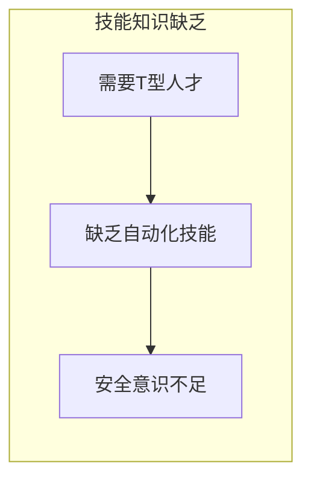

**遗留系统和技术债主要表现为：**

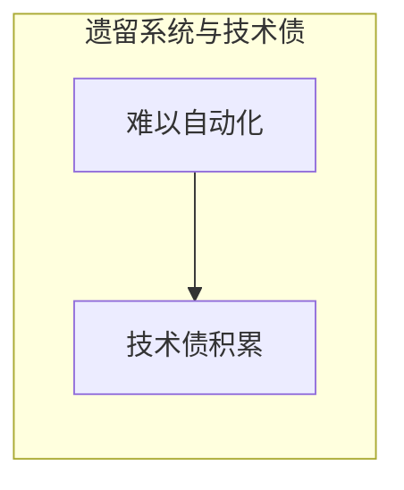

**衡量 DevOps 的成功困难主要表现为：**

```mermaid
graph LR
    subgraph 衡量成功困难
        T[缺乏明确指标] --> U[只关注技术指标]
    end
```

**如何应对：**
*   **高层支持：** 管理层的理解和大力支持非常重要。
*   **从小处着手：** 可以先选择一个小项目或一个小团队进行试点，取得成功经验后再逐步推广。
*   **加强沟通和培训：** 让大家理解 DevOps 的价值，学习新的技能和协作方式。
*   **鼓励开放和透明：** 营造一个安全的环境，让大家敢于尝试和分享。

## 5.2 工具选择和集成的复杂性 (Toolchain Complexity)

DevOps 依赖于各种自动化工具，比如 CI/CD 工具、配置管理工具、监控工具等等。这些工具组成了一个“工具链”。

*   **选择困难：** 市面上的 DevOps 工具非常多，选择适合自己团队的工具并不容易。
*   **集成挑战：** 把不同的工具整合起来，让它们能够顺畅地协同工作，可能需要花费不少精力。
*   **学习成本：** 团队成员需要学习如何使用这些新工具。
*   **维护成本：** 工具链也需要维护和升级。

**如何应对：**
*   **明确需求：** 先搞清楚自己需要解决什么问题，再去找合适的工具。
*   **逐步引入：** 不要一下子引入太多工具，可以先从最核心的工具开始。
*   **考虑开源和商业工具：** 根据预算和团队技术能力进行选择。
*   **寻求专业帮助：** 如果团队缺乏经验，可以考虑寻求外部咨询或服务。

## 5.3 技能和知识的缺乏 (Skill Gaps)

DevOps 需要员工具备更广泛的技能，比如开发人员可能需要了解一些运维知识，运维人员也可能需要学习一些自动化脚本的编写。

*   **T型人才：** DevOps 理想中的人才是“T型人才”，既有某个领域的深度专业知识（T的竖线），又有较广的知识面（T的横线）。培养这样的人才需要时间。
*   **自动化技能：** 编写自动化脚本、配置自动化工具等都需要相应的技能。
*   **安全意识：** 在快速迭代的过程中，如何保证安全性也是一个挑战 (DevSecOps 的概念应运而生)。

**如何应对：**
*   **持续学习和培训：** 鼓励团队成员学习新技能，提供培训资源。
*   **知识共享：** 在团队内部建立知识共享的机制。
*   **招聘和外部合作：** 根据需要招聘具备相应技能的人才，或者与外部专家合作。

## 5.4 遗留系统和技术债 (Legacy Systems and Technical Debt)

很多公司都有一些年代久远、架构复杂的“遗留系统”。这些系统可能很难进行自动化改造，推行 DevOps 的难度较大。

*   **难以自动化：** 老旧系统可能缺乏 API 接口，或者测试覆盖率很低，难以实现自动化构建和部署。
*   **技术债：** 过去为了快速上线而采取的一些临时方案或不规范的做法，会积累下来成为“技术债”，阻碍后续的改进。

**如何应对：**
*   **逐步改进：** 对于遗留系统，可以采取逐步重构或“绞杀者模式”（用新服务逐渐替换旧服务的功能）的方式。
*   **优先处理高价值部分：** 先从对业务影响最大的部分开始改造。
*   **偿还技术债：** 把偿还技术债也纳入到开发计划中。

## 5.5 衡量 DevOps 的成功 (Measuring Success)

如何衡量 DevOps 实施的效果？这是一个需要思考的问题。

*   **缺乏明确的指标：** 如果没有明确的衡量指标，就很难知道改进的方向和效果。
*   **只关注技术指标：** 有时团队可能只关注部署频率等技术指标，而忽略了对业务价值的实际影响。

**如何应对：**
*   **定义关键绩效指标 (KPI)：** 比如部署频率、变更失败率、平均修复时间 (MTTR)、客户满意度等。
*   **关注业务成果：** 将技术指标与业务成果联系起来，比如新用户增长、收入提升等。

实施 DevOps 是一个持续改进的过程，遇到挑战是正常的。关键在于正视这些挑战，并积极寻找解决方案，不断优化和调整，最终才能真正享受到 DevOps 带来的红利。

---

# 第六章：DevOps 的未来会怎样？

DevOps 经过多年的发展，已经从一个新兴理念变成很多公司的主流实践。那么，DevOps 的未来会走向何方呢？它还会继续演变和发展吗？答案是肯定的。让我们来看看 DevOps 未来可能的一些发展趋势。

我们可以用一个概览图来展示 DevOps 的主要未来趋势：

```mermaid
graph TD
    FutureDevOps[DevOps 未来趋势]
    FutureDevOps --> AIOps[AI/ML 融入 AIOps]
    FutureDevOps --> DevSecOps[安全左移 DevSecOps]
    FutureDevOps --> CloudNative[Serverless 与云原生]
    FutureDevOps --> VSM[价值流管理 VSM]
    FutureDevOps --> Culture[关注人与文化]

    subgraph 未来方向
        AIOps
        DevSecOps
        CloudNative
        VSM
        Culture
    end
```

## 6.1 人工智能与机器学习的融入 (AI/ML in DevOps - AIOps)

人工智能 (AI) 和机器学习 (ML) 技术正在越来越多地被应用到 DevOps 的各个环节，催生了 **AIOps (AI for IT Operations)** 的概念。

*   **智能自动化：** AI 可以帮助我们更智能地进行自动化，比如自动预测系统故障、自动调整资源分配、自动优化部署策略等。
*   **智能监控和告警：** 通过学习历史数据，AI 可以更准确地识别异常模式，减少误报，帮助我们更快地发现和定位问题。
*   **智能测试：** AI 可以帮助生成测试用例、优化测试覆盖率，甚至自动修复一些简单的 bug。
*   **数据驱动决策：** AI 可以分析大量的运维数据，为我们提供更精准的决策支持。

AIOps 的核心应用场景：

```mermaid
graph LR
    subgraph AIOps 应用
        SmartAuto[智能自动化] --> SmartMonitor[智能监控与告警]
        SmartMonitor --> SmartTest[智能测试]
        SmartTest --> DataDriven[数据驱动决策]
    end
```

想象一下，未来你的运维系统可以像一个聪明的助手一样，主动帮你发现问题、解决问题，甚至在你意识到之前就搞定了。

## 6.2 DevSecOps：安全融入 DevOps 全流程

过去，安全往往是在软件开发的最后阶段才考虑的事情，这就像房子盖好了才发现地基有问题一样，修复成本很高。

**DevSecOps** 的理念是把安全 (Security) 从一开始就融入到 DevOps 的整个生命周期中，实现“安全左移”（Shift Left），即尽早考虑和实施安全措施。

*   **自动化安全测试：** 在 CI/CD 流程中自动进行代码扫描、漏洞检测等安全测试。
*   **安全即代码 (Security as Code)：** 像管理基础设施一样，用代码来定义和管理安全策略。
*   **持续安全监控：** 对线上系统进行持续的安全监控和威胁检测。
*   **培养安全文化：** 让团队中的每个人都具备安全意识，共同为产品的安全负责。

DevSecOps 的核心实践：

```mermaid
graph LR
    subgraph DevSecOps 实践
        AutoSecTest[自动化安全测试] --> SecAsCode[安全即代码]
        SecAsCode --> ContSecMonitor[持续安全监控]
        ContSecMonitor --> SecCulture[培养安全文化]
    end
```

DevSecOps 的目标是让安全不再是某个部门或某个人的事情，而是成为 DevOps 流程中不可或缺的一部分，从而在保证快速交付的同时，也保证了软件的安全性。

## 6.3 Serverless 和云原生架构的普及

**Serverless（无服务器架构）** 是一种让开发者不用关心服务器运维的云计算模型。你只需要编写和上传你的代码（比如一个函数），云平台会自动处理服务器的分配、扩容和维护。

**云原生 (Cloud Native)** 则是一套构建和运行应用程序的方法论，它充分利用了云计算的优势，比如弹性伸缩、按需付费、高可用性等。容器技术 (如 Docker) 和微服务架构是云原生的重要组成部分。

这些技术的发展对 DevOps 提出了新的要求，也带来了新的机遇：

*   **更快的部署和伸缩：** Serverless 和云原生架构使得应用的部署和扩容更加灵活和快速。
*   **更细粒度的管理：** DevOps 工具和流程需要适应这种更细粒度的应用和服务管理。
*   **成本优化：** 按需付费的模式也对 DevOps 的资源管理和成本控制提出了更高要求。

Serverless 和云原生对 DevOps 的影响：

```mermaid
graph LR
    subgraph Serverless/云原生影响
        FastDeploy[更快部署与伸缩] --> FineGrainedMgmt[更细粒度管理]
        FineGrainedMgmt --> CostOpt[成本优化需求]
    end
```

## 6.4 关注价值流管理 (Value Stream Management)

DevOps 不仅仅是提高开发和部署的效率，更重要的是要为业务创造价值。

**价值流管理 (Value Stream Management, VSM)** 是一种关注从客户需求提出到价值交付给客户的整个端到端流程的方法。它帮助我们识别流程中的瓶颈和浪费，从而优化整个价值交付的过程。

*   **可视化价值流：** 将整个软件交付过程可视化，让团队清楚地看到每个环节的状态和效率。
*   **度量和分析：** 通过数据来度量价值流的各个指标，比如交付周期、吞吐量等。
*   **持续改进：** 基于数据分析，持续优化价值流，提升整体效率和价值产出。

价值流管理 (VSM) 的关键活动：

```mermaid
graph LR
    subgraph VSM 活动
        Visualize[可视化价值流] --> Measure[度量与分析]
        Measure --> ContinuousImprove[持续改进]
    end
```

VSM 帮助 DevOps 团队更好地将技术实践与业务目标对齐，确保所做的工作能够真正为企业带来价值。

## 6.5 更加关注人的因素和文化建设

虽然技术和工具在不断发展，但 DevOps 的核心始终是**人与文化**。

未来，DevOps 会更加强调：
*   **心理安全：** 创造一个让员工敢于尝试、不怕犯错、乐于分享的环境。
*   **持续学习和成长：** 鼓励团队成员不断学习新知识、新技能。
*   **多样性和包容性：** 建立多元化和包容性的团队文化，激发创新。
*   **领导力转型：** 领导者需要从传统的命令控制型转变为服务型和赋能型，支持团队的自主性和创造力。

更加关注人的因素和文化建设，强调：

```mermaid
graph LR
    subgraph 人与文化建设
        PsySafe[心理安全] --> ContLearn[持续学习与成长]
        ContLearn --> Diversity[多样性与包容性]
        Diversity --> Leadership[领导力转型]
    end
```

DevOps 的未来是技术与人文并重，通过不断的技术创新和文化建设，推动软件交付能力的持续提升，更好地适应快速变化的商业环境。

---

# 第七章：总结与展望：开启你的 DevOps 之旅

经过前面几个章节的学习，相信你对 DevOps 已经有了一个初步的认识。让我们简单回顾一下，并展望一下如何开始你的 DevOps 学习和实践之旅。

## 7.1 DevOps 核心回顾

简单来说，DevOps 是一种**文化理念、实践方法和工具集合**，它的目标是**打破开发 (Dev) 和运维 (Ops) 之间的壁垒，实现更快速、更可靠、更高质量的软件交付和价值创造**。

记住几个关键词：

*   **协作 (Collaboration)：** 开发、测试、运维等角色紧密合作，共同为目标努力。
*   **自动化 (Automation)：** 将重复性的手动任务自动化，提高效率，减少错误。
*   **持续 (Continuous)：** 持续集成、持续交付/部署、持续测试、持续监控，形成一个快速反馈的闭环。
*   **CALMS 框架：** 文化 (Culture)、自动化 (Automation)、精益 (Lean)、度量 (Measurement)、共享 (Sharing)，是理解 DevOps 的一个好框架。
*   **三大支柱 (The Three Ways)：** 系统思维 (Systems Thinking)、放大反馈回路 (Amplify Feedback Loops)、持续实验与学习文化 (Culture of Continual Experimentation and Learning)。

我们可以用一个图来总结 DevOps 的核心要素：

```mermaid
graph TD
    DevOpsCore[DevOps 核心]
    DevOpsCore --> Culture[文化理念]
    DevOpsCore --> Practices[实践方法]
    DevOpsCore --> Tools[工具集合]

    Culture --> Collaboration[协作]
    Culture --> CALMS[CALMS框架]
    Culture --> ThreeWays[三步工作法]
    Practices --> Continuous[持续CI/CD/Test/Monitor]
    Practices --> Automation[自动化]
    Tools --> CICDTools[CI/CD工具]
    Tools --> IaCTools[IaC工具]
    Tools --> MonitorTools[监控工具]

    subgraph 目标
        Goal[更快/更好/更可靠地交付价值]
    end
    DevOpsCore --> Goal
```

DevOps 不是一个一蹴而就的目标，而是一个**持续改进的旅程**。

## 7.2 为什么要学习和拥抱 DevOps？

无论你是开发人员、测试人员、运维工程师，还是产品经理、项目经理，了解和学习 DevOps 都会对你的工作和职业发展带来益处：

*   **提升个人技能：** 学习自动化工具、云技术、安全知识等，让你更具竞争力。
*   **改善工作方式：** 减少重复劳动，提高工作效率，让你有更多时间去做有创造性的事情。
*   **增强团队协作：** 更好地与团队成员沟通和协作，共同完成目标。
*   **适应行业趋势：** DevOps 已经是软件行业的主流趋势，掌握它能让你更好地适应未来的工作需求。
*   **创造更大价值：** 帮助你的团队和公司更快地交付高质量的软件，为用户和业务创造更大的价值。

## 7.3 如何开始你的 DevOps 之旅？

学习 DevOps 可能看起来有点 daunting（令人望而生畏），因为它涉及的知识面比较广。但别担心，你可以一步一步来：

1.  **理解核心理念：** 首先要真正理解 DevOps 的文化和原则，为什么需要它，它要解决什么问题。
2.  **学习关键实践：** 了解持续集成 (CI)、持续交付 (CD)、基础设施即代码 (IaC)、自动化测试、监控等核心实践。
3.  **动手实践：** 理论学习很重要，但更重要的是动手实践。可以从一些简单的工具开始尝试：
    *   **版本控制：** 学习使用 Git 和 GitHub/GitLab。
    *   **CI/CD 工具：** 尝试用 Jenkins, GitLab CI 或 GitHub Actions 搭建一个简单的自动化构建和部署流程。
    *   **容器技术：** 学习 Docker 的基本使用。
    *   **配置管理/IaC：** 了解一下 Ansible 或 Terraform。
    *   **监控工具：** 尝试使用 Prometheus 和 Grafana 搭建一个简单的监控系统。
4.  **从小处着手：** 在你的工作或个人项目中，尝试应用一些 DevOps 的实践。比如，先为你的一个小项目配置上 CI。
5.  **持续学习：** DevOps 技术和理念在不断发展，保持好奇心，持续学习新的知识。
    *   阅读相关的书籍、博客、文章。
    *   参加线上或线下的技术分享和研讨会。
    *   加入相关的技术社区，与他人交流学习。
你的 DevOps 学习路径可以这样规划：

```mermaid
graph LR
    A[1 理解核心理念] --> B[2 学习关键实践]
    B --> C[3 动手实践工具]
    C --> D[4 从小处着手应用]
    D --> E[5 持续学习与交流]
    E --> F[6 拥抱变化勇于尝试]

    subgraph DevOps 学习之旅
        A
        B
        C
        D
        E
        F
    end
```

6.  **拥抱变化，勇于尝试：** DevOps 本身就是关于持续改进和实验的，不要怕犯错，从错误中学习。

## 7.4 展望未来

DevOps 的旅程没有终点。随着技术的发展，如人工智能 (AIOps)、无服务器 (Serverless)、DevSecOps 等新趋势的出现，DevOps 的内涵和外延也在不断扩展。

最重要的是，始终保持以**交付价值为核心，以人为本，持续改进**的心态。


---