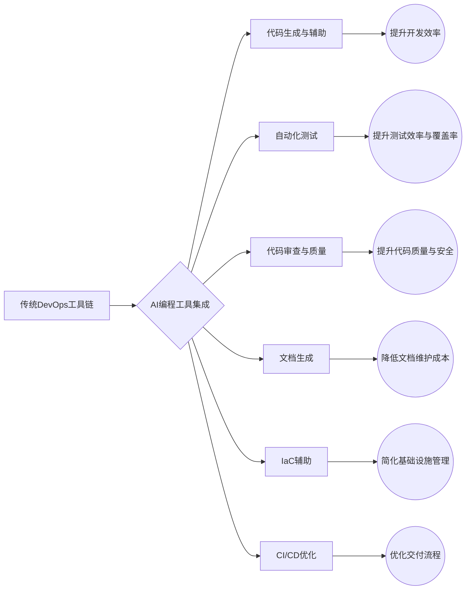
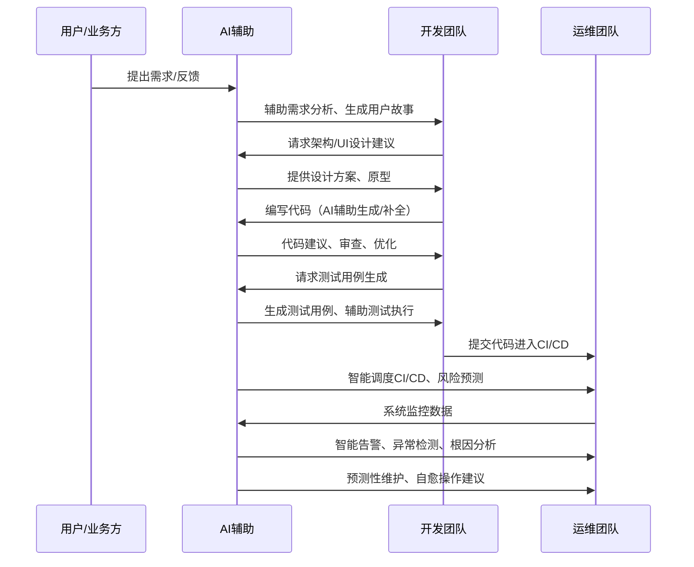

## 一、AI编程对DevOps的根本性影响

AI编程，特别是基于大型语言模型（LLM）的AI编码助手，正从根本上改变DevOps的实践方式和核心理念。这种影响不仅体现在工具链的革新，更深入到思维模式、角色定义和整个软件开发生命周期的重塑。

### 1.1 AI编程工具重塑DevOps生态

AI编程工具，如GitHub Copilot、Sourcegraph Cody、Tabnine、Amazon CodeWhisperer等，正在成为DevOps工具链中不可或缺的一环。它们通过以下方式重塑DevOps生态：

*   **代码生成与辅助**：AI能够根据自然语言描述或上下文自动生成代码片段、函数甚至整个模块，显著提高编码效率。它们还能提供代码补全、语法纠错、重构建议等，降低开发门槛。
*   **自动化测试**：AI可以辅助生成单元测试、集成测试用例，甚至进行探索性测试，提高测试覆盖率和效率。
*   **代码审查与质量保障**：AI工具能够分析代码的潜在缺陷、安全漏洞、性能瓶颈，并提供修复建议，辅助人工审查，提升代码质量。
*   **文档生成与维护**：AI可以根据代码自动生成技术文档、API文档，并辅助维护文档的实时性。
*   **基础设施即代码（IaC）辅助**：AI能够帮助编写和验证Terraform、Ansible等IaC脚本，简化基础设施的配置和管理。
*   **CI/CD流程优化**：AI可以分析CI/CD流水线的瓶颈，智能调度构建和部署任务，甚至预测潜在的部署风险。

这些工具的普及使得DevOps流程更加顺畅、高效，并促进了开发、测试、运维等不同角色之间的协作。

### 1.2 从自动化到智能化的思维转变

传统DevOps的核心在于“自动化”，即通过脚本和工具链将重复性任务自动化，以提高效率和一致性。AI的引入则将DevOps推向了“智能化”的新阶段。这种转变体现在：

*   **从规则驱动到数据驱动**：传统自动化依赖预设规则，而智能化则依赖从大量数据中学习和推理。例如，AIOps可以通过分析历史监控数据预测故障，而不是仅仅依赖阈值告警。
*   **从被动响应到主动预测**：AI能够基于模式识别和趋势分析，预测潜在问题（如性能瓶颈、安全漏洞、部署失败风险），从而实现主动预防和干预。
*   **从任务执行到认知协作**：AI不再仅仅是执行命令的工具，而是能够理解上下文、进行推理、提供建议，甚至与开发者进行自然语言交互的“认知伙伴”。开发者可以向AI提问、寻求解决方案，共同完成复杂任务。
*   **持续学习与自适应优化**：AI系统能够从新的数据和反馈中持续学习，不断优化其模型和决策能力，使得DevOps流程能够自适应地应对变化。

这种思维转变要求DevOps团队不仅关注工具和流程的自动化，更要关注数据的收集、治理和利用，以及人与AI的协同工作模式。

### 1.3 开发者角色的重新定义与技能重塑

AI编程的普及正在深刻影响开发者的角色和所需技能：

*   **从代码编写者到代码策划者/审查者**：开发者将更多地扮演“提示工程师”（Prompt Engineer）的角色，通过精确的自然语言指令引导AI生成代码，并将主要精力从逐行编写转移到对AI生成代码的审查、调试和集成上。
*   **关注点上移**：开发者可以从繁琐的底层编码细节中解放出来，更专注于业务逻辑、系统架构设计、用户体验和创新性工作。
*   **系统思维与跨领域能力增强**：随着AI承担更多编码任务，开发者需要具备更强的系统性思维，理解整个软件交付链路，并可能需要掌握更多与AI、数据科学相关的知识。
*   **人机协作与沟通能力**：有效地与AI工具协作，理解其能力边界和潜在偏见，以及清晰地向AI表达需求，将成为核心技能。
*   **持续学习与适应新技术**：AI技术发展迅速，开发者需要保持开放心态，持续学习新的AI工具和编程范式。

虽然AI可以提高生产力，但并不会完全取代开发者。相反，它将开发者提升到更高层次的抽象和创造性工作中，要求开发者具备新的技能组合，成为AI的驾驭者和协作者。

### 1.4 软件开发生命周期（SDLC）的智能化重构

AI正在对传统的软件开发生命周期（SDLC）的各个阶段进行智能化重构：

*   **需求分析与规划**：AI可以辅助分析用户反馈、市场趋势，甚至生成初步的产品需求文档和用户故事。
*   **设计**：AI可以根据需求生成初步的架构设计方案、UI/UX原型，并辅助进行技术选型。
*   **编码**：AI编码助手直接参与代码编写、重构和优化。
*   **测试**：AI驱动的自动化测试工具能够生成更全面的测试用例，进行智能化的缺陷检测和回归测试。
*   **部署（CI/CD）**：AI可以优化CI/CD流水线，例如通过智能分析历史构建数据来预测构建失败的风险，或者根据当前系统负载和资源状况智能决策部署策略，实现更安全的蓝绿部署或金丝雀发布。
*   **运维与监控（AIOps）**：AI在运维阶段的应用尤为突出，包括智能告警、异常检测、根因分析、预测性维护和自愈能力，大幅提升系统稳定性和运维效率。
*   **安全（DevSecOps）**：AI可以用于静态代码分析（SAST）、动态应用安全测试（DAST）、依赖项漏洞扫描，甚至实时威胁检测和响应，将安全性更早、更智能地融入SDLC。

通过在SDLC的每个环节引入智能，AI不仅提升了各阶段的效率和质量，更促进了各环节之间的无缝集成和信息流动，使得整个软件交付过程更加敏捷、可靠和富有洞察力。这种智能化重构是DevOps理念的自然延伸和深化，旨在构建一个能够快速响应变化、持续交付价值并具备自适应能力的软件工程体系。

---
