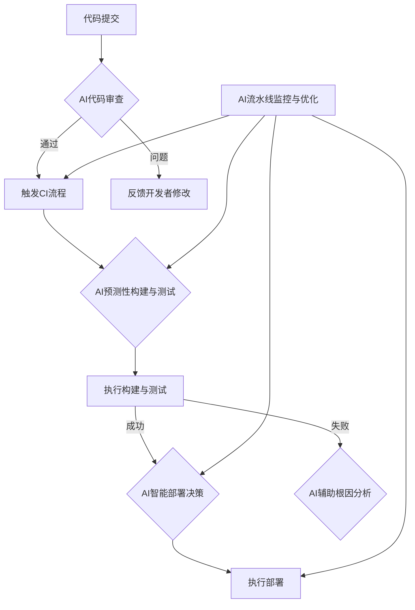
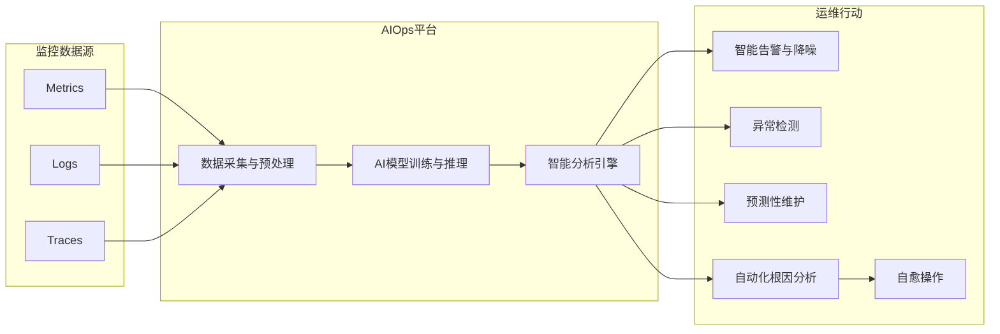

## 二、AI赋能的DevOps核心实践框架

AI的融入正在催生一系列新的DevOps核心实践，这些实践共同构成了一个更为智能、高效和自适应的框架。这个框架不仅优化了现有流程，还引入了全新的能力，推动DevOps向更高阶的成熟度演进。

### 2.1 智能化CI/CD流水线设计与优化

持续集成/持续交付（CI/CD）是DevOps的基石。AI正在通过以下方式使其更加智能化：

*   **智能代码审查与合并**：AI可以在代码提交阶段自动进行初步审查，识别潜在的缺陷、风格问题和安全漏洞，甚至提供自动修复建议，加速代码合并流程。
*   **预测性构建与测试**：通过分析历史构建数据和代码变更，AI可以预测哪些构建可能失败，哪些测试用例最相关，从而优化构建顺序和测试选择，减少不必要的等待时间。
*   **智能部署策略**：AI可以根据实时监控数据、系统负载和风险评估，动态选择最优的部署策略（如蓝绿部署、金丝雀发布、滚动更新），并智能调整发布节奏，最大限度降低部署风险。
*   **流水线性能分析与优化**：AI能够监控CI/CD流水线各阶段的耗时和资源消耗，识别瓶颈，并提供优化建议，例如调整并行任务数、优化缓存策略等。
*   **失败根本原因分析**：当CI/CD流水线失败时，AI可以辅助快速定位根本原因，缩短故障排除时间。

### 2.2 平台工程（Platform Engineering）：DevOps的自然进化与AI的融合

平台工程旨在通过构建内部开发者平台（IDP），为开发团队提供标准化的工具、服务和自动化流程，从而降低认知负荷，提升开发体验和效率。AI的融入进一步增强了平台工程的能力：

*   **智能化服务目录与推荐**：AI可以根据项目需求、技术栈和历史使用情况，智能推荐合适的平台服务和工具。
*   **自然语言交互接口**：开发者可以通过自然语言与IDP交互，例如“帮我创建一个新的微服务项目，使用Java和Spring Boot，并配置好CI/CD流水线”，AI驱动的平台可以理解并执行这些指令。
*   **自动化资源调配与优化**：AI可以根据应用负载和性能指标，自动调配和优化底层资源（如计算、存储、网络），实现成本和性能的最佳平衡。
*   **个性化开发者体验**：AI可以学习开发者的偏好和工作模式，提供个性化的工具配置、文档指引和问题解决方案。
*   **知识库与智能问答**：整合AI能力的平台可以构建强大的知识库，并通过智能问答系统快速解答开发者的疑问。

平台工程与AI的结合，使得DevOps的“自服务”理念得到极致发挥，开发者能够更便捷地获取所需资源和能力，专注于业务价值创造。

### 2.3 DevSecOps：AI驱动的安全左移与深度实践

DevSecOps强调将安全融入DevOps的每个阶段。AI技术为实现更早、更智能、更自动化的安全保障提供了强大支持：

*   **AI辅助静态应用安全测试（SAST）**：AI模型能够更准确地识别代码中的安全漏洞，减少误报和漏报，并提供修复建议。
*   **AI增强动态应用安全测试（DAST）**：AI可以模拟更复杂的攻击场景，智能生成测试输入，发现传统DAST难以发现的漏洞。
*   **智能化依赖项扫描与管理**：AI可以分析开源组件的漏洞信息、许可证合规性，并预测潜在的供应链风险。
*   **提示词注入检测与防御**：针对基于LLM的应用，AI可以帮助检测和防御提示词注入等新型攻击。
*   **自动化安全配置与合规性检查**：AI可以辅助生成和验证安全配置（如网络策略、IAM角色），确保符合安全基线和合规要求。
*   **智能威胁检测与响应**：在运行时，AI可以通过分析日志和行为模式，实时检测异常活动和潜在攻击，并辅助进行快速响应和溯源。

AI使得安全不再是流程的瓶颈，而是内建于开发过程中的一种能力，真正实现了“安全左移”和“安全右移”的闭环。

### 2.4 AIOps：可观测性与监控的智能化升级

AIOps（AI for IT Operations）利用AI和机器学习技术来自动化和改进IT运维任务。它是DevOps在运维侧的智能化延伸，核心在于提升系统的可观测性和自主性：

*   **智能告警与降噪**：AI可以区分重要告警和噪音，对告警进行聚合和关联分析，减少告警风暴，帮助运维人员聚焦关键问题。
*   **异常检测与模式识别**：AI能够从海量的监控数据（日志、指标、追踪）中自动学习正常行为模式，并实时检测偏离正常模式的异常情况。
*   **预测性维护与容量规划**：通过分析历史趋势和当前状态，AI可以预测潜在的硬件故障、性能瓶颈和资源耗尽，提前进行维护和容量规划。
*   **自动化根因分析（RCA）**：当故障发生时，AI可以通过关联分析不同来源的监控数据，快速定位问题的根本原因，缩短MTTR（平均修复时间）。
*   **业务影响分析**：AI可以将技术层面的故障与业务指标关联起来，评估故障对业务的实际影响，帮助确定修复优先级。

### 2.5 GitOps与基础设施即代码（IaC）的AI增强

GitOps以Git作为声明式基础设施和应用的唯一真实来源，通过版本控制和自动化流程管理基础设施和应用部署。IaC则是将基础设施配置代码化的实践。AI可以进一步增强这两者的能力：

*   **AI辅助IaC代码生成与验证**：AI编码工具可以帮助开发者编写Terraform、CloudFormation、Ansible等IaC代码，并根据最佳实践和安全策略进行验证。
*   **智能化变更影响分析**：在提交IaC变更前，AI可以分析变更可能对现有环境造成的影响和风险，提供预警。
*   **自动化漂移检测与修复**：AI可以持续监控实际基础设施状态与Git中声明状态的差异（漂移），并辅助生成修复代码或自动执行修复。
*   **优化资源配置建议**：基于对IaC代码和实际使用情况的分析，AI可以提供优化资源配置（如实例类型、存储大小）的建议，以降低成本或提升性能。
*   **自然语言生成IaC**：未来，开发者或许可以通过自然语言描述期望的基础设施状态，由AI自动生成相应的IaC代码。

### 2.6 AI Agent与自愈系统架构的实现

AI Agent是能够自主感知环境、做出决策并执行动作的智能实体。在DevOps领域，AI Agent可以用于构建更高级的自愈系统：

*   **自主监控与诊断**：AI Agent可以持续监控系统状态，一旦检测到异常或潜在问题，能自主进行深入诊断，分析问题原因。
*   **智能决策与规划**：基于诊断结果和预设的策略库（Playbooks），AI Agent可以自主决策采取何种修复措施，并规划执行步骤。
*   **自动化执行修复**：AI Agent可以自动执行修复操作，如重启服务、回滚部署、调整资源配置、隔离故障节点等。
*   **学习与进化**：通过记录和分析每次故障处理的过程和结果，AI Agent可以不断学习和优化其诊断和修复能力，变得越来越智能。

自愈系统旨在最大限度地减少人工干预，实现系统故障的自动检测、自动诊断和自动修复，从而提高系统的韧性和可用性。

### 2.7 MLOps与DevOps的深度融合

MLOps（Machine Learning Operations）是将DevOps原则应用于机器学习模型生命周期管理的实践。随着AI应用的普及，MLOps与传统DevOps的融合变得越来越重要：

*   **统一的工具链与流程**：将模型开发、训练、部署、监控与应用开发、部署、监控的工具链和流程进行整合，实现端到端的自动化。
*   **数据版本控制与流水线**：像管理代码一样管理数据和模型，建立可复现的数据处理和模型训练流水线。
*   **模型即代码（Model as Code）**：将模型训练脚本、配置文件、依赖项等纳入版本控制，确保模型的可追溯性和可复现性。
*   **持续集成/持续训练/持续部署（CI/CT/CD） for ML**：实现模型的自动化构建、测试、训练、验证和部署。
*   **模型监控与再训练**：持续监控已部署模型的性能（如准确率、漂移情况），当模型性能下降时自动触发再训练或告警。

DevOps为MLOps提供了成熟的自动化和协作框架，而MLOps则将AI/ML的特性（如数据依赖、实验性、模型漂移）纳入考量，二者的深度融合是成功交付和运维AI应用的关键。

### 2.8 AI治理框架的建立与FinOps的整合

随着AI在DevOps中的广泛应用，AI治理和成本管理（FinOps）成为不可忽视的方面：

*   **AI模型的可解释性与透明度**：确保AI决策过程的可理解性，特别是在关键的自动化操作中，需要知道AI为何做出某个决策。
*   **数据隐私与安全**：在AI模型训练和推理过程中，严格保护敏感数据，遵守相关法规。
*   **偏见与公平性**：审计和减轻AI模型中可能存在的偏见，确保其决策的公平性。
*   **版本控制与审计追踪**：对AI模型、训练数据、关键决策进行版本控制和审计追踪，确保可追溯性和问责制。
*   **FinOps左移**：将成本意识和优化实践融入DevOps早期阶段。AI可以辅助进行：
    *   **智能成本预测与预算管理**：基于历史数据和当前配置，预测AI模型训练和推理、以及AI增强的DevOps工具链的成本。
    *   **自动化资源优化**：AI可以动态调整GPU等昂贵资源的使用，根据负载自动启停实例，选择性价比最高的资源配置。
    *   **成本异常检测**：监控云支出，及时发现成本异常飙升并分析原因。

建立完善的AI治理框架和整合FinOps实践，是确保AI赋能的DevOps可持续、可信和经济高效发展的保障。

---
