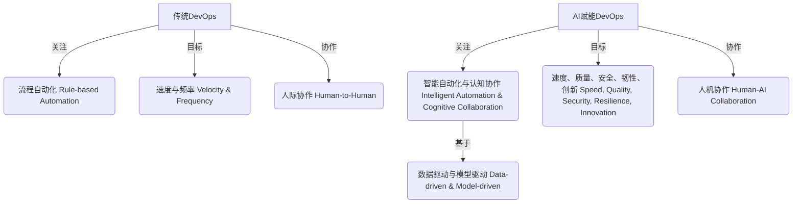

## 三、传统DevOps与AI赋能DevOps的全面对比

AI的融入并非简单地对传统DevOps进行增量改进，而是在多个维度上带来了质的飞跃。理解这两者之间的差异，有助于企业更好地规划其DevOps演进路径。

### 3.1 核心理念、生命周期与思维范式对比

| 特性         | 传统DevOps                                   | AI赋能DevOps (AI-Enhanced DevOps)                     |
| :----------- | :------------------------------------------- | :--------------------------------------------------- |
| **核心理念**   | CALMS (Culture, Automation, Lean, Measurement, Sharing) | CALMS + **Intelligence** (智能驱动、认知协作)        |
| **驱动力**     | 自动化 (Automation-driven)                   | 智能化、自治化 (Intelligence & Autonomy-driven)      |
| **思维范式**   | 流程为中心，规则驱动                         | 数据为中心，模型驱动，人机协作                       |
|              | 强调工具链的串联与效率                       | 强调知识的积累、洞察的发现与智能决策                 |
| **生命周期**   | 线性、阶段性优化                             | 迭代、自适应、全生命周期智能渗透                     |
|              | 自动化主要集中在CI/CD和测试                  | AI贯穿需求、设计、编码、测试、部署、运维全过程         |
| **协作模式**   | 人与人之间的协作，依赖标准化流程和工具         | 人与AI的认知协作，AI作为智能助手和决策伙伴           |
| **关注焦点**   | 提升交付速度和频率，减少手动错误               | 在速度和频率基础上，更强调质量、安全、韧性、创新和用户体验 |

**传统DevOps** 更侧重于通过工具和流程自动化来打破开发与运维之间的壁垒，实现快速、可靠的软件交付。其思维范式是以预定义的规则和脚本来驱动自动化，核心在于“让机器按指令工作”。

**AI赋能DevOps** 则在自动化的基础上引入了“智能”。它不仅仅是执行预设任务，更能从数据中学习、进行预测、自主决策，并与人类进行更深层次的认知协作。其思维范式转变为以数据和模型为中心，强调通过智能洞察来优化整个价值流。AI不再仅仅是工具，而是成为DevOps生态系统中的一个主动参与者和“认知引擎”。

### 3.2 工程实践与价值创造对比

| 方面         | 传统DevOps                                     | AI赋能DevOps                                         |
| :----------- | :--------------------------------------------- | :--------------------------------------------------- |
| **编码**     | 手动编码为主，辅以静态分析工具                   | AI辅助编码、代码生成、自动重构、智能代码审查             |
| **测试**     | 自动化测试脚本编写，依赖人工设计测试用例         | AI生成测试用例、智能模糊测试、预测性测试选择             |
| **CI/CD**    | 预设流水线，固定触发条件和部署策略               | 智能化流水线调度、风险预测、自适应部署策略               |
| **运维 (Ops)** | 基于阈值的监控告警，手动故障排除                 | AIOps：智能告警降噪、异常检测、预测性维护、自动化根因分析、自愈 |
| **安全 (Sec)** | 安全检查后置或部分左移，依赖人工审计和工具扫描   | DevSecOps+AI：AI驱动的SAST/DAST、实时威胁检测、自动化安全修复 |
| **可观测性** | 依赖日志、指标、追踪的收集与人工分析             | AI增强的可观测性：智能模式发现、关联分析、自然语言查询     |
| **基础设施** | 手动或脚本化IaC管理                            | AI辅助IaC生成与优化、漂移检测与自动修复                |
| **价值创造** | **效率提升**：减少重复劳动，加快交付速度         | **效率跃迁**：数量级提升开发和运维效率                 |
|              | **质量改进**：通过自动化测试减少缺陷             | **质量内生**：AI辅助设计、编码、测试，从源头提升质量       |
|              | **稳定性增强**：标准化部署，减少人为错误         | **韧性与自愈**：预测性维护，自动化故障恢复             |
|              | **成本节约**：主要通过减少人力成本               | **成本优化（FinOps）**：AI驱动的资源智能调度与成本控制     |
|              | **有限的创新**：开发者更多关注交付任务           | **创新加速**：解放开发者，使其更专注于高价值创新活动     |
| **工程师角色** | 专注于特定领域（开发、测试、运维），执行者角色 | 系统思考者、AI工具管理者、提示工程师、人机协作促进者     |

AI赋能的DevOps在几乎所有工程实践环节都引入了更高阶的智能。例如，在编码阶段，AI不仅能补全代码，还能生成整个函数或模块；在运维阶段，AIOps不仅能告警，还能预测故障并自动执行修复。这种深度的智能化带来了显著的价值跃迁，从简单的效率提升演变为质量、韧性、成本和创新能力的全面增强。

### 3.3 挑战、风险与应对策略对比

| 方面         | 传统DevOps                                     | AI赋能DevOps                                         |
| :----------- | :--------------------------------------------- | :--------------------------------------------------- |
| **技术挑战** | 工具链集成复杂性、自动化脚本维护成本高           | **AI模型质量与可靠性**：生成代码的正确性、幻觉问题       |
|              |                                                | **LLM不确定性与可解释性**：黑箱决策难以追溯             |
|              |                                                | **数据质量与偏见**：训练数据影响模型表现和公平性         |
|              |                                                | **集成复杂性**：AI工具与现有系统集成，API管理          |
| **组织文化** | 部门协作障碍、文化转型阻力                     | **技能差距**：需要新的AI相关技能（如提示工程、模型管理） |
|              |                                                | **人机协作模式磨合**：信任建立、职责划分               |
|              |                                                | **变革管理**：对现有流程和角色的冲击，引发焦虑和抵触     |
| **安全风险** | 传统应用安全漏洞、配置错误                     | **提示词注入（Prompt Injection）**、数据泄露（训练数据、输入输出） |
|              |                                                | **模型窃取与对抗性攻击**                             |
|              |                                                | **AI生成代码引入新漏洞**                             |
|              |                                                | **供应链安全**：依赖的AI模型或平台可能存在风险         |
| **成本风险** | 工具采购和维护成本                             | **GPU资源消耗**：模型训练和推理成本高昂                |
|              |                                                | **AI工具订阅费用**、API调用费用                        |
|              |                                                | **人才招聘与培训成本**                               |
| **伦理法律** | 相对较少                                       | **知识产权**：AI生成代码的版权归属                     |
|              |                                                | **责任界定**：AI决策失误导致的后果由谁承担             |
|              |                                                | **算法偏见与歧视**                                   |
| **应对策略** | 加强培训、选择合适的工具、逐步推进自动化         | **审慎引入与验证**：充分测试AI工具，建立质量门禁         |
|              |                                                | **统一治理与可观测性**：建立AI治理框架，监控模型表现     |
|              |                                                | **加强安全投入**：针对AI特有风险进行防护               |
|              |                                                | **FinOps实践**：精细化成本管理和优化                   |
|              |                                                | **持续学习与人才培养**：提升团队AI素养                 |
|              |                                                | **建立伦理审查机制**                                 |

虽然AI带来了巨大潜力，但也引入了新的、更复杂的挑战和风险。传统DevOps的挑战主要围绕工具链和组织协作，而AI赋能DevOps则面临AI模型本身带来的不确定性、安全漏洞、高昂成本以及伦理法律等问题。应对这些挑战需要更全面的治理框架、更强的技术能力和更深入的组织变革。

**案例研究对比 (示意)**

*   **传统DevOps案例 (如早期Netflix)**：通过自建工具链（如Asgard）和微服务架构，实现了快速部署和高可用性，但仍需大量工程师进行监控和故障排除。
*   **AI赋能DevOps案例 (如现代大型科技公司)**：
    *   **IBM**：利用Watson AIOps进行智能事件管理和异常检测，减少了85%的事件噪音，并将问题识别时间从几小时缩短到几分钟。
    *   **Airbnb**：使用AI进行代码审查、测试优化和个性化部署，提升开发效率和系统稳定性。
    *   **Facebook (Meta)**：广泛应用AI于代码推荐、缺陷预测、自动化测试和AIOps，支持其超大规模系统的快速迭代和稳定运行。
    *   **LinkedIn**：利用AI进行智能告警、容量规划和自动化修复，提升了网站的可靠性和用户体验。

这些案例表明，AI赋能的DevOps能够在传统DevOps的基础上，实现更高水平的自动化、智能化和效率提升。

---
