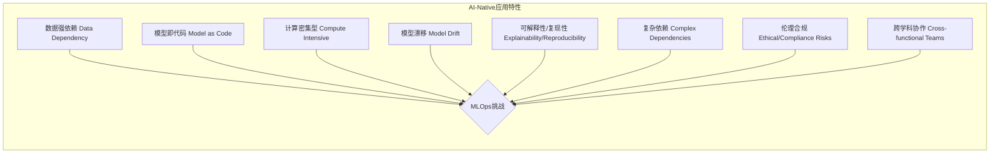

## 四、支持AI应用开发的专业化DevOps实践

随着AI技术的飞速发展，越来越多的应用本身就是基于AI/ML模型构建的（即AI-native应用）。这类应用的开发、部署和运维对传统的DevOps实践提出了新的要求。因此，发展一套专门支持AI应用开发的专业化DevOps实践（通常称为MLOps，但在此更强调与DevOps的融合视角）至关重要。

### 4.1 AI-native应用的特殊需求与挑战

AI-native应用与传统软件应用在生命周期、依赖关系和运维特性上存在显著差异，带来了独特的挑战：

*   **数据依赖性强**：AI模型的性能高度依赖于训练数据的质量和数量。数据预处理、特征工程、数据标注、数据版本控制和数据漂移检测成为关键环节。
*   **模型即代码（Model as Code）与实验性**：模型本身（包括其架构、参数、训练脚本）需要像代码一样进行版本控制和管理。模型开发过程充满实验性，需要快速迭代和追踪大量实验配置与结果。
*   **计算资源密集**：模型训练（尤其是深度学习模型）通常需要大量的GPU等计算资源，推理阶段也可能对延迟和吞吐量有较高要求。资源调度、优化和成本控制是重要考量。
*   **模型漂移与持续学习**：部署后的模型性能可能会随着时间的推移和数据分布的变化而下降（模型漂移）。需要建立监控机制，及时发现并触发模型的再训练和重新部署，实现持续学习。
*   **可解释性与可复现性**：理解模型为何做出特定预测（可解释性）以及能够复现模型的训练和推理结果（可复现性）对于调试、审计和合规至关重要。
*   **复杂的依赖关系**：AI应用不仅依赖代码，还依赖特定版本的数据集、模型、依赖库（如TensorFlow, PyTorch）以及硬件环境（如CUDA版本）。
*   **伦理与合规风险**：AI应用可能涉及偏见、隐私泄露、知识产权等伦理和法律问题，需要在开发和部署过程中加以考虑。
*   **跨学科团队协作**：AI应用的开发通常需要数据科学家、机器学习工程师、软件工程师和运维工程师等不同背景的专业人士紧密协作。

### 4.2 容器化和云原生AI应用部署策略

容器化（如Docker）和云原生技术（如Kubernetes）为解决AI应用部署和运维的复杂性提供了强大的支持，是专业化DevOps实践的核心组成部分：

*   **环境一致性与可移植性**：容器将应用代码、模型、依赖库和运行时环境打包在一起，确保了从开发、测试到生产环境的一致性，简化了部署，并实现了跨云和本地环境的可移植性。
*   **资源隔离与管理**：Kubernetes等容器编排平台能够有效地管理和调度GPU等稀缺资源，实现资源的隔离、共享和按需分配。
*   **弹性伸缩与高可用性**：云原生架构支持AI应用的弹性伸缩，根据实时负载自动调整推理服务的实例数量，确保高可用性和性能。
*   **标准化部署与版本控制**：通过Helm Charts或Kustomize等工具，可以标准化AI应用的部署描述，并将其纳入Git版本控制，实现GitOps驱动的模型部署。
*   **服务发现与负载均衡**：Kubernetes提供了内置的服务发现和负载均衡机制，简化了AI推理服务的暴露和访问。
*   **批处理与流式推理**：云原生平台可以支持不同类型的AI推理负载，包括大规模的批处理任务（如模型批量预测）和低延迟的流式实时推理。
*   **Serverless AI推理**：利用Knative、Kubeflow Serving或云厂商提供的Serverless平台（如AWS SageMaker Serverless Inference, Google AI Platform Prediction），可以实现AI推理服务的按需付费和自动扩缩容，进一步降低运维成本和复杂度。
*   **模型服务化框架**：使用如TensorFlow Serving, TorchServe, NVIDIA Triton Inference Server等专门的模型服务化框架，可以高效地将训练好的模型部署为生产级API服务，它们通常与容器和Kubernetes紧密集成。

**部署策略示例：**

1.  **模型打包**：将训练好的模型文件、推理代码和所有依赖项打包成Docker镜像。
2.  **镜像存储**：将Docker镜像推送到容器镜像仓库（如Docker Hub, AWS ECR, Google GCR）。
3.  **Kubernetes部署**：编写Kubernetes Deployment和Service YAML文件（或Helm Chart），定义推理服务的副本数、资源请求（CPU, GPU, 内存）、健康检查、服务暴露方式等。
4.  **GitOps流程**：将Kubernetes配置文件提交到Git仓库，通过ArgoCD或Flux等GitOps工具自动同步到Kubernetes集群，实现声明式部署。
5.  **监控与日志**：集成Prometheus、Grafana进行性能监控，ELK/EFK Stack进行日志收集和分析。
6.  **持续部署与回滚**：当新版本的模型或代码准备好后，更新Docker镜像和Kubernetes配置，通过GitOps触发滚动更新或蓝绿部署。如果出现问题，可以快速回滚到上一个稳定版本。

### 4.3 AI应用开发的安全性和合规性集成

AI应用的特殊性也带来了新的安全和合规挑战，需要在DevOps流程中专门应对：

*   **数据安全与隐私保护**：
    *   在数据采集、存储、处理和训练过程中，实施严格的访问控制和加密措施。
    *   对敏感数据进行脱敏、匿名化或使用差分隐私等技术。
    *   遵守GDPR、CCPA等数据保护法规。
*   **模型安全**：
    *   **对抗性攻击防护**：部署能够检测和防御针对模型的对抗性攻击（如在输入中添加微小扰动导致模型误判）的机制。
    *   **模型窃取防护**：保护模型知识产权，防止未经授权的复制和滥用。
    *   **后门攻击检测**：确保模型训练数据和过程中没有被植入恶意后门。
*   **代码与依赖项安全**：
    *   对AI应用的Python/R等代码进行静态和动态安全扫描。
    *   定期扫描和更新机器学习库（TensorFlow, PyTorch, scikit-learn等）及其依赖项，防范已知漏洞。
*   **提示词工程安全 (for LLM-based apps)**：
    *   **输入验证与过滤**：对用户输入进行严格校验，防止提示词注入、越狱等攻击。
    *   **输出审查**：对LLM的输出进行审查，防止生成有害、不当或泄露敏感信息的内容。
*   **基础设施安全**：确保模型训练和推理环境（如Kubernetes集群、GPU服务器）的安全性，遵循最小权限原则。
*   **可解释性与审计**：
    *   使用LIME、SHAP等工具提高模型决策的可解释性，便于排查问题和满足合规要求。
    *   记录模型训练过程、数据血缘、部署变更和推理日志，以备审计。
*   **偏见与公平性测试**：
    *   在模型开发和测试阶段，评估模型在不同人群或数据子集上的表现，识别和减轻潜在的偏见。
    *   确保AI应用的决策符合公平性原则。
*   **合规性自动化**：将安全和合规性检查（如数据隐私扫描、偏见检测、许可证合规性）集成到CI/CD流水线中，实现自动化验证。

通过将这些安全和合规措施深度集成到支持AI应用开发的DevOps流程中，可以构建更可信、更负责任的AI系统。

---
