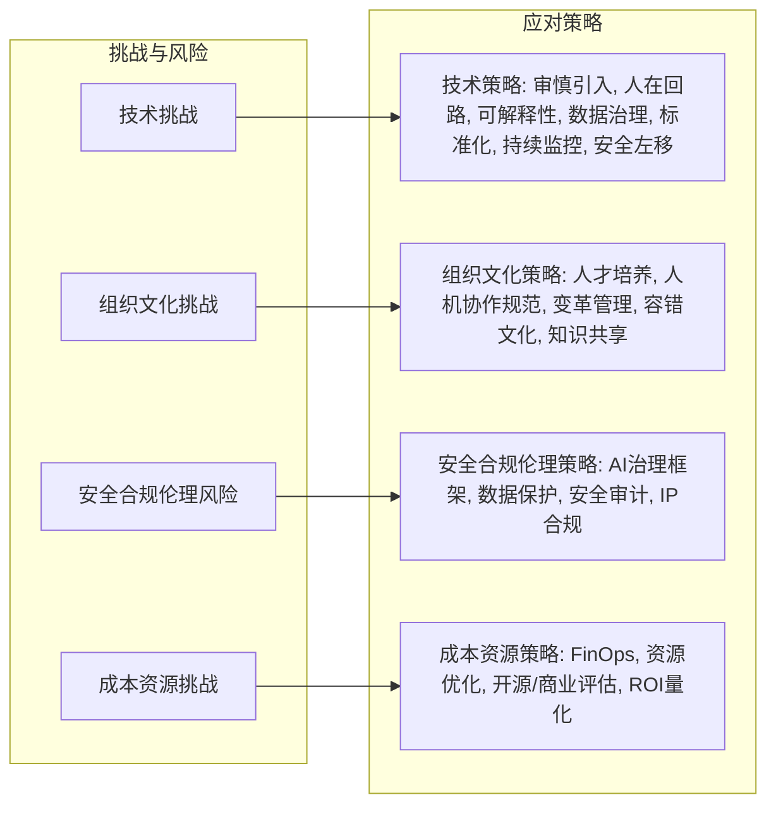

## 五、主要挑战、风险与应对策略

尽管AI为DevOps带来了革命性的潜力，但在实践过程中，企业和团队也会面临诸多挑战和风险。充分认识这些问题并制定有效的应对策略，是成功实施AI赋能DevOps的关键。

### 5.1 技术挑战与风险

*   **AI生成代码的质量与可靠性**：
    *   **挑战**：AI生成的代码可能存在逻辑错误、性能瓶颈、不符合编码规范或包含“幻觉”（hallucinations，即生成看似合理但实际错误的内容）。过度依赖AI可能导致开发者对代码的理解和掌控力下降。
    *   **风险**：引入难以发现的Bug，影响系统稳定性和可维护性；产生技术债务。
*   **大型语言模型（LLM）的不确定性与可解释性**：
    *   **挑战**：LLM的决策过程通常是“黑箱”，难以完全解释其生成特定代码或提出特定建议的原因。其输出具有一定的随机性和不确定性。
    *   **风险**：在关键决策点（如自动化修复、安全策略生成）依赖不可解释的模型可能导致灾难性后果；难以调试和优化模型行为。
*   **数据质量与偏见**：
    *   **挑战**：用于训练AI模型（尤其是AIOps模型或定制化编码助手）的数据质量直接影响模型性能。训练数据中存在的偏见可能被模型学习并放大。
    *   **风险**：模型产生错误或带有偏见的预测/建议，导致不公平的结果或系统性错误。
*   **集成复杂性与工具链碎片化**：
    *   **挑战**：将新的AI工具（如AI编码助手、AIOps平台）集成到现有的DevOps工具链和工作流程中可能非常复杂。市场上AI工具众多，标准不一，可能导致工具链进一步碎片化。
    *   **风险**：集成成本高，维护困难；数据孤岛，难以实现端到端的智能分析和自动化。
*   **模型漂移与持续维护**：
    *   **挑战**：部署后的AI模型（尤其是AIOps和MLOps中的模型）性能可能会随时间推移和环境变化而衰减（模型漂移）。需要持续监控、评估和再训练模型。
    *   **风险**：模型失效导致自动化决策错误，影响系统稳定性和效率。
*   **技术债务的潜在增加**：
    *   **挑战**：快速引入AI生成但未经充分审查的代码，或过度依赖特定AI工具可能引入新的技术债务。
    *   **风险**：长期维护成本增加，系统演进困难。

### 5.2 组织与文化挑战

*   **技能差距与人才短缺**：
    *   **挑战**：团队成员可能缺乏使用和管理AI工具所需的技能，如提示工程、数据分析、模型评估、AI伦理等。市场上具备这些综合技能的人才也相对稀缺。
    *   **风险**：AI工具无法得到有效利用，投资回报率低；项目进展缓慢。
*   **人机协作模式的磨合与信任建立**：
    *   **挑战**：开发者需要适应与AI助手共同工作的模式，学会信任AI的建议，同时保持批判性思维。AI的“黑箱”特性可能阻碍信任的建立。
    *   **风险**：AI工具被闲置或滥用；人机冲突导致效率下降。
*   **变革管理与文化阻力**：
    *   **挑战**：引入AI可能改变现有的工作流程、角色职责，甚至威胁到某些岗位的安全感，从而引发组织内部的焦虑和抵触情绪。
    *   **风险**：AI赋能DevOps的推行受阻，无法发挥预期效果。
*   **知识鸿沟与知识管理**：
    *   **挑战**：过度依赖AI可能导致团队成员对系统底层逻辑和细节的理解减弱。AI模型中蕴含的“知识”如何有效管理和传承也是一个问题。
    *   **风险**：关键知识流失，团队解决复杂问题的能力下降。
*   **对失败的容忍度**：
    *   **挑战**：AI系统并非完美，尤其在早期阶段可能会犯错。组织需要建立对AI尝试和失败的一定容忍度，并从中学习改进。
    *   **风险**：对AI的期望过高，一次失败可能导致整个项目的停滞。

### 5.3 安全、合规与伦理风险

*   **提示词注入与恶意利用 (Prompt Injection)**：
    *   **挑战**：攻击者可能通过精心构造的输入（提示词）来操纵LLM的行为，使其执行非预期操作、泄露敏感信息或生成有害内容。
    *   **风险**：数据泄露、系统被控、声誉受损。
*   **数据隐私与机密性**：
    *   **挑战**：在与AI工具交互（尤其是云端AI服务）或使用内部数据训练模型时，可能涉及敏感代码、配置信息或业务数据的传输和处理。
    *   **风险**：违反数据保护法规（如GDPR, CCPA），商业机密泄露。
*   **AI生成内容引入新漏洞**：
    *   **挑战**：AI生成的代码或配置可能无意中引入新的安全漏洞。
    *   **风险**：增加系统的攻击面。
*   **供应链安全风险**：
    *   **挑战**：依赖第三方AI模型、平台或库可能引入其自身的安全漏洞或后门。
    *   **风险**：整个系统面临来自供应链的威胁。
*   **知识产权与版权问题**：
    *   **挑战**：AI模型可能使用受版权保护的数据进行训练，其生成的代码或内容的版权归属尚不明确。
    *   **风险**：法律纠纷，使用受限。
*   **责任界定与问责制**：
    *   **挑战**：当AI系统（如自动化部署、自愈系统）做出错误决策并导致损失时，责任难以界定。
    *   **风险**：缺乏问责机制，难以从错误中学习和改进。
*   **算法偏见与歧视**：
    *   **挑战**：AI模型可能因训练数据或算法设计中的偏见而产生歧视性结果，例如在代码审查或问题分配中对特定人群不利。
    *   **风险**：损害公平性，引发社会和法律问题。

### 5.4 成本与资源挑战

*   **GPU等计算资源的高昂成本**：
    *   **挑战**：训练和运行先进的AI模型（尤其是LLM和深度学习模型）需要大量昂贵的GPU资源。
    *   **风险**：AI项目预算超支，投资回报不确定。
*   **AI工具的订阅与API调用费用**：
    *   **挑战**：许多商业AI工具采用订阅模式或按API调用量计费，大规模使用可能导致高昂的运营成本。
    *   **风险**：成本失控，难以规模化推广。
*   **人才招聘与培训成本**：
    *   **挑战**：具备AI和DevOps双重技能的人才薪资较高，对现有团队进行AI技能培训也需要投入。
    *   **风险**：人力成本显著增加。
*   **数据存储与管理成本**：
    *   **挑战**：AI应用通常需要处理和存储大量数据（训练数据、模型、日志等），带来额外的存储和管理开销。
    *   **风险**：存储成本持续增长。

### 5.5 应对策略与最佳实践

面对上述挑战和风险，企业可以采取以下策略和实践：

*   **技术层面**：
    *   **审慎引入与充分验证**：从小处着手，选择合适的AI工具进行试点，对AI生成的内容进行严格的测试和人工审查，建立质量门禁。
    *   **“人在回路”（Human-in-the-Loop）**：在关键决策点保留人工审核和干预环节，尤其是在AI系统成熟度不高或风险较高的场景。
    *   **关注可解释性与透明度**：尽可能选择或构建具有一定可解释性的AI模型，记录决策过程，便于调试和审计。
    *   **数据治理与偏见缓解**：建立完善的数据收集、清洗、标注和管理流程，定期审计数据和模型以发现和减轻偏见。
    *   **标准化与平台化**：通过平台工程提供标准化的AI工具和服务，避免工具链过度碎片化，降低集成和维护成本。
    *   **持续监控与反馈循环**：对AI模型的性能进行持续监控，建立反馈机制，及时进行模型更新和再训练。
    *   **安全左移与深度防御**：将AI安全考虑融入DevOps生命周期的早期阶段，采用多层防御策略应对AI特有的安全威胁。
*   **组织与文化层面**：
    *   **投资于人才培养与技能提升**：提供AI相关的培训和学习资源，鼓励团队成员学习新技能，培养跨学科的“AI+DevOps”人才。
    *   **建立清晰的人机协作规范**：明确AI与人类在各项任务中的职责分工和协作流程，促进信任和高效协同。
    *   **加强变革管理与沟通**：向团队清晰传达引入AI的目标、价值和影响，积极回应疑虑，争取广泛支持。
    *   **鼓励实验与容错文化**：营造允许尝试和从失败中学习的环境，推动AI应用的迭代创新。
    *   **知识共享与最佳实践沉淀**：建立知识库，分享AI工具使用经验和成功案例。
*   **安全、合规与伦理层面**：
    *   **建立AI治理框架**：制定AI应用的伦理准则、安全策略和合规流程，明确责任主体。
    *   **加强数据安全与隐私保护**：采用加密、脱敏等技术保护敏感数据，遵守相关法律法规。
    *   **定期进行安全审计与风险评估**：针对AI系统进行专门的安全测试和风险评估。
    *   **关注并遵守知识产权法规**：了解所使用AI工具和模型的数据来源和许可协议。
*   **成本与资源层面**：
    *   **实施FinOps实践**：将成本意识融入AI应用的整个生命周期，精细化管理云资源和AI服务支出。
    *   **优化资源利用**：采用按需分配、弹性伸缩、资源共享等策略，提高GPU等昂贵资源的利用率。
    *   **评估开源与商业工具**：根据实际需求和预算，在开源AI工具和商业解决方案之间进行权衡。
    *   **量化AI投入的ROI**：设定明确的业务目标和衡量指标，评估AI赋能DevOps带来的实际价值。

通过系统性地识别风险、制定周全的应对策略，并结合持续的监控和改进，企业可以更安全、更有效地利用AI来增强其DevOps能力，最终实现预期的业务价值。

---
