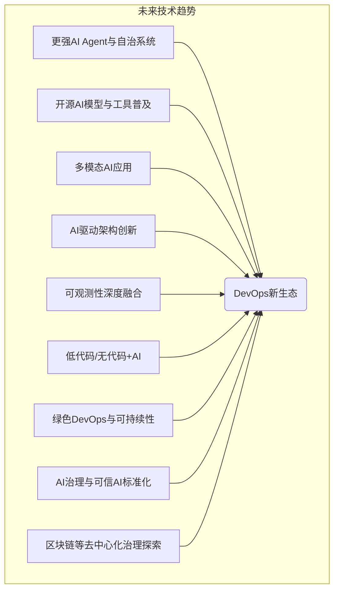

## 六、未来发展趋势与结论

AI赋能的DevOps正处在快速发展的初期，其未来充满了令人兴奋的可能性。随着AI技术的不断进步和应用场景的持续深化，我们可以预见以下主要发展趋势，并基于此提出相应的组织变革建议，最终共同构建一个更加智能、高效、可信和自适应的DevOps新生态。

### 6.1 技术发展方向与趋势

*   **更强大的AI Agent与自治系统**：
    *   未来的AI Agent将不仅仅是执行预设任务的工具，而是具备更强自主学习、推理、规划和协作能力的“数字同事”。它们能够在整个SDLC中承担更复杂的角色，例如自主设计和优化CI/CD流水线、主动进行代码重构和性能优化、甚至在一定程度上自主响应业务需求变化。
    *   AIOps将向“AIOps 2.0”或“自治运维”演进，系统不仅能预测和诊断故障，更能自主完成大部分修复工作，实现高度的自愈和自适应能力。
*   **开源AI模型与工具的普及**：
    *   随着Llama、Mistral等高质量开源大语言模型的涌现，以及相关开源工具（如LangChain, Ollama, vLLM）的成熟，企业将有更多机会构建和定制符合自身需求的AI编码助手和DevOps智能工具，降低对商业闭源方案的依赖，提升灵活性和可控性。
    *   社区驱动的AI模型和工具创新将加速，形成更加开放和繁荣的生态。
*   **多模态AI在DevOps中的应用**：
    *   未来的AI工具可能不仅仅处理文本（代码、日志、文档），还能理解和生成图像（如架构图、UI设计稿）、语音（如通过语音指令与AI交互）等多种模态的信息，为DevOps带来更丰富的交互方式和更全面的洞察力。
    *   例如，开发者可以通过绘制草图让AI生成前端代码，或者通过语音描述问题让AI辅助排查故障。
*   **AI驱动的架构创新与演进**：
    *   AI可能会参与到软件架构的设计和演化中，例如根据业务需求和非功能性需求（如性能、可扩展性、成本）智能推荐或生成合适的架构模式（如微服务、事件驱动、Serverless）。
    *   AI也可以分析现有系统的架构，识别潜在的瓶颈和风险，并提出重构建议。
*   **可观测性的深度融合与智能洞察**：
    *   AI将进一步提升系统的可观测性，不仅能从日志、指标、追踪中提取信息，更能将这些信息与代码变更、部署事件、业务指标等关联起来，提供更深层次的、面向业务的智能洞察。
    *   自然语言查询（NLQ）将成为与可观测性数据交互的主要方式，使非专业人员也能轻松获取所需信息。
*   **低代码/无代码平台与AI的结合**：
    *   AI将进一步降低软件开发的门槛，通过与低代码/无代码平台的深度融合，使业务人员也能参与到应用的构建和迭代中，实现真正的“全民开发”。
    *   DevOps流程需要适应这种更广泛的参与者和更快速的迭代周期。
*   **绿色DevOps与可持续性**：
    *   AI可以帮助优化IT基础设施的能源消耗，例如通过智能调度工作负载、优化代码执行效率、预测和管理数据中心能耗，助力实现绿色计算和可持续发展目标。
    *   FinOps与GreenOps的结合将更加紧密。
*   **AI治理与可信AI的标准化**：
    *   随着AI在DevOps中扮演越来越重要的角色，对AI的治理（包括安全性、公平性、透明度、可解释性、问责制）将变得至关重要。相关的标准、法规和最佳实践将逐步建立和完善。
    *   “可信AI”将成为评估AI赋能DevOps方案的核心指标。
*   **区块链等去中心化技术在治理中的探索**：
    *   在某些特定场景下，区块链等去中心化技术可能被探索用于增强AI模型和数据的溯源、审计和权限管理，提升透明度和可信度，例如在多方参与的开源模型训练或联邦学习场景。

### 6.2 组织变革与实施建议

为了抓住AI赋能DevOps带来的机遇并有效应对挑战，企业需要在组织层面进行相应的变革和调整：

*   **拥抱持续学习与技能重塑文化**：
    *   鼓励并投入资源支持团队成员学习AI相关知识和技能（如提示工程、数据素养、AI伦理）。
    *   营造允许实验、容忍失败、快速迭代的学习型组织文化。
*   **重新定义角色与职责**：
    *   随着AI承担更多重复性任务，开发者、测试工程师、运维工程师的角色将向更高价值的活动（如系统设计、创新、AI工具管理、人机协作优化）转变。
    *   可能出现新的角色，如AI DevOps工程师、AIOps专家、提示工程师、AI治理专员等。
*   **构建跨职能的融合团队**：
    *   打破传统部门壁垒，组建包含软件工程师、数据科学家、ML工程师、运维专家、安全专家和业务分析师的跨职能团队，共同推进AI在DevOps中的应用。
*   **建立以数据为中心的思维模式**：
    *   将数据视为核心资产，建立完善的数据收集、治理和分析体系，为AI模型的训练和DevOps决策提供高质量的数据支持。
*   **渐进式引入与价值驱动**：
    *   避免一步到位的大规模变革。从痛点最明显、最容易产生价值的场景入手，小范围试点AI工具和实践，逐步积累经验，验证效果后再推广。
    *   始终以业务价值为导向，确保AI的投入能够带来实际的效率提升、质量改进或成本节约。
*   **强化AI治理与风险管理**：
    *   建立专门的AI治理委员会或工作组，制定AI应用的伦理准则、安全策略和合规流程。
    *   定期对AI系统进行风险评估和审计，确保其安全、可靠、公平和透明。
*   **选择合适的合作伙伴与生态系统**：
    *   积极与AI技术提供商、咨询机构和开源社区合作，获取外部专业知识和资源支持。
    *   关注行业最佳实践和新兴趋势，保持开放和学习的心态。
*   **领导层的支持与推动**：
    *   AI赋能DevOps是一项系统性工程，需要高层领导的充分理解、坚定支持和持续投入，以克服转型过程中的阻力。

### 6.3 结论：构建可信、智能、自适应的DevOps新生态

AI，特别是AI编码技术，正在以前所未有的力量重塑DevOps的版图。它不仅仅是工具的革新，更是思维范式、协作模式、价值创造方式乃至组织文化的深刻变革。从自动化到智能化，再到未来的自治化，AI正驱动DevOps迈向一个全新的发展阶段。

通过将AI深度融入软件开发生命周期的各个环节——从智能编码辅助、自动化测试、智能化CI/CD，到平台工程的AI增强、AIOps驱动的智能运维、AI加持的DevSecOps，再到MLOps与DevOps的融合以及AI治理框架的建立——企业能够显著提升开发效率、保障软件质量、增强系统韧性、优化资源成本，并最终加速业务创新和价值交付。

然而，这条通往未来的道路并非没有挑战。AI生成代码的质量风险、模型的不确定性、数据安全与隐私、技能差距、高昂的成本以及伦理合规等问题，都需要我们审慎对待，并制定有效的应对策略。这要求我们不仅要拥抱技术创新，更要关注组织文化的适配、人才能力的培养以及治理体系的构建。

展望未来，AI Agent的崛起、开源AI生态的繁荣、多模态AI的应用以及AI驱动的架构创新等趋势，将进一步拓展AI赋能DevOps的边界。成功的关键在于以人为本，将AI视为增强人类智慧和能力的强大伙伴，而非简单的替代品。通过构建人机协同、数据驱动、持续学习的机制，我们能够逐步克服挑战，最大限度地发挥AI的潜力。

最终，我们的目标是构建一个**可信、智能、自适应的DevOps新生态**。在这个生态中，AI与人类开发者紧密协作，软件系统能够更快速、更可靠、更安全地响应变化，持续创造价值，并以更可持续的方式运行。这不仅是技术演进的必然趋势，也是企业在数字化浪潮中保持竞争力的核心要素。拥抱AI，重塑DevOps，正是通往这一未来的关键路径。