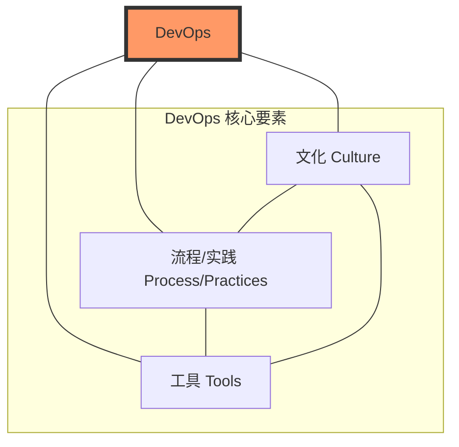
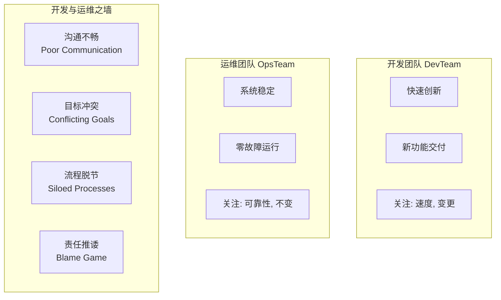
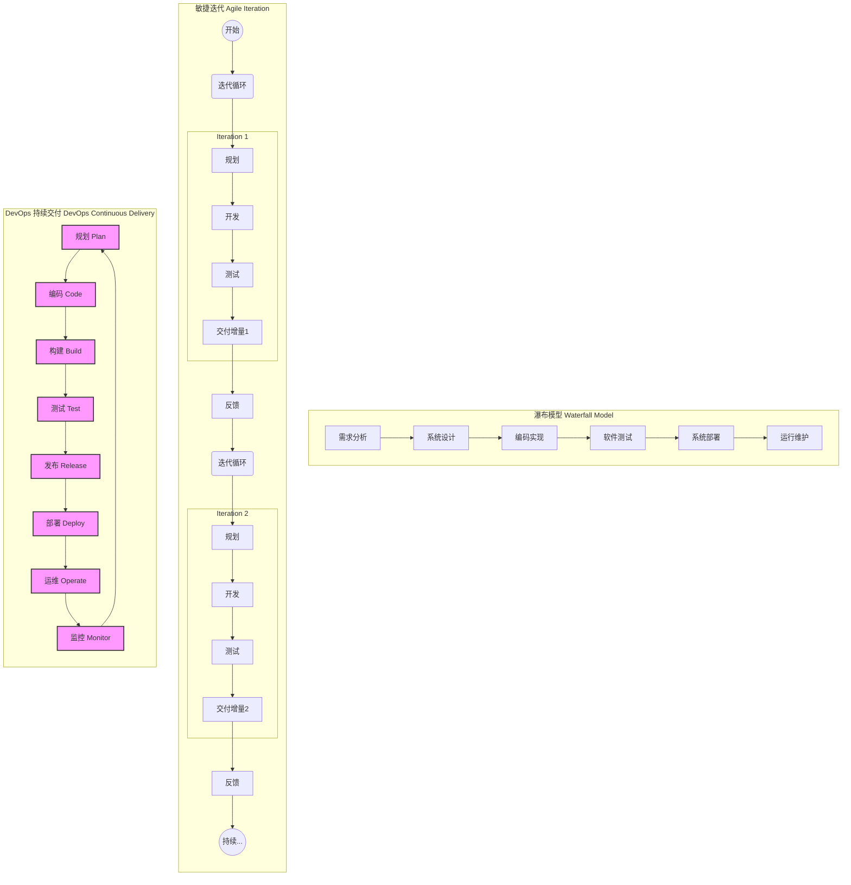

# 第一章 DevOps 导论

在当今快速迭代的数字化时代，软件已成为驱动业务创新和增长的核心引擎。然而，传统的软件开发与交付模式在应对市场快速变化、满足用户持续需求方面显得力不从心。DevOps 作为一种旨在打破传统壁垒、提升软件交付效率和质量的文化理念、实践方法及工具集合应运而生，并迅速成为行业主流趋势。本章将深入探讨 DevOps 的诞生背景、核心理念、演进历程以及它所带来的革命性价值。

## 1.1 DevOps 的定义与核心理念

DevOps 一词由 Development（开发）和 Operations（运维）组合而成，其核心目标是打破开发团队和运维团队之间的传统壁垒，促进他们之间的沟通、协作与整合。它不仅仅是一系列技术和工具的堆砌，更是一场深刻的文化变革和思维模式的转变。

**DevOps 的核心定义：**
DevOps 是一系列文化理念、实践方法和自动化工具的集合，旨在通过自动化的方式实现软件的快速、可靠交付和持续优化，从而更快地为客户和业务创造价值。其核心在于人（文化）、流程（实践）和技术（工具）的协同作用：
*   **文化（Culture）：** 强调共享责任、信任、透明沟通、持续学习和以客户为中心。
*   **实践（Practices）：** 包括持续集成（CI）、持续交付/部署（CD）、基础设施即代码（IaC）、监控与日志、自动化测试等一系列技术和管理实践。
*   **工具（Tools）：** 利用各种自动化工具链来支持 DevOps 实践的落地，覆盖从代码管理、构建、测试、部署到监控的整个生命周期。

**DevOps 的三大支柱 (或核心要素):**

**核心价值主张：**
DevOps 的核心价值在于通过协作、自动化和持续改进，加速高质量软件的交付。其目标包括：
*   **加速价值流动 (Velocity/Flow)：** 缩短从代码提交到生产上线的周期（Lead Time），更快响应市场需求。
*   **提升质量与可靠性 (Quality & Reliability)：** 通过自动化测试、持续反馈、渐进式发布等手段，构建韧性系统，减少故障，提升用户满意度。
*   **增强协作与信任 (Collaboration/Culture)：** 打破部门墙，建立共享目标、共同责任、透明沟通的“你构建，你运行”文化。
*   **优化资源效率 (Efficiency)：** 自动化重复劳动，按需弹性伸缩资源，降低运维成本。
*   **赋能创新与实验 (Experimentation)：** 低风险发布支持快速试错，数据驱动决策，加速创新迭代。

> **核心价值公式：DevOps价值 = f(速度, 质量, 文化, 效率, 创新)**

DevOps 的核心原则通常可以用 **CALMS** 模型来概括：
*   **C**ulture (文化)：信任、协作、共享责任、持续学习、包容失败。
*   **A**utomation (自动化)：一切可自动化的都应自动化。
*   **L**ean (精益)：识别并消除价值流中的浪费，小批量交付，持续优化。
*   **M**easurement (度量)：数据驱动决策，监控关键指标。
*   **S**haring (分享)：知识共享、工具共享、经验教训共享。

## 1.2 DevOps 的起源与演进历程

DevOps 的诞生是软件行业应对日益增长的复杂度、追求更高效率和质量的必然结果。

**传统软件交付之痛：瀑布模型与孤岛困境**
在 DevOps 理念普及之前，瀑布模型（Waterfall Model）长期占据主导地位。该模型将软件开发过程划分为线性、顺序的阶段（需求分析 → 系统设计 → 编码实现 → 测试 → 部署 → 维护）。

*   **僵化的流程与漫长的交付周期：** 瀑布模型反馈延迟、变更成本高昂，风险后期集中爆发。
*   **开发与运维的“墙”：** 开发（Dev）追求快速交付新功能，运维（Ops）追求系统稳定，目标冲突、信息断层、工具链割裂、责任推诿现象普遍存在，形成了所谓的“开发与运维之间的墙”。

*   **业务响应迟钝：** 冗长的交付周期使软件上线即可能过时，丧失竞争优势。

**敏捷的崛起及其局限性**
为了应对瀑布模型的挑战，敏捷（Agile）开发方法应运而生，强调迭代、协作、快速反馈和持续改进。敏捷极大地提升了开发团队的响应速度，但其成功主要集中在软件开发阶段，开发与运维之间的“墙”依然存在，形成了“敏捷开发，瀑布运维”的局面，交付的“最后一公里”问题凸显。

**DevOps 的应运而生**
DevOps 运动起源于 2007-2009 年间的一系列讨论和活动：
*   **关键人物与事件：**
    *   比利时IT顾问 Patrick Debois 在2007年亲身体验开发与运维的冲突，开始思考“敏捷基础设施”。
    *   2008年，Andrew Clay Shafer 提出“敏捷基础设施”议题。
    *   2009年，Flickr 的 John Allspaw 和 Paul Hammond 发表了“每天10次以上部署：Flickr的开发与运维协作”的演讲，展示了高效协作的成功案例。
    *   同年，Patrick Debois 在比利时根特组织了第一届 DevOpsDays 大会，正式创造并推广了“DevOps”一词。
*   **灵感来源：** DevOps 借鉴和融合了多种成熟的管理思想和实践，包括精益制造（Lean Thinking）、敏捷思想（Agile Thinking）和IT服务管理（ITSM，如ITIL）。

**传统瀑布模型 vs. 敏捷迭代 vs. DevOps 持续交付流程对比**

## 1.3 为何选择 DevOps？解决的痛点与目标

企业采纳和实施 DevOps 的根本驱动力在于其能够解决传统模式的痛点，并带来显著的业务价值和竞争优势。

**解决的痛点：**
*   **交付周期长，响应慢：** 传统模式下，新功能上线或问题修复耗时久，无法快速响应市场变化和用户需求。
*   **质量与速度的矛盾：** 追求速度往往牺牲质量，反之亦然，难以兼顾。
*   **变更的恐惧：** 手动操作多，发布风险高，导致团队对变更持保守态度。
*   **部门孤岛与沟通不畅：** 开发、运维、测试等团队间目标不一致，协作困难，效率低下。
*   **高昂的失败成本：** 问题发现晚，修复成本高，系统不稳定导致业务损失。

**DevOps 的目标与带来的收益：**
*   **加速价值交付 (Velocity)：** 显著缩短交付周期，提高发布频率，更快地将新功能和改进推向市场。
*   **提升软件质量与可靠性 (Quality & Reliability)：** 内置质量，自动化测试，降低发布风险，提升系统稳定性，减少生产事故。
*   **促进团队协作与沟通 (Collaboration)：** 打破隔阂，促进知识共享和共同承担责任，提升整体效率和员工满意度。
*   **降低风险与成本 (Risk & Cost Reduction)：** 自动化减少人为错误，小批量发布降低风险，早期发现问题降低修复成本，优化运营成本。
*   **增强业务敏捷性与创新能力 (Business Agility & Innovation)：** 支持快速试验新想法，获取市场反馈，驱动业务持续创新。

**量化效益标杆 (参考 DORA 报告及业界实践)：**

| 指标                | 传统模式         | DevOps高效组织     | 提升潜力 |  
|---------------------|------------------|---------------------|---------|  
| 部署频率 (Deployment Frequency) | 数月/次          | 数天/小时/分钟/次   | 数十至数百倍 |  
| 变更前置时间 (Lead Time for Changes) | 数周/月          | 分钟/小时           | 数十至数百倍 |  
| 服务恢复时间 (Mean Time To Restore - MTTR) | 小时/天级        | 分钟级              | 数倍至数十倍 |  
| 变更失败率 (Change Failure Rate) | 较高 (如15%-40%) | 较低 (如0%-15%)     | 显著降低 |  

通过拥抱 DevOps，企业能够构建起高效、可靠的软件交付能力，从而在激烈的市场竞争中赢得先机，实现可持续发展。

---
