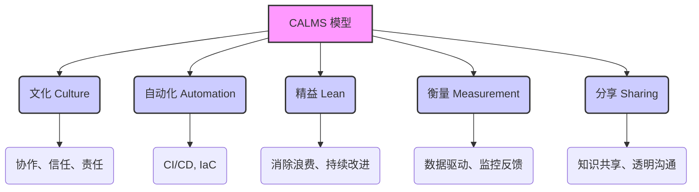
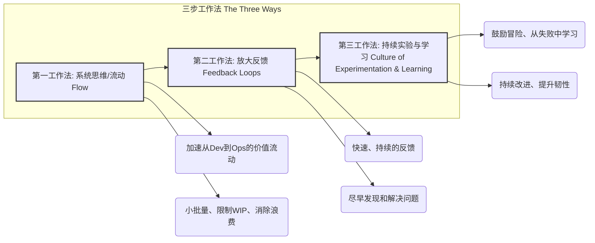

# 第二章：DevOps 核心原则与文化基础

DevOps 不仅仅是一套工具或流程的集合，其核心在于深刻的文化变革和一套指导性的原则。这些原则和文化共同构成了 DevOps 成功的基石，使得组织能够打破传统壁垒，实现高效协作，并持续交付价值。

## 2.1 CALMS 模型：DevOps 的五个支柱

CALMS 模型是理解和实施 DevOps 的一个重要框架，它代表了五个关键方面：文化（Culture）、自动化（Automation）、精益（Lean）、衡量（Measurement）和分享（Sharing）。

*   **文化 (Culture)**：这是 DevOps 的核心。强调建立一种开放、信任、协作和共担责任的文化。鼓励跨团队沟通，打破开发（Dev）和运维（Ops）之间的壁垒，以及其他相关团队（如测试、安全）之间的隔阂。领导层的支持和榜样作用至关重要。
*   **自动化 (Automation)**：尽可能地自动化重复性任务，以减少人为错误、提高效率和一致性。这包括构建、测试、部署、配置管理等各个环节。自动化使得团队能够更专注于价值创造活动。
*   **精益 (Lean)**：借鉴精益制造的思想，专注于消除浪费、优化流程、小批量交付和持续改进。通过识别和消除价值流中的瓶颈和不必要的步骤，提升整体效率和响应速度。
*   **衡量 (Measurement)**：通过收集和分析关键指标来理解系统性能、流程效率和客户满意度。数据驱动的决策有助于识别改进机会，验证变更效果，并确保与业务目标一致。例如 DORA 指标（部署频率、变更前置时间、变更失败率、平均恢复时间）。
*   **分享 (Sharing)**：鼓励知识、经验、工具和最佳实践在组织内部的共享。通过透明的沟通和协作平台，促进团队间的学习和共同成长，打破信息孤岛。

## 2.2 DevOps 三步工作法 (The Three Ways)

由 Gene Kim 等人在《DevOps Handbook》中提出的“三步工作法”是指导 DevOps 实践的核心原则，旨在创建快速、可靠和可持续的价值交付流程。

### 2.2.1 第一工作法：系统思维 (The Principles of Flow)

第一工作法强调从全局视角看待价值交付流程，从业务需求到客户价值实现，确保整个系统的顺畅流动。核心在于：

*   **理解和可视化价值流**：识别从需求提出到价值交付给最终用户的所有步骤。
*   **减少批量大小 (Small Batch Sizes)**：通过小批量、高频率的交付，降低风险，加速反馈，提高灵活性。
*   **限制在制品 (WIP - Work In Progress)**：避免过多的并行任务，减少上下文切换，提高专注度和吞吐量。
*   **消除瓶颈和浪费**：识别并解决流程中的瓶颈，消除不必要的等待、返工和手动操作。
*   **构建质量**：将质量内建于流程的每个阶段，而不是在最后进行检查。

目标是最大化工作从左到右（从开发到运维再到客户）的流动速度，减少交付周期。

### 2.2.2 第二工作法：放大反馈回路 (The Principles of Feedback)

第二工作法强调创建快速、持续和高质量的反馈回路，以便尽早发现和解决问题，并从错误中学习。核心在于：

*   **快速反馈**：在流程的每个阶段建立反馈机制，例如自动化测试、监控告警、代码审查等。
*   **放大信号**：确保问题和风险能够被及时发现并传递给相关人员，避免问题被掩盖或延迟处理。
*   **从源头解决问题**：鼓励团队在问题发生的地方立即解决，而不是将其传递到下游。
*   **知识共享和学习**：通过反馈促进团队学习和改进，将经验教训融入未来的工作中。

目标是缩短和放大从右到左（从客户和运维到开发）的反馈循环，使团队能够快速响应变化和问题。

### 2.2.3 第三工作法：持续实验与学习的文化 (The Principles of Continual Experimentation and Learning)

第三工作法强调建立一种鼓励冒险、实验、从失败中学习并持续改进的文化。核心在于：

*   **鼓励承担风险和创新**：允许团队进行小范围的实验，探索新的方法和技术。
*   **从失败中学习**：将失败视为学习和改进的机会，而不是惩罚的原因。进行“无指责事后分析”（Blameless Post-mortems）。
*   **分配时间进行改进**：鼓励团队投入时间进行流程优化、技能提升和工具改进（例如，通过“改进日”或“黑客马拉松”）。
*   **重复和练习**：通过不断的练习和重复，将最佳实践内化为团队的习惯。
*   **制度化改进**：将学习到的经验和改进措施固化到标准流程和工具中。

目标是创造一种高信任度的文化，支持动态的、纪律严明的科学实验，从而不断提升组织的能力和韧性。

## 2.3 协作与信任的文化基石

DevOps 的成功在很大程度上依赖于建立一种强大的协作与信任文化。这不仅仅是口号，而是需要通过具体的实践和行为来培养。

*   **共同的目标和责任 (Shared Goals and Responsibilities)**：开发、运维和其他团队需要对应用的整个生命周期共同负责，共享成功的喜悦和失败的教训。目标应该是一致的，即为客户提供稳定、高质量的服务。
*   **打破组织孤岛 (Breaking Down Silos)**：传统的组织结构常常导致开发和运维之间存在“墙”，信息不畅，目标冲突。DevOps 倡导跨职能团队，鼓励不同角色的人员紧密合作，共同解决问题。
*   **透明沟通 (Transparent Communication)**：开放、诚实和及时的沟通是建立信任的基础。使用共享的工具和平台，确保信息对所有相关人员可见。
*   **心理安全 (Psychological Safety)**：创造一个环境，让团队成员敢于提出问题、承认错误、尝试新事物，而不用担心受到指责或惩罚。这是创新和持续改进的前提。
*   **赋能与授权 (Empowerment and Ownership)**：赋予团队成员决策权和自主权，让他们对自己的工作负责。这能激发积极性和创造力。
*   **持续学习与改进 (Continuous Learning and Improvement - Kaizen)**：将持续改进（改善）作为一种常态。鼓励团队不断反思、学习新技能、优化流程，追求卓越。
*   **尊重与同理心 (Respect and Empathy)**：团队成员之间以及不同团队之间需要相互尊重，理解对方的挑战和视角。这有助于建立更强的合作关系。

文化的转变是一个持续的过程，需要领导层的坚定支持、所有成员的积极参与以及对新工作方式的不断适应和优化。没有强大的文化基础，即使拥有最先进的工具和流程，DevOps 的潜力也难以充分发挥。

---
