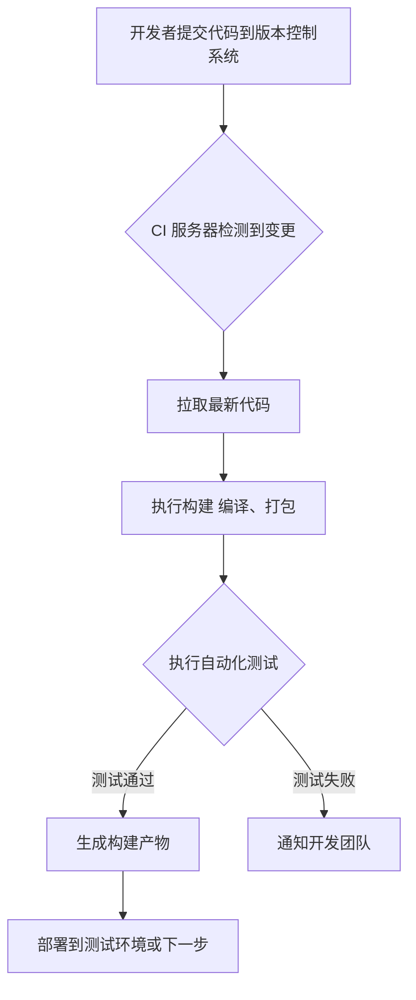
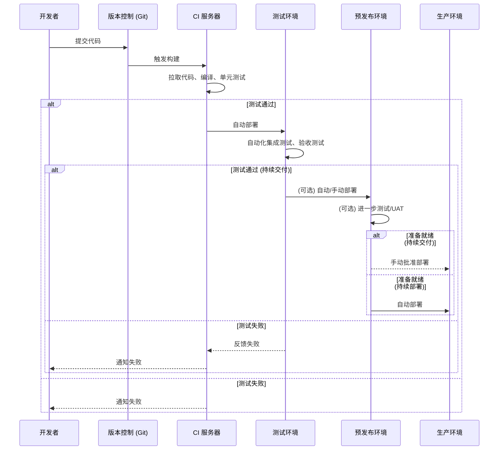
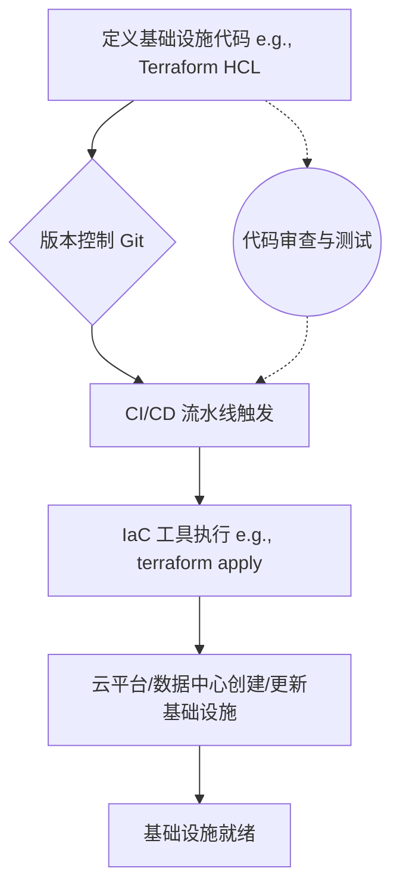
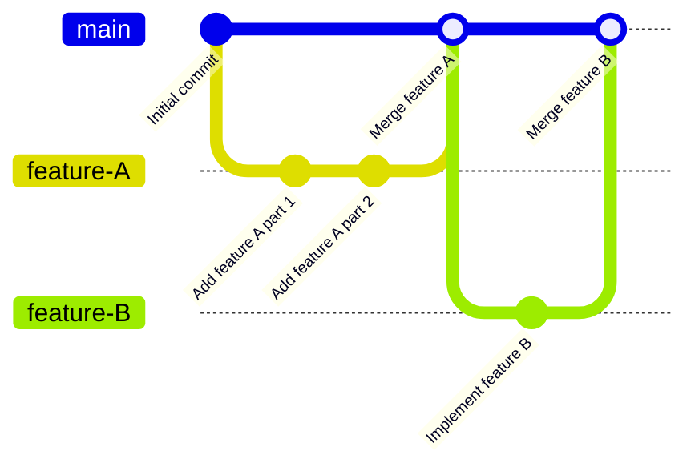
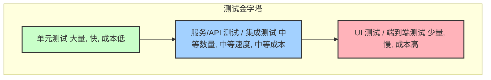
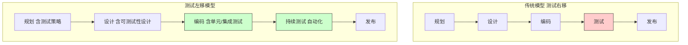
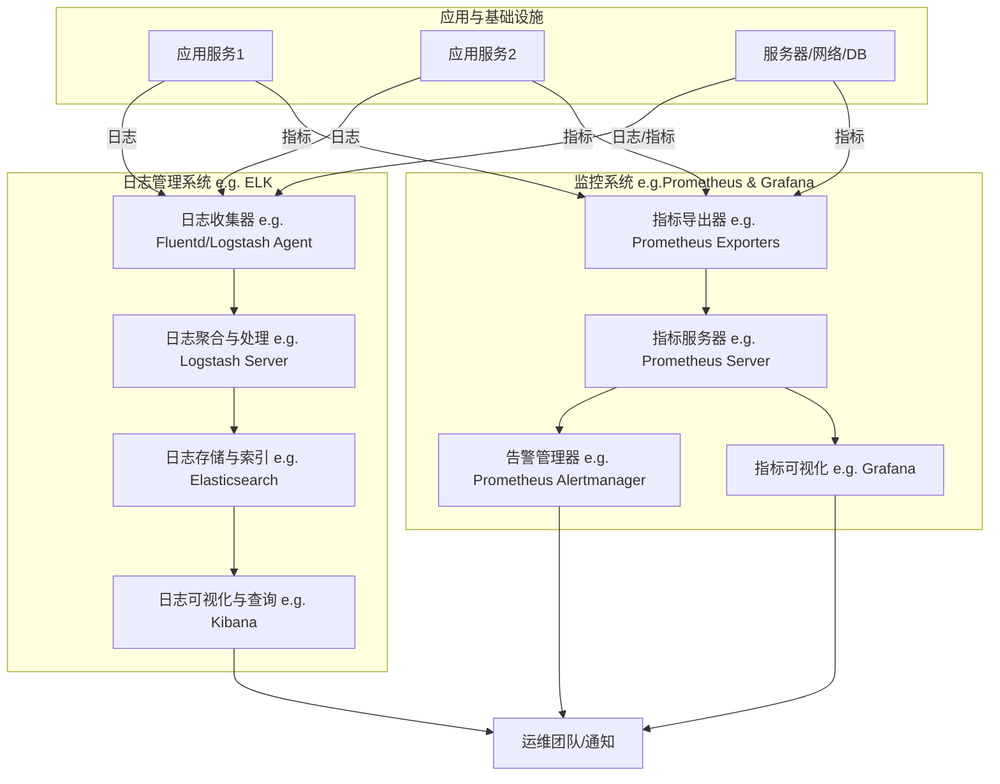
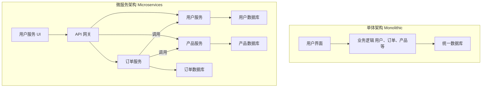
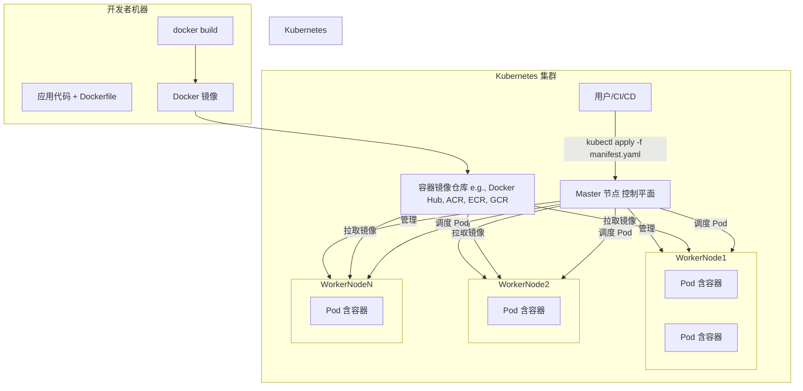
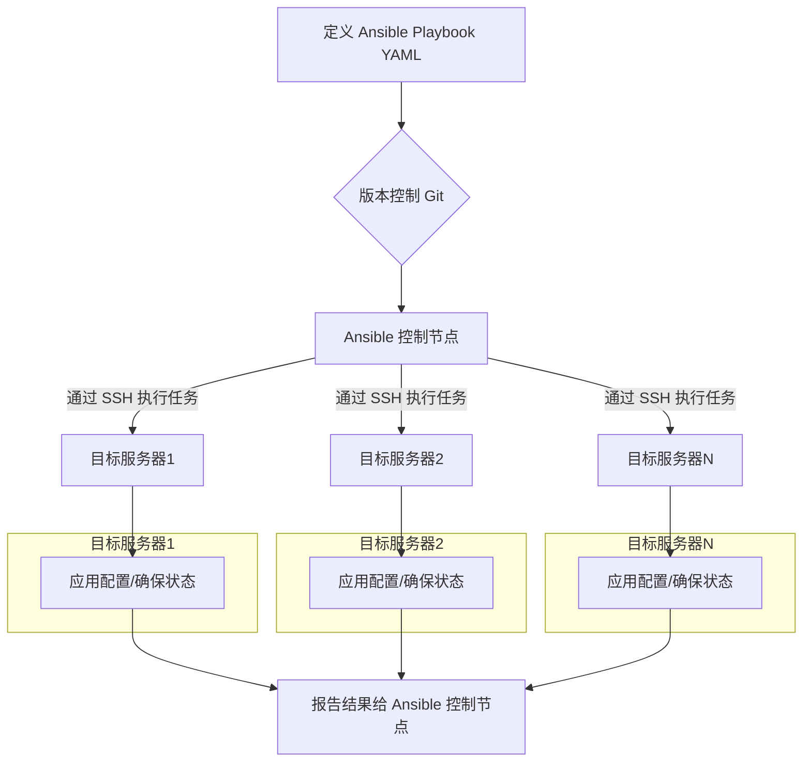

# 第三章：DevOps 的关键实践与技术栈

DevOps 的成功实施依赖于一系列关键实践和支撑技术栈的协同工作。这些实践旨在打破孤岛、自动化流程、提升效率和质量，并最终加速价值交付。本章将详细探讨各项核心实践及其相关的技术选型。

## 3.1 持续集成 (Continuous Integration - CI)

持续集成是一种软件开发实践，团队成员频繁地将其代码更改集成到共享的主干（通常是 Git 仓库的 master/main 分支）。每次集成都会通过自动化的构建和测试来验证，从而尽早发现和修复集成错误。

**核心目标：**
*   **快速反馈：** 尽早发现和定位错误，减少修复成本。
*   **减少集成问题：** 频繁小批量集成，避免“集成地狱”。
*   **提高代码质量：** 自动化测试保障代码质量。
*   **加速交付：** 更快地将新功能和修复推向市场。

**关键活动：**
*   开发人员定期（每天多次）提交代码到共享代码库。
*   CI 服务器自动检测代码变更。
*   自动执行构建过程（编译、打包）。
*   自动运行单元测试、集成测试等。
*   生成构建和测试报告，及时反馈给开发团队。

**典型 CI 服务器/工具：**
*   Jenkins
*   GitLab CI/CD
*   GitHub Actions
*   Azure DevOps Pipelines
*   CircleCI
*   Travis CI
*   Bamboo

**CI 流程示例 (Mermaid 图)：**

## 3.2 持续交付与持续部署 (Continuous Delivery & Continuous Deployment - CD)

**持续交付 (Continuous Delivery)** 是持续集成的延伸，确保所有通过自动化测试的代码更改都可以随时部署到生产环境。这意味着构建产物已经通过了所有必要的测试阶段（包括单元测试、集成测试、验收测试等），并且可以由业务决策者一键部署到生产。

**持续部署 (Continuous Deployment)** 更进一步，将通过所有测试阶段的代码更改自动部署到生产环境，无需人工干预。这是 DevOps 的理想状态之一，要求高度的自动化和对测试流程的信任。

**核心区别：**
*   **持续交付：** 强调“能够”随时部署，但部署到生产环境通常需要人工批准。
*   **持续部署：** 强调“自动”部署到生产环境，无需人工干预。

**核心目标：**
*   **快速、可靠的发布：** 频繁、小批量地发布新功能和修复。
*   **降低发布风险：** 自动化流程减少人为错误。
*   **缩短交付周期：** 从代码提交到生产部署的时间大大缩短。
*   **提高客户满意度：** 更快地响应市场需求和客户反馈。

**典型 CD 工具 (通常与 CI 工具集成)：**
*   Jenkins (配合部署插件)
*   GitLab CI/CD
*   GitHub Actions
*   Azure DevOps Pipelines
*   Spinnaker
*   Argo CD (针对 Kubernetes)
*   Flux (针对 Kubernetes)

**CI/CD 流水线示例 (Mermaid 图)：**

## 3.3 基础设施即代码 (Infrastructure as Code - IaC)

基础设施即代码 (IaC) 是一种通过代码（而非手动流程）来管理和配置计算基础设施（如服务器、网络、存储、数据库等）的实践。IaC 使用声明式或命令式语言来定义基础设施的状态，并允许版本控制、自动化和可重复性。

**核心目标：**
*   **自动化：** 消除手动配置，减少人为错误。
*   **可重复性：** 确保环境的一致性（开发、测试、生产）。
*   **版本控制：** 像应用程序代码一样管理基础设施配置，可追踪变更、回滚。
*   **可扩展性：** 快速、可靠地扩展或复制环境。
*   **成本效益：** 通过自动化和优化资源使用来降低成本。

**IaC 的两种主要方法：**
*   **声明式 (Declarative)：** 定义期望的最终状态，工具负责实现该状态（例如，Terraform, AWS CloudFormation, Azure Resource Manager, Kubernetes YAML）。
*   **命令式 (Imperative)：** 定义一系列需要执行的命令来达到期望状态（例如，Ansible (部分场景), Chef, Puppet, Shell 脚本）。

**典型 IaC 工具：**
*   **Terraform:** 跨云平台和本地环境的声明式 IaC 工具。
*   **AWS CloudFormation:** AWS 平台的声明式 IaC 服务。
*   **Azure Resource Manager (ARM) Templates / Bicep:** Azure 平台的声明式 IaC 服务。
*   **Google Cloud Deployment Manager:** Google Cloud 平台的声明式 IaC 服务。
*   **Ansible:** 命令式（也可声明式）的配置管理和应用部署工具，常用于 IaC。
*   **Chef:** 命令式的配置管理工具。
*   **Puppet:** 声明式的配置管理工具。
*   **Pulumi:** 使用通用编程语言（如 Python, Go, TypeScript）定义云基础设施。

**IaC 流程示例 (Mermaid 图)：**

## 3.4 版本控制 (Version Control - e.g., Git)

版本控制系统 (VCS) 是跟踪和管理文件（尤其是源代码）变更的工具。它允许多人协作开发，记录每次修改的历史，并能在需要时恢复到之前的版本。Git 是目前最流行和广泛使用的分布式版本控制系统。

**核心目标：**
*   **协作：** 支持多人同时在同一项目上工作，合并各自的更改。
*   **历史追踪：** 记录每个文件的所有变更，包括谁、何时、为何修改。
*   **分支与合并：** 允许创建独立的分支进行新功能开发或实验，而不影响主线代码，完成后再合并回主线。
*   **可恢复性：** 能够轻松回滚到任何历史版本。
*   **代码审查：** 结合 Pull Request/Merge Request 流程，促进代码审查。

**Git 的核心概念：**
*   **仓库 (Repository)：** 存储项目文件及其历史记录的地方。
*   **提交 (Commit)：** 将代码更改保存到仓库的快照。
*   **分支 (Branch)：** 代码库的一个独立开发线路。
*   **合并 (Merge)：** 将一个分支的更改集成到另一个分支。
*   **拉取请求/合并请求 (Pull Request/Merge Request)：** 在将代码合并到主分支前，进行代码审查和讨论的机制。

**典型版本控制平台 (基于 Git)：**
*   GitHub
*   GitLab
*   Bitbucket
*   Azure Repos

**Git 工作流示例 (Mermaid 图 - 简化的功能分支工作流)：**

## 3.5 自动化测试 (Automated Testing)

自动化测试是使用软件工具来执行预先编写的测试用例，验证应用程序是否按预期工作的过程。它是 DevOps 的基石，确保代码质量，加速反馈循环，并支持频繁发布。

**核心目标：**
*   **提高质量：** 尽早发现缺陷，减少手动测试的遗漏。
*   **加速反馈：** 快速验证代码更改的影响。
*   **降低成本：** 减少手动测试所需的时间和资源。
*   **增强信心：** 确保代码更改不会破坏现有功能。
*   **支持 CI/CD：** 是实现持续集成和持续交付的关键。

**测试类型：**
*   **单元测试 (Unit Tests)：** 测试最小的可测试代码单元（如函数、方法、类）。
*   **集成测试 (Integration Tests)：** 测试多个组件或模块协同工作的情况。
*   **端到端测试 (End-to-End Tests)：** 从用户角度测试整个应用程序流程。
*   **API 测试：** 测试应用程序接口 (API) 的功能、可靠性、性能和安全性。
*   **性能测试 (Performance Tests)：** 评估系统在不同负载下的响应能力和稳定性。
*   **安全测试 (Security Tests)：** 识别和修复应用程序中的安全漏洞。
*   **UI 测试 (User Interface Tests)：** 验证用户界面的功能和可用性。

### 3.5.1 测试金字塔 (Test Pyramid)

测试金字塔是一个模型，指导测试策略中不同类型测试的比例。它强调拥有大量快速、廉价的单元测试作为基础，较少量的集成测试，以及更少量的昂贵且执行缓慢的端到端/UI 测试。

**测试金字塔结构 (Mermaid 图)：**

**核心理念：**
*   **单元测试是基础：** 覆盖大部分代码逻辑，快速反馈。
*   **集成测试验证交互：** 确保组件间协同工作正常。
*   **UI/E2E 测试关注用户流程：** 验证关键用户场景，但数量应受控。

### 3.5.2 测试左移 (Shift-Left Testing)

测试左移是一种将测试活动尽可能早地融入软件开发生命周期 (SDLC) 的实践。目标是在开发早期发现和修复缺陷，而不是等到开发后期或测试阶段。

**核心理念：**
*   **尽早测试，频繁测试：** 从需求和设计阶段就开始考虑可测试性，开发人员编写单元测试和集成测试。
*   **开发人员参与测试：** 开发人员对代码质量负有更大责任。
*   **自动化是关键：** 通过自动化测试实现早期和频繁的测试。
*   **持续反馈：** 快速将测试结果反馈给开发团队。

**测试左移对 SDLC 的影响 (Mermaid 图)：**

**典型自动化测试工具/框架：**
*   **单元测试：** JUnit (Java), NUnit (.NET), pytest (Python), unittest (Python), Jest (JavaScript), Mocha (JavaScript), Go testing package (Go)
*   **集成/API 测试：** Postman, RestAssured (Java), Requests (Python), Supertest (JavaScript)
*   **UI/E2E 测试：** Selenium, Cypress, Playwright, Puppeteer, Appium (移动端)
*   **性能测试：** JMeter, LoadRunner, Gatling, k6
*   **安全测试：** OWASP ZAP, SonarQube (静态代码分析也含安全扫描), Snyk

## 3.6 监控与日志管理 (Monitoring and Log Management)

监控是在应用程序和基础设施运行时，持续收集、分析和展示性能指标、健康状况和事件数据的过程。日志管理则涉及收集、存储、聚合、搜索和分析应用程序和系统生成的日志文件。

**核心目标：**
*   **主动发现问题：** 在影响用户之前检测到性能下降或故障。
*   **快速故障排除：** 提供诊断问题所需的数据和上下文。
*   **容量规划：** 了解资源使用情况，预测未来需求。
*   **性能优化：** 识别瓶颈，改进系统性能。
*   **安全审计：** 检测可疑活动和安全事件。
*   **业务洞察：** (结合业务指标) 了解用户行为和系统对业务的影响。

**监控的关键方面 (GOLDEN Signals - Google SRE)：**
*   **延迟 (Latency)：** 服务处理请求所需的时间。
*   **流量 (Traffic)：** 系统承受的负载，如每秒请求数。
*   **错误 (Errors)：** 请求失败的速率。
*   **饱和度 (Saturation)：** 服务有多“满”，衡量系统中最受约束的资源的利用率。

**日志管理的关键活动：**
*   **收集 (Collection)：** 从各种来源（服务器、应用、网络设备）收集日志。
*   **聚合 (Aggregation)：** 将分散的日志集中存储。
*   **存储 (Storage)：** 有效存储大量日志数据，通常需要考虑保留策略。
*   **搜索与分析 (Search & Analysis)：** 提供强大的查询和分析功能，以便快速定位问题和提取洞察。
*   **告警 (Alerting)：** 基于日志中的特定模式或事件触发告警。

**典型监控工具：**
*   **Prometheus:** 开源监控和告警系统，常与 Grafana 结合使用。
*   **Grafana:** 开源的数据可视化和仪表盘工具。
*   **Datadog:** SaaS 监控和分析平台。
*   **New Relic:** SaaS 应用性能管理 (APM) 和监控平台。
*   **Dynatrace:** AI 驱动的全栈监控平台。
*   **Zabbix:** 开源的企业级监控解决方案。
*   **Nagios:** 开源的监控系统。

**典型日志管理工具 (ELK/EFK Stack)：**
*   **Elasticsearch:** 分布式搜索和分析引擎，用于存储和查询日志。
*   **Logstash:** 数据收集管道，用于收集、转换和发送日志到 Elasticsearch。
*   **Kibana:** 数据可视化和仪表盘工具，用于探索 Elasticsearch 中的日志。
*   **Fluentd / Fluent Bit:** 开源数据收集器，常作为 Logstash 的替代品 (EFK: Elasticsearch, Fluentd, Kibana)。
*   **Splunk:** 商业日志管理和分析平台。
*   **Graylog:** 开源日志管理平台。

**监控与日志系统架构示例 (Mermaid 图)：**

## 3.7 微服务架构 (Microservices Architecture)

微服务架构是一种将大型单体应用程序拆分为一组小型、独立、可独立部署的服务的架构风格。每个服务都围绕特定的业务能力构建，并拥有自己的数据存储。服务之间通过轻量级通信机制（通常是 HTTP API）进行交互。

**核心目标：**
*   **独立部署与扩展：** 每个服务可以独立开发、部署、扩展和升级，不影响其他服务。
*   **技术异构性：** 不同的服务可以使用最适合其功能的技术栈。
*   **故障隔离：** 一个服务的故障不会直接导致整个应用程序崩溃。
*   **团队自治：** 小型、专注的团队可以负责一个或多个微服务。
*   **提升可维护性和可理解性：** 单个服务代码库更小，更易于理解和维护。

**与单体架构对比 (Mermaid 图)：**

**挑战：**
*   **分布式系统复杂性：** 服务间通信、数据一致性、分布式事务等。
*   **运维复杂性：** 需要管理和监控大量独立的服务。
*   **测试复杂性：** 端到端测试和集成测试更具挑战。
*   **服务发现与注册：** 需要机制来定位和调用服务。

**相关技术/模式：**
*   **API 网关 (API Gateway)：** 作为所有客户端请求的单一入口点，处理路由、认证、限流等。
*   **服务发现 (Service Discovery)：** (e.g., Consul, Eureka, Kubernetes DNS) 允许服务动态发现彼此。
*   **配置中心 (Configuration Center)：** (e.g., Spring Cloud Config, Consul KV, Apollo) 集中管理微服务的配置。
*   **断路器 (Circuit Breaker)：** (e.g., Hystrix, Resilience4j) 防止级联故障。
*   **分布式追踪 (Distributed Tracing)：** (e.g., Jaeger, Zipkin) 跟踪跨多个服务的请求。

## 3.8 容器化与编排 (Containerization & Orchestration - e.g., Docker, Kubernetes)

**容器化 (Containerization)** 是一种轻量级的操作系统级虚拟化技术，它将应用程序及其所有依赖项（库、配置文件、运行时等）打包到一个称为“容器”的标准化单元中。容器在主机操作系统上作为隔离的进程运行，共享主机的内核。

**Docker** 是目前最流行的容器化平台。

**核心优势：**
*   **环境一致性：** “在我机器上能跑”的问题得到解决，确保开发、测试、生产环境一致。
*   **快速部署：** 容器启动速度远快于虚拟机。
*   **可移植性：** 容器可以在任何支持容器运行时的机器上运行。
*   **资源效率：** 相比虚拟机，容器更轻量，资源开销更小。
*   **隔离性：** 容器之间相互隔离，一个容器的问题不会影响其他容器。

**容器编排 (Container Orchestration)** 是自动化部署、管理、扩展和联网容器化应用程序的工具和实践。当应用程序由大量容器组成时，编排工具变得至关重要。

**Kubernetes (K8s)** 是目前最流行和功能最强大的开源容器编排平台。

**核心功能：**
*   **服务发现与负载均衡：** 自动发现容器，并在它们之间分配流量。
*   **自动装箱 (Bin Packing)：** 根据资源需求自动将容器调度到集群节点上。
*   **自我修复 (Self-healing)：** 自动重启失败的容器，替换不健康的节点上的容器。
*   **水平扩展 (Horizontal Scaling)：** 根据负载自动增加或减少容器实例数量。
*   **存储编排：** 管理容器的持久化存储。
*   **密钥与配置管理：** 安全地管理敏感信息和应用程序配置。
*   **批量执行与回滚：** 自动化部署和回滚应用程序更新。

**Docker 与 Kubernetes 关系 (Mermaid 图)：**

**其他容器编排工具：**
*   Docker Swarm
*   Apache Mesos (with Marathon)
*   Amazon ECS (Elastic Container Service)
*   Azure Kubernetes Service (AKS) - (Managed Kubernetes)
*   Google Kubernetes Engine (GKE) - (Managed Kubernetes)

## 3.9 配置管理 (Configuration Management)

配置管理 (CM) 是确保计算机系统、服务器和软件在其生命周期内保持一致状态的过程。它涉及定义期望的配置、应用这些配置、监控配置漂移并进行纠正。

**核心目标：**
*   **一致性：** 确保所有环境（开发、测试、生产）的配置一致。
*   **自动化：** 自动化配置应用和变更过程，减少手动错误。
*   **可审计性：** 跟踪配置变更，了解系统当前状态和历史状态。
*   **可靠性：** 通过标准化的配置减少系统故障。
*   **效率：** 快速部署和更新系统配置。

**与 IaC 的关系：**
IaC 通常侧重于基础设施的初始供应和定义（例如，创建虚拟机、网络、负载均衡器），而配置管理工具则更侧重于在这些已供应的基础设施上安装和配置软件、管理操作系统设置、确保系统符合特定状态。
两者经常协同工作，例如 Terraform 供应基础设施，然后 Ansible/Chef/Puppet 在其上配置应用程序。

**配置管理工具的特点：**
*   **幂等性 (Idempotency)：** 多次应用相同的配置操作，结果始终一致，不会产生副作用。
*   **声明式或命令式：** 定义期望状态或执行步骤。
*   **代理或无代理 (Agent-based / Agentless)：** 是否需要在被管理节点上安装代理软件。

**典型配置管理工具：**
*   **Ansible:** 无代理，基于 SSH，使用 YAML 定义 Playbook，易于上手。
*   **Chef:** 基于代理，使用 Ruby DSL 定义 Recipe 和 Cookbook，功能强大。
*   **Puppet:** 基于代理，使用自定义的声明式语言 (Puppet DSL) 定义 Manifest，成熟稳定。
*   **SaltStack (Salt):** 基于代理，速度快，支持远程执行和配置管理。
*   **Terraform (部分场景):** 虽然主要是 IaC 工具，但其 `provisioner` 功能也可以执行一些配置任务。
*   **Kubernetes ConfigMaps & Secrets:** 用于管理容器化应用的配置和敏感数据。

**配置管理流程示例 (Mermaid 图 - 以 Ansible 为例)：**

本章详细介绍了 DevOps 的各项关键实践及其相关的技术栈。这些实践并非孤立存在，而是相互关联、相互支持，共同构成了 DevOps 的核心能力。选择和实施适合自身组织和业务需求的技术栈是成功落地 DevOps 的重要一步。

---
