# 第四章：DevOps 对应用开发生命周期的影响

DevOps 并非仅仅是工具或流程的集合，它更是一种文化和方法论，深刻地改变了应用开发生命周期 (SDLC) 的每一个阶段。通过强调协作、自动化、快速反馈和持续改进，DevOps 使得软件交付更快、更可靠、质量更高。本章将探讨 DevOps 如何影响从规划到运维的各个 SDLC 阶段。

**传统 SDLC 与 DevOps SDLC 对比 (Mermaid 图)：**

```mermaid
graph TD
    subgraph "传统 SDLC (瀑布模型或部分敏捷)"
        P1[规划] --> D1[设计] --> C1[编码] --> T1[测试] --> DE1[部署] --> O1[运维]
        direction LR
    end

    subgraph "DevOps SDLC (持续迭代)"
        P2[持续规划与反馈] <--> C2[编码与构建]
        C2 <--> T2[持续测试]
        T2 <--> R2[持续发布与部署]
        R2 <--> O2[持续运维与监控]
        O2 <--> P2
        direction LR
    end

    style P1 fill:#FFC0CB,stroke:#333,stroke-width:2px
    style D1 fill:#FFC0CB,stroke:#333,stroke-width:2px
    style C1 fill:#FFC0CB,stroke:#333,stroke-width:2px
    style T1 fill:#FFC0CB,stroke:#333,stroke-width:2px
    style DE1 fill:#FFC0CB,stroke:#333,stroke-width:2px
    style O1 fill:#FFC0CB,stroke:#333,stroke-width:2px

    style P2 fill:#ADD8E6,stroke:#333,stroke-width:2px
    style C2 fill:#ADD8E6,stroke:#333,stroke-width:2px
    style T2 fill:#ADD8E6,stroke:#333,stroke-width:2px
    style R2 fill:#ADD8E6,stroke:#333,stroke-width:2px
    style O2 fill:#ADD8E6,stroke:#333,stroke-width:2px
```


## 4.1 规划与设计阶段 (Planning & Design)

在 DevOps 文化中，规划与设计阶段更加强调协作、透明度和快速迭代。开发、运维和业务团队从项目初期就共同参与，确保需求理解一致，并尽早考虑可运维性、可扩展性和安全性。

**DevOps 的影响：**
*   **跨职能协作：** 打破部门墙，Dev、Ops、QA、安全甚至业务方早期介入，共同定义需求、用户故事和验收标准。运维团队可以早期提供关于基础设施、部署和监控的输入。
*   **价值驱动与小批量：** 采用敏捷和精益原则，将大型项目分解为小而可管理的用户故事或功能，优先交付高价值特性，快速验证市场反馈。
*   **基础设施和运维的早期考虑：** 基础设施即代码 (IaC) 和配置管理使得基础设施的规划和设计与应用设计并行。自动化部署和监控策略在设计阶段就被纳入考量。
*   **设计可测试性与可监控性：** 在设计应用架构时，就考虑如何进行自动化测试，以及如何有效地监控应用性能和健康状况。
*   **版本控制一切：** 不仅代码，需求文档、设计文档、架构图、IaC 脚本等也纳入版本控制，确保可追溯和协作。
*   **工具支持：**
    *   **项目管理与协作工具：** Jira, Confluence, Trello, Azure Boards, GitLab Issues。
    *   **版本控制：** Git (GitHub, GitLab, Bitbucket)。
    *   **设计工具 (支持协作)：** Figma, Miro。

## 4.2 编码阶段 (Coding)

编码阶段在 DevOps 中更加注重代码质量、集成频率和开发效率。

**DevOps 的影响：**
*   **频繁提交与集成：** 开发者将代码小批量、高频率地提交到共享代码库 (如 Git)，触发持续集成 (CI) 流程。
*   **代码质量内建：**
    *   **单元测试：** 开发者编写单元测试，确保代码模块的正确性。
    *   **代码规范与静态分析：** 使用工具 (如 SonarQube, ESLint, Checkstyle) 自动检查代码风格、潜在 bug 和安全漏洞。
    *   **代码审查 (Code Review)：** 通过 Pull Request/Merge Request 机制，团队成员相互审查代码，提升代码质量，分享知识。
*   **分支策略：** 采用如 Gitflow 或 GitHub Flow 等分支策略，规范开发流程，支持并行开发和稳定发布。
*   **IDE 集成：** 现代 IDE 集成了版本控制、测试运行、静态分析等功能，提升开发效率。
*   **基础设施即代码 (IaC) 编写：** 运维人员或具备相关技能的开发人员编写 IaC 脚本 (Terraform, Ansible)，与应用代码一同管理。
*   **工具支持：**
    *   **IDE：** VS Code, IntelliJ IDEA, Eclipse。
    *   **版本控制：** Git。
    *   **代码质量工具：** SonarQube, ESLint, Prettier。

## 4.3 构建阶段 (Building)

构建阶段在 DevOps 中是高度自动化的，确保代码能够可靠、一致地编译、打包并生成可部署的产物。

**DevOps 的影响：**
*   **自动化构建：** CI 服务器 (Jenkins, GitLab CI, GitHub Actions) 自动拉取最新代码，执行编译、依赖管理、代码打包等任务。
*   **构建脚本化：** 使用构建工具 (Maven, Gradle, npm, Webpack, Dockerfile) 定义构建过程，确保可重复性和一致性。
*   **依赖管理：** 严格管理项目依赖，确保构建环境的纯净和可复现 (如使用 Nexus, Artifactory 管理二进制依赖，npm/pip 管理包依赖)。
*   **构建产物版本化与存储：** 构建生成的二进制文件、Docker 镜像等产物被版本化，并存储在专门的仓库 (Artifactory, Docker Hub, ECR, GCR) 中，供后续部署使用。
*   **快速反馈：** 构建失败时，CI 系统会立即通知开发团队，以便快速修复。
*   **工具支持：**
    *   **CI 服务器：** Jenkins, GitLab CI, GitHub Actions, Azure Pipelines。
    *   **构建工具：** Maven, Gradle (Java); npm, yarn, Webpack (JavaScript); pip, setuptools (Python); Docker (容器构建)。
    *   **构建产物仓库：** JFrog Artifactory, Sonatype Nexus, Docker Hub, Amazon ECR, Google Container Registry。

## 4.4 测试阶段 (Testing)

测试在 DevOps 中是持续的、自动化的，并且“左移”到开发流程的早期阶段，以确保快速反馈和高质量交付。

**DevOps 的影响：**
*   **自动化测试金字塔：** 大量单元测试、适量集成/API 测试、少量端到端/UI 测试，确保测试效率和覆盖率。
*   **持续测试：** 测试作为 CI/CD 流水线的一部分自动执行。每次代码提交都会触发相关测试。
*   **测试左移：** 开发人员在编码阶段就编写和运行单元测试、组件测试。QA 更多地参与需求分析、测试策略制定和探索性测试。
*   **并行测试：** 利用云资源或容器化环境并行执行测试用例，缩短测试时间。
*   **测试数据管理：** 关注测试数据的生成、维护和隔离。
*   **多种测试类型自动化：** 包括功能测试、性能测试、安全测试 (DAST/SAST)、兼容性测试等。
*   **测试结果可视化与反馈：** 测试报告清晰展示测试结果，失败的测试会阻塞流水线并通知相关人员。
*   **工具支持：**
    *   **单元测试框架：** JUnit, TestNG, NUnit, pytest, Jest, Mocha。
    *   **集成/API 测试工具：** Postman, RestAssured, Karate DSL。
    *   **UI 自动化工具：** Selenium, Cypress, Playwright, Appium。
    *   **性能测试工具：** JMeter, Gatling, k6, LoadRunner。
    *   **安全测试工具：** OWASP ZAP, SonarQube (SAST), Snyk, Veracode。
    *   **测试管理平台：** TestRail, Xray, Zephyr。

## 4.5 发布阶段 (Releasing)

发布阶段在 DevOps 中更加频繁、可靠且风险更低。持续交付 (CD) 确保软件始终处于可发布状态，而持续部署 (CD) 则可以自动化整个发布过程。

**DevOps 的影响：**
*   **自动化发布流程：** CD 流水线自动化了从构建到部署到生产（或预生产）的整个过程。
*   **版本控制与发布管理：** 清晰的版本号策略 (如 Semantic Versioning)，发布说明 (Release Notes) 自动化生成。
*   **制品库管理：** 发布的构建产物存储在制品库中，确保部署的是经过测试和验证的版本。
*   **审批流程 (可选)：** 对于持续交付，可能仍需要人工审批才能最终部署到生产环境，但审批流程也应高效。
*   **变更管理集成：** 与变更管理系统 (如 Jira Service Management, ServiceNow) 集成，记录和追踪发布。

### 4.5.1 灰度发布策略 (Canary Releases, Blue-Green Deployments)

为了降低发布风险，DevOps 广泛采用各种灰度发布策略：
*   **蓝绿部署 (Blue-Green Deployment)：**
    *   维护两个相同的生产环境：蓝色环境（当前运行版本）和绿色环境（新版本）。
    *   流量首先指向蓝色环境。新版本部署到绿色环境并进行测试。
    *   测试通过后，将流量从蓝色环境切换到绿色环境。
    *   如果出现问题，可以快速切回蓝色环境。
    *   **优点：** 快速回滚，零停机部署。
    *   **缺点：** 需要双倍资源，数据库兼容性可能复杂。
    *   **Mermaid 图：**
        ```mermaid
        graph TD
            LB[负载均衡器] --> EnvBlue[蓝色环境 v1]
            LB -.-> EnvGreen[绿色环境 v2 - 待命]

            subgraph 部署新版本v2
                direction LR
                DeployV2[部署 v2 到绿色环境] --> TestV2[在绿色环境测试 v2]
            end
            TestV2 -- 成功 --> SwitchTraffic[切换流量到绿色环境]
            SwitchTraffic --> LB2[负载均衡器]
            LB2 --> EnvGreenUpdated[绿色环境 v2 - 在线]
            LB2 -.-> EnvBlueOld[蓝色环境 v1 - 待命/下线]

            SwitchTraffic -- 失败/回滚 --> RollbackTraffic[切换流量回蓝色环境]
            RollbackTraffic --> LB
        ```

*   **金丝雀发布 (Canary Release)：**
    *   将新版本逐步引入生产环境，首先只对一小部分用户（金丝雀用户）开放。
    *   监控新版本的性能和用户反馈。
    *   如果表现良好，逐步扩大新版本的用户范围，直到所有用户都使用新版本。
    *   如果出现问题，可以快速回滚，只影响少量用户。
    *   **优点：** 风险低，真实用户反馈，逐步验证。
    *   **缺点：** 管理更复杂，可能需要更长的发布周期。
    *   **Mermaid 图：**
        ```mermaid
        graph TD
            LB[负载均衡器]
            subgraph 生产环境
                ServerPool_v1[大部分服务器 v1]
                ServerPool_Canary_v2[少量服务器 v2 - 金丝雀]
            end
            LB -- 95% 流量 --> ServerPool_v1
            LB -- 5% 流量 --> ServerPool_Canary_v2

            Monitor[监控金丝雀实例表现] --> Decision{表现良好?}
            Decision -- 是 --> IncreaseTraffic[逐步增加 v2 流量, 减少 v1 流量]
            IncreaseTraffic --> AllV2[最终所有流量到 v2]
            Decision -- 否 --> RollbackCanary[回滚金丝雀实例 / 停止向 v2 导流]
        ```

*   **其他策略：**
    *   **A/B 测试：** 将不同版本的特性推送给不同用户群，以比较效果，常用于 UI 或功能优化。
    *   **特性开关 (Feature Toggles/Flags)：** 在代码中预埋开关，控制特定功能是否对用户可见，可以在不重新部署的情况下启用或禁用功能，降低发布风险，支持按需发布。

**工具支持：**
*   **CD 工具：** Jenkins, GitLab CI, GitHub Actions, Spinnaker, Argo CD, FluxCD。
*   **负载均衡器/服务网格：** Nginx, HAProxy, AWS ELB/ALB, Istio, Linkerd (支持流量切换和灰度)。
*   **特性开关管理工具：** LaunchDarkly, Optimizely, Unleash。

## 4.6 部署阶段 (Deployment)

部署阶段在 DevOps 中是高度自动化、可重复且可靠的。

**DevOps 的影响：**
*   **自动化部署：** 使用 IaC 和配置管理工具 (Terraform, Ansible, Chef, Puppet, Kubernetes) 自动化基础设施的准备和应用的部署。
*   **零停机部署 (Zero-Downtime Deployment)：** 结合灰度发布策略，确保在部署过程中服务不中断。
*   **环境一致性：** IaC 和容器化 (Docker) 确保开发、测试、预生产和生产环境的一致性，减少“在我机器上能跑”的问题。
*   **一键部署/按需部署：** 理想情况下，部署可以一键触发或按计划自动执行。
*   **回滚策略自动化：** 如果部署失败，自动化流程可以快速回滚到上一个稳定版本。
*   **基础设施即代码 (IaC)：** 基础设施的创建和更新也通过代码进行管理和自动化。
*   **容器编排：** Kubernetes 等工具自动化容器的部署、扩展和管理。
*   **工具支持：**
    *   **IaC 工具：** Terraform, AWS CloudFormation, Azure ARM Templates。
    *   **配置管理工具：** Ansible, Chef, Puppet, SaltStack。
    *   **容器化与编排：** Docker, Kubernetes, Docker Swarm, Amazon ECS。
    *   **CD 工具：** (同发布阶段)

## 4.7 运维阶段 (Operations)

运维阶段在 DevOps 中不再是孤立的“救火队”，而是与开发紧密协作，共同为系统的稳定性、性能和可靠性负责。

**DevOps 的影响：**
*   **主动监控与告警：** 建立全面的监控体系 (Prometheus, Grafana, Datadog, ELK Stack)，实时收集应用和基础设施的指标、日志、追踪数据，并设置智能告警，主动发现和预警问题。
*   **自动化运维任务：** 例如，自动扩展、自动修复、补丁管理、备份恢复等。
*   **基础设施即代码 (IaC) 和配置管理：** 运维人员使用代码管理基础设施和配置，提高效率和一致性。
*   **站点可靠性工程 (SRE) 原则：** 引入 SRE 实践，如错误预算 (Error Budgets)、服务等级目标 (SLOs)、事后分析 (Post-mortems)，以数据驱动的方式提升系统可靠性。
*   **Dev 与 Ops 协作：** 运维团队参与开发过程，开发团队也参与线上问题的处理和值班 (On-call)，共同承担责任。
*   **ChatOps：** 将运维操作和通知集成到聊天平台 (Slack, Microsoft Teams)，提高协作效率和透明度。
*   **混沌工程 (Chaos Engineering)：** 主动在生产环境中注入故障，以测试系统的弹性和恢复能力。
*   **工具支持：**
    *   **监控工具：** Prometheus, Grafana, Datadog, New Relic, Zabbix, ELK Stack (Elasticsearch, Logstash, Kibana), Fluentd。
    *   **告警管理：** Alertmanager, PagerDuty, Opsgenie。
    *   **IaC/配置管理工具：** (同部署阶段)
    *   **自动化平台：** Ansible Tower, Rundeck。

## 4.8 监控与反馈阶段 (Monitoring & Feedback)

监控与反馈是 DevOps 持续改进循环的关键闭环。通过收集和分析数据，团队可以了解系统运行状况、用户行为，并将其反馈到规划、开发和运维的各个环节。

**DevOps 的影响：**
*   **全方位监控：** 不仅监控基础设施和应用性能 (APM)，还监控业务指标、用户体验、部署流水线效率等。
*   **实时反馈：** CI/CD 流水线提供快速的构建和测试反馈。生产环境的监控数据实时反馈给开发和运维团队。
*   **数据驱动决策：** 基于监控数据和分析结果来优化性能、改进用户体验、规划容量、修复缺陷。
*   **日志聚合与分析：** 集中管理和分析日志，快速定位问题，洞察系统行为。
*   **分布式追踪：** 在微服务架构中，跟踪请求在各个服务间的调用链路，帮助诊断性能瓶颈和故障。
*   **用户反馈收集：** 整合用户反馈渠道 (如应用商店评论、客服系统、社交媒体)，并将其纳入产品改进流程。
*   **持续学习与改进文化：** 定期回顾监控数据、事故报告 (Post-mortems)，识别改进点，推动流程和技术的优化。
*   **DORA 指标：** 关注 DevOps 领域公认的四个关键指标 (部署频率、变更前置时间、变更失败率、平均恢复时间)，衡量和改进 DevOps 效能。
*   **工具支持：**
    *   **监控与 APM：** (同运维阶段)
    *   **日志管理：** (同运维阶段)
    *   **分布式追踪：** Jaeger, Zipkin, OpenTelemetry。
    *   **数据分析与可视化：** Grafana, Kibana, Tableau, Power BI。
    *   **反馈收集工具：** UserVoice, Zendesk, Intercom。

通过将 DevOps 原则和实践融入整个 SDLC，组织能够构建出更具弹性、响应更迅速、交付更高效的软件开发和运维体系，最终实现业务价值的持续快速交付。


---
