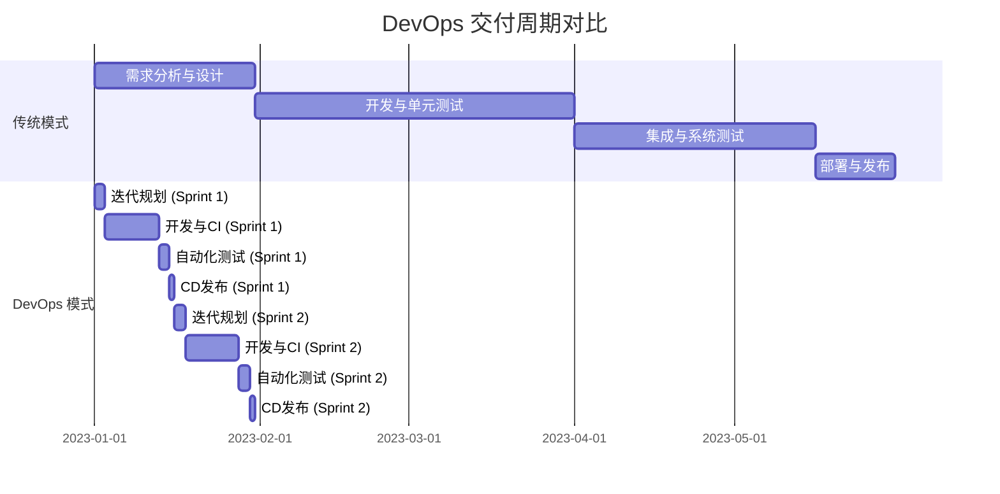
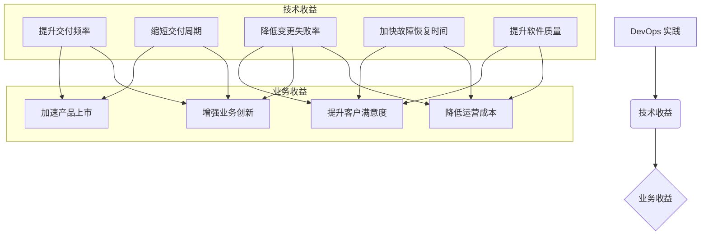

# 第五章：DevOps 的核心收益

DevOps 的实施为组织带来了多方面的显著收益，这些收益不仅体现在技术层面，更深刻地影响着业务成果和组织文化。全面理解这些核心收益，有助于企业更好地制定 DevOps 转型策略并衡量其成效。

## 5.1 技术收益 (Technical Benefits)

技术收益是 DevOps 实践最直接和最容易被感知的成果，它们共同指向了更快、更可靠、更高质量的软件交付。

### 5.1.1 提升交付频率与缩短交付周期 (Increased Delivery Frequency and Reduced Lead Time)
通过自动化构建、测试和部署流程，DevOps 使得软件交付的频率从过去的数月甚至数年一次，提升到数周、数天甚至每天多次。持续集成（CI）和持续交付/部署（CD）是实现这一目标的关键实践。更短的交付周期（Lead Time for Changes）意味着从代码提交到生产环境部署的时间大大缩短，能够更快地响应市场变化和用户需求。

### 5.1.2 降低变更失败率 (Lower Change Failure Rate)
DevOps 强调小批量、高频率的变更。通过自动化的测试、逐步的灰度发布（如蓝绿部署、金丝雀发布）以及强大的监控反馈机制，可以显著降低生产环境中变更引入的风险。当发生问题时，由于变更是小范围的，定位和回滚也更加容易和迅速。

### 5.1.3 加快故障恢复时间 (Faster Mean Time to Recover - MTTR)
尽管目标是减少故障，但故障在复杂的系统中仍然可能发生。DevOps 通过自动化的回滚机制、强大的监控和告警系统、以及清晰的故障处理流程，能够显著缩短从故障发生到系统恢复的平均时间（MTTR）。快速恢复能力保障了业务的连续性。

### 5.1.4 提升软件质量与稳定性 (Improved Software Quality and Stability)
“质量内建”是 DevOps 的核心思想之一。通过将测试左移（Shift-Left Testing），在开发早期就引入各种自动化测试（单元测试、集成测试、端到端测试等），并结合代码审查、静态代码分析等实践，可以更早地发现和修复缺陷，从而提升最终交付软件的质量和运行稳定性。

## 5.2 业务收益 (Business Benefits)

技术收益最终会转化为实实在在的业务价值，帮助企业在激烈的市场竞争中获得优势。

### 5.2.1 加速产品上市时间 (Faster Time to Market)
DevOps 通过缩短开发周期和提高交付频率，使得新功能和产品能够更快地推向市场，抓住市场机遇，领先竞争对手。

### 5.2.2 提升客户满意度 (Increased Customer Satisfaction)
更快的交付、更高的质量、更稳定的服务，以及对用户反馈的快速响应，都直接提升了客户的体验和满意度。满意的客户更有可能成为忠实用户并进行口碑传播。

### 5.2.3 增强业务创新能力 (Enhanced Business Innovation)
DevOps 降低了实验的成本和风险。团队可以更频繁地尝试新的想法，通过快速迭代和收集用户反馈来验证假设，从而鼓励创新并更快地找到有价值的业务增长点。

### 5.2.4 降低运营成本 (Reduced Operational Costs)
自动化减少了大量手动操作，提高了资源利用率（例如通过 IaC 和容器化）。同时，更少的故障和更快的恢复也减少了因服务中断造成的损失和修复成本。

## 5.3 文化与组织收益 (Cultural and Organizational Benefits)

DevOps 不仅仅是工具和流程的变革，更是一场深刻的文化转型，它对组织的运作方式和员工的工作体验产生积极影响。

### 5.3.1 改善团队协作与沟通 (Improved Team Collaboration and Communication)
DevOps 打破了开发（Dev）和运维（Ops）之间的传统壁垒，以及与其他相关团队（如测试、安全、业务）的隔阂。通过共享目标、共同承担责任、透明化的流程和频繁的沟通，促进了跨职能团队的紧密协作。

### 5.3.2 提升员工满意度与敬业度 (Increased Employee Satisfaction and Engagement)
DevOps 通过自动化消除了许多重复和繁琐的手动任务，让工程师能够专注于更有价值和创造性的工作。赋权、信任以及对学习和成长的鼓励，也使得员工更有成就感和归属感，从而提升整体的满意度和敬业度。

### 5.3.3 建立持续改进与学习型文化 (Fostering a Culture of Continuous Improvement and Learning)
DevOps 强调从失败中学习，通过反馈循环不断优化流程和实践。鼓励实验、拥抱变化、分享知识，使得组织能够持续适应和进化，形成一个积极向上的学习型文化。

总结来说，DevOps 的核心收益是全方位的，它通过技术革新驱动业务增长，并通过文化转型提升组织效能和员工福祉，最终帮助企业在快速变化的市场中保持竞争力和持续发展。

---
