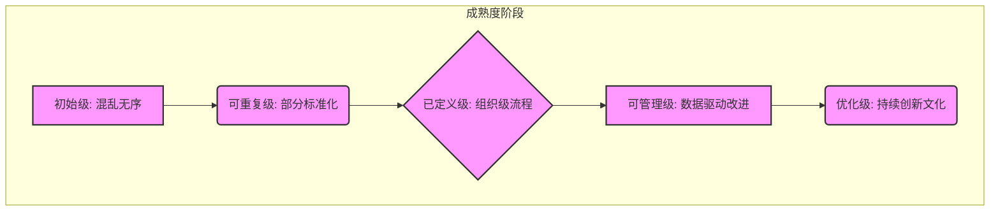
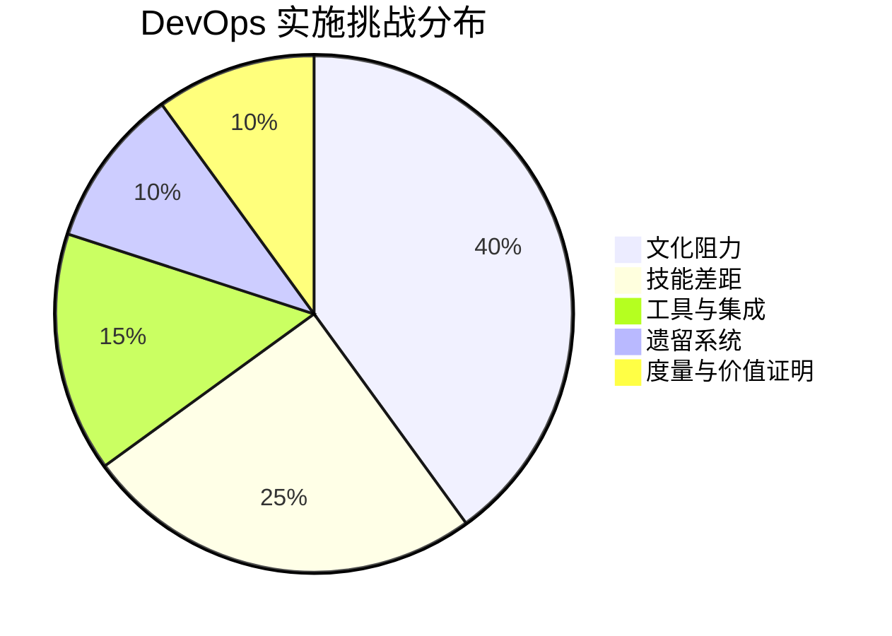

# 第六章：DevOps 的实施路径与挑战

成功实施 DevOps 转型并非一蹴而就，它需要清晰的路径规划、对潜在挑战的认知以及持续的努力。本章将探讨 DevOps 的实践路径、成熟度模型、常见的困难与挑战，并提供关键的成功要素与专家建议。

## 6.1 DevOps 实践路径与成熟度模型

组织在采纳 DevOps 时，通常会经历一个逐步演进的过程。理解这一过程并辅以成熟度模型进行评估，有助于组织系统地推进转型。

### 6.1.1 评估现状与设定目标 (Assess Current State and Set Goals)
实施 DevOps 的第一步是全面评估组织当前的开发、测试、部署和运维流程、技术栈、团队技能以及文化现状。识别痛点、瓶颈和改进机会。基于评估结果，设定清晰、可衡量、可实现、相关且有时限（SMART）的 DevOps 转型目标。例如，目标可以是缩短交付周期、降低变更失败率、提升系统稳定性等。

### 6.1.2 从试点项目开始 (Start with Pilot Projects)
选择一个或少数几个具有代表性但风险相对可控的项目作为试点，推行 DevOps 实践。试点项目的成功经验可以增强团队信心，暴露潜在问题，并为后续大规模推广提供宝贵的经验和模式。选择合适的工具链，并组建跨职能的试点团队。

### 6.1.3 逐步推广与扩展 (Gradual Rollout and Scaling)
在试点项目取得成功后，逐步将 DevOps 实践推广到更多的项目和团队。这个过程需要持续的沟通、培训和支持。根据不同团队和项目的特点，灵活调整实践方式和工具选择。建立内部的 DevOps 知识库和社区，促进经验分享和学习。

### 6.1.4 DevOps 成熟度模型概览 (Overview of DevOps Maturity Models)
DevOps 成熟度模型（DMM）提供了一个框架，用于评估组织在 DevOps 实践方面的成熟程度，并指导其持续改进。常见的成熟度模型通常包含以下几个级别：

*   **初始级 (Initial/Ad Hoc):** 流程混乱，缺乏标准化，高度依赖个人英雄主义。
*   **可重复级 (Repeatable/Opportunistic):** 部分流程开始标准化，有一些自动化工具的零星应用，但主要在项目或小团队内部。
*   **已定义级 (Defined/Systematic):** 组织层面有明确的 DevOps 流程和标准，工具链得到一定程度的集成，跨团队协作开始形成。
*   **可管理级 (Managed/Measured):** 通过度量指标来监控和管理 DevOps 流程的效率和效果，持续进行数据驱动的改进。
*   **优化级 (Optimized/Continuous Improvement):** DevOps 成为组织文化的一部分，持续创新和优化，自动化和智能化水平高，能够快速适应变化并引领行业最佳实践。

## 6.2 常见困难与挑战 (Common Difficulties and Challenges)

在 DevOps 转型过程中，组织往往会遇到各种各样的困难和挑战。

### 6.2.1 文化阻力与思维转变 (Cultural Resistance and Mindset Shift)
这是 DevOps 实施中最常见也是最大的挑战。传统的部门墙、孤岛文化、对失败的恐惧、以及不愿意改变旧有工作方式等，都会阻碍 DevOps 的推行。打破这些文化障碍，建立信任、协作和共享的文化至关重要。

### 6.2.2 技能差距与人才培养 (Skill Gaps and Talent Development)
DevOps 需要员工具备跨领域的技能，例如开发人员需要了解运维知识，运维人员也需要掌握自动化和编码能力。组织需要投入资源进行培训，弥补技能差距，并吸引和培养具备 DevOps 思维和技能的人才。

### 6.2.3 工具链选择与集成复杂性 (Toolchain Selection and Integration Complexity)
市场上有大量的 DevOps 工具，选择合适的工具并将其集成为一个高效的工具链是一项复杂的任务。需要考虑工具的兼容性、可扩展性、成本以及与现有系统的集成。避免“工具驱动”的 DevOps，而应以解决实际问题为出发点。

### 6.2.4 遗留系统与技术债务 (Legacy Systems and Technical Debt)
许多组织拥有庞大而复杂的遗留系统，这些系统往往难以适应 DevOps 的快速迭代和自动化要求。技术债务的累积也会拖慢 DevOps 的进程。需要制定策略逐步改造或替换遗留系统，并积极偿还技术债务。

### 6.2.5 度量与证明价值 (Measurement and Proving Value)
如何有效地度量 DevOps 的成效并向管理层证明其价值，是一个持续的挑战。需要建立合适的度量指标体系（如 DORA 指标），并持续跟踪和分析数据，以展示 DevOps 带来的改进。

## 6.3 关键成功要素与专家建议 (Key Success Factors and Expert Advice)

为了成功实施 DevOps 并克服上述挑战，以下是一些关键的成功要素和专家建议：

*   **高层领导的支持与承诺:** 自上而下的支持是推动文化变革和资源投入的保障。
*   **以价值为导向，从小处着手:** 明确 DevOps 转型的业务价值，并从能够快速产生可见成果的试点项目开始。
*   **赋能团队，鼓励实验:** 给予团队自主权，鼓励他们尝试新的工具和方法，并从失败中学习。
*   **持续沟通与透明化:** 在整个组织内就 DevOps 的目标、进展和挑战进行持续和透明的沟通。
*   **投资于自动化:** 尽可能自动化重复性的任务，以提高效率和减少人为错误。
*   **建立反馈循环:** 建立快速、有效的反馈机制，以便及时发现问题并进行调整。
*   **关注持续学习与改进:** DevOps 不是一次性的项目，而是一个持续学习和改进的旅程。
*   **选择合适的合作伙伴:** 如果内部资源不足，可以考虑寻求经验丰富的 DevOps 咨询伙伴的帮助。

通过周密的规划、坚定的决心和持续的努力，组织可以成功克服挑战，充分释放 DevOps 的潜力，实现技术和业务的双重突破。

---
