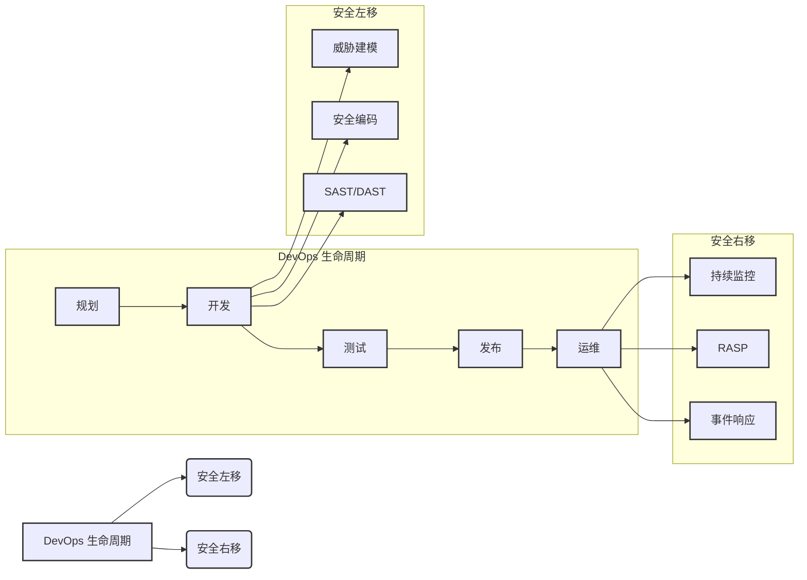
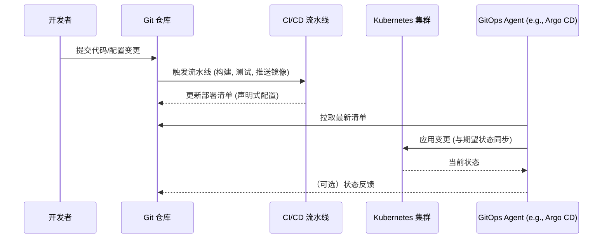

# 第七章：DevOps 的未来展望

DevOps 作为一个不断演进的理念和实践集合，其未来发展将更加聚焦于智能化、安全性、业务融合以及可持续性。随着技术的不断进步和业务需求的日益复杂，DevOps 将持续吸收新的思想和工具，以应对未来的挑战和机遇。

## 7.1 DevSecOps：安全融入 DevOps (Security Integrated into DevOps)

DevSecOps 强调将安全实践（Security）无缝集成到 DevOps 的整个生命周期中，实现“安全左移”（Shift Left Security）和“安全右移”（Shift Right Security）。这意味着从需求、设计、编码、测试、部署到运维的每个阶段都要考虑安全性，而不是将其作为事后的附加项。

*   **核心理念：** 安全是每个人的责任，自动化安全测试、持续安全监控、威胁建模、安全编码规范等将成为标准实践。
*   **关键技术：** SAST（静态应用安全测试）、DAST（动态应用安全测试）、IAST（交互式应用安全测试）、RASP（运行时应用自我保护）、安全编排与自动化响应（SOAR）。

## 7.2 AIOps：智能化运维 (AI for IT Operations)

AIOps 利用人工智能（AI）和机器学习（ML）技术来自动化和增强 IT 运维能力。通过分析海量的运维数据（日志、指标、追踪等），AIOps 可以实现智能告警、异常检测、根因分析、预测性维护和自动化修复，从而提高运维效率和系统可靠性。

*   **核心能力：** 大数据分析、模式识别、预测分析、自动化决策。
*   **应用场景：** 智能监控告警、自动化故障排除、容量规划与优化、安全事件检测与响应。

## 7.3 Serverless 架构与 DevOps (Serverless Architecture and DevOps)

Serverless 架构（如 AWS Lambda, Azure Functions, Google Cloud Functions）允许开发者构建和运行应用程序，而无需管理底层服务器基础设施。这进一步简化了运维工作，使得开发团队可以更专注于业务逻辑的实现。DevOps 实践（如 CI/CD、IaC）对于 Serverless 应用的开发和部署同样至关重要，但工具和流程需要适应 Serverless 的特点。

*   **优势：** 降低运维复杂性、按需付费、弹性伸缩。
*   **挑战：** 冷启动、函数编排、本地测试与调试、厂商锁定。

## 7.4 GitOps：以 Git 为核心的运维 (Git-centric Operations)

GitOps 是一种以 Git 作为声明式基础设施和应用程序配置的唯一真实来源（Single Source of Truth）的运维模式。所有的变更都通过 Git 提交和审查，并通过自动化的流程同步到生产环境。这使得基础设施和应用的管理更加透明、可追溯和可审计。

*   **核心原则：** 声明式配置、版本化控制、自动化同步、持续对账。
*   **典型工具：** Argo CD, Flux CD。

## 7.5 价值流管理 (Value Stream Management - VSM)

VSM 关注从业务需求提出到价值交付给最终用户的整个端到端流程。它通过可视化、度量和优化价值流，帮助组织识别瓶颈、减少浪费、提高交付效率和质量。DevOps 是实现 VSM 的关键使能器，VSM 则为 DevOps 实践提供了更广阔的业务视角和度量框架。

*   **关注点：** 流动效率、交付周期、交付吞吐量、交付质量。
*   **工具平台：** VSM 平台提供价值流映射、数据采集、分析和可视化能力。

## 7.6 平台工程 (Platform Engineering)

平台工程旨在构建和维护一个内部开发者平台（Internal Developer Platform - IDP），为开发团队提供自助式的工具、服务和自动化能力，从而降低认知负荷，提升开发体验和效率。IDP 可以看作是 DevOps 工具链和最佳实践的封装和产品化。

*   **目标：** 提升开发者生产力、标准化技术栈、加速应用交付。
*   **核心组件：** CI/CD、IaC、监控、日志、安全、服务目录等。

## 7.7 BizDevOps：业务与技术的深度融合 (Deep Integration of Business and Technology)

BizDevOps 强调业务团队、开发团队和运维团队之间更紧密的协作和目标对齐。通过将业务指标和反馈直接融入 DevOps 流程，使得技术决策能够更好地服务于业务目标，实现更快的业务价值交付和持续创新。

*   **核心思想：** 业务驱动开发、数据驱动决策、跨职能团队共同为业务成果负责。

## 7.8 可持续性与绿色 DevOps (Sustainability and Green DevOps)

随着对环境问题的日益关注，可持续性也成为 DevOps 发展的一个新方向。绿色 DevOps 旨在通过优化资源利用、减少能源消耗、采用更环保的技术和实践，来降低 IT 基础设施和软件开发过程对环境的影响。

*   **实践方向：** 优化云资源使用、采用节能硬件、设计高效算法、减少不必要的计算和存储。

DevOps 的未来充满了可能性。通过不断拥抱变化、学习新技术、深化文化变革，组织将能够持续利用 DevOps 的力量，在数字化时代保持领先地位。

---
