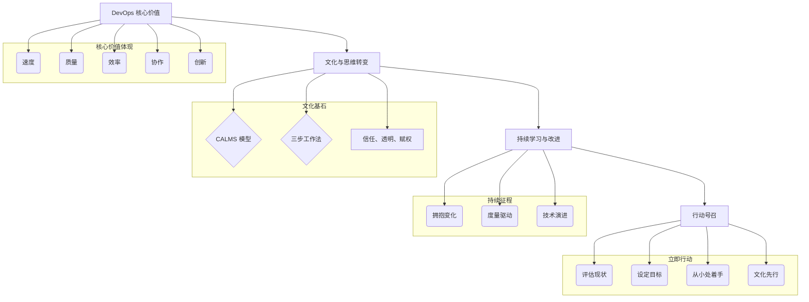

# 第八章：结论

经过对 DevOps 的深入探索，从其核心理念、文化基石、关键实践、技术栈，到其对应用开发生命周期的深远影响、带来的核心收益、实施路径与挑战，以及未来的发展趋势，我们可以清晰地看到 DevOps 不仅仅是一套工具或流程的集合，更是一种深刻的文化变革和思维模式的转变。它旨在打破传统IT组织中的壁垒，促进协作，加速价值交付，并最终驱动业务的成功。

## 8.1 DevOps 的核心价值回顾

DevOps 的核心价值在于其能够帮助组织实现：

*   **速度 (Velocity):** 通过自动化和持续交付，显著提升软件交付的频率和速度，更快地响应市场变化和客户需求。
*   **质量 (Quality):** 通过持续测试、持续集成和“质量内建”的文化，提升软件的稳定性和可靠性，减少缺陷和故障。
*   **效率 (Efficiency):** 通过自动化重复性任务、优化流程、减少浪费，提高团队和组织的整体运作效率。
*   **协作 (Collaboration):** 打破开发、运维、测试、安全乃至业务团队之间的孤岛，建立共享目标和责任的协作文化。
*   **创新 (Innovation):** 通过降低实验成本、鼓励快速迭代和从失败中学习，为业务创新提供更强大的技术支撑和文化土壤。

这些价值的实现，最终会转化为实实在在的业务成果，如更快的上市时间、更高的客户满意度、更强的市场竞争力和更低的运营成本。

## 8.2 文化与思维转变的重要性

在整个 DevOps 转型过程中，技术和工具固然重要，但文化和思维的转变才是其成功的基石和最艰巨的挑战。CALMS 模型（文化、自动化、精益、度量、分享）和三步工作法（流动、反馈、持续学习与实验）为我们指明了方向。建立信任、透明、赋权、鼓励学习和容忍建设性失败的文化氛围，是 DevOps 精神得以生根发芽的土壤。

领导层的支持、跨部门的沟通、以及每一位团队成员的积极参与，都是推动这种文化和思维转变不可或缺的因素。这需要耐心、决心和持续的努力。

## 8.3 持续学习与改进的征程

DevOps 不是一个终点，而是一个持续学习、持续实验和持续改进的旅程。技术在不断发展，业务需求在不断变化，市场环境也在不断演进。因此，DevOps 的实践也需要与时俱进，不断吸收新的理念（如 DevSecOps, AIOps, GitOps, Platform Engineering）和工具，优化现有的流程和方法。

建立有效的反馈循环，通过度量来驱动改进，鼓励团队不断探索和创新，是保持 DevOps 实践活力的关键。拥抱变化，将每一次挑战都视为学习和成长的机会。

## 8.4 行动号召：拥抱 DevOps，驱动未来

DevOps 已经从一个新兴趋势发展成为现代软件开发和IT运维的主流模式。它为组织提供了一条在快速变化的数字时代保持竞争力、实现可持续发展的有效路径。

无论您的组织处于哪个发展阶段，现在都是开始或深化 DevOps 转型的最佳时机。评估现状，设定清晰的目标，从小处着手，逐步推广，并始终将文化建设放在首位。

拥抱 DevOps，不仅仅是采用新的工具和技术，更是拥抱一种新的工作方式、一种新的协作精神和一种持续追求卓越的文化。让我们共同踏上这段激动人心的旅程，用 DevOps 的力量驱动创新，塑造更加美好的技术未来和业务未来。

