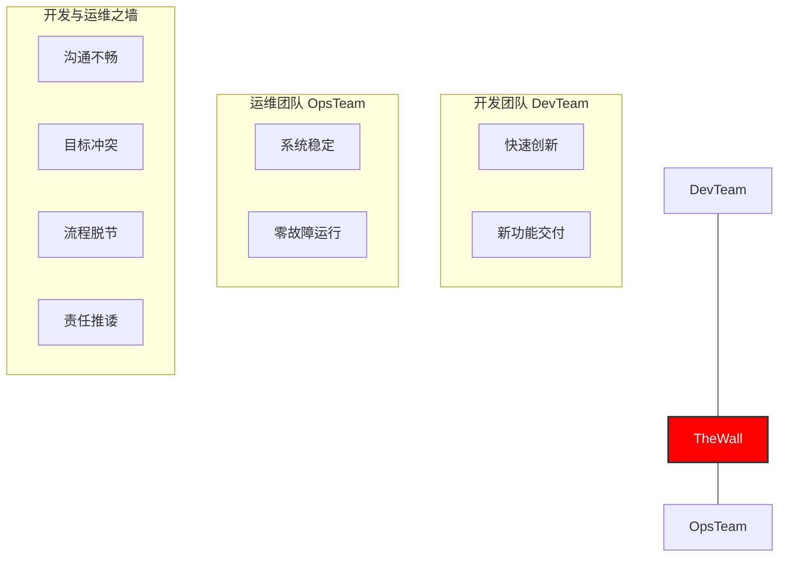
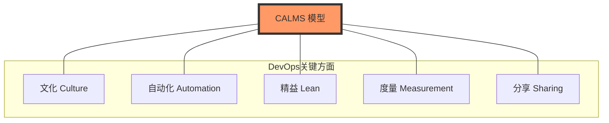
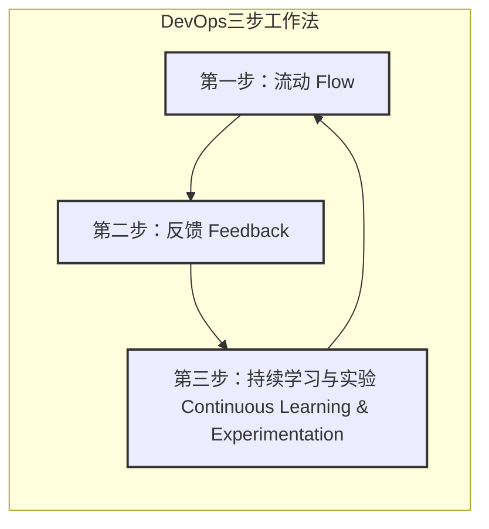

# 第一章：什么是 DevOps？

想象一下，在传统的软件开发公司里，开发团队（写代码的人）和运维团队（维护软件上线运行的人）常常像是两个独立的部门，他们有不同的目标，沟通也不总是那么顺畅。开发团队希望快速推出新功能，而运维团队则希望系统稳定，少出问题。这种隔阂常常导致软件交付缓慢，问题频出。

DevOps 就是为了解决这些问题而诞生的！

传统开发与运维的隔阂，就像下面这样：

DevOps 的目标就是打破这堵墙，让双方更好地协作。

## 1.1 DevOps 简介：它解决了什么问题？

DevOps 这个词是 “Development”（开发）和 “Operations”（运维）的组合。简单来说，**DevOps 是一种文化理念、一系列实践方法和一些自动化工具的集合，目的是让开发团队和运维团队更好地协作，从而更快、更可靠地交付高质量的软件。**

**DevOps 主要解决以下痛点：**

*   **交付太慢：** 新功能上线或修复问题要等很久。
*   **质量和速度难平衡：** 想要快，质量可能就差；想要质量好，速度可能就慢。
*   **害怕变更：** 每次发布新版本都心惊胆战，怕搞砸了。
*   **团队各做各的：** 开发、测试、运维团队之间沟通不畅，互相不理解。
*   **出问题了修复慢：** 系统出故障了，要花很长时间才能恢复。

DevOps 的目标就是通过打破壁垒，让大家朝着一个共同的目标努力：**更快地为用户创造价值。**

## 1.2 核心理念：协作、自动化、持续改进

DevOps 的核心不仅仅是工具，更重要的是一种思维方式和工作文化。我们可以用几个关键词来概括它的核心理念：

*   **协作 (Collaboration)：** 这是最重要的！开发、运维、测试等所有相关人员需要紧密合作，共享信息，共同承担责任。不再是“你的事”、“我的事”，而是“我们的事”。
*   **自动化 (Automation)：** 把那些重复的、手动的、容易出错的工作交给机器去做。比如自动编译代码、自动测试、自动部署软件。这样不仅快，还能减少人为失误。
*   **精益 (Lean)：** 借鉴了制造业的思想，就是要消除浪费，小步快跑。一次只做少量的工作，快速交付，快速得到反馈，然后不断优化。
*   **度量 (Measurement)：** 用数据说话。通过监控和收集数据，了解我们的工作效率怎么样，软件质量怎么样，用户满意度怎么样，然后根据数据来做决策和改进。
*   **分享 (Sharing)：** 知识、经验、工具、甚至失败的教训，都应该在团队和组织内部共享。这样大家才能一起学习，一起进步。

这些理念可以用一个叫 **CALMS** 的模型来记住，它代表了 DevOps 的几个关键方面：

*   **C**ulture (文化)
*   **A**utomation (自动化)
*   **L**ean (精益)
*   **M**easurement (度量)
*   **S**haring (分享)

还有一个重要的指导原则叫做 **“三步工作法”**：
1.  **流动 (Flow)：** 确保工作能够顺畅地从开发团队流向运维团队，最终交付给用户，中间不要有太多等待和阻塞。
2.  **反馈 (Feedback)：** 建立快速的反馈渠道。比如，代码一提交，马上就能知道测试有没有通过；软件一上线，马上就能知道用户用得怎么样。这样就能尽早发现问题，尽早修复。
3.  **持续学习与实验 (Continuous Learning and Experimentation)：** 鼓励大家尝试新的方法，从成功和失败中学习，不断改进工作方式和产品。

这“三步工作法”可以用下图简单表示：

## 1.3 为什么我们需要 DevOps？

在一个变化飞快的时代，公司需要快速响应市场和用户的需求。DevOps 能帮助我们：

*   **更快地把产品推向市场：** 抓住商业机会。
*   **提升软件的质量和稳定性：** 让用户用得更放心。
*   **提高团队的工作效率：** 让工程师们更专注于有价值的工作。
*   **增强团队的幸福感：** 减少不必要的压力和冲突。
*   **最终，提升公司的竞争力。**

简单来说，DevOps 就像是给软件开发和交付过程装上了一个高效的引擎，并让所有参与者都朝着同一个方向努力。它不是一个一蹴而就的事情，而是一个持续改进的过程。

---