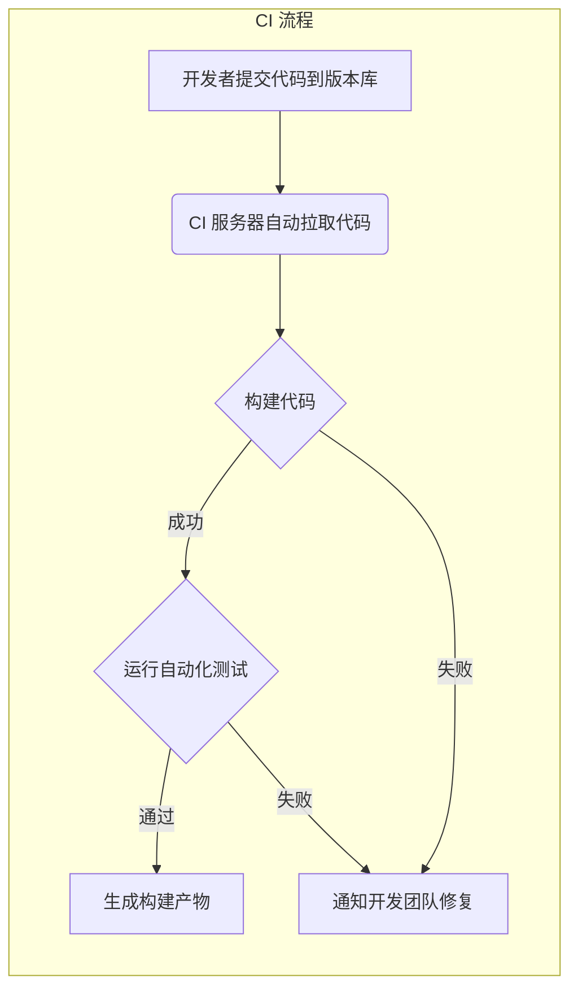
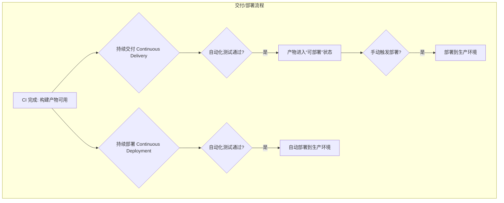
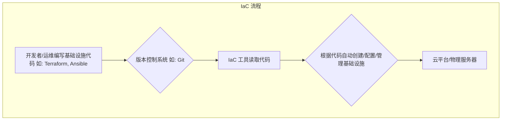
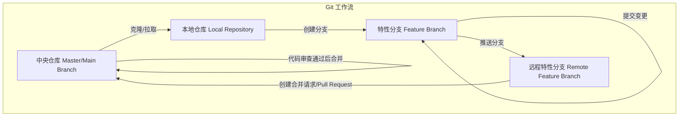

# 第二章：DevOps 的关键实践

理解了 DevOps 的核心理念后，我们来看看在实际工作中，有哪些关键的实践方法可以帮助我们落地 DevOps。这些实践通常会借助一些自动化工具来完成。

## 2.1 持续集成 (CI)：让代码集成更轻松

想象一下，一个项目有很多开发人员同时在写代码。如果大家都是埋头写很久，最后才把代码合在一起，很容易出现各种冲突和问题，解决起来非常头疼，这就是所谓的“集成地狱”。

**持续集成 (Continuous Integration, CI)** 就是一种让开发人员更频繁地（比如每天好几次）把自己写的代码合并到主代码库中的实践。每次合并后，会自动运行构建（比如编译代码）和测试，来确保新的代码没有破坏原有的功能。

一个典型的 CI 流程如下：

**CI 的好处：**
*   **尽早发现问题：** 代码一有问题，马上就能知道，修复起来也更容易。
*   **减少集成麻烦：** 每次只集成一小部分代码，比一次性集成大量代码简单多了。
*   **提高代码质量：** 自动测试能保证代码的基本质量。
*   **让发布更频繁：** 因为代码总是处于一个相对稳定的状态。

**常用 CI 工具：** Jenkins, GitLab CI, GitHub Actions 等。

## 2.2 持续交付与持续部署 (CD)：软件发布更快更稳

CI 解决了代码集成的问题，那么代码集成后如何快速又安全地交到用户手里呢？这就是持续交付和持续部署要解决的问题。

*   **持续交付 (Continuous Delivery)：** 这是 CI 的延伸。它意味着，任何时候，只要我们的代码通过了所有的自动化测试，它就处于一个“可以发布”的状态。也就是说，我们可以一键就把最新的软件版本部署到生产环境（用户实际使用的环境），但通常这个“一键”还是需要人来按一下，做最终的决定。

*   **持续部署 (Continuous Deployment)：** 这个更进一步。它意味着，只要代码通过了所有自动化测试，就会自动地、不需要人工干预地部署到生产环境。这要求我们对自动化测试有极高的信心。

持续交付与持续部署的流程可以这样理解：

**CD 的好处：**
*   **发布更快：** 大大缩短了从写完代码到用户用上新功能的时间。
*   **发布更可靠：** 自动化流程减少了人为失误。
*   **降低发布风险：** 每次只发布一小部分改动，出问题也好回滚。

**常用 CD 工具：** 通常和 CI 工具集成在一起，比如 Jenkins, GitLab CI, GitHub Actions, Spinnaker, Argo CD 等。

## 2.3 基础设施即代码 (IaC)：像管理代码一样管理服务器

以前，我们要准备一台服务器（比如网站运行需要的计算机环境），可能需要运维人员手动去配置操作系统、安装软件、设置网络等等，非常繁琐，也容易出错，而且每次配置可能还不一样。

**基础设施即代码 (Infrastructure as Code, IaC)** 就是用写代码的方式来定义和管理我们的服务器、网络、存储等基础设施。我们可以写一些配置文件（比如用 Terraform 或 Ansible 这样的工具），描述我们想要什么样的环境，然后让工具自动去创建和配置。

基础设施即代码的工作方式：

**IaC 的好处：**
*   **自动化：** 不用手动操作了，省时省力还不容易错。
*   **环境一致：** 无论是开发环境、测试环境还是生产环境，都能保证配置是一样的。
*   **可追踪：** 基础设施的配置也像代码一样有了版本历史，可以追踪改动，也可以回滚。
*   **可重复：** 需要再来一套同样的环境？运行一下代码就行了。

**常用 IaC 工具：** Terraform, Ansible, AWS CloudFormation, Azure Resource Manager 等。

## 2.4 版本控制 (Git)：团队协作的基础

版本控制系统 (Version Control System, VCS) 是用来追踪和管理文件（尤其是代码）变化的工具。它允许多个人在同一个项目上协作，记录下每一次修改，并且可以在需要的时候回到之前的任何一个版本。

**Git** 是目前最流行的版本控制系统。

一个简化的 Git 工作流程可能如下：

**版本控制的好处：**
*   **团队协作：** 大家可以同时工作，然后把各自的修改合并起来。
*   **历史记录：** 知道谁在什么时候改了什么，为什么改。
*   **分支管理：** 可以在不影响主代码的情况下，拉出一个分支去开发新功能或修复 bug，完成后再合并回去。
*   **轻松回滚：** 如果改错了，可以方便地回到之前的某个版本。

**常用 Git 平台：** GitHub, GitLab, Bitbucket 等，它们提供了代码托管、协作和代码审查等功能。

## 2.5 自动化测试：保证软件质量

为了确保我们写的软件能正常工作，并且修改代码后不会把原来的功能搞坏，我们需要进行测试。

**自动化测试** 就是用程序来代替人工执行测试用例。它是 DevOps 中非常重要的一环，因为只有测试能够自动化，我们才能放心地进行频繁的集成和部署。

**常见的自动化测试类型：**
*   **单元测试：** 测试代码中最小的功能单元（比如一个函数）。
*   **集成测试：** 测试多个模块组合在一起时是否能正常工作。
*   **端到端测试：** 模拟真实用户的使用场景，测试整个系统的流程。

**自动化测试的好处：**
*   **提高质量：** 更早发现 bug。
*   **快速反馈：** 代码一改，马上知道有没有问题。
*   **减少人工：** 把测试人员从重复的测试中解放出来，去做更有价值的事情。
*   **增强信心：** 自动化测试通过了，我们对发布的版本就更有信心。

## 2.6 监控：了解系统运行状况

软件发布上线后，我们还需要时刻关注它的运行状态，确保它能稳定地为用户提供服务。

**监控 (Monitoring)** 就是收集、分析和展示关于系统运行的各种数据（比如服务器的 CPU 使用率、内存占用、网络流量、应用程序的响应时间、错误日志等）。当出现问题或者潜在风险时，监控系统会发出告警，通知相关人员及时处理。

**监控的好处：**
*   **主动发现问题：** 在用户发现之前就定位并解决问题。
*   **快速排障：** 通过日志和指标数据，帮助我们快速找到问题的原因。
*   **了解系统瓶颈：** 知道系统的哪些部分压力比较大，需要优化。
*   **数据驱动决策：** 根据监控数据来做容量规划、性能优化等决策。

**常用监控工具：** Prometheus, Grafana, Zabbix, Datadog, ELK Stack (Elasticsearch, Logstash, Kibana) 等。

这些关键实践相互关联，共同构成了 DevOps 的技术基础，帮助团队实现更快、更好、更可靠的软件交付。

---