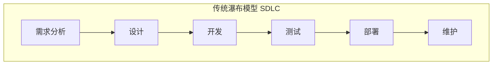
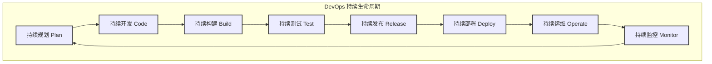

# 第三章：DevOps 如何改变软件开发？

在了解了 DevOps 是什么以及它的一些关键实践之后，我们来看看 DevOps 是如何影响和改进传统的软件开发生命周期 (Software Development Life Cycle, SDLC) 的。

## 3.1 传统软件开发流程的痛点

想象一下传统的软件开发，可能像一个接力赛，每个环节的人做完自己的事，再交给下一个人：

1.  **需求分析：** 产品经理提出要做什么功能。
2.  **设计：** 架构师和设计师设计软件的蓝图。
3.  **开发：** 程序员根据设计写代码。
4.  **测试：** 测试人员检查软件有没有 bug。
5.  **部署：** 运维人员把软件安装到服务器上让用户使用。
6.  **维护：** 软件上线后，运维人员负责保持它正常运行，开发人员修复 bug。

这种模式被称为“瀑布模型”，因为每个阶段都像瀑布一样，一级一级往下流，一个阶段完成了才能到下一个阶段。如下图所示：

这种方式有很多问题：

*   **沟通不畅：** 开发团队 (Dev) 和运维团队 (Ops) 常常是分开的，他们有不同的目标和工具，沟通起来很费劲，甚至会互相指责（“开发写的代码有问题！”“运维的环境不行！”）。
*   **反馈缓慢：** 用户要等很久才能看到最终产品，如果产品不符合需求，修改起来成本很高。
*   **交付周期长：** 从开始到最终上线，可能要几个月甚至更久。
*   **风险高：** 最后集成和部署的时候，才发现一堆问题，手忙脚乱。
*   **创新受阻：** 因为发布太慢，尝试新东西的风险也大。

## 3.2 DevOps 如何优化开发流程

DevOps 就像给这个接力赛引入了新的规则和工具，让整个过程更流畅、更高效。

DevOps 强调**协作、自动化和快速反馈**，它把传统的 SDLC 变成了一个持续的、循环的流程，而不是线性的瀑布。

**DevOps 下的 SDLC 看起来更像一个无限循环的符号，代表持续的流动和改进：**

*   **持续规划 (Continuous Planning)：** 团队一起快速规划小的功能迭代。
*   **持续开发与集成 (Continuous Development & Integration)：** 开发人员频繁提交代码，代码自动构建和测试 (CI)。
*   **持续测试 (Continuous Testing)：** 自动化测试贯穿整个过程，保证质量。
*   **持续交付/部署 (Continuous Delivery/Deployment)：** 测试通过的代码可以快速、自动地部署到生产环境 (CD)。
*   **持续监控与反馈 (Continuous Monitoring & Feedback)：** 软件上线后，持续监控其运行状态，收集用户反馈，这些信息又会回到规划阶段，形成一个闭环。

*   **持续规划 (Continuous Planning)：** 团队一起快速规划小的功能迭代。
*   **持续开发与集成 (Continuous Development & Integration)：** 开发人员频繁提交代码，代码自动构建和测试 (CI)。
*   **持续测试 (Continuous Testing)：** 自动化测试贯穿整个过程，保证质量。
*   **持续交付/部署 (Continuous Delivery/Deployment)：** 测试通过的代码可以快速、自动地部署到生产环境 (CD)。
*   **持续监控与反馈 (Continuous Monitoring & Feedback)：** 软件上线后，持续监控其运行状态，收集用户反馈，这些信息又会回到规划阶段，形成一个闭环。

**DevOps 带来的改变：**

*   **打破部门墙：** 开发、测试、运维不再是孤立的团队，而是紧密协作，共同为产品的成功负责。
*   **自动化一切可自动化的：** 从代码构建、测试、部署到基础设施管理，都尽可能自动化，减少人工错误，提高效率。
*   **小步快跑，频繁发布：** 不再是一次性发布一个巨大的版本，而是把大的功能拆分成小的模块，快速开发、测试、发布。这样用户能更快用到新功能，团队也能更快得到反馈。
*   **质量内建：** 测试不再是开发完成后的一个独立阶段，而是从一开始就融入到开发过程中。
*   **快速响应变化：** 由于发布周期短，团队能更快地响应市场变化和用户需求。

## 3.3 开发 (Dev) 和运维 (Ops) 的协作

DevOps 的核心就是 **Dev (开发)** 和 **Ops (运维)** 的协作。

*   **共同的目标：** 双方不再只关心自己的 KPI（比如开发关心代码量，运维关心系统稳定性），而是共同关注如何快速、高质量地交付价值给用户。
*   **共享的工具和流程：** 比如，开发人员也会关心代码在生产环境如何运行，运维人员也会参与到早期的设计和测试中。
*   **责任共担：** 软件上线后出了问题，不再是运维一个人的事，开发也要一起参与解决。
*   **文化融合：** 鼓励开放沟通、相互信任和持续学习。

通过这种方式，DevOps 使得软件开发过程更加敏捷、高效和可靠，最终能够更好地满足用户需求，提升业务价值。

---