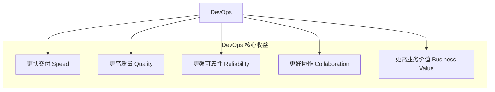
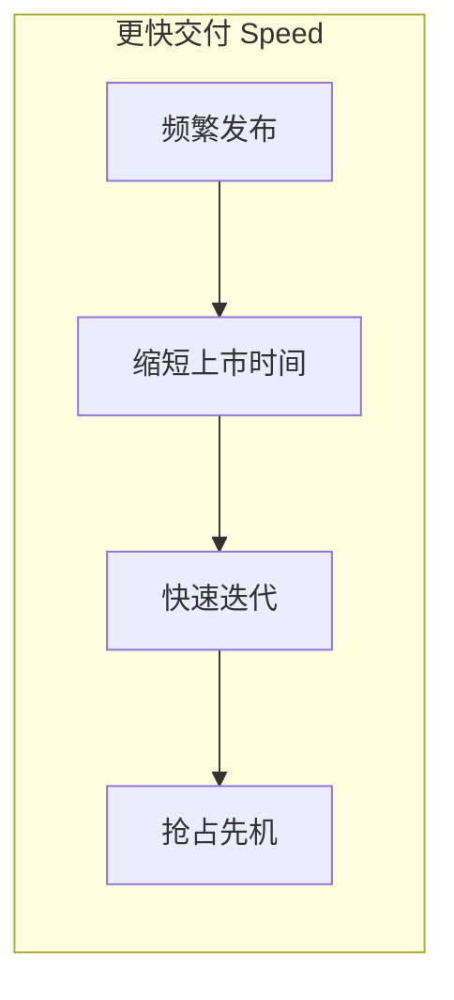
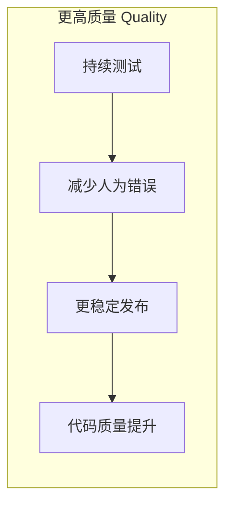
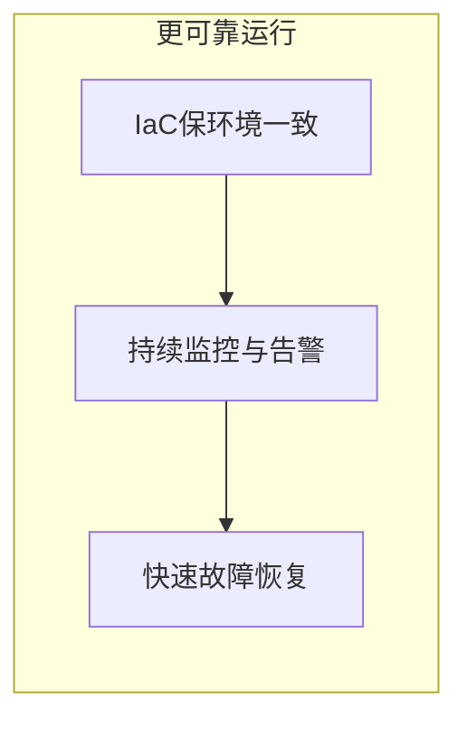
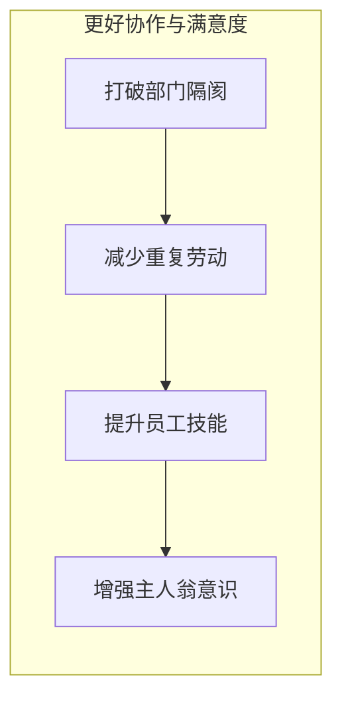
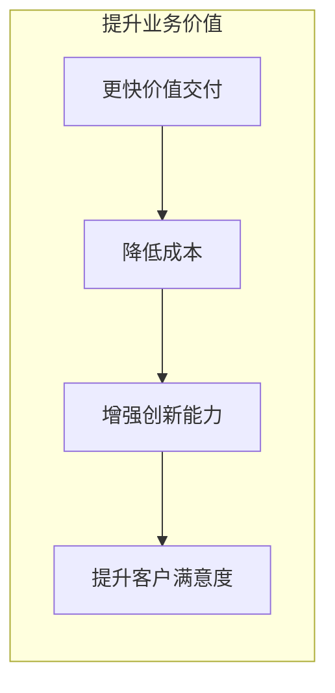

# 第四章：DevOps 能带来什么好处？

我们已经了解了 DevOps 是什么，以及它的一些关键实践和对软件开发流程的改进。那么，一个团队或公司费心费力地去推行 DevOps，到底能得到哪些实实在在的好处呢？

简单来说，DevOps 能帮助我们**更快、更好、更稳定**地交付软件，从而提升竞争力。

我们可以用一个简单的图来概括 DevOps 的核心好处：

## 4.1 更快的交付速度 (Speed)

这是 DevOps 最显著的好处之一。

*   **频繁发布：** 通过自动化和持续交付/部署，我们可以更频繁地发布新功能或修复。以前可能几个月才发布一次，现在可能一天发布好几次。
*   **缩短上市时间 (Time to Market)：** 新的想法、新的产品能更快地交到用户手中，抢占市场先机。
*   **快速迭代：** 能够根据用户反馈快速调整产品方向，小步快跑，不断优化。

想象一下，你的竞争对手还在慢吞吞地准备一个大版本，而你已经通过 DevOps 快速上线了好几个小功能，不断吸引和满足用户，优势自然就体现出来了。

**总结一下，更快的交付速度意味着：**

## 4.2 更高的软件质量 (Quality)

速度快了，质量会不会下降呢？DevOps 恰恰相反，它能帮助提升软件质量。

*   **持续测试：** 自动化测试在开发的每个阶段都在运行，能尽早发现和修复 bug。
*   **减少人为错误：** 自动化的构建、测试和部署流程，比人工操作更可靠，减少了因疏忽导致的错误。
*   **更稳定的发布：** 每次发布的内容更少，风险更小。即使出了问题，也更容易定位和回滚。
*   **代码质量提升：** 持续集成和代码审查等实践，有助于提升整体代码质量。

**总结一下，更高的软件质量意味着：**

## 4.3 更可靠的系统运行 (Reliability)

软件发布上线后，能稳定运行不出问题，对用户体验至关重要。

*   **基础设施即代码 (IaC)：** 确保开发、测试和生产环境的一致性，减少了“在我电脑上明明是好的”这类问题。
*   **持续监控和告警：** 能够实时了解系统运行状况，在问题扩大前及时发现并处理。
*   **快速故障恢复：** 如果系统出现故障，DevOps 流程和工具能帮助团队更快地恢复服务。

**总结一下，更可靠的系统运行意味着：**

## 4.4 更好的团队协作和员工满意度 (Collaboration & Satisfaction)

DevOps 不仅仅是工具和流程，更是一种文化。

*   **打破部门隔阂：** 开发、测试、运维等团队不再是孤岛，而是紧密协作，共同为目标努力。
*   **减少重复劳动：** 自动化解放了团队成员，让他们可以专注于更有创造性和价值的工作。
*   **提升员工技能：** 鼓励学习和尝试新技术，员工能得到成长。
*   **增强主人翁意识：** 团队对整个产品生命周期负责，更有成就感和归属感。

当团队成员心情舒畅、合作愉快时，工作效率和创造力自然会更高。

**总结一下，更好的团队协作和员工满意度意味着：**

## 4.5 提升业务价值 (Business Value)

最终，所有的技术改进都是为了服务于业务目标。

*   **更快的价值交付：** 新功能更快上线，意味着能更快地为用户创造价值，更快地获得收益。
*   **降低成本：** 自动化减少了人工成本，高效的流程减少了浪费。
*   **增强创新能力：** 快速迭代和试错的能力，让企业敢于尝试新的商业模式和产品。
*   **提升客户满意度：** 更快获得新功能、更稳定的服务、更少的问题，自然会带来更高的客户满意度。

**总结一下，提升业务价值意味着：**

总而言之，DevOps 通过一系列文化、流程和工具的变革，能够帮助组织在快速变化的市场中保持竞争力，实现可持续的业务增长。

---