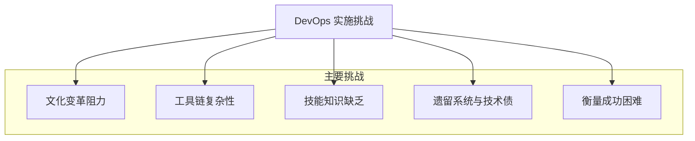
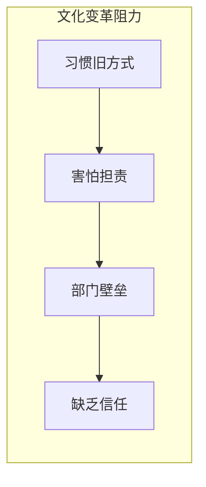
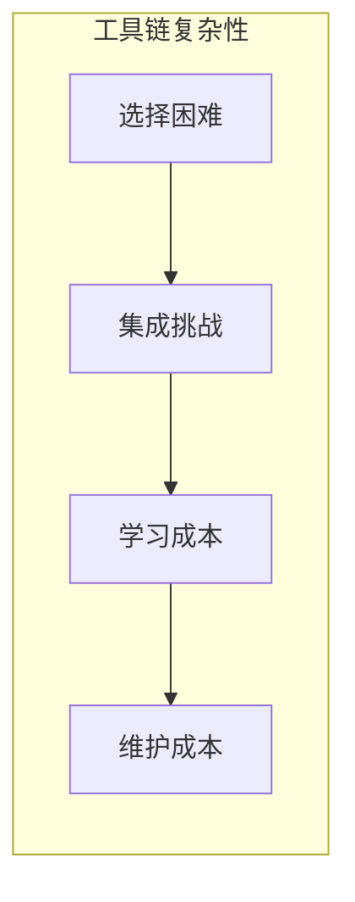
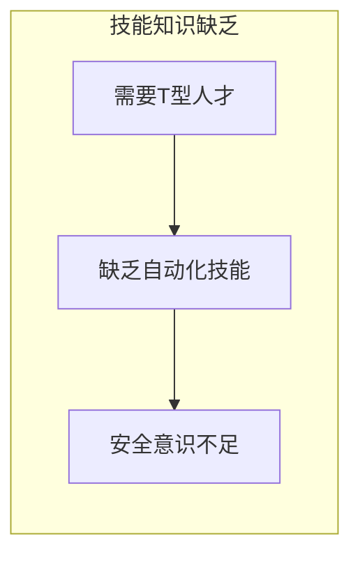
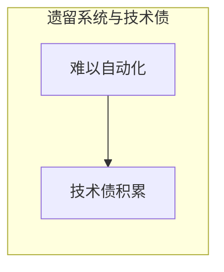
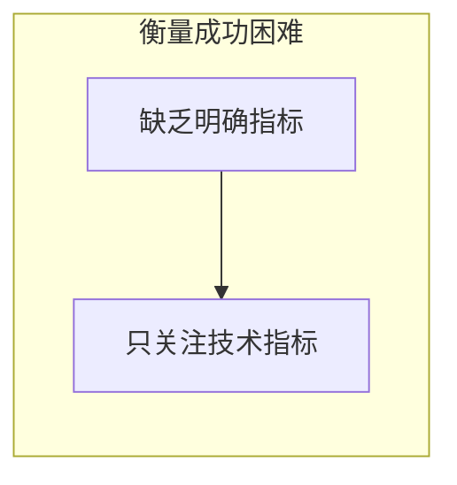

# 第五章：实施 DevOps 会遇到哪些挑战？

DevOps 听起来很美好，能带来很多好处。但在实际推行 DevOps 的过程中，并不是一帆风顺的，我们可能会遇到各种各样的挑战。了解这些挑战，可以帮助我们更好地准备和应对。

我们可以将这些挑战总结如下：

## 5.1 文化变革的阻力 (Resistance to Cultural Change)

这是最常见也是最大的挑战之一。DevOps 不仅仅是引入新工具或新流程，更重要的是**思维方式和工作文化的转变**。

*   **习惯的力量：** 人们往往习惯于旧的工作方式，不愿意改变。比如，开发和运维团队习惯了各做各的，让他们紧密协作可能会感到不适应。
*   **害怕担责：** DevOps 强调共同负责，有些人可能害怕承担额外的责任或担心犯错。
*   **部门壁垒：** 传统的组织架构可能强化了部门之间的隔阂，打破这些壁垒需要时间和努力。
*   **缺乏信任：** 如果团队之间缺乏信任，协作就很难进行。

**文化变革的阻力主要表现为：**

**工具选择和集成的复杂性主要表现为：**

**技能和知识的缺乏主要表现为：**

**遗留系统和技术债主要表现为：**

**衡量 DevOps 的成功困难主要表现为：**

**如何应对：**
*   **高层支持：** 管理层的理解和大力支持非常重要。
*   **从小处着手：** 可以先选择一个小项目或一个小团队进行试点，取得成功经验后再逐步推广。
*   **加强沟通和培训：** 让大家理解 DevOps 的价值，学习新的技能和协作方式。
*   **鼓励开放和透明：** 营造一个安全的环境，让大家敢于尝试和分享。

## 5.2 工具选择和集成的复杂性 (Toolchain Complexity)

DevOps 依赖于各种自动化工具，比如 CI/CD 工具、配置管理工具、监控工具等等。这些工具组成了一个“工具链”。

*   **选择困难：** 市面上的 DevOps 工具非常多，选择适合自己团队的工具并不容易。
*   **集成挑战：** 把不同的工具整合起来，让它们能够顺畅地协同工作，可能需要花费不少精力。
*   **学习成本：** 团队成员需要学习如何使用这些新工具。
*   **维护成本：** 工具链也需要维护和升级。

**如何应对：**
*   **明确需求：** 先搞清楚自己需要解决什么问题，再去找合适的工具。
*   **逐步引入：** 不要一下子引入太多工具，可以先从最核心的工具开始。
*   **考虑开源和商业工具：** 根据预算和团队技术能力进行选择。
*   **寻求专业帮助：** 如果团队缺乏经验，可以考虑寻求外部咨询或服务。

## 5.3 技能和知识的缺乏 (Skill Gaps)

DevOps 需要员工具备更广泛的技能，比如开发人员可能需要了解一些运维知识，运维人员也可能需要学习一些自动化脚本的编写。

*   **T型人才：** DevOps 理想中的人才是“T型人才”，既有某个领域的深度专业知识（T的竖线），又有较广的知识面（T的横线）。培养这样的人才需要时间。
*   **自动化技能：** 编写自动化脚本、配置自动化工具等都需要相应的技能。
*   **安全意识：** 在快速迭代的过程中，如何保证安全性也是一个挑战 (DevSecOps 的概念应运而生)。

**如何应对：**
*   **持续学习和培训：** 鼓励团队成员学习新技能，提供培训资源。
*   **知识共享：** 在团队内部建立知识共享的机制。
*   **招聘和外部合作：** 根据需要招聘具备相应技能的人才，或者与外部专家合作。

## 5.4 遗留系统和技术债 (Legacy Systems and Technical Debt)

很多公司都有一些年代久远、架构复杂的“遗留系统”。这些系统可能很难进行自动化改造，推行 DevOps 的难度较大。

*   **难以自动化：** 老旧系统可能缺乏 API 接口，或者测试覆盖率很低，难以实现自动化构建和部署。
*   **技术债：** 过去为了快速上线而采取的一些临时方案或不规范的做法，会积累下来成为“技术债”，阻碍后续的改进。

**如何应对：**
*   **逐步改进：** 对于遗留系统，可以采取逐步重构或“绞杀者模式”（用新服务逐渐替换旧服务的功能）的方式。
*   **优先处理高价值部分：** 先从对业务影响最大的部分开始改造。
*   **偿还技术债：** 把偿还技术债也纳入到开发计划中。

## 5.5 衡量 DevOps 的成功 (Measuring Success)

如何衡量 DevOps 实施的效果？这是一个需要思考的问题。

*   **缺乏明确的指标：** 如果没有明确的衡量指标，就很难知道改进的方向和效果。
*   **只关注技术指标：** 有时团队可能只关注部署频率等技术指标，而忽略了对业务价值的实际影响。

**如何应对：**
*   **定义关键绩效指标 (KPI)：** 比如部署频率、变更失败率、平均修复时间 (MTTR)、客户满意度等。
*   **关注业务成果：** 将技术指标与业务成果联系起来，比如新用户增长、收入提升等。

实施 DevOps 是一个持续改进的过程，遇到挑战是正常的。关键在于正视这些挑战，并积极寻找解决方案，不断优化和调整，最终才能真正享受到 DevOps 带来的红利。

---