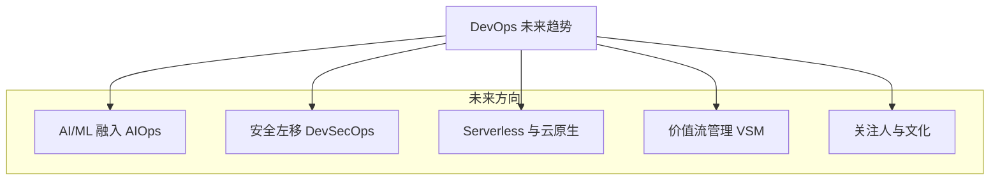
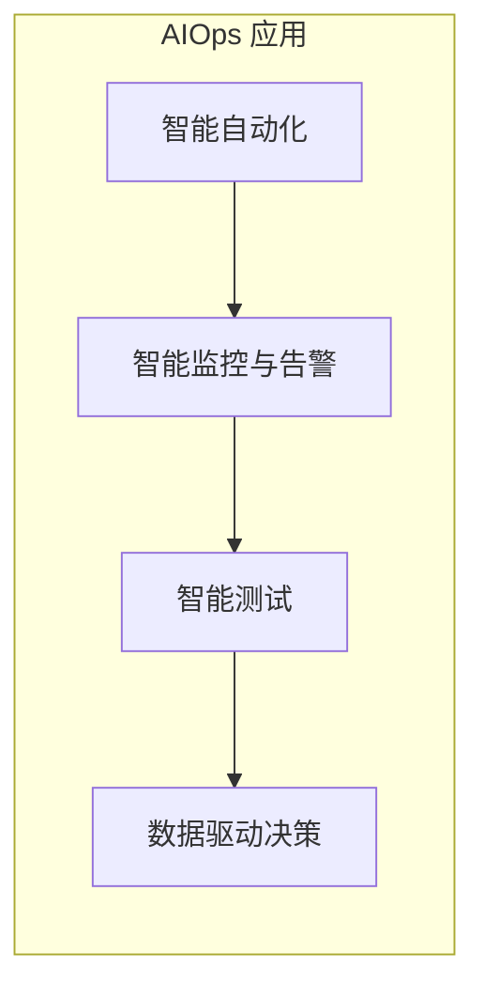
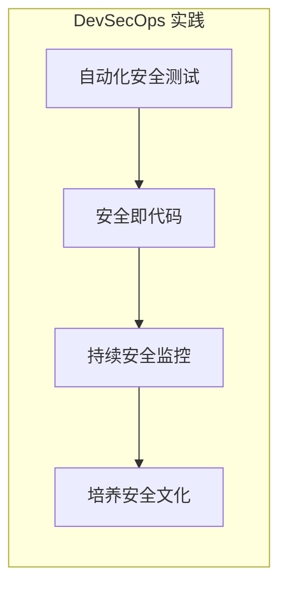
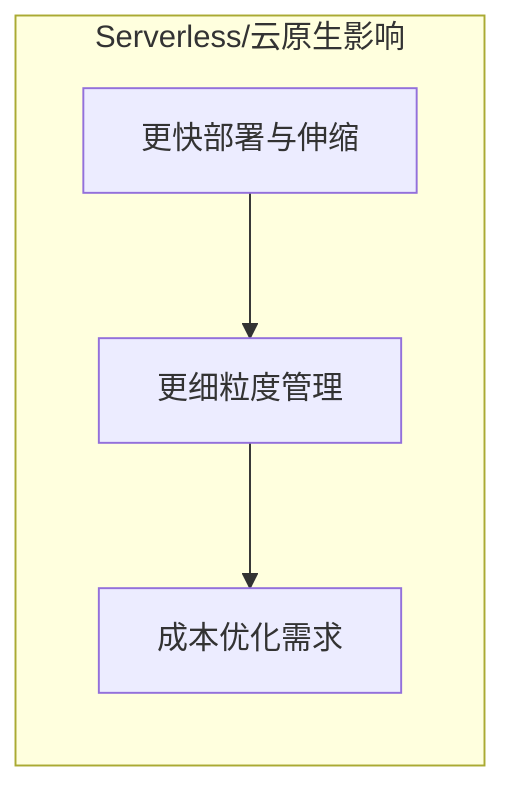
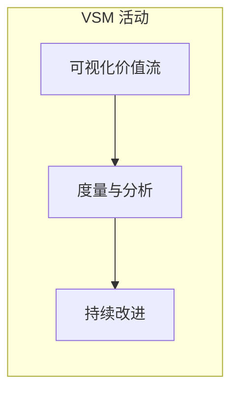
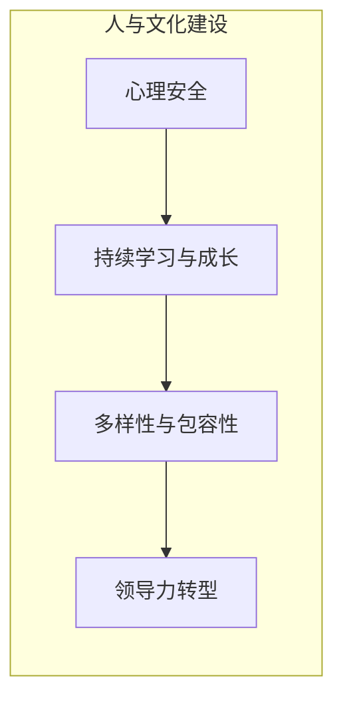

# 第六章：DevOps 的未来会怎样？

DevOps 经过多年的发展，已经从一个新兴理念变成很多公司的主流实践。那么，DevOps 的未来会走向何方呢？它还会继续演变和发展吗？答案是肯定的。让我们来看看 DevOps 未来可能的一些发展趋势。

我们可以用一个概览图来展示 DevOps 的主要未来趋势：

## 6.1 人工智能与机器学习的融入 (AI/ML in DevOps - AIOps)

人工智能 (AI) 和机器学习 (ML) 技术正在越来越多地被应用到 DevOps 的各个环节，催生了 **AIOps (AI for IT Operations)** 的概念。

*   **智能自动化：** AI 可以帮助我们更智能地进行自动化，比如自动预测系统故障、自动调整资源分配、自动优化部署策略等。
*   **智能监控和告警：** 通过学习历史数据，AI 可以更准确地识别异常模式，减少误报，帮助我们更快地发现和定位问题。
*   **智能测试：** AI 可以帮助生成测试用例、优化测试覆盖率，甚至自动修复一些简单的 bug。
*   **数据驱动决策：** AI 可以分析大量的运维数据，为我们提供更精准的决策支持。

AIOps 的核心应用场景：

想象一下，未来你的运维系统可以像一个聪明的助手一样，主动帮你发现问题、解决问题，甚至在你意识到之前就搞定了。

## 6.2 DevSecOps：安全融入 DevOps 全流程

过去，安全往往是在软件开发的最后阶段才考虑的事情，这就像房子盖好了才发现地基有问题一样，修复成本很高。

**DevSecOps** 的理念是把安全 (Security) 从一开始就融入到 DevOps 的整个生命周期中，实现“安全左移”（Shift Left），即尽早考虑和实施安全措施。

*   **自动化安全测试：** 在 CI/CD 流程中自动进行代码扫描、漏洞检测等安全测试。
*   **安全即代码 (Security as Code)：** 像管理基础设施一样，用代码来定义和管理安全策略。
*   **持续安全监控：** 对线上系统进行持续的安全监控和威胁检测。
*   **培养安全文化：** 让团队中的每个人都具备安全意识，共同为产品的安全负责。

DevSecOps 的核心实践：

DevSecOps 的目标是让安全不再是某个部门或某个人的事情，而是成为 DevOps 流程中不可或缺的一部分，从而在保证快速交付的同时，也保证了软件的安全性。

## 6.3 Serverless 和云原生架构的普及

**Serverless（无服务器架构）** 是一种让开发者不用关心服务器运维的云计算模型。你只需要编写和上传你的代码（比如一个函数），云平台会自动处理服务器的分配、扩容和维护。

**云原生 (Cloud Native)** 则是一套构建和运行应用程序的方法论，它充分利用了云计算的优势，比如弹性伸缩、按需付费、高可用性等。容器技术 (如 Docker) 和微服务架构是云原生的重要组成部分。

这些技术的发展对 DevOps 提出了新的要求，也带来了新的机遇：

*   **更快的部署和伸缩：** Serverless 和云原生架构使得应用的部署和扩容更加灵活和快速。
*   **更细粒度的管理：** DevOps 工具和流程需要适应这种更细粒度的应用和服务管理。
*   **成本优化：** 按需付费的模式也对 DevOps 的资源管理和成本控制提出了更高要求。

Serverless 和云原生对 DevOps 的影响：

## 6.4 关注价值流管理 (Value Stream Management)

DevOps 不仅仅是提高开发和部署的效率，更重要的是要为业务创造价值。

**价值流管理 (Value Stream Management, VSM)** 是一种关注从客户需求提出到价值交付给客户的整个端到端流程的方法。它帮助我们识别流程中的瓶颈和浪费，从而优化整个价值交付的过程。

*   **可视化价值流：** 将整个软件交付过程可视化，让团队清楚地看到每个环节的状态和效率。
*   **度量和分析：** 通过数据来度量价值流的各个指标，比如交付周期、吞吐量等。
*   **持续改进：** 基于数据分析，持续优化价值流，提升整体效率和价值产出。

价值流管理 (VSM) 的关键活动：

VSM 帮助 DevOps 团队更好地将技术实践与业务目标对齐，确保所做的工作能够真正为企业带来价值。

## 6.5 更加关注人的因素和文化建设

虽然技术和工具在不断发展，但 DevOps 的核心始终是**人与文化**。

未来，DevOps 会更加强调：
*   **心理安全：** 创造一个让员工敢于尝试、不怕犯错、乐于分享的环境。
*   **持续学习和成长：** 鼓励团队成员不断学习新知识、新技能。
*   **多样性和包容性：** 建立多元化和包容性的团队文化，激发创新。
*   **领导力转型：** 领导者需要从传统的命令控制型转变为服务型和赋能型，支持团队的自主性和创造力。

更加关注人的因素和文化建设，强调：

DevOps 的未来是技术与人文并重，通过不断的技术创新和文化建设，推动软件交付能力的持续提升，更好地适应快速变化的商业环境。

---