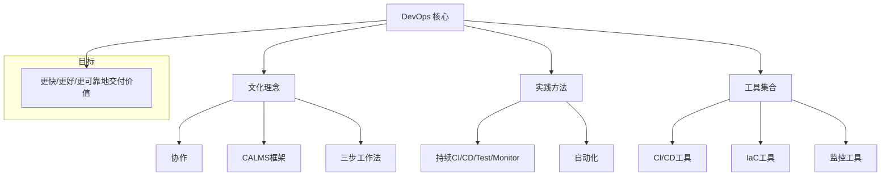
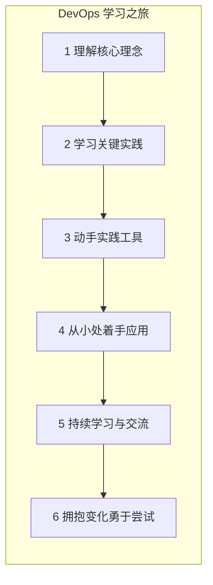

# 第七章：总结与展望：开启你的 DevOps 之旅

经过前面几个章节的学习，相信你对 DevOps 已经有了一个初步的认识。让我们简单回顾一下，并展望一下如何开始你的 DevOps 学习和实践之旅。

## 7.1 DevOps 核心回顾

简单来说，DevOps 是一种**文化理念、实践方法和工具集合**，它的目标是**打破开发 (Dev) 和运维 (Ops) 之间的壁垒，实现更快速、更可靠、更高质量的软件交付和价值创造**。

记住几个关键词：

*   **协作 (Collaboration)：** 开发、测试、运维等角色紧密合作，共同为目标努力。
*   **自动化 (Automation)：** 将重复性的手动任务自动化，提高效率，减少错误。
*   **持续 (Continuous)：** 持续集成、持续交付/部署、持续测试、持续监控，形成一个快速反馈的闭环。
*   **CALMS 框架：** 文化 (Culture)、自动化 (Automation)、精益 (Lean)、度量 (Measurement)、共享 (Sharing)，是理解 DevOps 的一个好框架。
*   **三大支柱 (The Three Ways)：** 系统思维 (Systems Thinking)、放大反馈回路 (Amplify Feedback Loops)、持续实验与学习文化 (Culture of Continual Experimentation and Learning)。

我们可以用一个图来总结 DevOps 的核心要素：

DevOps 不是一个一蹴而就的目标，而是一个**持续改进的旅程**。

## 7.2 为什么要学习和拥抱 DevOps？

无论你是开发人员、测试人员、运维工程师，还是产品经理、项目经理，了解和学习 DevOps 都会对你的工作和职业发展带来益处：

*   **提升个人技能：** 学习自动化工具、云技术、安全知识等，让你更具竞争力。
*   **改善工作方式：** 减少重复劳动，提高工作效率，让你有更多时间去做有创造性的事情。
*   **增强团队协作：** 更好地与团队成员沟通和协作，共同完成目标。
*   **适应行业趋势：** DevOps 已经是软件行业的主流趋势，掌握它能让你更好地适应未来的工作需求。
*   **创造更大价值：** 帮助你的团队和公司更快地交付高质量的软件，为用户和业务创造更大的价值。

## 7.3 如何开始你的 DevOps 之旅？

学习 DevOps 可能看起来有点 daunting（令人望而生畏），因为它涉及的知识面比较广。但别担心，你可以一步一步来：

1.  **理解核心理念：** 首先要真正理解 DevOps 的文化和原则，为什么需要它，它要解决什么问题。
2.  **学习关键实践：** 了解持续集成 (CI)、持续交付 (CD)、基础设施即代码 (IaC)、自动化测试、监控等核心实践。
3.  **动手实践：** 理论学习很重要，但更重要的是动手实践。可以从一些简单的工具开始尝试：
    *   **版本控制：** 学习使用 Git 和 GitHub/GitLab。
    *   **CI/CD 工具：** 尝试用 Jenkins, GitLab CI 或 GitHub Actions 搭建一个简单的自动化构建和部署流程。
    *   **容器技术：** 学习 Docker 的基本使用。
    *   **配置管理/IaC：** 了解一下 Ansible 或 Terraform。
    *   **监控工具：** 尝试使用 Prometheus 和 Grafana 搭建一个简单的监控系统。
4.  **从小处着手：** 在你的工作或个人项目中，尝试应用一些 DevOps 的实践。比如，先为你的一个小项目配置上 CI。
5.  **持续学习：** DevOps 技术和理念在不断发展，保持好奇心，持续学习新的知识。
    *   阅读相关的书籍、博客、文章。
    *   参加线上或线下的技术分享和研讨会。
    *   加入相关的技术社区，与他人交流学习。
你的 DevOps 学习路径可以这样规划：

6.  **拥抱变化，勇于尝试：** DevOps 本身就是关于持续改进和实验的，不要怕犯错，从错误中学习。

## 7.4 展望未来

DevOps 的旅程没有终点。随着技术的发展，如人工智能 (AIOps)、无服务器 (Serverless)、DevSecOps 等新趋势的出现，DevOps 的内涵和外延也在不断扩展。

最重要的是，始终保持以**交付价值为核心，以人为本，持续改进**的心态。

希望这个简化的 DevOps 入门介绍能为你打开一扇门。现在，是时候开始你自己的 DevOps 探索之旅了！祝你学习愉快，实践顺利！

---