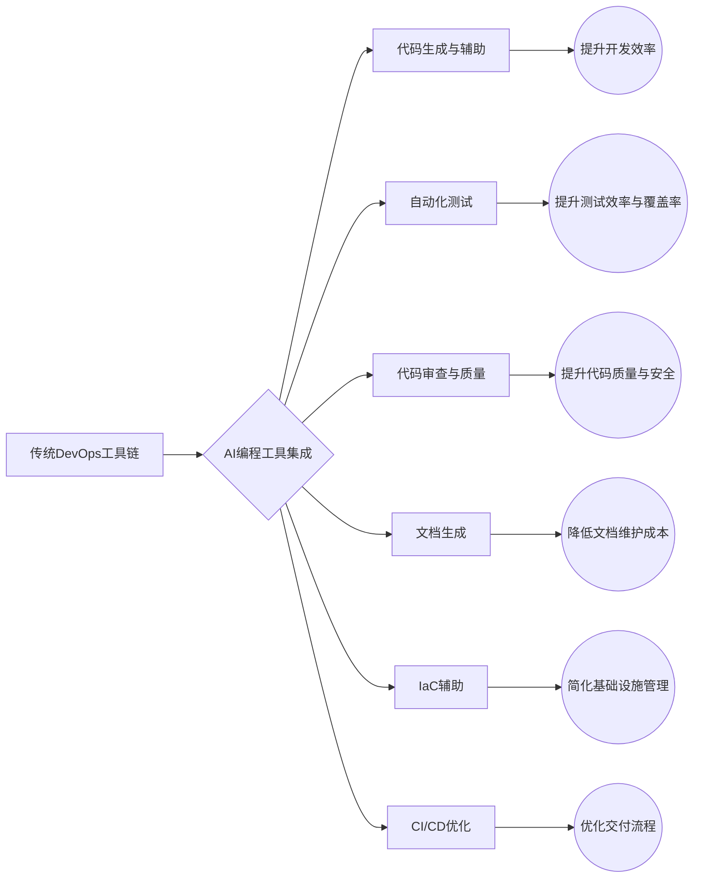
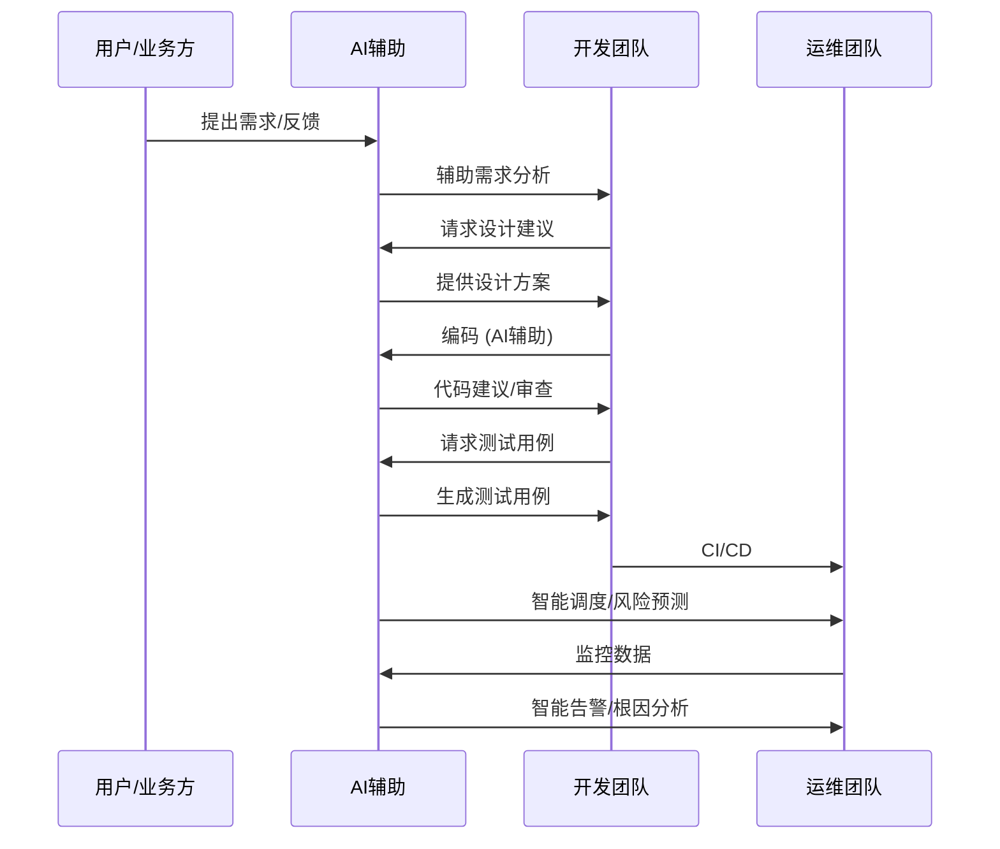
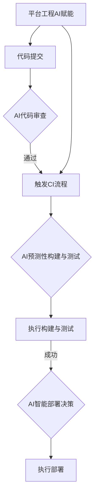
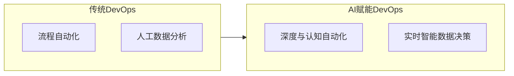
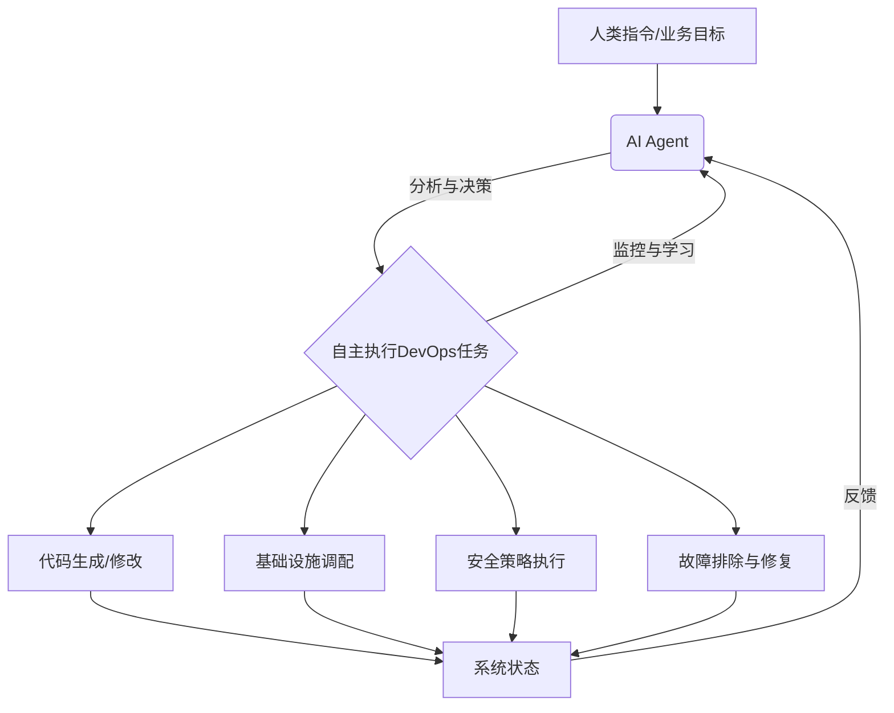

## 封面 (第1页)

**AI浪潮下的DevOps变革与未来展望**

基于《DevOps_AI_Report_Simplified.md》报告

---

## 引言：AI浪潮、DevOps变革及报告主旨 (第2页)

*   **时代背景**：2024年，大语言模型（LLM）和生成式AI（GenAI）正深刻改变各行各业，软件工程首当其冲。DevOps作为连接开发与运维、追求高效交付与稳定运行的核心理念，正经历AI引发的深刻变革。
*   **变革的实质**：不仅是工具升级，更是思维范式、协作模式、工作流程、开发者角色乃至组织形态的系统性重塑。AI的核心驱动是推动DevOps从“自动化”向“智能化”乃至“自治化”的智变跃迁。
*   **本演示主旨**：全面剖析AI（特别是AI编码技术）如何深度赋能并重构现代DevOps的各个环节，提供一个清晰的路线图，理解和把握AI时代DevOps的变革机遇。
*   **核心议题概览**：AI编程影响、AI赋能核心实践、传统与AI赋能对比、MLOps、挑战风险与应对、未来趋势。

**Takeaway**: AI正从根本上重塑DevOps，本次分享将系统梳理其应用、影响与未来。

---

## AI编程对DevOps的根本性影响 (第3页)

*   **核心观点**：AI编程，特别是基于LLM的AI编码助手，正从根本上改变DevOps的实践方式和核心理念。
*   **影响层面**：工具链革新、思维模式转变、角色定义重塑、软件开发生命周期（SDLC）重构。

**Takeaway**: AI编程是DevOps变革的核心驱动力之一，影响深远。

---

## AI编程工具重塑DevOps生态 (第4页)

*   **主流AI编程工具**：Cursor, GitHub Copilot, Windsurf等。
*   **核心能力与影响**：代码生成与辅助、自动化测试、代码审查与质量保障、文档生成与维护、IaC辅助、CI/CD流程优化。

**Takeaway**: AI编程工具正成为DevOps工具链的核心组成，全面提升各环节效率与质量。

---

## 从自动化到智能化的思维转变 (第5页)

*   **传统DevOps核心**：“自动化” (脚本和工具链驱动)。
*   **AI引入后的核心**：“智能化” (数据和模型驱动)。
*   **思维转变体现**：规则驱动 -> 数据驱动；被动响应 -> 主动预测；任务执行 -> 认知协作；持续学习与自适应优化。

**Takeaway**: AI将DevOps从“自动化”推向“智能化”，核心是数据驱动和认知协作。

---

## 开发者角色的重新定义与技能重塑 (第6页)

*   **角色转变**：代码编写者 -> **代码策划者/审查者 (提示工程师)**。关注点：底层编码细节 -> **业务逻辑、系统架构、用户体验、创新**。
*   **技能重塑需求**：系统思维与跨领域能力 (AI、数据科学)；人机协作与沟通能力；持续学习与适应新技术。

**Takeaway**: AI不会取代开发者，而是将其提升到更高层次，要求新的技能组合。

---

## 软件开发生命周期（SDLC）的智能化重构 (第7页)

*   **AI在SDLC各阶段的应用**：需求分析、设计、编码、测试、部署 (CI/CD)、运维与监控 (AIOps)、安全 (DevSecOps)。

**Takeaway**: AI贯穿SDLC各环节，实现全流程智能化，提升效率与质量。

---

## AI赋能的DevOps核心实践：智能化CI/CD与平台工程 (第8页)

*   **核心观点**：AI的融入催生新一代DevOps核心实践，构成更智能、高效、自适应的框架。
*   **智能化CI/CD流水线**：智能代码审查与合并；预测性构建与测试；智能部署策略；流水线性能分析与优化；失败根本原因分析。
*   **平台工程与AI融合**：智能化服务目录与推荐；自然语言交互接口；自动化资源调配与优化；个性化开发者体验；知识库与智能问答。

**Takeaway**: AI使CI/CD更智能，并与平台工程结合，将DevOps的“自服务”理念发挥到极致。

---

## 传统与AI赋能DevOps对比：自动化扩展与数据驱动 (第9页)

*   **核心观点**：AI赋能的DevOps在效率、智能、预测能力和适应性方面远超传统DevOps。
*   **自动化程度与范围的扩展**：
    *   传统DevOps：侧重于流程自动化。
    *   AI赋能DevOps：实现深度自动化（代码生成、智能测试）和认知自动化（理解上下文、自动修复）。
*   **数据驱动决策能力的革新**：
    *   传统DevOps：依赖人工分析，决策滞后。
    *   AI赋能DevOps：实时数据分析、模式识别与预测、智能洞察与建议 (AIOps核心)。

**Takeaway**: AI将DevOps自动化从“体力活”提升到“脑力活”，决策从事后响应转变为事前预测。

---

## MLOps：AI原生应用的专门化DevOps实践精要 (第10页)

*   **核心观点**：MLOps是将DevOps原则应用于ML模型生命周期管理的专门分支，应对AI/ML的独特性。
*   **独特需求与挑战**：数据依赖性强、模型迭代复杂、计算资源密集、实验管理繁琐、模型漂移、合规与可解释性要求。
*   **关键实践**：数据/模型版本控制、模型训练/部署/监控/再训练、实验跟踪。
*   **容器化与云原生 (Docker/Kubernetes, Serverless, 托管ML平台)**：实现环境一致性、可移植性、可扩展性、资源隔离，简化部署与管理。

**Takeaway**: MLOps是确保AI模型持续交付价值的关键，容器化和云原生是其重要技术支撑。

---

## AI赋能DevOps的挑战与应对：技术与组织文化 (第11页)

*   **核心观点**：AI为DevOps带来巨大潜力，但也伴随新的挑战和风险，需主动识别和管理。
*   **技术挑战**：数据质量与可获得性；模型复杂性与可解释性；集成复杂性；技能差距；AI模型偏见。
*   **技术应对**：数据治理；可解释性AI (XAI)；标准化API；团队培训；偏见检测与缓解。
*   **组织与文化挑战**：变革阻力；角色重新定义；跨部门协作障碍；缺乏数据驱动文化。
*   **组织文化应对**：加强沟通；提供培训；建跨职能团队；高层推动文化培育。

**Takeaway**: 克服技术挑战、适配组织文化是AI赋能DevOps成功的前提与保障。

---

## AI赋能DevOps的挑战与应对：安全、合规、伦理与成本 (第12页)

*   **安全、合规与伦理挑战**：AI模型安全性（对抗攻击）；数据隐私保护；算法偏见与公平性；责任归属；行业合规性。
*   **安全、合规与伦理应对**：DevSecOps；数据加密与访问控制；公平性审计；AI治理框架；关注法律法规。
*   **成本与资源挑战**：AI工具与平台成本；计算资源成本；专业人才成本。
*   **成本与资源应对**：评估ROI；优化资源使用；利用开源工具；分阶段投入。

**Takeaway**: 必须将安全、合规、伦理及成本考量置于AI赋能DevOps的核心，并制定相应策略。

---

## AI在DevOps未来发展趋势展望 (第13页)

*   **核心观点**：AI将持续深度融合DevOps，推动其向更智能、更自主、更普惠的方向发展。
*   **主要趋势**：更强大的AI Agent与自主操作；开源AI与社区驱动创新；多模态AI应用；AI驱动架构设计；增强的AI可观测性；低代码/无代码协同；绿色DevOps；AI治理。

**Takeaway**: AI与DevOps的结合前景广阔，将不断涌现新的创新和应用场景。

---

## 更强大的AI Agent与自主操作 (第14页)

*   **趋势描述**：AI Agent将具备更强的自主决策和执行能力，能够独立完成更复杂的DevOps任务（自主诊断修复、自动调整架构、主动安全修复、生成完整模块）。
*   **影响**：进一步解放人力，实现更高程度的自动化和智能化，甚至达到“无人驾驶”的运维状态。

**Takeaway**: 未来的AI Agent有望成为DevOps团队的核心成员，承担起更广泛的自主操作职责。

---

## 开源AI与社区驱动创新 (第15页)

*   **趋势描述**：开源AI模型、框架和工具的普及，将极大降低AI在DevOps中应用的门槛。更多针对DevOps场景的开源AI解决方案涌现，社区加速创新，企业灵活定制集成。
*   **影响**：推动AI赋能DevOps的民主化，使更多组织能够受益。

**Takeaway**: 开源将是AI在DevOps领域普及和发展的重要驱动力。

---

## 拥抱AI浪潮：组织变革的建议 (第16页)

*   **核心观点**：成功将AI融入DevOps不仅是技术问题，更需要组织层面的战略调整和文化变革。
*   **关键建议**：培养持续学习文化；重新定义角色与技能；构建跨职能团队；数据驱动决策；渐进式引入；关注风险与伦理；寻求外部合作；高层领导支持。

**Takeaway**: 组织需要主动适应和变革，才能充分释放AI在DevOps中的巨大潜力。

---

## 总结与展望 (第17页)

*   **AI对DevOps的变革是深刻且持续的**：AI是思维模式和工作方式的革新。
*   **机遇与挑战并存**：AI带来效率提升和智能化，也伴随多方面挑战。
*   **未来展望**：一个更加**智能 (Intelligent)**、**自主 (Autonomous)**、**自适应 (Adaptive)** 的新一代DevOps生态正在形成。人机协作更紧密，持续创新是主旋律。
*   **行动呼吁**：积极拥抱AI，主动学习和实践，共同塑造DevOps的美好未来！

**Takeaway**: AI正在引领DevOps进入一个全新的智能时代，现在是开始行动的最佳时机。

---