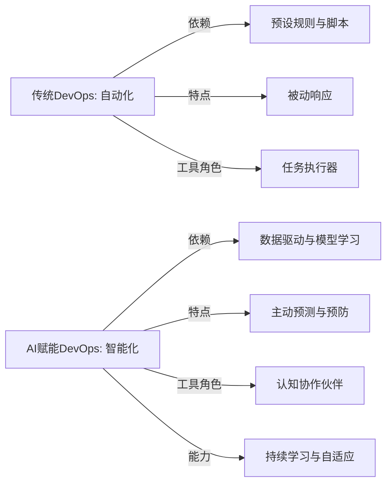
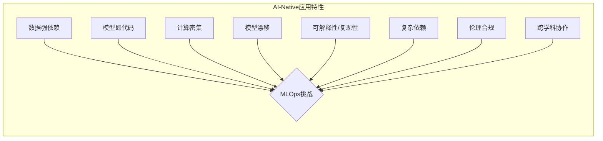
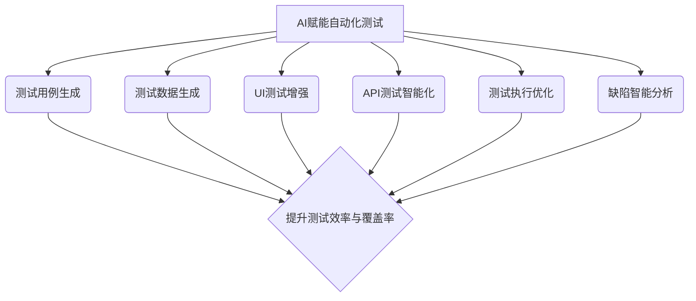

## 01. AI对DevOps的革命性影响

AI技术正深刻变革DevOps实践，旨在全面提升效率、质量和智能化水平。

---

## 02. AI在DevOps核心实践中的应用

**Takeaways:** AI能够增强DevOps各阶段能力，例如通过AI进行代码补全、缺陷预测、智能告警、根因分析和自动化修复，实现更高效和可靠的软件交付。

| DevOps核心实践 | AI应用点                                   | 价值                                   |
| :--------------- | :----------------------------------------- | :------------------------------------- |
| 计划与设计       | 需求分析、用户故事生成、架构建议           | 更快理解需求、优化设计                 |
| 开发与编码       | 代码生成/补全、代码审查、Bug预测与修复     | 提高编码效率、减少缺陷                 |
| 构建与集成       | 智能构建触发、依赖分析优化                 | 加速构建、稳定集成                     |
| 测试与验证       | 测试用例生成、自动化测试、缺陷定位         | 提升测试覆盖率、快速定位问题           |
| 部署与发布       | 智能部署策略（金丝雀/蓝绿）、风险评估      | 降低发布风险、平滑上线                 |
| 运维与监控       | AIOps：智能告警、异常检测、根因分析、自愈 | 提高系统可用性、降低MTTR             |
| 反馈与优化       | 用户行为分析、性能瓶颈识别、优化建议       | 持续改进产品与流程                     |

---

## 03. 传统DevOps与AI赋能DevOps对比

**Takeaways:** AI赋能的DevOps在自动化、智能化、预测能力和决策支持方面远超传统DevOps，但同时也带来了新的复杂性和风险。

| 特性         | 传统DevOps                               | AI赋能DevOps                                                              |
| :----------- | :--------------------------------------- | :------------------------------------------------------------------------ |
| **自动化水平** | 脚本化、流程自动化                       | **深度自动化**：基于学习和推理，覆盖更复杂场景                                |
| **核心驱动**   | 工具链、流程规范                         | **数据与智能驱动**：利用数据洞察进行预测、决策和优化                          |
| **问题处理**   | 被动响应、依赖人工经验                   | **主动预测与预防**：异常检测、根因分析、甚至自愈                                |
| **效率提升**   | 依赖工具和流程优化                       | **指数级效率提升**：AI辅助编码、测试、运维，大幅缩短周期                      |
| **决策支持**   | 基于历史数据和报表                       | **智能决策支持**：提供实时洞察、风险评估和优化建议                            |
| **主要挑战**   | 工具链集成、文化转型、技能提升           | **模型准确性、数据质量、可解释性、伦理、安全、成本**                            |

---

## 04. 思维转变：从自动化到智能化

**Takeaways:** AI推动DevOps从依赖预设规则的“自动化”向基于数据学习和推理的“智能化”转变，实现更主动、更具洞察力的运作模式。

*   **从规则驱动到数据驱动**：传统自动化依赖预设规则，智能化则依赖从大量数据中学习和推理（例如AIOps通过分析历史监控数据预测故障）。
*   **从被动响应到主动预测**：AI能够基于模式识别和趋势分析，预测潜在问题（如性能瓶颈、安全漏洞），实现主动预防。
*   **从任务执行到认知协作**：AI不再仅是执行命令的工具，而是能理解上下文、提供建议、与开发者进行自然语言交互的“认知伙伴”。
*   **持续学习与自适应优化**：AI系统能从新数据和反馈中持续学习，优化模型和决策，使DevOps流程自适应变化。



---

## 05. 开发者角色重塑与技能演进

**Takeaways:** AI编程正重塑开发者角色，从纯粹的编码者转变为AI的协作者和引导者，要求开发者具备新的技能组合。

*   **从代码编写者到代码策划者/审查者**：更多扮演“提示工程师”角色，引导AI生成代码，并专注于审查、调试和集成。
*   **关注点上移**：从底层编码细节解放，更专注于业务逻辑、系统架构、用户体验和创新。
*   **系统思维与跨领域能力增强**：需具备更强系统思维，理解整个交付链路，可能需掌握AI、数据科学知识。
*   **人机协作与沟通能力**：有效与AI协作，理解其边界与偏见，清晰表达需求成为核心技能。
*   **持续学习与适应新技术**：AI技术快速发展，需保持开放心态，持续学习新工具和范式。

---

## 06. 平台工程：DevOps的进化与AI融合

**Takeaways:** 平台工程通过构建内部开发者平台（IDP）提升开发体验和效率，AI的融入进一步增强了IDP的智能化服务能力。

*   **核心理念**：为开发者提供标准化的工具、服务和自动化流程，降低认知负荷。
*   **AI增强的IDP能力**：
    *   **智能化服务目录与推荐**：根据项目需求和历史数据智能推荐平台服务。
    *   **自然语言交互接口**：允许开发者通过自然语言与IDP交互（如：“创建新微服务”）。
    *   **自动化资源调配与优化**：AI根据应用负载自动调配和优化资源。
    *   **个性化开发者体验**：学习开发者偏好，提供个性化配置和指引。
    *   **知识库与智能问答**：构建强大知识库，通过智能问答快速解决疑问。

```mermaid
graph TD
    A[平台工程 (IDP)] --> B(标准化工具与服务);
    A --> C(自动化流程);
    A --> D(降低认知负荷);
    A --> E(提升开发体验与效率);
    F[AI融合] --> G(智能化服务推荐);
    F --> H(自然语言交互);
    F --> I(自动化资源优化);
    F --> J(个性化体验);
    F --> K(智能知识库);
    B & C & D & E --> L{DevOps自服务理念极致发挥};
    G & H & I & J & K --> L;
```

---

## 07. AI-Native应用的特殊需求与挑战

**Takeaways:** 基于AI/ML模型的应用（AI-Native应用）在数据依赖、模型迭代、计算资源、持续学习等方面对DevOps提出了新的、更复杂的要求。

*   **数据依赖性强**：模型性能高度依赖训练数据的质和量。
*   **模型即代码与实验性**：模型本身需版本控制，开发过程充满实验。
*   **计算资源密集**：训练和推理对GPU等资源需求大。
*   **模型漂移与持续学习**：部署后模型性能可能下降，需持续监控和再训练。
*   **可解释性与可复现性**：理解模型决策和复现结果至关重要。
*   **复杂的依赖关系**：依赖特定版本的数据、模型、库和硬件。
*   **伦理与合规风险**：涉及偏见、隐私、知识产权等。
*   **跨学科团队协作**：需数据科学家、ML工程师、软件工程师等紧密协作。



---

## 08. AI赋能DevOps的主要挑战与风险

**Takeaways:** 尽管潜力巨大，AI赋能DevOps面临技术（如代码质量、模型黑箱）、组织（如技能差距、文化阻力）、安全（如提示注入、数据隐私）和成本（如GPU、工具费用）等多方面挑战。

*   **技术挑战**:
    *   AI生成代码的质量与可靠性 (幻觉、Bug)
    *   LLM的不确定性与可解释性 (黑箱)
    *   数据质量与偏见问题
    *   集成复杂性与工具链碎片化
    *   模型漂移与持续维护
*   **组织与文化挑战**:
    *   技能差距与人才短缺 (提示工程、AI伦理)
    *   人机协作模式磨合与信任建立
    *   变革管理与文化阻力
*   **安全、合规与伦理风险**:
    *   提示词注入 (Prompt Injection)
    *   数据隐私与机密性
    *   AI生成内容引入新漏洞
    *   知识产权与责任界定
*   **成本与资源挑战**:
    *   GPU等计算资源的高昂成本
    *   AI工具订阅与API调用费用

---

## 09. 应对AI赋能DevOps挑战的核心策略

**Takeaways:** 应对AI挑战需采取审慎引入、人机协同、关注可解释性、加强数据治理、推动文化变革和安全左移等综合策略。

*   **技术层面**:
    *   **审慎引入与充分验证**：试点先行，严格测试，建立质量门禁。
    *   **“人在回路” (Human-in-the-Loop)**：关键决策保留人工审核。
    *   **关注可解释性与透明度**：选择或构建可解释模型。
    *   **数据治理与偏见缓解**：确保数据质量，审计偏见。
    *   **标准化与平台化**：避免工具链碎片化。
    *   **持续监控与反馈循环**：及时更新和再训练模型。
    *   **安全左移与深度防御**：早期融入AI安全，多层防御。
*   **组织与文化层面**:
    *   **投资人才培养与技能提升**：赋能团队掌握新技能。
    *   **建立信任与促进协作**：鼓励尝试，明确人机职责。
    *   **积极变革管理**：清晰沟通，高层支持，逐步推进。
    *   **知识共享与持续学习文化**。
*   **安全、伦理与成本层面**:
    *   **制定AI伦理准则与治理框架**。
    *   **加强AI安全投入与风险评估**。
    *   **FinOps实践**：精细化AI成本管理与优化。

---

## 10. AI编程助手：提升开发效率与代码质量

**Takeaways:** AI编程助手通过代码生成、补全、解释、调试和文档编写等功能，显著提升开发者生产力，但需关注其输出质量和潜在风险。

*   **核心功能**：
    *   代码生成与补全 (Copilot, CodeWhisperer)
    *   代码解释与理解
    *   Bug检测与修复建议
    *   单元测试用例生成
    *   代码重构与优化建议
    *   技术文档与注释生成
*   **主要优势**：
    *   大幅提升编码速度
    *   降低重复劳动，聚焦复杂逻辑
    *   辅助学习新技术和API
    *   改进代码规范性和一致性
*   **潜在风险与挑战**：
    *   生成代码的质量、安全性和版权问题
    *   过度依赖导致开发者技能退化
    *   “幻觉”与不准确性
    *   数据隐私（如将代码片段发送到云端分析）

---

## 11. AI在自动化测试中的应用

**Takeaways:** AI能够自动生成测试用例、优化测试执行、智能分析测试结果并辅助缺陷定位，从而提高测试效率、覆盖率和准确性。

*   **测试用例自动生成**：基于代码、需求或用户行为生成测试场景。
*   **测试数据智能生成**：生成多样化、有效的测试数据。
*   **UI自动化测试增强**：通过视觉AI识别和操作UI元素，提高脚本鲁棒性。
*   **API测试智能化**：自动探索API接口，生成测试序列。
*   **测试执行优化**：基于代码变更和风险预测，智能选择和排序测试用例执行。
*   **缺陷智能分析与定位**：分析失败日志，快速定位缺陷根源。
*   **可视化测试与回归**：通过图像对比检测UI变化。



---

## 12. AI在持续集成与持续部署(CI/CD)中的革新

**Takeaways:** AI可以优化CI/CD流水线，通过智能触发构建、预测构建失败、自动化代码审查、智能部署决策和风险评估，使CI/CD更高效、更可靠。

*   **智能构建触发**：基于代码提交内容和历史数据，判断是否需要触发完整构建流程。
*   **构建失败预测与分析**：在构建早期预测潜在失败，分析失败原因。
*   **AI辅助代码审查**：自动检测潜在缺陷、安全漏洞、代码异味，提供修复建议。
*   **智能部署策略选择**：根据应用特性、风险评估和当前环境，推荐或自动选择最佳部署策略（如金丝雀、蓝绿）。
*   **部署风险实时评估**：监控部署过程中的关键指标，预测潜在问题，支持自动回滚决策。
*   **变更失败预测 (Change Failure Prediction)**：基于历史变更数据预测新变更的失败概率。

---

## 13. AIOps：智能运维的崛起

**Takeaways:** AIOps利用大数据和机器学习算法，实现运维任务的自动化和智能化，包括异常检测、事件关联、根因分析和自动化修复，旨在提升系统稳定性和运维效率。

*   **核心能力**：
    *   **海量数据收集与处理**：整合日志、指标、追踪等多源异构数据。
    *   **智能告警与降噪**：基于机器学习的动态阈值、异常检测，减少误报和漏报。
    *   **事件关联与根因分析 (RCA)**：自动识别告警风暴中的核心问题，快速定位故障源头。
    *   **预测性维护**：预测潜在故障和容量瓶颈。
    *   **自动化修复与自愈**：执行预定义的修复操作，甚至自主决策进行修复。
*   **关键技术**：
    *   时间序列分析、异常检测算法 (如3-sigma, Isolation Forest, LSTM)
    *   自然语言处理 (NLP) 用于日志分析
    *   图计算用于依赖关系分析和事件传播
    *   强化学习用于自动化决策

---

## 14. DevSecOps：在DevOps中内嵌AI驱动的安全性

**Takeaways:** AI可以增强DevSecOps实践，通过自动化漏洞发现、威胁建模、安全测试和事件响应，实现更早、更智能的安全防护。

*   **AI驱动的静态应用安全测试 (SAST)**：更精准地识别代码中的安全漏洞。
*   **AI驱动的动态应用安全测试 (DAST)**：模拟攻击行为，发现运行时漏洞。
*   **智能化依赖项扫描与管理**：识别开源组件中的已知漏洞，并提供修复建议。
*   **自动化威胁建模**：基于系统架构和历史数据，预测潜在攻击路径。
*   **智能安全事件响应**：自动化分析安全告警，辅助或自动执行响应措施。
*   **用户行为分析 (UBA)**：检测异常用户行为，识别内部威胁。

---

## 15. AI在DevOps中的未来趋势

**Takeaways:** 未来AI将更深度融入DevOps，向自主化、认知化、个性化和普惠化方向发展，并与边缘计算、量子计算等新技术结合。

*   **自主化DevOps (Autonomous DevOps)**：AI系统能够独立完成更多复杂的DevOps任务，减少人工干预。
*   **认知智能增强**：AI不仅执行任务，更能理解意图、进行推理、主动提供洞察和创新建议。
*   **超自动化 (Hyperautomation)**：AI与其他自动化技术（如RPA）结合，实现端到端的流程自动化。
*   **个性化与情境感知**：AI根据开发者、项目和环境的特定情境提供定制化的辅助。
*   **AI普惠化与低代码/无代码**：更多开发者能利用AI能力，降低DevOps实践门槛。
*   **与新兴技术融合**：如AI与边缘计算结合的EdgeOps，AI与量子计算结合优化复杂问题。

---

## 16. 成功实施AI赋能DevOps的关键因素

**Takeaways:** 成功实施AI赋能DevOps需要战略规划、数据驱动文化、人才培养、技术与工具的审慎选择、持续迭代以及强有力的领导支持。

*   **明确的战略与愿景**：将AI赋能DevOps与业务目标对齐。
*   **数据驱动的文化**：重视数据收集、治理和利用。
*   **人才培养与技能提升**：投资于团队的AI和数据素养。
*   **合适的工具与技术栈**：审慎选择和集成AI工具，避免盲目追新。
*   **从小处着手，持续迭代**：选择有价值的场景试点，逐步推广。
*   **跨部门协作与沟通**：打破孤岛，促进知识共享。
*   **关注伦理、安全与合规**：建立治理框架，确保负责任的AI应用。
*   **强有力的领导支持与投入**。

---

## 17. 案例研究：AI在DevOps中的成功应用（占位）

**Takeaways:** （此部分将根据具体选取的1-2个行业案例进行填充，展示AI在DevOps中解决的实际问题和带来的具体效益。）

*   **案例一：[公司A] 利用AI优化CI/CD流水线**
    *   问题：构建时间长，部署失败率高。
    *   AI方案：引入AI进行构建失败预测和智能部署策略。
    *   成果：构建时间缩短X%，部署成功率提升Y%。
*   **案例二：[公司B] 应用AIOps提升系统稳定性**
    *   问题：告警风暴频繁，故障定位慢。
    *   AI方案：部署AIOps平台进行智能告警降噪和根因分析。
    *   成果：平均故障恢复时间(MTTR)降低Z%，运维人力成本节省W%。

---

## 18. 总结与展望

**Takeaways:** AI正从根本上重塑DevOps，使其向更智能、高效、自适应的未来演进。企业应积极拥抱变革，审慎规划，以充分利用AI带来的巨大潜力，同时应对其挑战。

*   **AI是DevOps的进化引擎**：推动DevOps从自动化向智能化、自治化跃迁。
*   **全生命周期赋能**：AI在需求、设计、开发、测试、部署、运维各环节均有应用。
*   **核心价值**：提升效率、质量、稳定性，加速创新，优化成本。
*   **挑战并存**：技术、组织、安全、成本等挑战不容忽视。
*   **未来展望**：自主化、认知化、个性化、普惠化，并与新技术深度融合。
*   **行动建议**：战略引领、文化先行、人才为本、小步快跑、持续优化。

---

## 19. 相关“Ops”领域简介：MLOps, AIOps, DevSecOps, LLMOps

**Takeaways:** MLOps专注于ML模型的生命周期管理，AIOps将AI用于IT运维，DevSecOps强调安全内建，LLMOps针对大型语言模型应用的运维。

*   **MLOps (Machine Learning Operations)**: 将DevOps原则应用于机器学习模型的构建、部署和维护，关注数据准备、模型训练、版本控制、持续集成/持续交付(CI/CD for ML)、监控和再训练。
*   **AIOps (AI for IT Operations)**: 利用AI和机器学习技术来自动化和改进IT运维任务，如异常检测、事件关联、根因分析、预测性维护和自动化修复。
*   **DevSecOps (Development, Security, and Operations)**: 在DevOps流程的每个阶段都融入安全实践和工具，实现“安全左移”，让安全成为共同责任。
*   **LLMOps (Large Language Model Operations)**: 专注于大型语言模型应用的生命周期管理，包括数据准备、提示工程、模型微调、部署、监控、内容审核和成本优化等特定挑战。

---

## 20. 推荐行动与企业落地建议

**Takeaways:** 企业应制定清晰的AI+DevOps战略，从小处着手试点，培养人才，选择合适工具，并建立持续改进的机制。

1.  **战略规划先行**：评估现状，明确AI在DevOps中的应用目标和路线图。
2.  **建立试点项目**：选择高价值、低风险的场景进行AI赋能DevOps的尝试。
3.  **投资人才培养**：提升团队成员的AI素养和相关技能（如提示工程）。
4.  **选择合适的工具与平台**：根据需求评估和选择AI编码助手、AIOps平台等。
5.  **数据治理是基础**：确保高质量的数据用于AI模型训练和决策。
6.  **关注安全与伦理**：建立AI应用的安全规范和伦理准则。
7.  **推动文化变革**：鼓励实验、容忍失败、促进人机协作。
8.  **持续监控与迭代优化**：跟踪AI应用的表现，不断调整和改进。