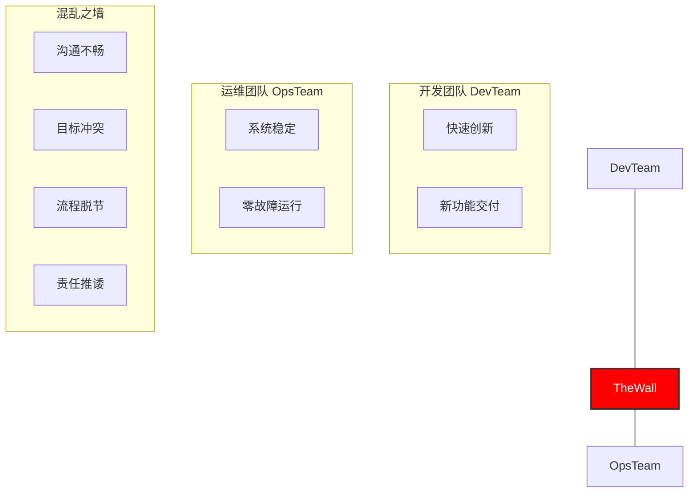
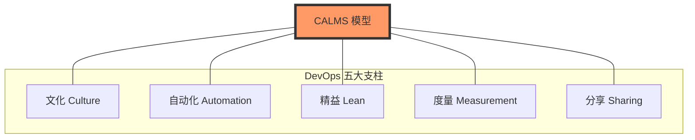
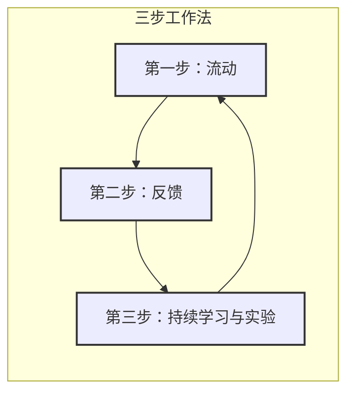
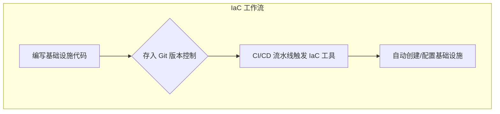
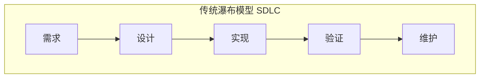
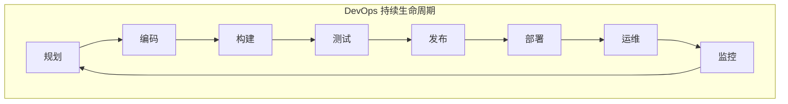
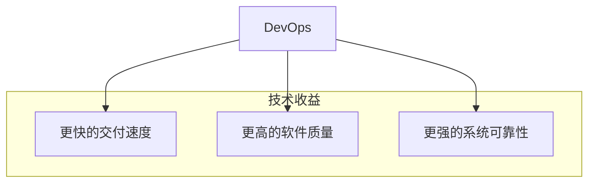
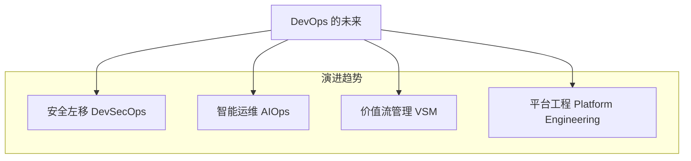
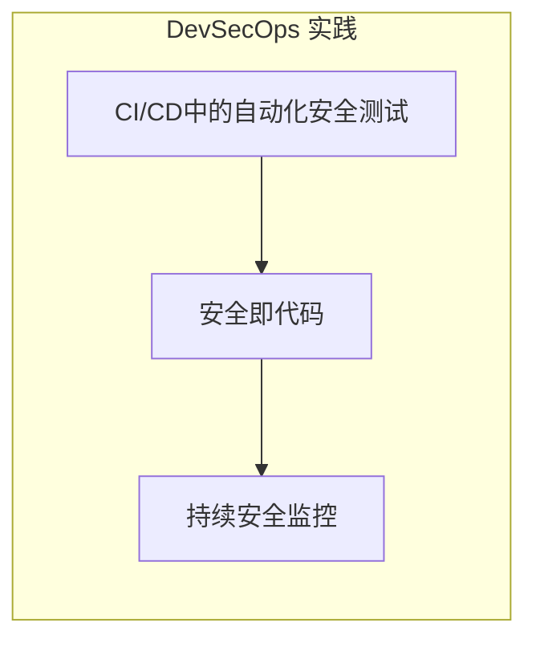
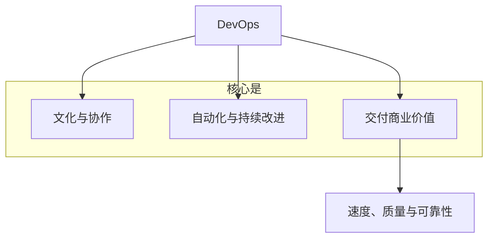

## 解密 DevOps：构建高效能技术组织的引擎 (第 1 页)

**一份面向初学者的 DevOps 核心理念与实践指南**

---

## 本次分享议程 (第 2 页)

1.  **问题的根源：** 传统开发与运维的冲突
2.  **解决方案：** 什么是 DevOps？其核心理念是什么？
3.  **核心实践：** DevOps 是如何运作的？
4.  **价值与收益：** DevOps 能带来什么好处？
5.  **挑战与未来：** 如何落地及未来的发展趋势？
6.  **开启你的旅程：** 如何开始学习和实践 DevOps？

**目标：** 在本次分享后，您将理解 DevOps 的核心思想，并了解如何开启自己的 DevOps 之旅。

---

## 巨大的鸿沟：开发 vs. 运维 (第 3 页)

*   **传统冲突：** 在许多组织中，开发团队和运维团队的目标是相互冲突的。
    *   **开发者 (Dev):** 追求快速创新和功能交付。
    *   **运维 (Ops):** 追求系统稳定和零故障。

*   **“混乱之墙”：** 这种冲突造成了一道屏障，导致：
    *   沟通不畅、流程孤立
    *   目标冲突、互相指责
    *   交付缓慢、变更困难



**核心要点：** 传统的开发与运维分离模式，是阻碍软件快速、高质量交付的根本原因之一。

---

## 解决方案：什么是 DevOps？ (第 4 页)

*   **打破壁垒：** DevOps 是 **Development (开发)** 和 **Operations (运维)** 的组合，旨在解决开发与运维之间的冲突。

*   **不仅是工具：** DevOps 是一种**文化理念**、一系列**实践方法**和一些**自动化工具**的集合。

*   **最终目标：** 让开发和运维团队更好地协作，从而**更快、更可靠地交付高质量的软件**。

*   **它解决了什么痛点？**
    *   交付太慢，无法快速响应市场。
    *   质量和速度难以平衡。
    *   害怕变更，每次发布都心惊胆战。
    *   团队各自为战，沟通效率低下。
    *   出了问题修复缓慢。

**核心要点：** DevOps 是一种打破壁垒的全新工作方式，旨在更快地为用户创造价值。

---

## 核心哲学：CALMS 模型 (第 5 页)

DevOps 文化可以通过 **CALMS** 模型来理解，它代表了 DevOps 的五个关键支柱。



*   **C**ulture (文化): 最重要的一环，倡导协作、信任和共同担责。
*   **A**utomation (自动化): 将重复、易错的工作交给机器，提升效率和可靠性。
*   **L**ean (精益): 消除浪费，小步快跑，快速交付和获取反馈。
*   **M**easurement (度量): 用数据说话，基于数据做决策和改进。
*   **S**haring (分享): 知识、经验、工具在团队和组织内共享，共同成长。

**核心要点：** DevOps 的基石是文化，并通过自动化、精益、度量和分享的原则来支撑。

---

## 指导原则：三步工作法 (第 6 页)

“三步工作法”是支撑所有 DevOps 实践的基础原则，描述了工作与价值的流动方式。



1.  **第一步：流动 (Flow)**
    *   关注价值从左到右（从开发到运维，再到用户）的顺畅流动，消除瓶颈。

2.  **第二步：反馈 (Feedback)**
    *   建立快速、持续的反馈环路，让问题尽早暴露，尽早修复。

3.  **第三步：持续学习与实验 (Continual Learning & Experimentation)**
    *   创造鼓励尝试、从失败中学习、不断精进的文化。

**核心要点：** 掌握价值的顺畅流动，建立快速反馈，并构建持续学习的文化。

---

## 引擎：持续集成与交付 (CI/CD) (第 7 页)

CI/CD 是自动化流水线，构成了现代软件交付的骨干。

*   **持续集成 (Continuous Integration, CI):**
    *   开发人员频繁将代码合并到主干。
    *   每次合并都自动触发**构建**和**单元测试**。
    *   **目标：** 尽早发现集成错误，让代码库时刻处于健康状态。

*   **持续交付 (Continuous Delivery):**
    *   CI 的延伸。通过所有测试的代码，自动发布到“准生产环境”。
    *   到生产环境的部署，需要**手动一键触发**。

*   **持续部署 (Continuous Deployment):**
    *   最高级的阶段。通过所有测试后，**自动部署**到生产环境，无需人工干预。

```mermaid
graph TD
    subgraph CI/CD 流水线
        direction LR
        A[代码提交] --> CI{CI 服务器}
        CI --> Build[构建产物]
        Build --> Test[自动化测试]
        Test -- 通过 --> Ready(准备部署)
        Ready --> Deploy_Manual[手动部署到生产 <br/>(持续交付)]
        Ready --> Deploy_Auto[自动部署到生产 <br/>(持续部署)]
    end
```

**核心要点：** CI/CD 自动化了从代码到产品的路径，是实现快速、可靠发布的核心引擎。

---

## 基石：一切皆代码 (X as Code) (第 8 页)

DevOps 将软件交付过程中的所有元素都视为代码来管理，以实现自动化、一致性和可追溯性。

*   **基础设施即代码 (Infrastructure as Code, IaC):**
    *   用代码来定义和管理服务器、网络、数据库等基础设施。
    *   **工具：** Terraform, Ansible, CloudFormation。

*   **版本控制 (Git) 是这一切的中心：**
    *   不仅是应用代码，IaC 代码、配置文件、测试脚本等都应存放在 Git 中。
    *   提供了协作、审计和回滚的能力。



**核心要点：** 像管理应用代码一样管理基础设施，为环境带来自动化、版本化和一致性。

---

## 质量守护：自动化测试 (第 9 页)

在 DevOps 中，质量是内建的，而非在流程最后检查出来的。自动化测试是实现这一目标的关键。

*   **为何至关重要?**
    *   它是实现快速、频繁、可靠发布的**信心来源**。
    *   为开发人员提供了一个强大的安全网，让他们敢于重构和创新。
    *   将测试人员从重复的手动测试中解放出来。

*   **测试金字塔：**
    *   **单元测试 (Unit Tests):** 大量、快速、廉价。测试最小的代码单元。
    *   **集成测试 (Integration Tests):** 数量中等。测试多个模块的协同工作。
    *   **端到端测试 (E2E Tests):** 少量、慢速、昂贵。模拟真实用户场景，测试整个系统。

**核心要点：** 没有可靠的自动化测试，就没有可靠的持续交付。

---

## 稳定保障：持续监控 (第 10 页)

软件发布上线只是一个新的开始，持续监控确保系统稳定运行，并为改进提供数据支持。

*   **监控什么？**
    *   **系统指标：** CPU、内存、磁盘、网络流量。
    *   **应用性能 (APM):** 响应时间、错误率、吞吐量。
    *   **用户体验：** 页面加载时间、会话录制。
    *   **日志：** 记录系统和应用的行为，用于排错。

*   **不仅仅是告警：**
    *   **主动发现问题：** 在用户抱怨之前发现并解决问题。
    *   **快速排障：** 提供数据线索，帮助快速定位问题根源。
    *   **数据驱动决策：** 为容量规划、性能优化提供依据。
    *   **常用工具：** Prometheus + Grafana, Zabbix, Datadog, ELK Stack.

**核心要点：** 监控是 DevOps 反馈环路的关键一环，它让我们能看到系统的真实运行状况。

---

## 变革 SDLC：从瀑布到循环 (第 11 页)

DevOps 将传统的软件开发生命周期 (SDLC) 从线性的“瀑布模型”转变为持续、协作的“无限循环”。

*   **旧方法：瀑布模型**
    *   僵化、顺序的过程，反馈周期极长，风险在最后集中爆发。



*   **新方法：DevOps 生命周期**
    *   一个代表持续价值交付的无限循环，所有阶段紧密关联，通过快速反馈不断改进。



**核心要点：** DevOps 将 SDLC 从一场缓慢的接力赛，转变为一个高速、持续的价值创造循环。

---

## 核心收益(1)：更快、更好、更稳 (第 12 页)

采用 DevOps 在技术层面能带来显著的、可衡量的收益。



*   **速度 (Speed):**
    *   **更快的上市时间：** 快速响应市场，抢占先机。
    *   **更高的部署频率：** 从“月”到“天”甚至“小时”。

*   **质量 (Quality):**
    *   **更低的变更失败率：** 自动化测试和渐进式发布，降低风险。
    *   **内建的质量：** 通过持续集成和代码审查，质量贯穿始终。

*   **可靠性 (Reliability):**
    *   **更快的故障恢复时间 (MTTR)：** 快速定位并修复问题。
    *   **一致性的环境：** IaC 消除“在我电脑上是好的”问题。

**核心要点：** DevOps 让你能够更快、更好、更稳定地交付软件。

---

## 核心收益(2)：协作与商业价值 (第 13 页)

DevOps 的优势最终会转化为团队效能和商业上的成功。

*   **更好的团队协作和满意度 (Collaboration & Satisfaction):**
    *   **打破部门墙：** 建立共同目标，减少内耗。
    *   **减少重复劳动：** 自动化解放人力，让工程师更专注于创造性工作。
    *   **增强主人翁意识：** 团队对产品端到端负责，更有成就感。

*   **提升商业价值 (Business Value):**
    *   **更快的价值变现：** 新功能更快上线，更快获得收益。
    *   **增强创新能力：** 低成本、低风险的试错环境，鼓励创新。
    *   **提升客户满意度：** 更好的产品和服务带来更高的客户忠诚度。

**核心要点：** DevOps 不仅是技术实践，更是驱动团队成长和商业成功的战略。

---

## 挑战(1)：文化与技能的阻碍 (第 14 页)

推行 DevOps 的道路并非一帆风顺，最大的挑战往往来自非技术领域。

*   **文化变革的阻力 (第一大挑战):**
    *   人们习惯于旧的工作方式，害怕改变和承担额外责任。
    *   根深蒂固的部门墙和“筒仓”文化。
    *   **应对：** 需要管理层强力支持，从小处试点，用成功案例来证明价值。

*   **技能和知识的缺乏:**
    *   需要员工具备更广泛的技能（"T型人才"）。
    *   开发人员需要了解运维知识，运维人员需要学习自动化脚本。
    *   **应对：** 投资培训，建立知识共享机制，鼓励持续学习。

**核心要点：** DevOps 最大的挑战是人与文化的变革，而非技术本身。

---

## 挑战(2)：工具、遗留系统与衡量 (第 15 页)

除了文化，实践中的技术和管理问题同样需要被正视。

*   **工具链的复杂性:**
    *   市面上工具繁多，选择、集成和维护成本高。
    *   **应对：** 从解决最痛的问题开始，逐步构建，避免"为了工具而工具"。

*   **遗留系统和技术债:**
    *   老旧、复杂的"单体"系统难以自动化和改造。
    *   **应对：** 采取逐步重构策略，优先改造高价值部分，并规划时间偿还技术债。

*   **如何衡量 DevOps 的成功:**
    *   **陷阱：** 只关注部署频率等技术指标，而忽略了对业务的实际影响。
    *   **应对：** 定义关键效能指标（如交付周期、变更失败率、MTTR），并将其与业务成果挂钩。

**核心要点：** 正视技术和管理挑战，采用务实、演进的策略来逐一攻克。

---

## DevOps 的未来趋势 (第 16 页)

DevOps 在不断演进，几个关键趋势正在塑造其未来，使其更智能、更安全、更与业务对齐。



*   **DevSecOps:** 将安全无缝集成到 DevOps 的每个环节（"安全左移"）。
*   **AIOps:** 利用人工智能和机器学习实现智能告警、故障预测和自我修复。
*   **价值流管理 (VSM):** 聚焦从客户需求到价值交付的端到端流程，识别并消除浪费。
*   **平台工程:** 构建内部开发者平台（IDP），为开发团队提供自助服务能力，降低认知负荷。

**核心要点：** DevOps 的未来将更智能、更安全，并更加关注交付效率和开发者体验。

---

## 聚光灯：DevSecOps 的兴起 (第 17 页)

安全不能是事后检查，必须在流程之初就融入。DevSecOps 将安全无缝集成到 DevOps 工作流中。

*   **旧方法：** 安全是开发周期末端的"守门员"，这会造成瓶颈，且为时已晚。

*   **DevSecOps 的方式："安全左移" (Shift Left)**
    *   从一开始就内建安全，让安全成为每个人的共同责任。

*   **关键实践：**
    *   **自动化安全测试：** 在 CI/CD 流水线中集成代码扫描 (SAST)、漏洞检测 (DAST) 等。
    *   **安全即代码：** 用代码来定义和管理安全策略与合规规则。
    *   **持续安全监控：** 主动监控生产环境中的安全威胁。



**核心要点：** DevSecOps 旨在快速、规模化地构建安全的软件，让安全成为业务的推动者，而非阻碍者。

---

## 最终回顾：DevOps 核心原则 (第 18 页)

让我们再次总结 DevOps 的绝对核心。



*   **文化变革：** 打破壁垒，培养协作，拥抱共同所有权。
*   **自动化一切：** 解放人力，让他们专注于创造性工作。
*   **快速迭代：** 使用"三步工作法"以小而频繁的增量交付价值。
*   **度量改进：** 用数据驱动决策，持续优化。
*   **终极目标是商业价值：** 帮助组织通过更快、更好地交付产品来赢得市场。

**核心要点：** DevOps 是现代数字化转型的引擎，它结合文化、自动化和精益原则以实现业务目标。

---

## 如何开启你的 DevOps 之旅 (第 19 页)

DevOps 是一段旅程，而不是一个一次性的项目。这里有一份实用的入门路线图。

```mermaid
graph LR
    A[1. 理解"为什么"] --> B[2. 学习关键实践]
    B --> C[3. 动手实践工具]
    C --> D[4. 从小处着手并迭代]
    D --> E[5. 分享并持续学习]

    subgraph 你的学习路径
        A; B; C; D; E
    end
```

1.  **理解"为什么"：** 真正掌握 DevOps 要解决的核心问题和文化理念。
2.  **学习关键实践：** 深入了解 CI/CD、IaC、自动化测试和监控。
3.  **动手实践工具：**
    *   **代码：** 精通 `Git` 和 `GitHub`/`GitLab`。
    *   **CI/CD：** 使用 `GitHub Actions` 或 `Jenkins` 构建简单的流水线。
    *   **容器：** 学习 `Docker` 的基础。
    *   **IaC：** 尝试用 `Terraform` 配置一个简单的云资源。
4.  **从小处着手：** 为你的一个个人项目或小团队项目配置 CI。
5.  **分享并持续学习：** DevOps 在不断发展，保持好奇心，加入社区，分享你的经验。

**核心要点：** 从今天开始，学习原则，小范围试验工具，并在成功的基础上持续前进。

