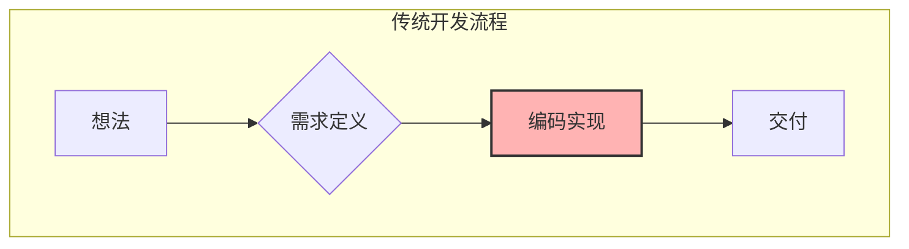
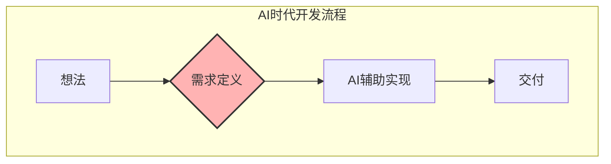
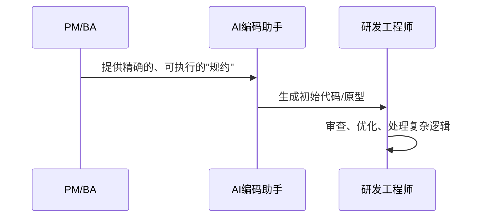

<!-- Page 1 -->
# 驾驭变革：AI时代项目经理(PM)与业务分析师(BA)的挑战与机遇

## 为管理者与项目团队打造的战略指南

---

<!-- Page 2 -->
## 世界已然改变：AI，是你的新同事

**过去，我们习惯于...**
*   基于文档的线性交接
*   以"沟通"和"翻译"为核心价值
*   开发周期长，试错成本高

**现在，AI带来了...**
*   实时的、人机协同的开发模式
*   对"价值定义"速度和质量的空前挑战
*   一个根本性的问题：**我们的核心价值是什么？**

---

<!-- Page 3 -->
## 变革的引擎：开发已进入AI加速时代

以 `Cursor`, `Claude Code`, `WindSurf` 等为代表的AI编程助手，正在系统性地重塑开发工作。

*   **效率飞跃:** 任务完成速度提升 **50%+**。
*   **角色转变:** 开发者的工作重心从"手工编码"转向更高阶的：
    *   系统设计与架构规划
    *   与AI协同进行"指令工程"
    *   对AI生成代码的批判性评估与审查

> 这种根本性的效率提升，是后续所有变化的催化剂。

---

<!-- Page 4 -->
## 瓶颈的漂移：从"技术实现"到"价值定义"

过去，软件开发的瓶颈在于编码速度。现在，这个瓶颈已经向上游转移。


**现在，瓶颈在我们这里：**

项目的成败，更多地取决于我们 **"决定做什么"**，而不是"能多快做完"。

---

<!-- Page 5 -->
## 重思"需求"：从沟通文档到机器可执行的契约

我们的核心产出物，必须从"写给人看的文档"进化为"给机器执行的契约"。

|   | **传统需求文档 (PRD)** | **AI时代的需求规约 (Spec)** |
|---|:---:|:---:|
| **读者** | 主要为人类 | 人类 & **机器** |
| **形态** | 大段、模糊的自然语言 | 精确、结构化的指令 |
| **核心** | 沟通与共识 | **可执行与可验证** |
| **结果** | 依赖人的解读，易产生歧义 | 驱动AI生成代码，减少偏差 |

---

<!-- Page 6 -->
## AI时代的优质需求剖析

一份有效的、为AI和高效团队准备好的高质量需求，必须具备四大核心特质：

*   **1. 机器可读 (Machine-Readable):**
    *   采用结构化语言（如YAML, Markdown表格, Gherkin）。
*   **2. 精确且可量化 (Precise & Measurable):**
    *   **告别:** "系统响应要快。"
    *   **拥抱:** "API的P99响应时间应低于200毫秒。"
*   **3. 模块化 (Modular):**
    *   像乐高积木一样，分解为可独立测试和实现的功能单元。
*   **4. 上下文完整 (Rich in Context):**
    *   每份需求都需回答：**为谁 (Who)？为何 (Why)？如何衡量 (How)？**

---

<!-- Page 7 -->
## 新使命：从需求翻译官到价值架构师

PM/BA正在从一个流程的"协调者"，进化为一个端到端价值的"架构师"与"掌舵人"。我们的精力必须向价值链两端进行战略性转移：

*   **向最前端（价值发现）延伸:**
    *   **做什么？** 投入更多时间进行深度用户研究、市场分析和商业模式探索。
    *   **核心任务：** 发现那些"真正值得解决的问题"。

*   **向最后端（价值验证）延伸:**
    *   **做什么？** 对最终的业务成果全面负责，设计衡量体系，用数据说话。
    *   **核心任务：** 科学地判断我们的解决方案是否"真正为客户和公司交付了价值"。

---

<!-- Page 8 -->
## 协作新矩阵：与关键角色的协同进化

我们的工作核心——"连接"，正在被赋予全新的意义。未来的协作模式是围绕"我们"展开的、基于共享智能平台的网状协同。

```mermaid
graph TD
    subgraph "PM / BA"
        P((PM/BA))
    end

    subgraph "关键角色"
        D[研发<br>Dev]
        T[测试<br>QA]
        O[运维<br>Ops]
        C[客户<br>Customer]
    end

    P -- AI规约 -- D
    P -- 质量策略 -- T
    P -- 业务目标(SLO) -- O
    P -- 数字孪生对话 -- C
```

---

<!-- Page 9 -->
## 与研发协同："AI规约工程师"的崛起

**核心转变：** 从"提需求"到"给规约"

**新范式：提示词驱动开发 (Prompt-Driven Development)**

**PM/BA的新角色：**
*   **规约工程师：** 定义清晰、可测试、AI可读的指令。
*   **快速验证者：** 利用AI原型工具，在编码前完成价值验证。

---

<!-- Page 10 -->
## 与测试协同：成为共筑质量的"质量策略师"

**核心转变：** 从"下游验证"到"上游共建"

**新范式：自然语言测试 (Natural Language Testing)**
> PM/BA可以直接在需求规约中用一句话描述测试意图：
> **"测试当用户使用无效优惠券时，系统能否正确提示并阻止下单。"**

AI测试平台会自动将这句话转化为一系列可执行的自动化测试脚本，并覆盖各种边界条件。

**我们的新角色：**
*   **质量规约定义者：** 与QE共同定义业务、性能、视觉等验收标准。
*   **测试意图设计师：** 用业务语言驱动自动化测试的生成。

---

<!-- Page 11 -->
## 与运维协同：成为懂业务的"价值共管伙伴"

**核心转变：** 从"被动响应"到"主动共管"

**新范式：基于业务价值的运维**

我们与运维/SRE团队的新协作基石是 **共享的可观测性平台**，它将技术指标与业务指标直接挂钩。

**我们的核心任务：共同定义服务等级目标 (SLO)**
> **用业务语言驱动运维：**
> *   "99.9%的商品详情页加载时间应在1秒以内。"
> *   "支付接口的成功率必须达到99.99%。"

这确保了运维团队的资源总是优先投入到对用户和业务价值最高的领域。

---

<!-- Page 12 -->
## 与客户协同：AI的"数字孪生对话"

**核心转变：** 从"周期性访谈"到"7x24小时在线洞察"

我们获得了两种革命性的新能力：

1.  **AI合成用户 (Synthetic Users):**
    *   **是什么？** 基于真实用户数据训练出的"AI虚拟焦点小组"。
    *   **怎么用？** 随时可用来"访谈"，以极低成本、极高效率验证早期想法。

2.  **AI驱动的用户洞察 (AI-Powered Insights):**
    *   **是什么？** 自动聚合、分析全渠道海量用户反馈的AI平台。
    *   **怎么用？** 从"数据捞针"变为"洞察上门"，AI直接提炼出核心痛点与需求。

---

<!-- Page 13 -->
## 新能力图谱：技术硬壳与人性内核

为了在新时代中茁壮成长，能力矩阵要求：

*   **硬技能 (技术硬壳):** 我们与机器和数据进行"高带宽"沟通的语言。
    *   AI基础素养与提示工程
    *   数据分析与实验设计
    *   掌握结构化文档MD
    *   理解系统与架构思维

*   **软技能 (人性内核):** 当AI覆盖执行层后，这些能力将成为我们最坚固的"护城河"。
    *   战略性的远见
    *   回归第一性原理的批判性思维
    *   深度的用户同理心
    *   复杂的价值协商与影响力

---

<!-- Page 14 -->
## 组织转型三引擎（管理者行动指南）

组织的成功转型是一项系统工程，需要管理者自上而下地驱动变革：

1.  **流程再造 (Process Re-engineering):**
    *   **核心：** 从奖励"交付功能"，转向奖励"获得有效认知"。
    *   **举措：** 建立"快速实验通道"，将"价值验证"和"机器可读规约"纳入"完成的定义"(DoD)。

2.  **文化重塑 (Cultural Reshaping):**
    *   **核心：** 营造允许"聪明地失败"的心理安全区。
    *   **举措：** 倡导"数据知情" (Data-Informed)，而非"数据驱动" (Data-Driven)，强调数据是用来启发和验证人类智慧的。

3.  **工具链升级 (Toolchain Evolution):**
    *   **核心：** 打造一体化的、无缝集成的工具链。
    *   **举措：** 投资整合需求、代码、部署、监控的知识与协作平台，为PM/BA配备AI助手。

---

<!-- Page 15 -->
## 个人进化三部曲（PM/BA行动指南）

不要坐等组织变革完成，将职业发展的主动权掌握在自己手中。

*   **第一步：诊断与学习 (Diagnose & Learn)**
    *   诚实评估个人能力现状，识别短板。
    *   制定一个有针对性的、可执行的90天学习计划。

*   **第二步：刻意实践 (Deliberate Practice)**
    *   在下一个项目中，主动承担一项新技能相关的任务。
    *   与工程师结对，学习AI编程；或主导一次数据驱动的决策。

*   **第三步：构建影响力 (Build Influence)**
    *   分享是最好的学习，将心得与成果写成文章或进行内部分享。
    *   用新的、基于价值贡献的指标来记录和展示你的工作成绩。

---

<!-- Page 16 -->
## 从小处着手，赢得大局

宏大的变革始于微小的、可立即执行的行动。用一个个"小胜利"来建立信心，并产生涟漪效应。

*   **工具侧，可以…**
    *   向团队推荐并试用一个AI会议纪要或文档协作工具。
*   **流程侧，可以…**
    *   在下一次冲刺回顾会中，增加一个新问题："本次冲刺，我们验证或证伪了什么核心假设？"
*   **能力侧，可以…**
    *   组织一次1小时的"提示词工程"工作坊，产出适用于团队业务的高质量需求模板。

---

<!-- Page 17 -->
## 驾驭风险：保持警惕，而非恐惧

拥抱AI变革的同时，必须主动识别并有效治理其风险：

| 风险类型 | 表现 | 应对策略 |
|:---|:---|:---|
| **偏差放大效应** | 一个模糊的需求，被AI高速、错误地实现 | 提升需求规约质量，加强人工审查 |
| **功能工厂陷阱** | 高速构建大量无价值的"僵尸功能" | 坚持价值验证，以业务成果为导向 |
| **AI幻觉与安全** | AI生成错误信息，或导致机密外泄 | 建立严格的"人类在环"审查机制，使用可信的私有化AI服务 |

> **核心原则：** 建立并坚持"人类在环" (Human-in-the-loop) 的审查与决策机制，由我们来掌控最终方向。

---

<!-- Page 18 -->
## 未来已来，价值凸显

AI技术正沿着一条清晰的路径演进，我们的角色也随之升维。

```mermaid
graph TD
    A[近期: AI辅助<br>(AI-Assisted)] --> B[中期: AI增强<br>(AI-Augmented)]
    B --> C[远期: AI自主<br>(AI-Autonomous)]

    subgraph "PM/BA 角色演变"
        A_Role[指令者/审查者]
        B_Role[策略对话伙伴]
        C_Role[价值目标设定者/伦理守护者]
    end

    A --> A_Role
    B --> B_Role
    C --> C_Role
```
AI将处理越来越多"做什么"和"怎么做"的问题，而我们将更专注于只有人类能回答的终极问题。

---

<!-- Page 19 -->
## 结语：成为驾驭不确定性的"价值领航员"

AI时代的到来，对于项目经理和业务分析师而言，是一场深刻的 **"角色升维"** 的号角。

它正在将我们从繁琐的、重复性的、流程驱动的"翻译"与"协调"工作中解放出来。

未来已来，与其焦虑自己的岗位是否会被替代，不如主动拥抱变革，成为那个手握罗盘、定义方向，驾驭着AI这艘强大航船，在充满不确定性的商业海洋中，为组织开辟新航路的 **"价值领航员"**。

---

<!-- Page 20 -->
## 谢谢

