### **前言：从代码生成到价值涌现——软件工程的第二次革命**

> **核心启示 (Takeaway):** AI 正在让写代码变得极其便宜和快速，所以，软件开发的重点不再是"怎么做"，而是"做什么"和"为什么做"。未来的团队是"人加AI"的超级组合，我们每个人的角色都要因此而改变。

软件工程，自其诞生之日起，本质上就是一场关于"抽象"和"自动化"的持久战。第一次革命，我们通过高级语言、编译器和框架，将工程师从繁琐的机器指令中解放出来，实现了"思想"到"代码"的第一次大规模抽象。而今天，我们正站在第二次革命的浪尖。这一次，生成式AI（Generative AI）和大语言模型（LLM）正以前所未有的力量，从根本上重塑软件创造的每一个环节。这不再仅仅是关于"更快地写代码"，而是关于**重构价值创造本身**。

#### **AI作为新的生产力要素：成本结构与速度的颠覆**

传统的软件开发成本结构，长期以来被"实现"（Implementation）阶段所主导。然而，AI正在颠覆这一结构。以代码生成模型为例，从早期的代码补全到如今能够理解复杂需求、生成完整应用模块、乃至自主进行多轮测试和修复的"AI智能体"（AI Agent），软件的**"生产成本"正趋近于零**。这并非夸张，而是描述一种趋势：过去需要一个团队数周才能完成的编码和单元测试工作，现在可能由一个AI智能体在几小时内完成。

这种变化直接导致了两个颠覆性后果：

1.  **速度的指数级提升**：创新的周期被极大缩短。一个想法从概念到可交互原型的距离，从"月"缩短到了"天"甚至"小时"。这使得快速试错和市场验证的成本变得极低。
2.  **价值链瓶颈的漂移**：当"如何实现"（How）的成本急剧下降时，**"做什么"（What）和"为什么做"（Why）的决策质量**便成为决定项目成败的**核心杠杆**。软件工程的重心，正不可逆转地从"工程实现"向上游的"价值发现"和下游的"价值交付"转移。

#### **"角色"边界的溶解与"团队"定义的重组**

第二次革命的另一个深刻影响，体现在对"人"的重新定义。传统软件团队如同分工明确的工业流水线：产品经理定义需求，架构师设计蓝图，开发者砌砖，测试者质检，运维者保障。

AI打破了这道墙。一个产品经理，现在可以借助AI直接将一个模糊的想法具象化为可交互的应用原型。一个开发者，其角色更像一个侦探或指挥官，而非单纯的编码者。这种变化意味着：

*   **单一技能角色的价值被稀释**：仅仅会"写代码"或"点功能"的工程师，其核心竞争力正在被AI快速取代。
*   **跨领域（T型）人才成为主流**：未来的价值创造者，必须是"多面手"，既要懂业务，又要懂技术，更要懂得如何与AI高效协同。
*   **"团队"的定义被重写**：未来的团队，将是一个由**人类专家和AI智能体共同组成的"混合超级团队"**。在这个团队里，AI不再是工具，而是拥有特定"角色"的**核心成员**。

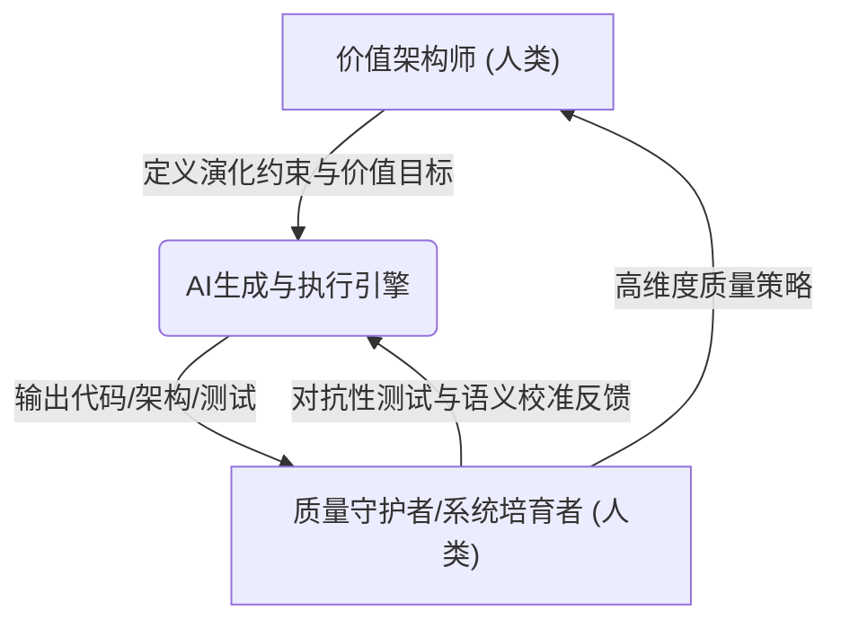

#### **核心命题：探寻人机协同新范式下的进化路径**

面对这场深刻的变革，本报告的核心命题是：**在AI深度介入软件全生命周期的背景下，我们必须重新定义软件工程的各个角色，重构团队间的协同模式，并最终建立一套全新的价值评估体系，以探寻个体与组织在AI时代的进化路径。**

我们将不再孤立地讨论"AI如何辅助编码"，而是系统性地剖析从**价值前端（上游）**的"价值架构"，到**工程核心（中游）**的"系统培育"，再到**交付运维（下游）**的"智能韧性"，每一个环节、每一种角色的冲击与演进。

本报告旨在为身处变革浪潮中的技术领导者、架构师、产品经理和每一位工程师，提供一份深度思考的框架和一份面向未来的行动指南。我们相信，那些能够深刻理解并主动拥抱这场"角色、协同与价值"全面重构的个人和组织，将成为驾驭不确定性的价值领航员。

软件工程的第二次革命已经到来，它关乎技术，但更关乎人。现在，让我们一同深入这场变革的内核。 

---
### **第一章：范式基石的重塑——AI驱动下的软件开发新公理**

> **核心启示 (Takeaway):** 软件开发正在经历三大颠覆。第一，AI从"帮手"变成"主力"，效率呈指数级增长。第二，写代码不再是瓶颈，"想清楚需求"和"管好AI"成了新难题。第三，静态文档过时了，未来要靠一个能实时更新、连接所有信息的"活的知识图谱"来协同。

在任何领域，革命的发生，往往源于其底层公理（Axiom）的失效与重写。软件工程的第一次革命，建立在"机器时间昂贵，人力时间相对便宜"的公理之上。而今天，AI正在颠覆那些我们早已习以为常的新公理。进入2025年后的软件工程，其范式基石正在被三股强大的力量重塑：效率的非线性跃迁、瓶颈的系统性漂移、以及知识形态的彻底革命。理解这三大新公理，是理解未来一切角色和流程变革的前提。

#### **1.1. 效率的非线性跃迁：从"辅助编程"到"自主系统生成"**

> **核心启示 (Takeaway):** AI 的发展就像升级打怪，经历了三个阶段：从早期帮你补全代码的"辅助"，到如今能独立完成整个任务的"干将"，再到未来可以自主创造整个系统的"帅才"。这个升级过程让软件生产效率的提升不再是匀速前进，而是进入了指数级爆发的快车道。

##### **1.1.1. 技术演进的三阶段轨迹**

软件开发效率的提升，正经历着一场从量变到质变的非线性跃迁。这条技术轨迹清晰地展示了AI在软件工程中角色的演进，它大致可分为三个阶段：

*   **阶段一：辅助编程（~2021-2023）**
    此阶段的AI，以GitHub Copilot的早期版本为代表，扮演的是一个"高级代码补全工具"。它的核心价值在于**局部优化**：根据上下文建议代码片段、生成通用函数。此时，人类开发者仍然是绝对的主导者。

*   **阶段二：任务导向的代码生成（~2024-2025）**
    AI的能力发生了质变，能够理解更高层级的**任务指令**。开发者可以向AI"智能体"（AI Agent）下达一个明确的任务，例如："为'用户管理'模块创建一个CRUD微服务"，AI便能自主完成完整的任务闭环。人类的角色从"逐行编码"转变为"任务分解与结果验收"。

*   **阶段三：自主系统生成（2025年以后）**
    这是我们正在迈入的全新阶段。人类的输入是更高层次的**业务需求、架构约束和价值目标**。AI系统会自主地编排多个专职AI智能体协同工作，进行系统设计、代码生成、集成、测试和部署方案的制定。人类专家则转变为"需求澄清者"、"架构决策者"和"最终仲裁者"。


##### **1.1.2. 效率曲线的拐点与指数级增长**

这种从"辅助"到"自主"的演进，意味着软件生产的模式从"人工作坊"彻底转向"自动化工厂"，其成本结构随之发生深刻变革。

**单个功能点开发成本演进趋势 (单位: 相对成本，预测)**

| 年份/阶段 | 纯人工开发 | AI辅助编程 | 自主系统生成 |
| :--- | :--- | :--- | :--- |
| **2020 (基线)** | 1000 | 1000 | (未出现) |
| **2024 (当前)** | 800 | 400 | 700 |
| **2028 (中期)** | 600 | 150 | 250 |
| **2030+ (长期)** | 500 | 80 | 100 |

技术注解：当AI生成代码占比超过70%时，开发成本曲线从线性下降转向指数级下降，但**模型训练、微调及知识图谱的维护成本**成为新的关键变量。

#### **1.2. 瓶颈的系统性漂移：当"实现"不再是问题**

> **核心启示 (Takeaway):** 过去我们总觉得写代码、做测试最花时间，现在AI快把这些活儿干完了。结果，新的问题浮出水面，成了新的瓶颈。现在最难的是：如何精准地定义我们到底要做什么（价值定义）、如何确保AI生成的代码是可信的（信任与治理），以及如何获取高质量的数据来喂养AI，让它持续进化。

##### **1.2.1. 旧瓶颈：实现的困境**

根据约束理论，任何系统的产出都由其最慢的环节（瓶颈）决定。在传统软件工程中，"实现"（编码、测试、调试）无疑是长期以来的核心瓶颈。

##### **1.2.2. 新的三大瓶颈：价值定义、系统集成、人类审核**

当AI将"实现"的效率提升数个量级后，瓶颈被打破，但整个价值链的产出受限于新的、过去被掩盖的瓶颈。

| **传统瓶颈** | **AI时代新瓶颈** | **技术成因** |
| :--- | :--- | :--- |
| 代码实现速度 | **价值定义精度** | 需求模糊性被AI以前所未有的速度放大 |
| 人力协作效率 | **人机语义对齐损耗** | 自然语言到机器可执行指令之间的鸿沟 |
| 硬件资源限制 | **高质量领域数据获取** | 数据隐私与标注成本制约AI模型的持续进化 |
| 手动测试覆盖 | **AI生成代码的信任与治理** | AI幻觉、安全漏洞、架构腐化风险需要新的治理手段 |

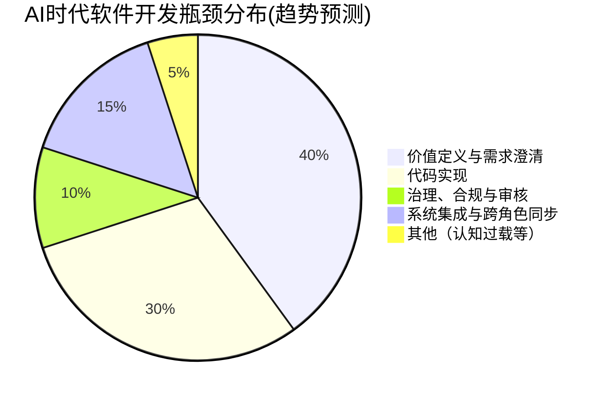
**趋势预警**：行业普遍预测，未来多数AI辅助项目延迟，其根源将不再是技术实现本身，而是**需求定义的不确定性**被AI的能力放大所致。

#### **1.3. 知识的形态革命：从"静态文档"到"活的知识图谱"**

> **核心启示 (Takeaway):** Word、PDF、Wiki这些静态文档都将成为过去式。因为系统变化太快，文档根本跟不上。未来的核心是一个"活的知识图谱"，它就像一个软件系统的"数字孪生"，把需求、代码、测试、监控等所有信息实时、自动地关联在一起，成为所有人（和AI）都信赖的唯一信息源。

##### **1.3.1. 传统知识载体的失效**

传统的知识载体——如需求文档（Word）、设计图（PDF）、Wiki页面——存在致命缺陷：它们是**静态的、孤立的、非结构化的，且极易与实际运行的系统脱节**。当系统以10倍速演进时，维护这些静态文档的成本高到无法接受。

##### **1.3.2. "活的知识图谱"：动态的数字孪生与单一事实来源**

未来的解决方案，是一个**"活的知识图谱"（Living Knowledge Graph）**。它并非一个简单的数据库，而是整个软件生命周期的**动态、多维、结构化的数字孪生**，是连接所有角色、所有工具和所有流程的"单一事实来源"。**这本质上是将成熟的DevOps自动化思想与DataOps数据治理能力深度融合，并由AI进行赋能的终极体现。**

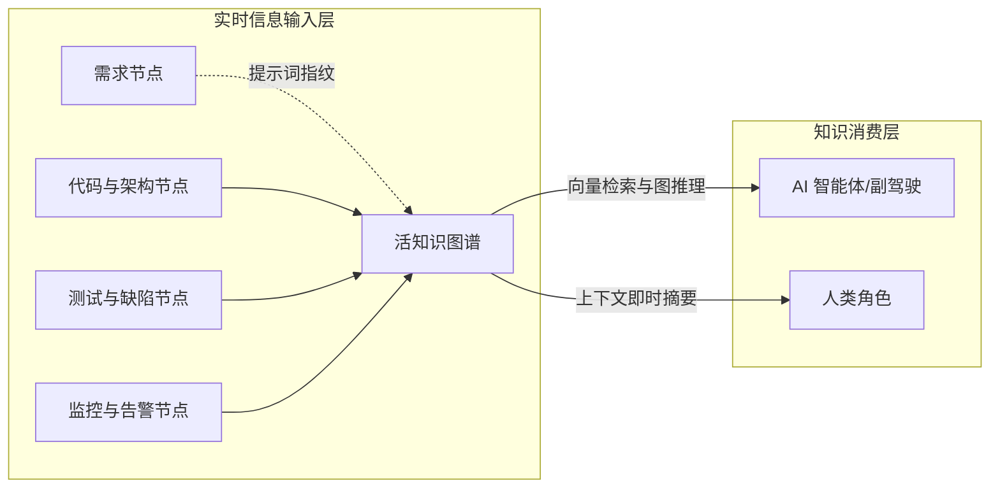

*   **"活"的本质**：
    这个图谱由AI智能体和CI/CD工具链进行**实时、自动的维护**。
    -   当一个AI开发者Agent生成了一段代码，它会自动在图谱中创建代码节点，并建立其与需求节点、API节点之间的连接。
    -   当AIOps系统检测到性能异常，它会创建一个告警节点，并自动追溯关联到可能导致问题的代码变更和部署事件。

*   **革命性的价值**：
    这个知识图谱成为了人与AI、人与人之间协同的**核心媒介**，使得跨领域的影响性分析和根本原因追溯成为可能。
    -   **技术栈示例**：通过`Neo4j`（图存储）+ `Milvus`（向量存储）+ `LangGraph`（智能体编排）+ `OpenTelemetry`（数据采集）来构建这一中枢。

*   **关键机制：Prompt-as-Code 与 DevOps 原生可追溯性**
    为了确保每一次人机交互都可审计和追溯，最佳实践是将指令（Prompt）本身也视为代码（**Prompt-as-Code**），并利用成熟的DevOps工具链实现其生命周期管理。
    -   **Git作为单一事实来源**：所有结构化的Prompt都应存储在Git仓库中。每一次修改都通过一次Commit来完成，**Git的Commit Hash本身就构成了最可靠、最自然的"指纹"**，天然地将Prompt与作者、时间戳和变更意图绑定。
    -   **CI/CD流水线集成**：当一个Prompt被合并或执行时，CI/CD流水线会自动触发，将该Prompt（及其Commit Hash）与它所生成的所有下游产物（代码、测试、部署ID）在知识图谱中建立关联。这构成了端到端的、不可篡改的追溯链。

---
### **第二章：价值前端的革命：从"需求转译"到"价值架构"**

> **核心启示 (Takeaway):** 产品经理和架构师的角色彻底变了。产品经理不再是传话筒，而是要成为"价值架构师"，核心工作是发现真正值得解决的问题，并用数据验证价值。架构师也不再是画一成不变的图纸，而是像个"系统策展人"，负责设定系统演化的"交通规则"，确保AI在狂奔时不出轨。

正如第一章所揭示，当AI接管了绝大部分"如何实现"（How）的繁重工作后，软件工程的瓶颈迅速向上游漂移。**"做什么"（What）的决策质量**与**"为什么做"（Why）的战略洞察**，其重要性被前所未有地放大。一个错误的决策，过去可能在数周或数月的开发周期后才被发现，造成有限的沉没成本；而在AI时代，它可能在数小时内就催生出一个功能完备但毫无价值的复杂系统，导致惊人的资源错配。

因此，价值链的前端——传统上由产品经理和架构师主导的领域——正经历着一场从"转译者"到"架构师"的深刻革命。这里的"架构师"，不仅指技术架构，更指**价值架构**。

#### **2.1. 产品经理(PM)/业务分析师(BA)的蜕变：从需求中介到价值架构师**

> **核心启示 (Takeaway):** 产品经理和业务分析师（PM/BA）不能再只当一个"传话筒"了。因为AI已经能听懂客户的录音、能根据一句话画出原型。PM/BA必须进化成"价值架构师"，把精力花在刀刃上：用AI工具去挖掘真正值得解决的问题，用数据去量化每个决策的商业影响，以及学习用一种更精确的"规约语言"去指挥AI。

##### **2.1.1. 冲击：作为"信息转录员"的价值压缩**

传统意义上的产品经理或业务分析师，其核心职能之一是作为业务方和技术方之间的"中间人"或"翻译官"。然而，这层"中间人"的价值正在被AI迅速压缩：

1.  **AI的需求理解能力增强**：先进的AI模型可以直接分析原始的、非结构化的输入（如客户访谈录音、用户反馈文本），从中提炼出潜在的需求点和用户痛点。
2.  **从需求到原型的直接生成**：PM不再需要用Figma精心绘制每一个交互细节。他们可以用自然语言描述一个核心想法，AI就能在几分钟内生成一个可交互、高保真的前端原型。
3.  **技术沟通壁垒降低**：当开发者可以通过与AI对话来理解需求背后的业务逻辑时，PM作为"人肉API"负责答疑解惑的职能也被部分替代。

##### **2.1.2. 演进路径：价值架构师的三大核心支柱**

面对价值压缩，PM/BA角色必须向上进化，从一个被动的"需求转译者"演进为主动的**"价值架构师"（Value Architect）**。他们的工作重心不再是定义"功能"，而是构建和验证"价值假设"。

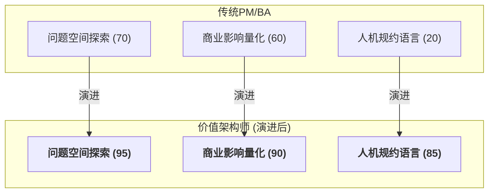

###### **2.1.2.1. 问题空间探索：成为问题的发现者**

价值架构师不再是"需求的接收者"，而是"问题的发现者"。他们运用AI作为"外脑"和"放大器"，在广阔的可能性中定位真正值得解决的问题。

*   **技术应用**：
    *   **AI驱动的用户研究**：利用AI工具对海量的市场报告、社交媒体讨论、用户评论进行主题建模和情感分析，快速发现趋势和潜在需求。
    *   **规模化的假设驱动验证**：AI极大地降低了MVP的构建成本。价值架构师的核心工作是设计一系列并行的"价值假设"，然后利用AI快速生成用于验证这些假设的多个微型产品或功能变体，进行大规模的A/B测试。
    *   **AI辅助的因果推断**：利用AI分析产品数据，建立因果模型，去回答"到底是不是X功能 *导致* 了高留存率？"，从而做出更精准的决策。
        ```python
        # 使用DoWhy库构建需求因果图
        model = CausalModel(
            data=df,
            treatment='新增功能X',
            outcome='用户留存率',
            graph="""digraph {
              付费意愿 -> 用户留存率;
              功能易用性 -> 付费意愿;
              新增功能X -> 功能易用性;
            }"""
        )
        # 量化功能X对留存率的真实影响
        estimate = model.estimate_effect()
        ```

###### **2.1.2.2. 商业影响衡量：量化决策的价值**

在AI时代，功能的交付速度不再是衡量PM绩效的关键指标。取而代之的，是所交付功能对核心商业指标的**可量化影响**。

*   **技术应用**：
    *   **定义与追踪"价值指标"**：他们需要定义能够衡量商业价值的北极星指标，并将其关联到知识图谱中对应的"需求"和"功能"节点上，形成"假设-开发-衡量-学习"的闭环。
    *   **动态价值仪表盘**：建立实时仪表盘，追踪核心价值维度的变化，并利用AI进行趋势预测和根因诊断。
        ```
        ┌───────────────┬───────────────┬───────────────┐
        │ 价值维度      │ 实时指标      │ AI预测趋势    │
        ├───────────────┼───────────────┼───────────────┤
        │ 用户留存      │ 62.1%(▲3.2%)  │ ↗️ 达68% (30d)│
        │ 转化率        │ 14.3%(▽0.7%) │ ↘️ 触12% (7d) │
        └───────────────┴───────────────┴───────────────┘
        ▶️ 根因诊断：转化率下降源于新版支付流程步骤增加 (AI归因分析)
        ```


###### **2.1.2.3. 人机规约语言：掌握与AI对话的精确语言**

这是价值架构师区别于传统PM的**最硬核**的技能。当开发的执行者从"人类工程师"变为"AI智能体"时，沟通的语言必须升级。模糊的自然语言用户故事已不再足够，需要一种更精确、更结构化、但又比代码更抽象的**"规约语言" (Prompt DSL)**。

*   **Prompt DSL 草案 v0.3**
    - **目标**：让PM用**结构化自然语言**直接生成可执行规约。
    - **语法（EBNF范式）**：
      ```
      Specification := "AS" Role "I WANT" Goal "SO THAT" Impact
                     (Acceptance)* (Guard)* (Metric)*

      Acceptance   := "GIVEN" Context "WHEN" Trigger "THEN" Outcome
      Guard        := "MUST" Constraint
      Metric       := "MEASURE" KPI "BY" TelemetryQuery
      ```
    - **示例**：
      ```
      AS Shopper
      I WANT one-click reorder from past purchases
      SO THAT conversion rate increases by >= 5 %

      GIVEN user has >= 1 past order
      WHEN user clicks "Reorder"
      THEN order created in < 400 ms

      MUST comply with GDPR
      MEASURE conversion_rate BY SELECT COUNT(DISTINCT user_id) WHERE event = 'reorder_success'
      ```
    - **编译流程**：`Prompt DSL → LLM → Gherkin + Policy-Rego + SQL Telemetry`

#### **2.2. 架构师(Architect)的战略转向：从蓝图绘制者到进化式系统策展人**

> **核心启示 (Takeaway):** 架构师不能再像以前那样，花几个月画一份完美但很快就过时的系统"蓝图"。因为系统是AI快速"长"出来的，而不是人"设计"出来的。架构师的新角色是"系统策展人"，工作重心变成三件事：用代码化的策略给AI设定好不能碰的"护栏"，向整个团队（包括AI）宣传必须遵守的"技术原则"，以及像图书管理员一样精心管理好那个包罗万象的"活的知识图谱"。

##### **2.2.1. 冲击：静态蓝图在"涌现式架构"前的失效**

传统软件架构师的核心产出物是一份详尽的系统设计"蓝图"。然而，在系统能够以天为单位进行功能迭代和结构演变的AI时代，这种静态的、前置的重量级蓝图模式正在迅速失效。

1.  **AI生成初始架构**：架构师不再需要从零开始绘制常见的架构模式。只需要提供高级约束，AI就可以生成一个相当成熟的初始架构方案。
2.  **"涌现式"而非"设计式"的架构**：由于开发速度极快，系统的架构更多地是在持续不断地功能添加和重构中"涌现"出来的，而非预先完美设计的。

##### **2.2.2. 演进路径：系统策展人的三大核心职责**

架构师的角色必须从一个静态的"蓝图绘制者"转变为一个动态的**"进化式系统的策展人"（Curator of Evolutionary Systems）**。他们的目标，不是阻止变化，而是**引导和塑造变化**。

###### **2.2.2.1. 定义演化约束：用"架构适应度函数"设定护栏**

策展人不再画出每一个细节，而是设定AI在自主生成和修改系统时必须遵守的"物理定律"和"护栏"。这些约束是代码化的，并被集成到AI的决策框架中。

*   **技术应用：Policy-as-Code**
    他们编写可被自动化工具（如Open Policy Agent）执行的策略，来持续验证系统是否符合某个架构特性。
    ```rego
    # 策略示例：禁止"结算服务"直接调用老旧的"账单服务"
    package authz.service_deps

    deny[msg] {
        input.from == "checkout"
        input.to == "legacy-billing"
        msg := "checkout service must not directly call legacy-billing service"
    }
    ```
    这些策略会嵌入CI/CD流水线，AI生成任何代码变更时，都必须首先确保不会违反这些约束。

###### **2.2.2.2. 传播技术原则：成为AI与团队的"立法者"**

原则比约束更抽象，它们是指导决策的"价值观"。策展人负责定义、维护并向整个混合团队（包括人类和AI）"布道"这些原则。

*   **技术应用：原则的数字化表达**
    ```json
    {
      "principle_id": "STATELESS_FIRST",
      "description": "优先设计无状态服务，以提升可扩展性和韧性",
      "enforcement_rules": [
        {
          "if": "component.type == 'backend_service'",
          "then": "storage.state == 'external' or component.is_cache == true",
          "weight": 0.9
        }
      ],
      "override_condition": "latency_requirement < 10ms"
    }
    ```
    这些数字化的原则会影响AI智能体在进行技术选型和架构设计时的决策偏好。

###### **2.2.2.3. 治理知识图谱：成为组织的"首席本体论家"**

如果说知识图谱是AI时代的"单一事实来源"，那么系统策展人就是这个图谱的**首席本体论家和图书管理员**。

*   **治理职责**：
    *   **定义图谱的Schema（本体）**：策展人决定知识图谱中应该有哪些类型的实体（节点，如`微服务`、`API契约`、`数据表`）以及它们之间可以有哪些类型的关系（边，如`依赖于`、`实现`）。
    *   **确保图谱的完整性与准确性**：他们需要设计机制，确保AI和工具链在与系统交互时，能够正确、实时地更新知识图谱。
    *   **利用图谱进行战略决策**：知识图谱是策展人进行宏观分析的超级武器。他们可以通过查询图谱来回答复杂的战略问题，例如："如果我们废弃掉这个老旧的技术平台，会对哪些业务能力和下游客户产生冲击？" 

---
### **第三章：工程核心的质变：从"代码实现"到"系统培育"**

> **核心启示 (Takeaway):** 开发者和测试工程师的工作迎来了巨变。开发者不再是埋头写代码的工匠，而是要成为指挥AI干活的"指令工程师"，和照料AI生成系统的"培育者"。测试工程师也不再是找bug的捕手，而是定义更高维度质量（比如安全、性能）的"守护者"，以及通过巧妙的测试来"训练"AI、教它学聪明的"AI教练"。

在软件价值链的中游，即传统的"实现"和"验证"阶段，AI正以一种近乎颠覆的姿态，从根本上重塑了"工作"的定义。这里曾是工程师们通过精湛的编码和调试技巧，将抽象需求转化为具体产品的"工厂车间"。如今，这个车间的生产线正在被高度自动化的AI智能体所取代。当AI接管了绝大部分编码和基础测试任务时，一个尖锐的问题摆在了所有工程师面前：**人类的独特价值究竟体现在何处？**

答案并非无所作为，而是角色的质变。工程师将从"工匠"转变为"培育者"，从"建造者"转变为"园丁"。他们的工作不再是逐砖逐瓦地砌墙，而是设计和培育一个能够自我生长、自我修复的复杂生态系统。

#### **3.1. 开发者(Developer)的进化：从代码工匠到AI指令工程师与系统培育者**

> **核心启示 (Takeaway):** 作为开发者，如果还只是满足于写写业务逻辑和"胶水代码"，会非常危险，因为这些工作AI做得又快又好。未来的开发者必须完成两项进化：首先要成为"AI指令工程师"，擅长把一个大问题拆解成AI能听懂的一系列小指令；其次要升级为"系统培育者"，像园丁一样，核心工作是审查AI生成代码的"意图"对不对，以及用新的"人机对话"方式来调试这个复杂的AI共生系统。

##### **3.1.1. 冲击："胶水代码"工程师的风险与手动编码的终结**

1.  **大规模编码工作的自动化**：从前端组件到后端服务，从数据迁移脚本到API接口实现，这些占据了传统开发者大量时间的"模板化"和"逻辑明确"的编码工作，正在被AI全面接管。
2.  **沦为"胶水代码"工程师的风险**：一个显而易见的风险是，开发者的工作被降级为简单地"粘合"由不同AI智能体生成的黑箱模块，负责调用API、配置参数、处理简单的数据转换，却对模块内部的复杂逻辑一无所知。这是一种极度危险的"去技能化"。

为了避免这种命运，开发者必须完成两次关键的身份转变：成为**"AI指令工程师"**，并升维为**"系统培育者"**。

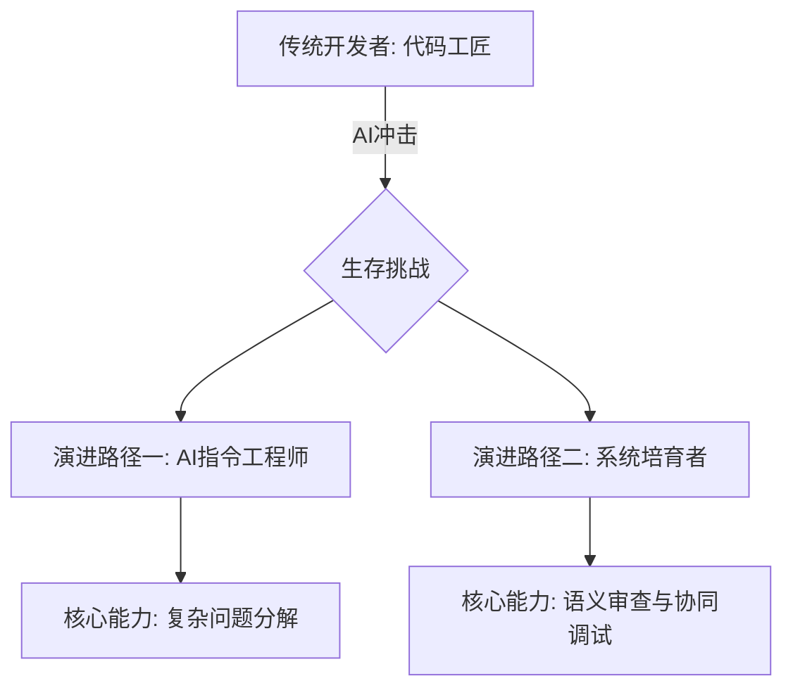

##### **3.1.2. 演进路径(一)：成为"AI指令工程师"**

这是开发者的第一个新身份，是与AI协作的**战术层面**。他们是AI开发智能体的"指挥官"，负责将复杂的战役目标分解为AI可以精准执行的命令。

###### **3.1.2.1. 核心能力：复杂问题分解的艺术**

这是AI时代开发者的**首要核心技能**。价值架构师提供了"做什么"的精确规约，而AI指令工程师则负责定义"第一步做什么，第二步做什么"。

*   **技术应用：AI可执行的分解协议**
    面对一个复杂的特性需求，例如"实现一个基于用户行为的实时推荐引擎"，开发者需要将其分解为一系列逻辑上独立且可验证的AI任务。这种分解能力，将模糊的业务需求转化为AI可执行的、原子化的、有明确验收标准的工程指令。
    ```json
    {
      "task_id": "RecSys-001",
      "description": "实现用户实时推荐系统",
      "decomposition_strategy": "DataFlow",
      "sub_tasks": [
        {
          "id": "T1",
          "description": "基于知识图谱中的`UserDataModel`，设计并生成一个能存储用户行为事件的Kafka主题Schema和对应的生产者服务。",
          "dependencies": [],
          "verification": "Schema validation & message production test"
        },
        {
          "id": "T2",
          "description": "创建一个Flink应用，消费上述Kafka主题，并使用协同过滤算法计算物品相似度矩阵。",
          "dependencies": ["T1"],
          "verification": "Output matrix format correctness"
        },
        {
          "id": "T3",
          "description": "生成一个RESTful API服务，输入用户ID，能实时查询推荐结果。",
          "dependencies": ["T2"],
          "constraints": {
            "latency_p99": "lt:50ms",
            "observability_principle": "AP-005"
          },
          "verification": "API contract test & load test"
        }
      ]
    }
    ```

##### **3.1.3. 演进路径(二)：成为"系统培育者"**

这是开发者的第二个、更具战略意义的身份。他们像园丁一样，对AI创建的这个快速生长的"数字花园"进行持续的照料、修剪和改良。

###### **3.1.3.1. 核心能力：AI生成代码的"语义审查"与人机协同调试**

*   **从"代码审查"到"语义审查"**：审查的重点不再是语法错误或编码风格，而是更深层次的"语义"和"意图"层面。开发者需要回答：AI生成的代码是否**真正理解**了业务规则的微妙之处？它是否引入了难以察觉的"AI幻觉"？
*   **人机协同调试 (Collaborative Human-AI Debugging)**：当一个由数万行AI代码构成的复杂系统出现问题时，传统的单步调试方法已然失效。新的调试范式是人机对话式的。
    *   **Trace-Pair协议**：人类的意图（Human Trace）与AI的执行路径（AI Trace）被并列呈现，让开发者能快速定位"理解偏差"。
    *   **增强现实（AR）调试界面**：通过类似AR覆盖层的形式，AI将诊断信息、修复建议直接叠加在代码视图上。
        ```
        [代码视图]
          L42: user_service.get_profile() → 返回Null (预期UserDTO)
          │
          [AR覆盖层 / AI诊断]
          ├─ 🔍 诊断：user_service (v1.4) 与 auth_service (v1.2) 版本不兼容导致认证失败。
          ├─ 💡 建议：(1) 降级auth_service至v1.1；(2) 修改适配层代码。
          └─ ⚡ 即时修复：[点击此处由AI生成兼容层代码]
        ```

#### **3.2. 测试工程师(QA)的跃迁：从缺陷捕手到质量守护者与AI教练**

> **核心启示 (Takeaway):** 测试工程师（QA）的核心价值不再是手动找bug或者写自动化脚本，因为这些AI都能干。QA需要向上走两步：第一步是成为"质量守护者"，负责定义和保障更高维度的质量，比如系统的性能、安全、公平性、不能有偏见等；第二步是成为"AI教练"，用人类的智慧和直觉去设计一些AI意想不到的"刁钻"测试，然后用这些失败的例子作为"错题本"去训练AI，让它在逻辑上变得更完善。

##### **3.2.1. 冲击：传统自动化测试价值的降低与"左移"的质量保证**

1.  **AI自动生成海量测试用例**：AI可以阅读需求规约和代码，自动生成覆盖各种正常路径和边界条件的测试用例，使得QA编写和维护传统测试脚本的工作量大幅减少。
2.  **"左移"的质量保证**：许多低级错误在编码阶段就被AI开发者智能体通过自带的测试和修复能力消除了，导致下游的传统测试环节能发现的缺陷数量锐减。

##### **3.2.2. 演进路径(一)：成为"质量守护者"**

他们的视野从"功能是否正确"扩展到"系统是否优秀"，负责定义和捍卫一个**高维度的质量模型**。

###### **3.2.2.1. 核心能力：设计高维度质量策略（性能、安全、伦理等）**

守护者不再执行琐碎的测试用例，而是设计整个质量保障体系的蓝图。这份策略不仅包括功能正确性，还涵盖性能、安全、可用性、韧性、伦理与偏见等。

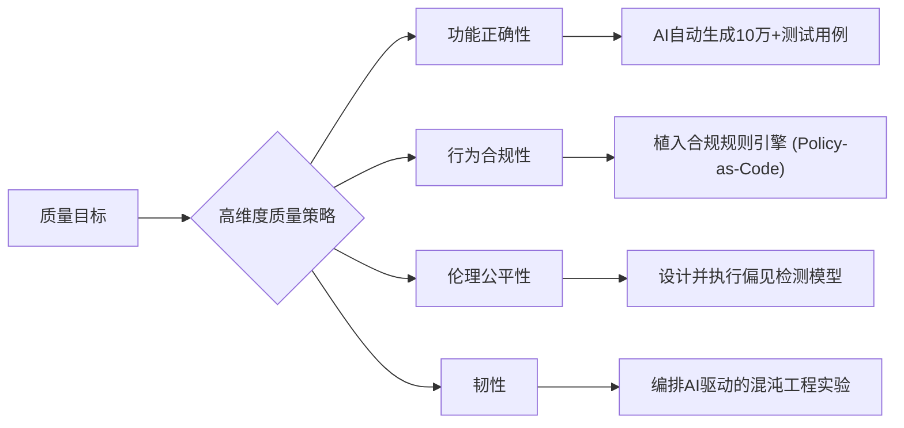
*   **伦理测试示例**：
    ```python
    # 检测AI推荐系统是否存在年龄歧视
    from fairness_testing_kit import FairnessTest

    bias_detector = FairnessTest(
      model=recommendation_model,
      sensitive_features=["age_group"],
      metrics=["disparate_impact"] # 不利影响比率
    )
    report = bias_detector.run(test_data)
    # 不利影响比率应在[0.8, 1.25]的合规区间内
    assert 0.8 <= report["disparate_impact"] <= 1.25
    ```

##### **3.2.3. 演进路径(二)：成为"AI教练"**

这是QA角色最革命性的转变。他们利用人类的独特优势——直觉、同理心和创造性——来发现AI的盲点，并通过测试用例与AI进行逻辑校准。

###### **3.2.3.1. 核心能力：通过"探索性测试"与"校准测试用例"训练AI**

*   **探索性与对抗性测试**：当AI完成了所有"意料之中"的测试后，QA的工作才真正开始。他们利用自己的领域知识和对人性的理解，进行"意料之外"的探索。
*   **通过测试用例与AI进行逻辑校准（Logic Calibration via Test Cases）**：这是QA"执教"AI的核心机制。当探索性测试发现一个逻辑漏洞或需求理解偏差时，QA的核心产出物不再是一份简单的缺陷报告，而是一个**精确的、可执行的"反例"测试用例**。
    *   **反馈闭环**：这个测试用例被提交后，会立即在CI/CD流水线中失败。更重要的是，它会被标记并反馈给源头的AI开发者智能体。AI会分析这个失败的用例，并被告知："你之所以失败，是因为错误地理解了业务规则。"这个测试用例，就像一道"错题"，被加入到AI的"错题本"中，用于修正其内部模型，确保未来不会再犯同样的逻辑错误。

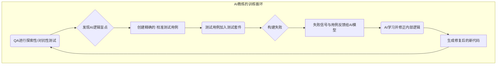

---

### **第四章：交付与运维的重塑：从"稳定运行"到"智能韧性"**

> **核心启示 (Takeaway):** 运维和交付的角色也升级了。运维工程师不再是到处救火的消防员，而是利用AIOps来设计一个能自我修复、有超强弹性的"韧性系统"。交付顾问也不再只是帮客户装软件，而是要成为客户的"价值伙伴"，用AI和数据帮客户把软件的商业价值真正用出来。

软件价值链的下游——交付与运维，是价值承诺最终兑现的战场。传统上，这一阶段的核心目标是"稳定"，即确保系统按照预期平稳运行。然而，在一个由AI驱动、以惊人速度持续演进的复杂系统中，"稳定"已远不足够。系统的复杂性已经超越了任何人类团队可以完全手动理解和控制的范畴。

因此，下游的核心议题从追求静态的"稳定运行"转向构建动态的**"智能韧性"（Intelligent Resilience）**。智能韧性意味着系统不仅能在发生故障时快速恢复，更能预测并规避潜在的风险，主动适应变化的环境，并始终以保障用户体验和业务连续性为最高目标。

```math
\text{智能韧性指数} = \frac{\text{系统自愈能力} \times \text{风险预测精度}}{\text{MTTR(平均修复时间)} \times \text{系统熵增系数}}
```
> **关键洞察**：当系统复杂度超过人脑认知极限（例如，微服务数量 > 150），传统运维手段逐渐失效，**AI代理必须成为系统免疫系统的核心**。

#### **4.1. 运维工程师(Ops)的升华：从系统消防员到AIOps主导的韧性设计师**

> **核心启示 (Takeaway):** 运维（Ops）不能再满足于当一个被动救火的"消防员"了。因为AIOps平台能够预测问题、自动修复。Ops的未来角色是"韧性设计师"，工作核心是三件事：第一，确保系统能吐出高质量的监控数据，让AI有米下锅；第二，主动用"混沌工程"给系统找茬，训练AI的自愈能力；第三，像管理员一样，持续管理和优化AIOps平台里的那些AI模型，防止它们"变笨"。

##### **4.1.1. 冲击：预测性运维与自愈能力取代手动干预**

1.  **AI预测性运维**：AIOps平台能够分析海量的历史和实时监控数据，识别出人类难以察觉的微弱信号，从而在故障发生前数分钟甚至数小时就发出预警。
2.  **AI驱动的自愈能力**：当检测到问题或预测到风险时，AI运维智能体可以自动执行修复操作（如重启服务、隔离故障节点、回滚部署），无需人工干预。

这些能力使得大量传统的、手动的"救火"式运维工作变得多余，Ops工程师的角色必须升维。

##### **4.1.2. 演进路径：韧性设计师的三大核心实践**

运维工程师不再是被动的问题解决者，而是主动的系统行为设计者。他们的工作不再是修复故障，而是**设计一个不会（或能自动从）故障中倒下的系统**。他们是AIOps平台的"大脑"和"教练"。

###### **4.1.2.1. 专注于可观测性设计 (Observability by Design)**

"垃圾进，垃圾出"。如果系统不能提供高质量的遥测数据，再强大的AI也无能为力。韧性设计师的核心职责之一，就是与开发者合作，将可观测性要求（如结构化日志格式、关键业务指标埋点）作为"技术原则"和"架构适应度函数"，强制AI开发者智能体在生成代码时自动遵循。

*   **技术应用：可观测性合约**
    通过声明式YAML定义服务的SLO、遥测标准和混沌实验策略，并在CI阶段强制校验。
    ```yaml
    apiVersion: o11y.io/v1
    kind: Contract
    metadata:
      name: checkout-slo
    spec:
      slo:
        latency: p99 < 200ms
        availability: "> 99.95%"
      telemetry:
        traces: ["checkout", "payment", "inventory"]
        goldenSignals: ["latency", "traffic", "errors", "saturation"]
      chaos:
        # 每周执行的自动化混沌实验
        weekly:
          - pod-kill: 1%
          - network-delay: { to: "payment-gateway", latency: "50ms", duration: "5m" }
    ```

###### **4.1.2.2. 拥抱并主导混沌工程2.0 (AI-driven Chaos Engineering)**

为了确保AIOps的自愈能力真实有效，韧性设计师必须主动地、有计划地向系统中注入混乱。

*   **与传统混沌工程的差异**：
| 维度 | 传统混沌工程 | AI混沌工程2.0 |
| :--- | :--- | :--- |
| 实验设计 | 人工定义故障场景 | AI基于历史故障和系统拓扑生成衍生场景 |
| 爆炸半径 | 静态控制 | 强化学习动态调节，寻找最脆弱路径 |
| 停止条件 | 超时/人工干预 | 基于SLO的自动熔断 |

*   **技术实现：AIOps 2.0 参考架构**
    ```mermaid
    graph TD
        subgraph Observability 3.0
            A[OpenTelemetry Collector] -->|eBPF增强| B["统一遥测数据(Metrics/Trace/Log)"]
            B --> C[向量数据库]
        end
        subgraph AI Engine
            C --> D["因果AI/LLM Planner"]
            D -->|生成修复剧本| E["Argo CD / GitOps"]
            D -->|生成混沌策略| F[ChaosMesh]
        end
        subgraph Runtime
            G[Kubernetes Cluster]
        end
        E -->|自愈/回滚| G
        F -->|注入故障| G
        G -->|实时反馈| A
    ```

###### **4.1.2.3. 负责AI运维模型的全生命周期管理**

AIOps平台核心的预测和决策模型需要持续的管理和优化。韧性设计师是这些模型的"管理员"。

*   **管理挑战与解决方案**:
| 模型类型 | 管理挑战 | 解决方案 |
| :--- | :--- | :--- |
| 故障预测 | 概念漂移（系统变化导致模型失效） | 在线增量学习，持续拿新数据微调 |
| 容量规划 | 新服务冷启动问题 | 迁移学习 + 合成数据生成 |
| 日志分析 | 高维稀疏数据 | 图嵌入表示（Graph Embedding） |

*   **模型漂移检测示例代码**：
    ```python
    from alibi_detect.cd import ClassifierDrift

    # drift_detector是在参考数据上训练好的漂移检测器
    drift_detector = ClassifierDrift(x_ref, model, backend='tensorflow')
    # 使用生产环境的新数据进行预测
    drift_pred = drift_detector.predict(x_production)

    if drift_pred['data']['is_drift']:
        # 自动触发模型重训练或告警
        retrain_model_pipeline.trigger()
    ```


#### **4.2. 实施/交付顾问(Implementation/Delivery)的转型：从技术配置员到客户价值实现的智能伙伴**

> **核心启示 (Takeaway):** 对于交付顾问来说，帮客户把软件装好、配通只是最基础的工作，因为AI正在自动化这些流程。他们的核心价值必须转向"客户成功"。这意味着要转型为"客户价值伙伴"，提供两项核心服务：一是利用AI和数据，在项目开始前就帮客户建立起一套衡量商业价值的模型；二是在项目上线后，利用AI持续监控客户的使用情况，主动发现价值流失的风险，并提供优化建议，真正帮客户把钱花在刀刃上。

##### **4.2.1. 冲击：AI自动化配置与部署，降低技术门槛**

AI的进步正将大量标准化的交付工作自动化。例如，AI可以分析客户提供的需求问卷，自动生成初始配置文件和数据迁移脚本。这使得基础的、技术性的交付工作变得商品化。

##### **4.2.2. 演进路径：客户价值伙伴的两大核心服务**

交付顾问的角色重心，必须从**"项目上线"**彻底转向**"客户成功"**。他们不再是技术的搬运工，而是利用AI作为赋能工具，帮助客户从软件投资中榨取最大商业价值的战略伙伴。

###### **4.2.2.1. 数据驱动的价值咨询与建模**

交付顾问的价值，体现在他们提供的**个性化和前瞻性**的建议中。

*   **技术应用**：
    *   **上线前的价值建模**：在项目启动之初，顾问就利用AI分析客户的业务数据和行业基准，与客户一同建立一个"价值实现模型"，将交付目标从"功能上线"变为可量化的业务指标（如"利润率提升3%"）。
    - **价值机会挖掘**：
        ```python
        # AI价值挖掘引擎识别未开发的价值机会
        opportunities = ValueMiner(
            customer_data=pos_transactions,
            industry_benchmark="retail",
            constraints=["budget < 1M USD", "timeline < 6 months"]
        ).find_opportunities()
        # 输出: [{"name": "智能补货系统", "estimated_roi": "214%"}, {"name": "动态定价引擎", "estimated_roi": "158%"}]
        ```

###### **4.2.2.2. AI赋能的持续成功服务(CSS)**

交付不再是一个有明确终点的项目，而是一个持续的、动态的价值实现过程。

*   **技术应用：客户成功价值闭环**
    ```mermaid
    graph LR
        subgraph 客户侧
            A[业务KPI] -->|定义| B[实时价值遥测]
        end
        subgraph 交付侧
            C[AI客户成功顾问] -->|分析洞察| D[生成优化建议]
            D -->|开启特性/调整配置| E[应用系统]
            E --> B
        end
        B -->|数据输入| C
    ```
    - **价值流失预警算法**：
      ```python
      def calculate_churn_risk_score(usage_data):
          """使用预训练模型预测客户流失风险"""
          features = [
              usage['active_days_decay_rate'],
              usage['key_feature_adoption_rate'],
              usage['support_ticket_sentiment_score']
          ]
          return churn_risk_model.predict_proba(features)
      ```
    当AI检测到客户使用模式存在优化空间或健康度下降时，会主动向顾问发出提醒，顾问可据此提供精准的主动服务。 

---
### **第五章：新协同范式：以"沟通升维"驱动的超级团队**

> **核心启示 (Takeaway):** 团队协作的方式变了。我们不再是靠传来传去的文档沟通，而是所有人（包括AI）都盯着一个叫"活的知识图谱"的"第二大脑"同步信息。做决策时，也不是老板拍板，而是AI提方案、分析利弊，人类专家结合经验和直觉来做最终裁决，实现高效的人机混合决策。

前面章节中，我们深入剖析了AI时代各个软件工程角色的独立演进。然而，这些进化并非孤立发生。将这些新角色——价值架构师、系统策展人、AI指令工程师、质量守护者、韧性设计师——简单地置于旧的协作流程中，不仅不会提升效率，反而会因目标与手段的错位而引发混乱。

真正的变革，在于构建一个全新的协同范式，其核心驱动力是**沟通的彻底升维**。

传统的团队协同模式，是基于"信息传递"的。需求文档从产品经理传递给架构师，设计文档传递给开发者。每一次传递都伴随着信息的损耗、歧义和延迟。而在AI时代，协同模式进化为基于**"状态同步"**。团队成员——无论是人类还是AI——不再是线性接力赛的选手，而是围绕一个共享的、实时更新的"数字大脑"进行并发工作的"超级团队"成员。

#### **5.1. 新的沟通协议：超越"信息传递"的"状态同步"**

> **核心启示 (Takeaway):** 未来的沟通方式不再是传来传去的"信息传递"，而是所有人（包括AI）围绕一个中心进行"状态同步"。这包括两个方面：首先，人跟AI沟通时，要用像代码一样精确的"精粹指令"，AI才能准确干活；其次，人跟人沟通时，AI会扮演"智能翻译"和"会议纪要员"的角色，主动消除不同角色之间的信息壁垒，让大家始终保持信息同步。

##### **5.1.1. 直接人机沟通："精粹指令工程"的核心原则**

与AI的沟通能力，即"提示工程"（Prompt Engineering），已演化为一门严谨的专业学科，我们称之为**"精粹指令工程"（Precise Instruction Engineering）**。它早已不是简单地向聊天机器人提问，而是为专职AI智能体设计和编写结构化、无歧义、富含上下文的指令集。

*   **特征**：
    *   **结构化与形式化**：高质量的指令通常采用类似YAML或JSON的半形式化语言，包含明确的字段，如`Goal`、`Context`、`Constraints`、`OutputFormat`等。
    *   **上下文关联**：指令深度嵌入"活的知识图谱"，通过引用特定节点ID（如`"related_requirement": "REQ-123"`），使得AI能够调取海量的背景信息，准确理解意图。
    *   **分层与版本化**：指令被设计为可分层、可版本化的YAML文件，存入Git进行管理，确保每一次人机交互都可追溯、可审计。
        ```yaml
        prompt_version: "v2.3.1"
        intent:
          action: "Generate a resilient payment API for our e-commerce platform"
        constraints:
          - "p99 latency must be < 150 ms under 5000 RPS"
          - "Must be fully GDPR and PCI-DSS v4.0 compliant"
        context:
          knowledge_graph_nodes:
            - "ArchPrinciple:AP-007-ZeroTrust"
            - "FeatureSpec:FS-042-GuestCheckout"
        acceptance:
          test_id: "payment_api_v3.postman_collection.json"
          coverage_target: "95% line coverage, 90% branch coverage"
        metadata:
          author: "alice@example.com"
          timestamp: "2025-07-15T09:41:00Z"
        ```

##### **5.1.2. AI介导的人际沟通：作为"智能上下文引擎"消除壁垒**

更深刻的变革在于，AI成为了人类团队成员之间沟通的**智能媒介**。

*   **AI作为"角色视角翻译官"**：当一个产品经理更新了一条业务目标，AI可以自动将其"翻译"并推送给相关人员：
    *   **对架构师**："新的业务目标'提升用户转化率'可能要求'支付服务'具备更高的弹性，请评估当前架构是否需要调整。"
    *   **对开发者**："与'支付服务'相关的代码模块，其优先级已提升。在未来的代码生成中，请优先考虑降低该模块的响应延迟。"
*   **AI作为"智能会议主持人"**：在会议前，AI根据知识图谱生成"待对齐列表"；会议中，实时将语音转为结构化纪要，并高亮显示与知识图谱已有信息的冲突点；会议后，自动生成决议摘要并创建相应的任务。

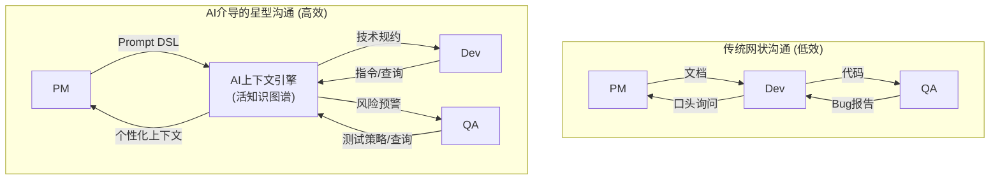

#### **5.2. 决策的重构：数据、直觉与AI建议的融合**

> **核心启示 (Takeaway):** 团队决策不再是单纯靠领导拍板，也不是完全听数据的，而是升级为"人机混合决策"。对于常规问题，AI可以自动处理；对于复杂问题，AI会提出几个备选方案，并分析好各自的成本、风险和收益，然后由人类专家结合自己的经验和直觉进行最终拍板。这种方式既高效又可靠。

##### **5.2.1. 人机混合决策框架的三层模型**

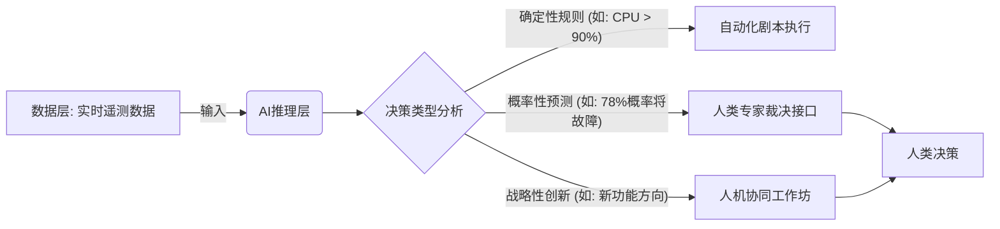

##### **5.2.2. 决策流程与协议的建立**

*   **AI提出方案，人类进行裁决**：
    1.  **情景触发**：AIOps平台预测到"用户注册服务"在下个流量高峰有50%的概率会过载。
    2.  **AI提出备选方案**：AI运维智能体自动分析后，提出三个选项，并附上预估成本、风险和成功率。
        *   **A方案（保守）**：立即将服务实例数量翻倍。成本：高。风险：低。
        *   **B方案（优化）**：重构注册流程中的一个瓶颈函数。成本：低。风险：中。
        *   **C方案（创新）**：引入排队机制，在流量高峰时对非VIP用户进行排队。成本：中。风险：低（技术上），但可能影响用户体验。
    3.  **人类专家审议**：团队（韧性设计师、开发者、产品经理）召开一个15分钟的"混合决策会议"，基于经验、直觉和战略考量进行裁决。
    4.  **形成混合决策并记录**：团队最终决定："采纳A方案作为临时措施...同时，创建一个P2级别的任务探索B方案的重构..." 该决策及其理由被记录到知识图谱中，作为未来AI学习的宝贵资料。

#### **5.3. 共享心智模型："活的知识图谱"作为团队的动态"第二大脑"**

> **核心启示 (Takeaway):** "活的知识图谱"是实现高效协同的基石，它扮演着整个团队共享的、实时更新的"第二大脑"的角色。过去，团队的知识和默契存在于每个人的脑子里和零散的文档里，既不完整也不同步。现在，知识图谱把所有信息都显性化、集中化了。团队成员都可以通过查询这个"大脑"来获得全局信息，从而做出更明智的决策。

##### **5.3.1. 从个体记忆到统一的、动态的团队记忆库**

一个高效的团队，其成员必须拥有一个共享的心智模型（Shared Mental Model）。在过去，这个模型模糊地存在于每个人的大脑和散乱的文档中。而知识图谱，第一次将这个模型显性化、集中化、实时化。

*   **技术实现：实时一致性协议**
    为了保证分布式的团队成员（包括AI）对知识图谱的视图保持一致，可以采用**CRDT（无冲突复制数据类型）**和**向量时钟（Vector Clock）**等技术，确保图谱节点的最终一致性，并能检测和处理并发修改。

##### **5.3.2. 基于图谱的全局推理与影响性分析**

知识图谱的力量在于"连接"。它为所有决策提供了坚实的事实基础。

*   **决策支持示例**：
    > **人类提问**："是否应该将缓存从Memcached迁移至Redis？"
    >
    > **AI通过图谱推理后回答**：
    >
    > "**建议立即迁移**。理由如下：
    > 1.  **性能缺口**：图谱显示，当前[Memcached]节点吞吐量为12k QPS，而关联的[业务增长预测]节点显示，6个月后系统需支撑18k QPS。
    > 2.  **能力匹配**：图谱中[Redis]节点的基准测试数据显示，同规格下其吞吐量可达25k QPS，满足未来需求。
    > 3.  **成本效益**：关联的[成本模型]节点计算得出，Memcached扩容成本为$8k/月，而Redis迁移的一次性成本为$15k，月度成本为$5k，投资回报周期小于4个月。"

当整个团队都围绕着同一个"第二大脑"进行思考、沟通和决策时，协同的效率和深度达到了前所未有的高度，团队真正融合成一个高效运转的超级有机体。 

---
### **第六章：进化路线图：组织与个人的转型之路**

> **核心启示 (Takeaway):** 个人和公司该如何转型？个人需要从"T型人才"进化成"E型人才"，不仅要懂专业，还要会跟AI高效合作、敢于探索创新、并善于沟通。公司则要彻底改造流程、文化和工具链，核心是围绕"价值验证"来转，并且要用新的尺子（比如业务影响、学习速度）来衡量成功，而不是看谁写的代码多。

前五章描绘了AI时代软件工程的宏大图景。然而，知晓未来的方向与抵达未来之间，隔着一条充满挑战的实践鸿沟。本章将聚焦于"如何抵达"，为组织和个人提供一份体系化的进化路线图。这不仅仅是关于学习新工具，更是关于重塑能力模型、再造组织引擎和刷新衡量标准的一场系统工程。

#### **6.1. 能力新图谱：从T型人才到E型人才的演进**

> **核心启示 (Takeaway):** 在AI时代，光有"T型人才"已经不够了，未来需要的是"E型人才"。这个"E"代表着除了要有过硬的专业深度（Expertise）外，还必须具备三项横向能力：能与AI高效协作的执行力（Execution）、能探索未知和定义新问题的创新力（Exploration）、以及能理解他人、高效沟通的同理心（Empathy）。

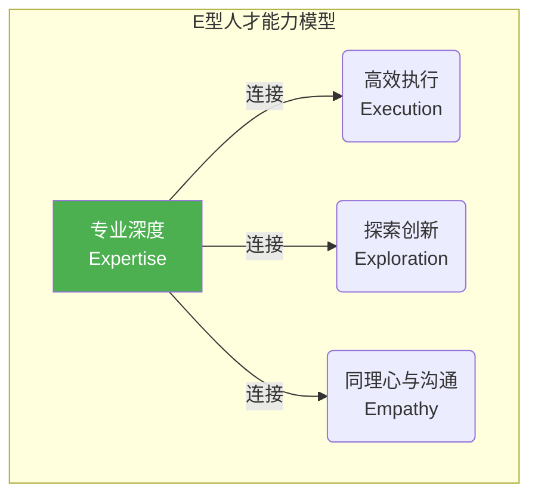

*   **垂直主干 - Expertise (专业深度)**：这依然是根基。无论是对业务领域的深刻洞察，还是对特定技术栈的精通，专业知识是无法被替代的，它决定了人才的价值下限。

*   **第一横 - Execution (高效执行)**：这在AI时代被重新定义为**人机沟通素养（Human-AI Communication Literacy）**。它包括：
    *   **精粹指令工程**：能够设计和编写结构化的、富含上下文的指令，精准地驱动AI完成复杂任务。
    *   **AI输出的批判性评估**：具备快速甄别AI生成内容中"幻觉"、偏见和逻辑谬误的能力。
    *   **反馈与校准**：知道如何通过提供高质量的反馈（如"校准测试用例"）来"执教"AI。

*   **第二横 - Exploration (探索与创新)**：当"实现"不再是瓶颈，探索未知和定义问题的能力变得至关重要。
    *   **系统思维与问题分解**：能够将模糊、庞大的业务问题，拆解为一系列清晰、可验证的子问题和价值假设。
    *   **假设驱动的实验**：习惯于用"小而快"的实验来验证想法，从"一次做对"的压力转变为"快速学习"的坦然。

*   **第三横 - Empathy (同理心与沟通)**：AI可以处理逻辑，但无法真正理解情感。人的独特价值在"连接"中愈发凸显。
    *   **深度同理心**：对用户、对客户、对团队成员的深度理解和情感共鸣。
    *   **跨领域沟通**：利用AI作为上下文引擎，与不同角色的人进行高效、无歧义的沟通。

#### **6.2. 组织转型引擎：流程、文化、工具链的三轮驱动**

> **核心启示 (Takeaway):** 组织的转型需要三个轮子一起转。首先，流程上要从线性的"接力棒"模式，转变为快速试错、快速学习的"价值验证环"模式。其次，文化上要鼓励大胆实验、容忍"聪明的失败"，让信息完全透明。最后，工具链要全部围绕"活的知识图谱"这个核心来构建，让所有工具都能和它对话。

##### **6.2.1. 流程再造：从"线性接力"到"价值验证环"**

*   **告别"线性接力"**：彻底抛弃从需求到开发再到测试的瀑布式或伪敏捷的线性流程。
*   **转向"价值验证环"**：以"提出价值假设 → AI生成MVP → 投放市场验证 → 数据驱动学习 → 迭代假设/扩展规模"为核心，形成持续流动的模式。
*   **重新定义"完成"**：工作的完成标志不再是"代码合并"，而是**"一个价值假设得到了验证"** 或 **"一次成功的学习并已更新至知识图谱"**。

##### **6.2.2. 文化重塑：拥抱实验、学习、透明与策展价值**

*   **拥抱"实验文化"**：领导者必须创造极高的心理安全区，鼓励团队大胆提出假设、拥抱"聪明的失败"。失败不再是问责的由头，而是获取宝贵学习数据的必要成本。
*   **倡导"学习者文化"**：从招聘到晋升，都要奖励那些表现出强烈好奇心、快速学习能力和知识分享行为的员工。
*   **践行"透明文化"**：默认所有信息都应开放并注入"活的知识图谱"，摧毁"信息即权力"的旧观念。
*   **尊重"策展价值"**：公开认可和奖励那些在定义原则、治理知识图谱、培育系统健康方面做出杰出贡献的"策展人"。

##### **6.2.3. 工具链重构：以知识图谱为核心的"图谱原生"生态**

*   **知识图谱为中心**：构建或引入"活的知识图谱"作为整个工具链的核心。
*   **图谱原生（Graph-Native）**：所有其他工具——从需求管理、代码仓库、CI/CD、可观测性平台到AI智能体本身——都必须能双向、实时地与图谱进行数据交换。
*   **人机交互界面升级**：投资开发新一代的人机交互界面，它应该能支持结构化的"精粹指令"编写，能够可视化地展示知识图谱的关联，并提供富交互的"人机协同调试"环境。

#### **6.3. 新的衡量体系：从评估"工作量"到评估"价值贡献"**

> **核心启示 (Takeaway):** 如果公司还用"代码行数"、"完成的故事点"来考核员工，转型肯定会失败。新的考核标准必须彻底改变，不再看你有多"忙"，而是看你贡献了多少"价值"。比如，你多快验证了一个商业想法？你交付的功能给公司多赚了多少钱？你把AI训练得多聪明？以及你把系统建设得多有弹性？这些才是AI时代真正有意义的指标。

##### **6.3.1. 淘汰"伪指标"，拥抱"价值指标"**

*   **应淘汰的伪指标**：
    *   ~~代码行数 (Lines of Code)~~：在AI生成代码的时代已毫无意义。
    *   ~~完成的故事点 (Story Points)~~：衡量的是"忙碌程度"，而非"成果"。
    *   ~~测试用例数量 (Number of Tests)~~：AI可以生成无数的用例，数量不代表质量。
    *   ~~关闭的工单数 (Tickets Closed)~~：可能导致团队只挑容易的工单处理。

*   **应拥抱的价值指标**：
| **衡量维度** | **核心指标** | **衡量目标** |
| :--- | :--- | :--- |
| **价值发现** | **价值假设验证周期 (Value Hypothesis-to-Validation Cycle Time)** | 团队将一个想法转化为可验证结果的速度有多快？ |
| **价值交付** | **业务影响指标 (Business Impact Metric)** (如：转化率提升、用户留存率) | 团队交付的功能对最终的商业目标产生了多大的可量化影响？ |
| **学习与成长** | **AI模型校准率 (AI Model Calibration Rate)** (提交并被采纳的校准用例数) | 团队"执教"和改善AI智能体的效率有多高？ |
| **系统韧性** | **混沌工程实验成功率 (Chaos Experiment Success Rate)** | 系统在面对主动注入的混乱时，其自愈和恢复能力有多强？ |
| **个人成长** | **学习速度 (Learning Velocity)** (ΔValue / ΔTime-to-Learn) | 单位学习时间内，个人创造的价值增量有多大？ |


##### **6.3.2. 个人与团队的综合评估公式**

*   **个人价值贡献分 (Personal Score)**:
    ```
    Score = w1·ΔV + w2·(1/ΔT_learn) + w3·ShareRatio
    ```
    - `ΔV`: Sprint内对北极星指标的增量贡献
    - `ΔT_learn`: 掌握新技能所需时间
    - `ShareRatio`: 知识分享到图谱的贡献度

*   **团队健康度 (Team Health)**:
    ```
    Health = (Σ ΔV) · e^(-λ · ConflictHours)
    ```
    - `Σ ΔV`: 团队总价值贡献
    - `ConflictHours`: 每周用于解决跨角色冲突的会议时长

通过实施这套新的衡量体系，组织才能真正引导团队将精力聚焦于——**快速学习、创造真实价值、构建健康系统和培育更聪明的AI**——这些在AI时代真正重要的事情上。 

---
### **第七章：风险治理与终局展望**

> **核心启示 (Takeaway):** AI很强大，但风险也大。我们需要警惕三只"幽灵"：需求被AI搞偏、AI自己"产生幻觉"犯低级错误、以及公司机密数据泄露。必须建立清晰的规则，比如AI犯错了谁负责，哪些关键领域必须由人来拍板。最终，当AI能搞定所有技术活，人类最宝贵的价值将回归到那些机器无法替代的品质上：远见、同理心和领导力。

拥抱AI驱动的软件工程新范式，意味着我们不仅要享受其带来的指数级效率提升，更要清醒地认识并管理其伴生的新型风险。当AI从工具进化为核心协作者，甚至自主执行者时，传统的风险治理模型已不再适用。我们必须建立一套与新范式相匹配的实践护栏，以确保创新之火不会演变为失控的野火。

#### **7.1. AI协作的核心风险：警惕三大"幽灵"**

> **核心启示 (Takeaway):** 和AI一起工作，要时刻提防三个"坑"。第一，你给的需求如果有点模糊，AI可能会"完美地"执行错，造成巨大浪费。第二，AI有时会"一本正经地胡说八道"，在代码里埋下难以发现的逻辑炸弹。第三，如果把公司内部的保密代码或数据发给外部AI，可能会导致严重的数据泄露。

在人机深度协同的模式下，三个核心风险如同幽灵般潜藏在高效的工作流之下，必须得到严密监控。

| 风险类别 | 典型表现 | 潜在影响 | 关键护栏策略 |
| :--- | :--- | :--- | :--- |
| **需求偏差放大** | 模糊的Prompt或价值假设被AI完美执行 | 巨大资源浪费，商业价值南辕北辙 | 价值假设验证沙箱，Prompt DSL强制约束 |
| **AI逻辑幻觉** | LLM生成看似合理但存在微妙逻辑漏洞的代码 | 系统崩溃，数据损坏，安全漏洞 | 对抗性测试，人类红线复审，知识图谱一致性校验 |
| **知识资产安全** | 专有数据/代码在与外部LLM交互时泄露 | IP泄露，合规处罚，合同违约 | 差分隐私，联邦学习，本地化部署模型 |

*   **风险场景（需求偏差放大）**：一个价值架构师在规约中对折扣计算规则的描述存在边界条件的歧义。AI根据这个有瑕疵的规约，在几分钟内生成了逻辑自洽但业务上错误的定价服务，并通过了所有AI生成的测试，最终导致巨大的经济损失。

#### **7.2. 责任的边界：当AI犯错时如何追溯与界定**

> **核心启示 (Takeaway):** AI犯错了，锅谁来背？这得看情况。如果是人给的指令本身就有问题，那人的责任最大。如果是指令没问题，但AI自己"犯傻"了，那就是AI模型或其提供商的问题。最复杂的是，单个AI都没错，但凑在一起就出问题了，那负责设计整个系统的"策展人"就要承担集体责任。为了方便事后"断案"，所有的人机交互都必须在"知识图谱"里留下不可磨灭的证据。

##### **7.2.1. 责任追溯框架：指令错误、模型缺陷、涌现失效**

*   **指令错误（Instruction Error）**：如果错误的根源，可以追溯到一个由人类专家发出的、但存在缺陷的"精粹指令"或规约，那么**下达指令的人类负有主要责任**。
*   **模型缺陷（Model Flaw）**：如果人类的指令清晰且正确，但AI智能体在执行过程中产生了无法预料的"幻觉"或违反了其应遵循的已知规则，那么责任可能归结于**AI模型本身的缺陷**，由AI模型管理的团队或供应商承担。
*   **涌现失效（Emergent Failure）**：最复杂的情况是，人类指令正确，单个AI的行为也符合预期，但多个组件在复杂交互中涌现出了系统性的、未曾预料到的失败。在这种情况下，责任更多地属于一个**集体责任**，特别是负责系统整体演化和韧性的**系统策展人和韧性设计师**。

##### **技术实现：不可篡改的交互证据链**
"活的知识图谱"是最终的责任仲裁系统。每一次人机交互、每一次AI决策、每一次系统变更，都必须被记录为图谱中带有时间戳、可追溯的节点（如用Prompt指纹、AST哈希、部署哈希等技术），形成不可篡改的证据链。

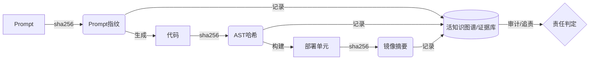

#### **7.3. 实践护栏：建立"人类复审红线"与透明度原则**

> **核心启示 (Takeaway):** 我们必须给AI的权力设置"护栏"。首先要划定一条"红线"，明确规定哪些核心领域（比如跟钱、安全、隐私相关的）绝对不能让AI自己做主，必须由有经验的人类专家最后签字确认。其次，所有AI的行为都必须是"透明"的，它做的任何决策，都得能解释清楚"为什么"，并且整个过程都要能被追溯和审计。我们绝不能跟一个"黑箱"AI共事。

*   **建立"人类复审红线"（Human Review Redline）**
    组织必须明确划定一条"红线"，定义出那些**绝对禁止AI自主决策和修改**、必须由具备资质的人类专家进行最终复审和确认（Sign-off）的关键领域。
    *   **红线区域示例**：
        *   **安全认证与授权**：任何与用户身份认证、权限控制相关的代码变更。
        *   **核心金融交易**：涉及资金处理、计费、定价的核心逻辑。
        *   **数据模型与隐私**：对核心数据模型的Schema变更，以及任何触及用户隐私数据的处理逻辑。
        *   **对外公共API契约**：对承诺了向后兼容的公共API的破坏性修改。

*   **贯彻AI交互的透明度原则**
    黑箱式的AI是不可接受的。所有引入的AI系统必须遵循严格的透明度原则。
    *   **可追溯性（Traceability）**：AI的每一次行动，都必须能清晰地追溯到其触发源。
    *   **可解释性（Explainability）**：对于其关键决策，AI应能提供"为什么"的解释。例如，"我之所以建议重构这个函数，是因为我的分析显示它违反了'性能原则P-001'。"
    *   **可审计性（Auditability）**：所有的人机交互、AI决策和系统变更日志，都必须是防篡改的，并可供独立的第三方进行审计。

#### **7.4. 终局展望：当"角色"消融于"价值创造"**

> **核心启示 (Takeaway):** 长远来看，AI会变得越来越自主，也许有一天，我们今天定义的这些新"角色"也会渐渐消失。但即使到了那个时候，人的价值依然无可替代。当所有"术"层面的问题（怎么做）都被AI解决了，人类最核心的竞争力将回归到"道"的层面：是那种提出伟大愿景的"远见"，是那种与人建立真实情感连接的"同理心"，以及那种在人与AI共存的复杂世界里设定方向、凝聚人心的"领导力"。

##### **7.4.1. 从"AI辅助"到"AI自主"的远期趋势**

本报告所描述的人机协同范式，可能仍是一个过渡阶段。长远来看，从"AI辅助"到"AI自主"的趋势不可阻挡。今天由"价值架构师"和"系统策展人"扮演的战略引导角色，未来也可能被更高级的"战略AI"所增强甚至部分取代。一个企业或许只需要定义最高层次的商业愿景，AI就能自主进行市场分析、产品构思、系统生成和持续运营。

**结语：成为驾驭不确定性的价值领航员**

AI时代软件工程的第二次革命，归根结底，是一场关于"价值"的革命。它将工程师从实现的枷锁中解放出来，迫使我们去思考更根本的问题。

在这场波澜壮阔的技术浪潮面前，我们有两种选择：成为一名固守旧有流程，技能逐渐被AI覆盖的"流程执行者"；或者，勇敢地拥抱变革，重塑自己的能力，学习与AI共舞，进化为一名能够洞察机遇、定义问题、引导系统、驾驭不确定性的**"价值领航员"**。

变革已经开始，未来正在被书写。 