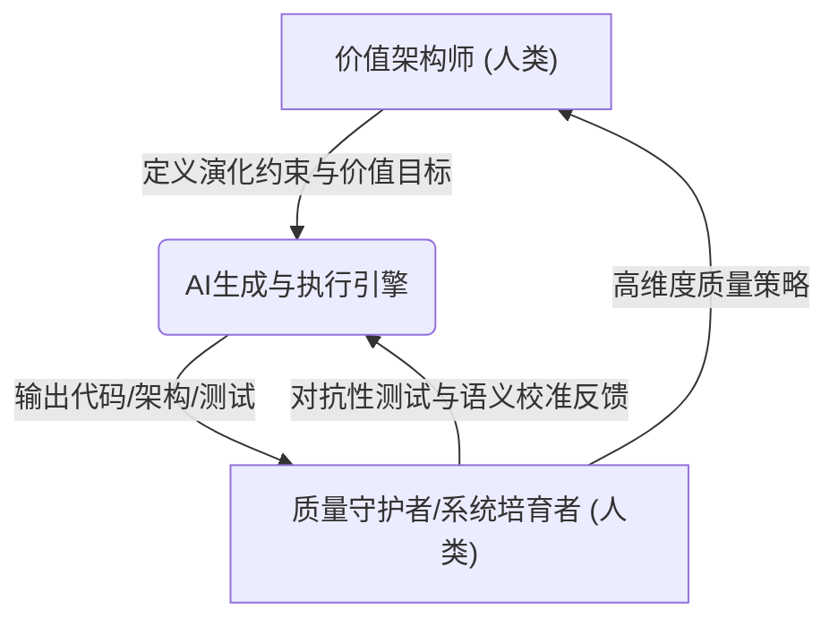

### **前言：从代码生成到价值涌现——软件工程的第二次革命**

软件工程，自其诞生之日起，本质上就是一场关于"抽象"和"自动化"的持久战。第一次革命，我们通过高级语言、编译器和框架，将工程师从繁琐的机器指令中解放出来，实现了"思想"到"代码"的第一次大规模抽象。而今天，我们正站在第二次革命的浪尖。这一次，生成式AI（Generative AI）和大语言模型（LLM）正以前所未有的力量，从根本上重塑软件创造的每一个环节。这不再仅仅是关于"更快地写代码"，而是关于**重构价值创造本身**。

#### **AI作为新的生产力要素：成本结构与速度的颠覆**

传统的软件开发成本结构，长期以来被"实现"（Implementation）阶段所主导。然而，AI正在颠覆这一结构。以代码生成模型为例，从早期的代码补全到如今能够理解复杂需求、生成完整应用模块、乃至自主进行多轮测试和修复的"AI智能体"（AI Agent），软件的**"生产成本"正趋近于零**。这并非夸张，而是描述一种趋势：过去需要一个团队数周才能完成的编码和单元测试工作，现在可能由一个AI智能体在几小时内完成。

这种变化直接导致了两个颠覆性后果：

1.  **速度的指数级提升**：创新的周期被极大缩短。一个想法从概念到可交互原型的距离，从"月"缩短到了"天"甚至"小时"。这使得快速试错和市场验证的成本变得极低。
2.  **价值链瓶颈的漂移**：当"如何实现"（How）的成本急剧下降时，**"做什么"（What）和"为什么做"（Why）的决策质量**便成为决定项目成败的**核心杠杆**。软件工程的重心，正不可逆转地从"工程实现"向上游的"价值发现"和下游的"价值交付"转移。

#### **"角色"边界的溶解与"团队"定义的重组**

第二次革命的另一个深刻影响，体现在对"人"的重新定义。传统软件团队如同分工明确的工业流水线：产品经理定义需求，架构师设计蓝图，开发者砌砖，测试者质检，运维者保障。

AI打破了这道墙。一个产品经理，现在可以借助AI直接将一个模糊的想法具象化为可交互的应用原型。一个开发者，其角色更像一个侦探或指挥官，而非单纯的编码者。这种变化意味着：

*   **单一技能角色的价值被稀释**：仅仅会"写代码"或"点功能"的工程师，其核心竞争力正在被AI快速取代。
*   **跨领域（T型）人才成为主流**：未来的价值创造者，必须是"多面手"，既要懂业务，又要懂技术，更要懂得如何与AI高效协同。
*   **"团队"的定义被重写**：未来的团队，将是一个由**人类专家和AI智能体共同组成的"混合超级团队"**。在这个团队里，AI不再是工具，而是拥有特定"角色"的**核心成员**。

#### **核心命题：探寻人机协同新范式下的进化路径**

面对这场深刻的变革，本报告的核心命题是：**在AI深度介入软件全生命周期的背景下，我们必须重新定义软件工程的各个角色，重构团队间的协同模式，并最终建立一套全新的价值评估体系，以探寻个体与组织在AI时代的进化路径。**

我们将不再孤立地讨论"AI如何辅助编码"，而是系统性地剖析从**价值前端（上游）**的"价值架构"，到**工程核心（中游）**的"系统培育"，再到**交付运维（下游）**的"智能韧性"，每一个环节、每一种角色的冲击与演进。

本报告旨在为身处变革浪潮中的技术领导者、架构师、产品经理和每一位工程师，提供一份深度思考的框架和一份面向未来的行动指南。我们相信，那些能够深刻理解并主动拥抱这场"角色、协同与价值"全面重构的个人和组织，将成为驾驭不确定性的价值领航员。

软件工程的第二次革命已经到来，它关乎技术，但更关乎人。现在，让我们一同深入这场变革的内核。 

---
