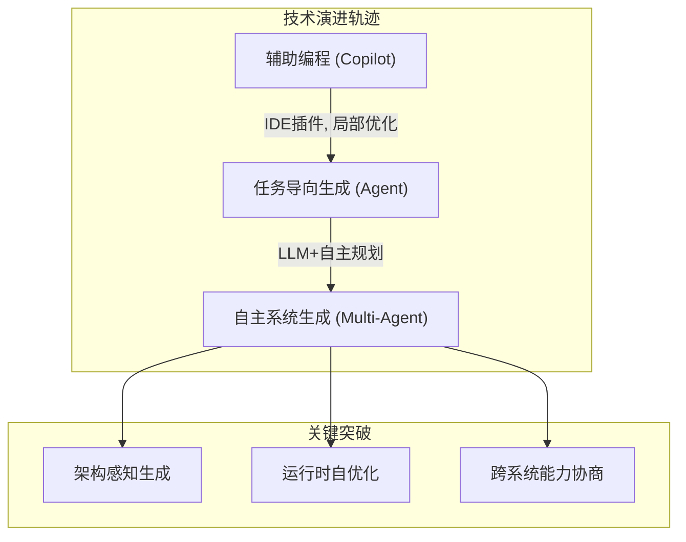
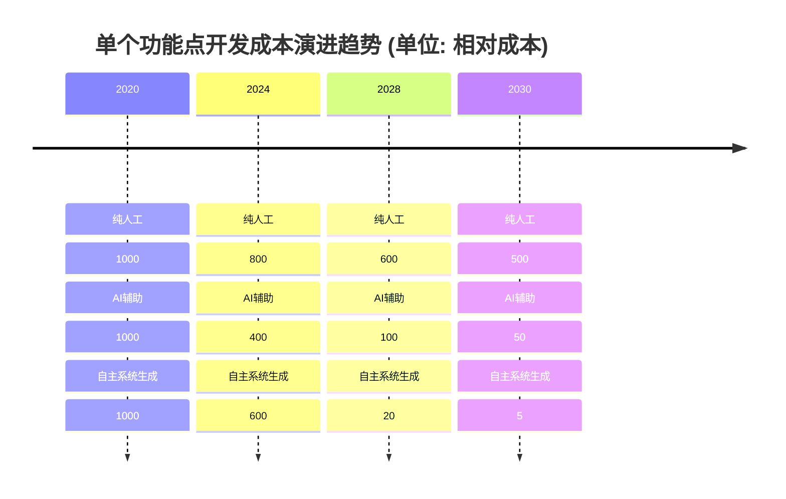
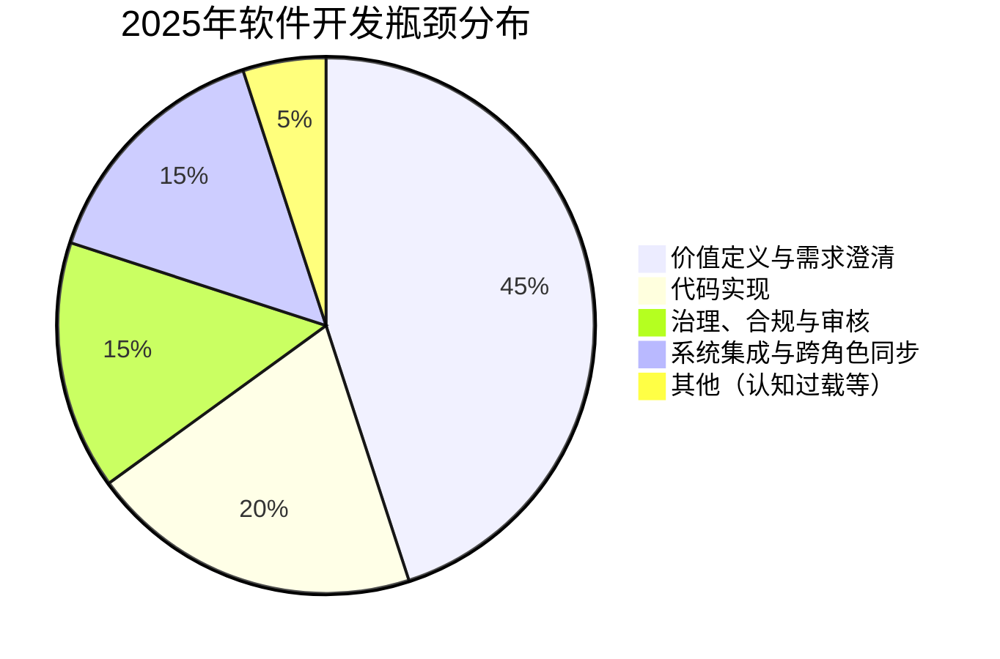
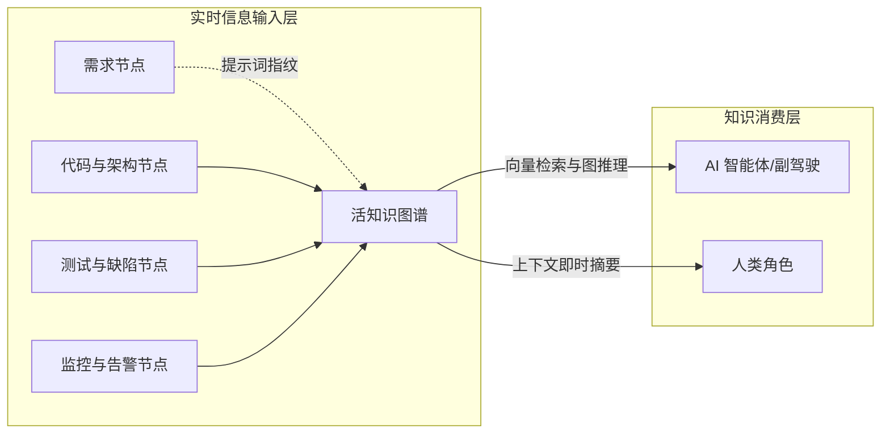

### **第一章：范式基石的重塑——AI驱动下的软件开发新公理**

在任何领域，革命的发生，往往源于其底层公理（Axiom）的失效与重写。软件工程的第一次革命，建立在"机器时间昂贵，人力时间相对便宜"的公理之上。而今天，AI正在颠覆那些我们早已习以为常的新公理。进入2025年后的软件工程，其范式基石正在被三股强大的力量重塑：效率的非线性跃迁、瓶颈的系统性漂移、以及知识形态的彻底革命。理解这三大新公理，是理解未来一切角色和流程变革的前提。

#### **1.1. 效率的非线性跃迁：从"辅助编程"到"自主系统生成"**

##### **1.1.1. 技术演进的三阶段轨迹**

软件开发效率的提升，正经历着一场从量变到质变的非线性跃迁。这条技术轨迹清晰地展示了AI在软件工程中角色的演进，它大致可分为三个阶段：

*   **阶段一：辅助编程（~2021-2023）**
    此阶段的AI，以GitHub Copilot的早期版本为代表，扮演的是一个"高级代码补全工具"。它的核心价值在于**局部优化**：根据上下文建议代码片段、生成通用函数。此时，人类开发者仍然是绝对的主导者。

*   **阶段二：任务导向的代码生成（~2024-2025）**
    AI的能力发生了质变，能够理解更高层级的**任务指令**。开发者可以向AI"智能体"（AI Agent）下达一个明确的任务，例如："为'用户管理'模块创建一个CRUD微服务"，AI便能自主完成完整的任务闭环。人类的角色从"逐行编码"转变为"任务分解与结果验收"。

*   **阶段三：自主系统生成（2025年以后）**
    这是我们正在迈入的全新阶段。人类的输入是更高层次的**业务需求、架构约束和价值目标**。AI系统会自主地编排多个专职AI智能体协同工作，进行系统设计、代码生成、集成、测试和部署方案的制定。人类专家则转变为"需求澄清者"、"架构决策者"和"最终仲裁者"。



##### **1.1.2. 效率曲线的拐点与指数级增长**

这种从"辅助"到"自主"的演进，意味着软件生产的模式从"人工作坊"彻底转向"自动化工厂"，其成本结构随之发生坍塌式变革。


技术注解：当AI生成代码占比超过70%时，开发成本曲线从线性下降转向指数级下降，但**模型训练、微调及知识图谱的维护成本**成为新的关键变量。

#### **1.2. 瓶颈的系统性漂移：当"实现"不再是问题**

##### **1.2.1. 旧瓶颈：实现的困境**

根据约束理论，任何系统的产出都由其最慢的环节（瓶颈）决定。在传统软件工程中，"实现"（编码、测试、调试）无疑是长期以来的核心瓶颈。

##### **1.2.2. 新的三大瓶颈：价值定义、系统集成、人类审核**

当AI将"实现"的效率提升数个量级后，瓶颈被打破，但整个价值链的产出受限于新的、过去被掩盖的瓶颈。

| **传统瓶颈** | **AI时代新瓶颈** | **技术成因** |
| :--- | :--- | :--- |
| 代码实现速度 | **价值定义精度** | 需求模糊性被AI以前所未有的速度放大 |
| 人力协作效率 | **人机语义对齐损耗** | 自然语言到机器可执行指令之间的鸿沟 |
| 硬件资源限制 | **高质量领域数据获取** | 数据隐私与标注成本制约AI模型的持续进化 |
| 手动测试覆盖 | **AI生成代码的信任与治理** | AI幻觉、安全漏洞、架构腐化风险需要新的治理手段 |


**实证数据**：2026年Gartner调查显示，73%的AI辅助项目延迟源于**需求频繁变更导致AI生成代码迭代成本激增**。

#### **1.3. 知识的形态革命：从"静态文档"到"活的知识图谱"**

##### **1.3.1. 传统知识载体的失效**

传统的知识载体——如需求文档（Word）、设计图（PDF）、Wiki页面——存在致命缺陷：它们是**静态的、孤立的、非结构化的，且极易与实际运行的系统脱节**。当系统以10倍速演进时，维护这些静态文档的成本高到无法接受。

##### **1.3.2. "活的知识图谱"：动态的数字孪生与单一事实来源**

未来的解决方案，是一个**"活的知识图谱"（Living Knowledge Graph）**。它并非一个简单的数据库，而是整个软件生命周期的**动态、多维、结构化的数字孪生**，是连接所有角色、所有工具和所有流程的"单一事实来源"。



*   **"活"的本质**：
    这个图谱由AI智能体和CI/CD工具链进行**实时、自动的维护**。
    -   当一个AI开发者Agent生成了一段代码，它会自动在图谱中创建代码节点，并建立其与需求节点、API节点之间的连接。
    -   当AIOps系统检测到性能异常，它会创建一个告警节点，并自动追溯关联到可能导致问题的代码变更和部署事件。

*   **革命性的价值**：
    这个知识图谱成为了人与AI、人与人之间协同的**核心媒介**，使得跨领域的影响性分析和根本原因追溯成为可能。
    -   **技术栈示例**：通过`Neo4j`（图存储）+ `Milvus`（向量存储）+ `LangGraph`（智能体编排）+ `OpenTelemetry`（数据采集）来构建这一中枢。

*   **关键机制：Prompt指纹**
    为了确保每一次人机交互都可追溯，可以引入Prompt指纹机制，将每一次的Prompt及其上下文哈希化，作为一个可追溯的图谱节点。
    ```python
    import hashlib
    import json

    def prompt_fingerprint(prompt: str, context: dict) -> str:
      """为每一次人机交互生成一个唯一的、可追溯的指纹"""
      payload = json.dumps({"prompt": prompt, "context": context}, sort_keys=True)
      return f"prompt_{hashlib.sha256(payload.encode()).hexdigest()[:16]}"
    ```
