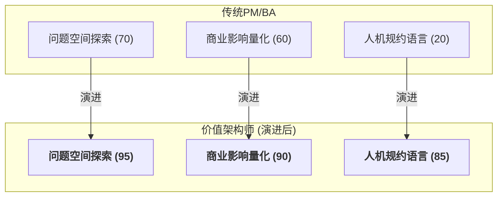

### **第二章：价值前端的革命：从"需求转译"到"价值架构"**

正如第一章所揭示，当AI接管了绝大部分"如何实现"（How）的繁重工作后，软件工程的瓶颈迅速向上游漂移。**"做什么"（What）的决策质量**与**"为什么做"（Why）的战略洞察**，其重要性被前所未有地放大。一个错误的决策，过去可能在数周或数月的开发周期后才被发现，造成有限的沉没成本；而在AI时代，它可能在数小时内就催生出一个功能完备但毫无价值的复杂系统，导致惊人的资源错配。

因此，价值链的前端——传统上由产品经理和架构师主导的领域——正经历着一场从"转译者"到"架构师"的深刻革命。这里的"架构师"，不仅指技术架构，更指**价值架构**。

#### **2.1. 产品经理(PM)/业务分析师(BA)的蜕变：从需求中介到价值架构师**

##### **2.1.1. 冲击：作为"信息转录员"的价值压缩**

传统意义上的产品经理或业务分析师，其核心职能之一是作为业务方和技术方之间的"中间人"或"翻译官"。然而，这层"中间人"的价值正在被AI迅速压缩：

1.  **AI的需求理解能力增强**：先进的AI模型可以直接分析原始的、非结构化的输入（如客户访谈录音、用户反馈文本），从中提炼出潜在的需求点和用户痛点。
2.  **从需求到原型的直接生成**：PM不再需要用Figma精心绘制每一个交互细节。他们可以用自然语言描述一个核心想法，AI就能在几分钟内生成一个可交互、高保真的前端原型。
3.  **技术沟通壁垒降低**：当开发者可以通过与AI对话来理解需求背后的业务逻辑时，PM作为"人肉API"负责答疑解惑的职能也被部分替代。

##### **2.1.2. 演进路径：价值架构师的三大核心支柱**

面对价值压缩，PM/BA角色必须向上进化，从一个被动的"需求转译者"演进为主动的**"价值架构师"（Value Architect）**。他们的工作重心不再是定义"功能"，而是构建和验证"价值假设"。



**2.1.2.1. 问题空间探索：成为问题的发现者**

价值架构师不再是"需求的接收者"，而是"问题的发现者"。他们运用AI作为"外脑"和"放大器"，在广阔的可能性中定位真正值得解决的问题。

*   **技术应用**：
    *   **AI驱动的用户研究**：利用AI工具对海量的市场报告、社交媒体讨论、用户评论进行主题建模和情感分析，快速发现趋势和潜在需求。
    *   **规模化的假设驱动验证**：AI极大地降低了MVP的构建成本。价值架构师的核心工作是设计一系列并行的"价值假设"，然后利用AI快速生成用于验证这些假设的多个微型产品或功能变体，进行大规模的A/B测试。
    *   **AI辅助的因果推断**：利用AI分析产品数据，建立因果模型，去回答"到底是不是X功能 *导致* 了高留存率？"，从而做出更精准的决策。
        ```python
        # 使用DoWhy库构建需求因果图
        model = CausalModel(
            data=df,
            treatment='新增功能X',
            outcome='用户留存率',
            graph="""digraph {
              付费意愿 -> 用户留存率;
              功能易用性 -> 付费意愿;
              新增功能X -> 功能易用性;
            }"""
        )
        # 量化功能X对留存率的真实影响
        estimate = model.estimate_effect()
        ```

**2.1.2.2. 商业影响衡量：量化决策的价值**

在AI时代，功能的交付速度不再是衡量PM绩效的关键指标。取而代之的，是所交付功能对核心商业指标的**可量化影响**。

*   **技术应用**：
    *   **定义与追踪"价值指标"**：他们需要定义能够衡量商业价值的北极星指标，并将其关联到知识图谱中对应的"需求"和"功能"节点上，形成"假设-开发-衡量-学习"的闭环。
    *   **动态价值仪表盘**：建立实时仪表盘，追踪核心价值维度的变化，并利用AI进行趋势预测和根因诊断。
        ```
        ┌───────────────┬───────────────┬───────────────┐
        │ 价值维度      │ 实时指标      │ AI预测趋势    │
        ├───────────────┼───────────────┼───────────────┤
        │ 用户留存      │ 62.1%(▲3.2%)  │ ↗️ 达68% (30d)│
        │ 转化率        │ 14.3%(▽0.7%) │ ↘️ 触12% (7d) │
        └───────────────┴───────────────┴───────────────┘
        ▶️ 根因诊断：转化率下降源于新版支付流程步骤增加 (AI归因分析)
        ```


**2.1.2.3. 人机规约语言：掌握与AI对话的精确语言**

这是价值架构师区别于传统PM的**最硬核**的技能。当开发的执行者从"人类工程师"变为"AI智能体"时，沟通的语言必须升级。模糊的自然语言用户故事已不再足够，需要一种更精确、更结构化、但又比代码更抽象的**"规约语言" (Prompt DSL)**。

*   **Prompt DSL 草案 v0.3**
    - **目标**：让PM用**结构化自然语言**直接生成可执行规约。
    - **语法（EBNF范式）**：
      ```
      Specification := "AS" Role "I WANT" Goal "SO THAT" Impact
                     (Acceptance)* (Guard)* (Metric)*

      Acceptance   := "GIVEN" Context "WHEN" Trigger "THEN" Outcome
      Guard        := "MUST" Constraint
      Metric       := "MEASURE" KPI "BY" TelemetryQuery
      ```
    - **示例**：
      ```
      AS Shopper
      I WANT one-click reorder from past purchases
      SO THAT conversion rate increases by >= 5 %

      GIVEN user has >= 1 past order
      WHEN user clicks "Reorder"
      THEN order created in < 400 ms

      MUST comply with GDPR
      MEASURE conversion_rate BY SELECT COUNT(DISTINCT user_id) WHERE event = 'reorder_success'
      ```
    - **编译流程**：`Prompt DSL → LLM → Gherkin + Policy-Rego + SQL Telemetry`

#### **2.2. 架构师(Architect)的战略转向：从蓝图绘制者到进化式系统策展人**

##### **2.2.1. 冲击：静态蓝图在"涌现式架构"前的失效**

传统软件架构师的核心产出物是一份详尽的系统设计"蓝图"。然而，在系统能够以天为单位进行功能迭代和结构演变的AI时代，这种静态的、前置的重量级蓝图模式正在迅速失效。

1.  **AI生成初始架构**：架构师不再需要从零开始绘制常见的架构模式。只需要提供高级约束，AI就可以生成一个相当成熟的初始架构方案。
2.  **"涌现式"而非"设计式"的架构**：由于开发速度极快，系统的架构更多地是在持续不断地功能添加和重构中"涌现"出来的，而非预先完美设计的。

##### **2.2.2. 演进路径：系统策展人的三大核心职责**

架构师的角色必须从一个静态的"蓝图绘制者"转变为一个动态的**"进化式系统的策展人"（Curator of Evolutionary Systems）**。他们的目标，不是阻止变化，而是**引导和塑造变化**。

**2.2.2.1. 定义演化约束：用"架构适应度函数"设定护栏**

策展人不再画出每一个细节，而是设定AI在自主生成和修改系统时必须遵守的"物理定律"和"护栏"。这些约束是代码化的，并被集成到AI的决策框架中。

*   **技术应用：Policy-as-Code**
    他们编写可被自动化工具（如Open Policy Agent）执行的策略，来持续验证系统是否符合某个架构特性。
    ```rego
    # 策略示例：禁止"结算服务"直接调用老旧的"账单服务"
    package authz.service_deps

    deny[msg] {
        input.from == "checkout"
        input.to == "legacy-billing"
        msg := "checkout service must not directly call legacy-billing service"
    }
    ```
    这些策略会嵌入CI/CD流水线，AI生成任何代码变更时，都必须首先确保不会违反这些约束。

**2.2.2.2. 传播技术原则：成为AI与团队的"立法者"**

原则比约束更抽象，它们是指导决策的"价值观"。策展人负责定义、维护并向整个混合团队（包括人类和AI）"布道"这些原则。

*   **技术应用：原则的数字化表达**
    ```json
    {
      "principle_id": "STATELESS_FIRST",
      "description": "优先设计无状态服务，以提升可扩展性和韧性",
      "enforcement_rules": [
        {
          "if": "component.type == 'backend_service'",
          "then": "storage.state == 'external' or component.is_cache == true",
          "weight": 0.9
        }
      ],
      "override_condition": "latency_requirement < 10ms"
    }
    ```
    这些数字化的原则会影响AI智能体在进行技术选型和架构设计时的决策偏好。

**2.2.2.3. 治理知识图谱：成为组织的"首席本体论家"**

如果说知识图谱是AI时代的"单一事实来源"，那么系统策展人就是这个图谱的**首席本体论家和图书管理员**。

*   **治理职责**：
    *   **定义图谱的Schema（本体）**：策展人决定知识图谱中应该有哪些类型的实体（节点，如`微服务`、`API契约`、`数据表`）以及它们之间可以有哪些类型的关系（边，如`依赖于`、`实现`）。
    *   **确保图谱的完整性与准确性**：他们需要设计机制，确保AI和工具链在与系统交互时，能够正确、实时地更新知识图谱。
    *   **利用图谱进行战略决策**：知识图谱是策展人进行宏观分析的超级武器。他们可以通过查询图谱来回答复杂的战略问题，例如："如果我们废弃掉这个老旧的技术平台，会对哪些业务能力和下游客户产生冲击？" 