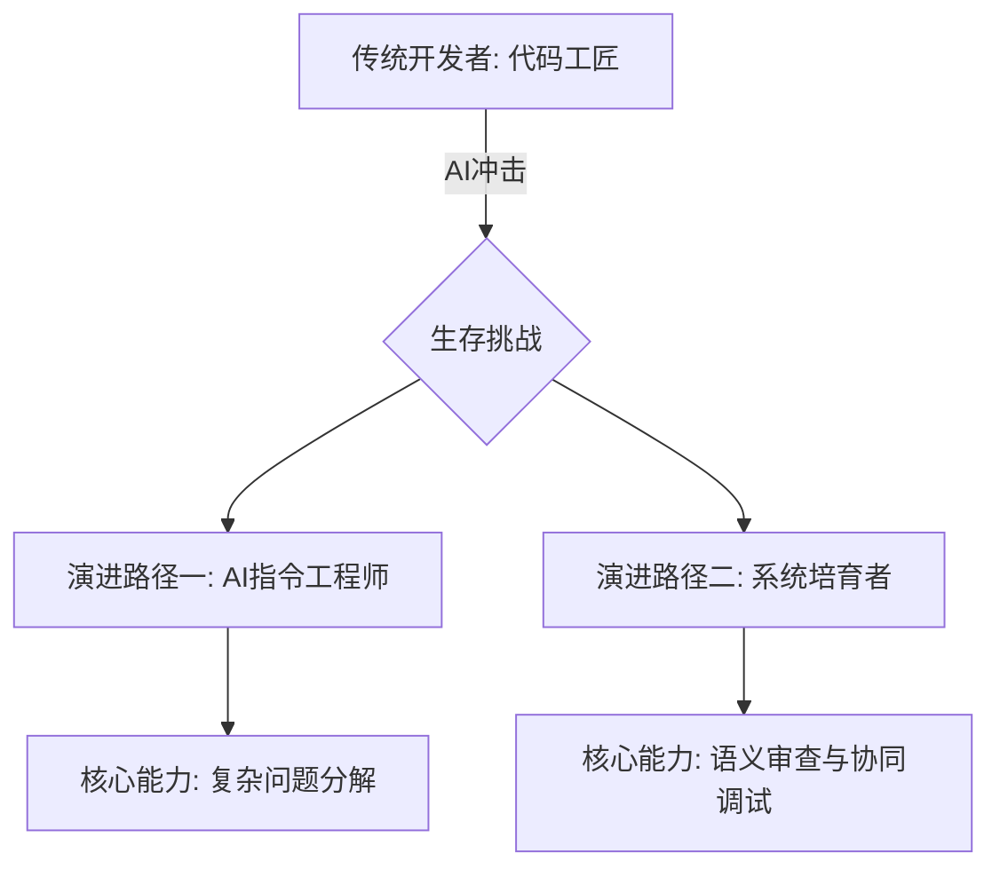
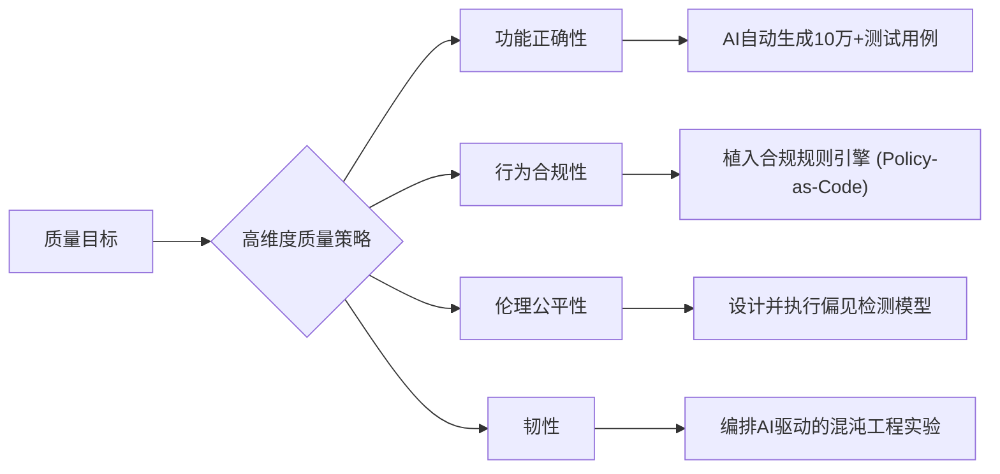
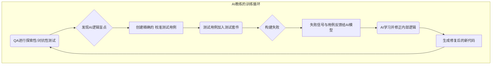

### **第三章：工程核心的质变：从"代码实现"到"系统培育"**

在软件价值链的中游，即传统的"实现"和"验证"阶段，AI正以一种近乎颠覆的姿态，从根本上重塑了"工作"的定义。这里曾是工程师们通过精湛的编码和调试技巧，将抽象需求转化为具体产品的"工厂车间"。如今，这个车间的生产线正在被高度自动化的AI智能体所取代。当AI接管了绝大部分编码和基础测试任务时，一个尖锐的问题摆在了所有工程师面前：**人类的独特价值究竟体现在何处？**

答案并非无所作为，而是角色的质变。工程师将从"工匠"转变为"培育者"，从"建造者"转变为"园丁"。他们的工作不再是逐砖逐瓦地砌墙，而是设计和培育一个能够自我生长、自我修复的复杂生态系统。

#### **3.1. 开发者(Developer)的进化：从代码工匠到AI指令工程师与系统培育者**

##### **3.1.1. 冲击："胶水代码"工程师的风险与手动编码的终结**

1.  **大规模编码工作的自动化**：从前端组件到后端服务，从数据迁移脚本到API接口实现，这些占据了传统开发者大量时间的"模板化"和"逻辑明确"的编码工作，正在被AI全面接管。
2.  **沦为"胶水代码"工程师的风险**：一个显而易见的风险是，开发者的工作被降级为简单地"粘合"由不同AI智能体生成的黑箱模块，负责调用API、配置参数、处理简单的数据转换，却对模块内部的复杂逻辑一无所知。这是一种极度危险的"去技能化"。

为了避免这种命运，开发者必须完成两次关键的身份转变：成为**"AI指令工程师"**，并升维为**"系统培育者"**。



##### **3.1.2. 演进路径(一)：成为"AI指令工程师"**

这是开发者的第一个新身份，是与AI协作的**战术层面**。他们是AI开发智能体的"指挥官"，负责将复杂的战役目标分解为AI可以精准执行的命令。

**3.1.2.1. 核心能力：复杂问题分解的艺术**

这是AI时代开发者的**首要核心技能**。价值架构师提供了"做什么"的精确规约，而AI指令工程师则负责定义"第一步做什么，第二步做什么"。

*   **技术应用：AI可执行的分解协议**
    面对一个复杂的特性需求，例如"实现一个基于用户行为的实时推荐引擎"，开发者需要将其分解为一系列逻辑上独立且可验证的AI任务。这种分解能力，将模糊的业务需求转化为AI可执行的、原子化的、有明确验收标准的工程指令。
    ```json
    {
      "task_id": "RecSys-001",
      "description": "实现用户实时推荐系统",
      "decomposition_strategy": "DataFlow",
      "sub_tasks": [
        {
          "id": "T1",
          "description": "基于知识图谱中的`UserDataModel`，设计并生成一个能存储用户行为事件的Kafka主题Schema和对应的生产者服务。",
          "dependencies": [],
          "verification": "Schema validation & message production test"
        },
        {
          "id": "T2",
          "description": "创建一个Flink应用，消费上述Kafka主题，并使用协同过滤算法计算物品相似度矩阵。",
          "dependencies": ["T1"],
          "verification": "Output matrix format correctness"
        },
        {
          "id": "T3",
          "description": "生成一个RESTful API服务，输入用户ID，能实时查询推荐结果。",
          "dependencies": ["T2"],
          "constraints": {
            "latency_p99": "lt:50ms",
            "observability_principle": "AP-005"
          },
          "verification": "API contract test & load test"
        }
      ]
    }
    ```

##### **3.1.3. 演进路径(二)：成为"系统培育者"**

这是开发者的第二个、更具战略意义的身份。他们像园丁一样，对AI创建的这个快速生长的"数字花园"进行持续的照料、修剪和改良。

**3.1.3.1. 核心能力：AI生成代码的"语义审查"与人机协同调试**

*   **从"代码审查"到"语义审查"**：审查的重点不再是语法错误或编码风格，而是更深层次的"语义"和"意图"层面。开发者需要回答：AI生成的代码是否**真正理解**了业务规则的微妙之处？它是否引入了难以察觉的"AI幻觉"？
*   **人机协同调试 (Collaborative Human-AI Debugging)**：当一个由数万行AI代码构成的复杂系统出现问题时，传统的单步调试方法已然失效。新的调试范式是人机对话式的。
    *   **Trace-Pair协议**：人类的意图（Human Trace）与AI的执行路径（AI Trace）被并列呈现，让开发者能快速定位"理解偏差"。
    *   **增强现实（AR）调试界面**：通过类似AR覆盖层的形式，AI将诊断信息、修复建议直接叠加在代码视图上。
        ```
        [代码视图]
          L42: user_service.get_profile() → 返回Null (预期UserDTO)
          │
          [AR覆盖层 / AI诊断]
          ├─ 🔍 诊断：user_service (v1.4) 与 auth_service (v1.2) 版本不兼容导致认证失败。
          ├─ 💡 建议：(1) 降级auth_service至v1.1；(2) 修改适配层代码。
          └─ ⚡ 即时修复：[点击此处由AI生成兼容层代码]
        ```

#### **3.2. 测试工程师(QA)的跃迁：从缺陷捕手到质量守护者与AI教练**

##### **3.2.1. 冲击：传统自动化测试价值的降低与"左移"的质量保证**

1.  **AI自动生成海量测试用例**：AI可以阅读需求规约和代码，自动生成覆盖各种正常路径和边界条件的测试用例，使得QA编写和维护传统测试脚本的工作量大幅减少。
2.  **"左移"的质量保证**：许多低级错误在编码阶段就被AI开发者智能体通过自带的测试和修复能力消除了，导致下游的传统测试环节能发现的缺陷数量锐减。

##### **3.2.2. 演进路径(一)：成为"质量守护者"**

他们的视野从"功能是否正确"扩展到"系统是否优秀"，负责定义和捍卫一个**高维度的质量模型**。

**3.2.2.1. 核心能力：设计高维度质量策略（性能、安全、伦理等）**

守护者不再执行琐碎的测试用例，而是设计整个质量保障体系的蓝图。这份策略不仅包括功能正确性，还涵盖性能、安全、可用性、韧性、伦理与偏见等。


*   **伦理测试示例**：
    ```python
    # 检测AI推荐系统是否存在年龄歧视
    from fairness_testing_kit import FairnessTest

    bias_detector = FairnessTest(
      model=recommendation_model,
      sensitive_features=["age_group"],
      metrics=["disparate_impact"] # 不利影响比率
    )
    report = bias_detector.run(test_data)
    # 不利影响比率应在[0.8, 1.25]的合规区间内
    assert 0.8 <= report["disparate_impact"] <= 1.25
    ```

##### **3.2.3. 演进路径(二)：成为"AI教练"**

这是QA角色最革命性的转变。他们利用人类的独特优势——直觉、同理心和创造性——来发现AI的盲点，并通过测试用例与AI进行逻辑校准。

**3.2.3.1. 核心能力：通过"探索性测试"与"校准测试用例"训练AI**

*   **探索性与对抗性测试**：当AI完成了所有"意料之中"的测试后，QA的工作才真正开始。他们利用自己的领域知识和对人性的理解，进行"意料之外"的探索。
*   **通过测试用例与AI进行逻辑校准（Logic Calibration via Test Cases）**：这是QA"执教"AI的核心机制。当探索性测试发现一个逻辑漏洞或需求理解偏差时，QA的核心产出物不再是一份简单的缺陷报告，而是一个**精确的、可执行的"反例"测试用例**。
    *   **反馈闭环**：这个测试用例被提交后，会立即在CI/CD流水线中失败。更重要的是，它会被标记并反馈给源头的AI开发者智能体。AI会分析这个失败的用例，并被告知："你之所以失败，是因为错误地理解了业务规则。"这个测试用例，就像一道"错题"，被加入到AI的"错题本"中，用于修正其内部模型，确保未来不会再犯同样的逻辑错误。



---

