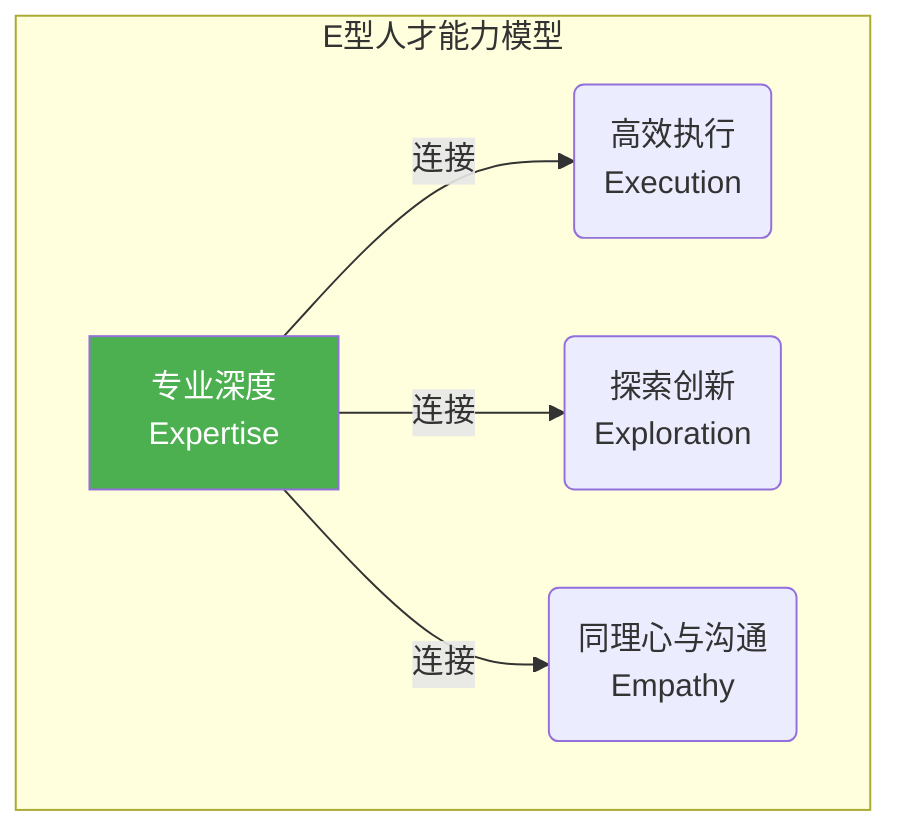

### **第六章：进化路线图：组织与个人的转型之路**

前五章描绘了AI时代软件工程的宏大图景。然而，知晓未来的方向与抵达未来之间，隔着一条充满挑战的实践鸿沟。本章将聚焦于“如何抵达”，为组织和个人提供一份体系化的进化路线图。这不仅仅是关于学习新工具，更是关于重塑能力模型、再造组织引擎和刷新衡量标准的一场系统工程。

#### **6.1. 能力新图谱：从T型人才到E型人才的演进**

在新的范式下，对人才能力的要求发生了根本性的变化。传统的"I"型专家（深耕单一领域）和"T"型人才（一专多能）已不足以应对挑战。未来需要的是**"E"型人才**，其能力模型如字母"E"所示，代表其在专业深度基础上，横向发展出三项关键能力。



*   **垂直主干 - Expertise (专业深度)**：这依然是根基。无论是对业务领域的深刻洞察，还是对特定技术栈的精通，专业知识是无法被替代的，它决定了人才的价值下限。

*   **第一横 - Execution (高效执行)**：这在AI时代被重新定义为**人机沟通素养（Human-AI Communication Literacy）**。它包括：
    *   **精粹指令工程**：能够设计和编写结构化的、富含上下文的指令，精准地驱动AI完成复杂任务。
    *   **AI输出的批判性评估**：具备快速甄别AI生成内容中"幻觉"、偏见和逻辑谬误的能力。
    *   **反馈与校准**：知道如何通过提供高质量的反馈（如"校准测试用例"）来"执教"AI。

*   **第二横 - Exploration (探索与创新)**：当"实现"不再是瓶颈，探索未知和定义问题的能力变得至关重要。
    *   **系统思维与问题分解**：能够将模糊、庞大的业务问题，拆解为一系列清晰、可验证的子问题和价值假设。
    *   **假设驱动的实验**：习惯于用"小而快"的实验来验证想法，从"一次做对"的压力转变为"快速学习"的坦然。

*   **第三横 - Empathy (同理心与沟通)**：AI可以处理逻辑，但无法真正理解情感。人的独特价值在"连接"中愈发凸显。
    *   **深度同理心**：对用户、对客户、对团队成员的深度理解和情感共鸣。
    *   **跨领域沟通**：利用AI作为上下文引擎，与不同角色的人进行高效、无歧义的沟通。

#### **6.2. 组织转型引擎：流程、文化、工具链的三轮驱动**

组织层面的转型，必须从流程、文化、工具链三个方面系统性地推进，三者互为犄角，缺一不可。

##### **6.2.1. 流程再造：从"线性接力"到"价值验证环"**

*   **告别"线性接力"**：彻底抛弃从需求到开发再到测试的瀑布式或伪敏捷的线性流程。
*   **转向"价值验证环"**：以"提出价值假设 → AI生成MVP → 投放市场验证 → 数据驱动学习 → 迭代假设/扩展规模"为核心，形成持续流动的模式。
*   **重新定义"完成"**：工作的完成标志不再是"代码合并"，而是**"一个价值假设得到了验证"** 或 **"一次成功的学习并已更新至知识图谱"**。

##### **6.2.2. 文化重塑：拥抱实验、学习、透明与策展价值**

*   **拥抱"实验文化"**：领导者必须创造极高的心理安全区，鼓励团队大胆提出假设、拥抱"聪明的失败"。失败不再是问责的由头，而是获取宝贵学习数据的必要成本。
*   **倡导"学习者文化"**：从招聘到晋升，都要奖励那些表现出强烈好奇心、快速学习能力和知识分享行为的员工。
*   **践行"透明文化"**：默认所有信息都应开放并注入"活的知识图谱"，摧毁"信息即权力"的旧观念。
*   **尊重"策展价值"**：公开认可和奖励那些在定义原则、治理知识图谱、培育系统健康方面做出杰出贡献的"策展人"。

##### **6.2.3. 工具链重构：以知识图谱为核心的"图谱原生"生态**

*   **知识图谱为中心**：构建或引入"活的知识图谱"作为整个工具链的核心。
*   **图谱原生（Graph-Native）**：所有其他工具——从需求管理、代码仓库、CI/CD、可观测性平台到AI智能体本身——都必须能双向、实时地与图谱进行数据交换。
*   **人机交互界面升级**：投资开发新一代的人机交互界面，它应该能支持结构化的"精粹指令"编写，能够可视化地展示知识图谱的关联，并提供富交互的"人机协同调试"环境。

#### **6.3. 新的衡量体系：从评估"工作量"到评估"价值贡献"**

组织的衡量体系（KPIs）是指挥棒，它直接决定了团队的行为模式。沿用旧的衡量标准来管理新的生产范式，是转型失败的最常见原因。

##### **6.3.1. 淘汰"伪指标"，拥抱"价值指标"**

*   **应淘汰的伪指标**：
    *   ~~代码行数 (Lines of Code)~~：在AI生成代码的时代已毫无意义。
    *   ~~完成的故事点 (Story Points)~~：衡量的是"忙碌程度"，而非"成果"。
    *   ~~测试用例数量 (Number of Tests)~~：AI可以生成无数的用例，数量不代表质量。
    *   ~~关闭的工单数 (Tickets Closed)~~：可能导致团队只挑容易的工单处理。

*   **应拥抱的价值指标**：
| **衡量维度** | **核心指标** | **衡量目标** |
| :--- | :--- | :--- |
| **价值发现** | **价值假设验证周期 (Value Hypothesis-to-Validation Cycle Time)** | 团队将一个想法转化为可验证结果的速度有多快？ |
| **价值交付** | **业务影响指标 (Business Impact Metric)** (如：转化率提升、用户留存率) | 团队交付的功能对最终的商业目标产生了多大的可量化影响？ |
| **学习与成长** | **AI模型校准率 (AI Model Calibration Rate)** (提交并被采纳的校准用例数) | 团队"执教"和改善AI智能体的效率有多高？ |
| **系统韧性** | **混沌工程实验成功率 (Chaos Experiment Success Rate)** | 系统在面对主动注入的混乱时，其自愈和恢复能力有多强？ |
| **个人成长** | **学习速度 (Learning Velocity)** (ΔValue / ΔTime-to-Learn) | 单位学习时间内，个人创造的价值增量有多大？ |


##### **6.3.2. 个人与团队的综合评估公式**

*   **个人价值贡献分 (Personal Score)**:
    ```
    Score = w1·ΔV + w2·(1/ΔT_learn) + w3·ShareRatio
    ```
    - `ΔV`: Sprint内对北极星指标的增量贡献
    - `ΔT_learn`: 掌握新技能所需时间
    - `ShareRatio`: 知识分享到图谱的贡献度

*   **团队健康度 (Team Health)**:
    ```
    Health = (Σ ΔV) · e^(-λ · ConflictHours)
    ```
    - `Σ ΔV`: 团队总价值贡献
    - `ConflictHours`: 每周用于解决跨角色冲突的会议时长

通过实施这套新的衡量体系，组织才能真正引导团队将精力聚焦于——**快速学习、创造真实价值、构建健康系统和培育更聪明的AI**——这些在AI时代真正重要的事情上。 