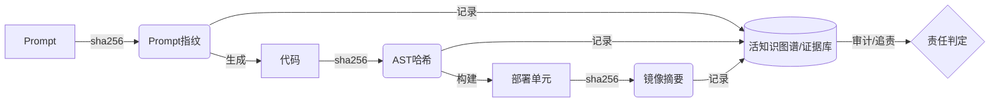
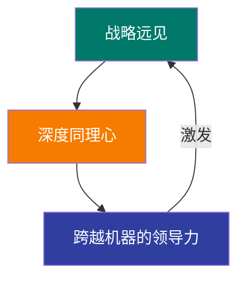

### **第七章：风险治理与终局展望**

拥抱AI驱动的软件工程新范式，意味着我们不仅要享受其带来的指数级效率提升，更要清醒地认识并管理其伴生的新型风险。当AI从工具进化为核心协作者，甚至自主执行者时，传统的风险治理模型已不再适用。我们必须建立一套与新范式相匹配的实践护栏，以确保创新之火不会演变为失控的野火。

#### **7.1. AI协作的核心风险：警惕三大"幽灵"**

在人机深度协同的模式下，三个核心风险如同幽灵般潜藏在高效的工作流之下，必须得到严密监控。

| 风险类别 | 典型表现 | 潜在影响 | 关键护栏策略 |
| :--- | :--- | :--- | :--- |
| **需求偏差放大** | 模糊的Prompt或价值假设被AI完美执行 | 巨大资源浪费，商业价值南辕北辙 | 价值假设验证沙箱，Prompt DSL强制约束 |
| **AI逻辑幻觉** | LLM生成看似合理但存在微妙逻辑漏洞的代码 | 系统崩溃，数据损坏，安全漏洞 | 对抗性测试，人类红线复审，知识图谱一致性校验 |
| **知识资产安全** | 专有数据/代码在与外部LLM交互时泄露 | IP泄露，合规处罚，合同违约 | 差分隐私，联邦学习，本地化部署模型 |

*   **风险场景（需求偏差放大）**：一个价值架构师在规约中对折扣计算规则的描述存在边界条件的歧义。AI根据这个有瑕疵的规约，在几分钟内生成了逻辑自洽但业务上错误的定价服务，并通过了所有AI生成的测试，最终导致巨大的经济损失。

#### **7.2. 责任的边界：当AI犯错时如何追溯与界定**

当由AI主导或生成的系统出现问题时，"谁来负责？"成为一个必须回答的棘手问题。建立清晰的责任追溯链条，是维持信任和秩序的基石。

##### **7.2.1. 责任追溯框架：指令错误、模型缺陷、涌现失效**

*   **指令错误（Instruction Error）**：如果错误的根源，可以追溯到一个由人类专家发出的、但存在缺陷的"精粹指令"或规约，那么**下达指令的人类负有主要责任**。
*   **模型缺陷（Model Flaw）**：如果人类的指令清晰且正确，但AI智能体在执行过程中产生了无法预料的"幻觉"或违反了其应遵循的已知规则，那么责任可能归结于**AI模型本身的缺陷**，由AI模型管理的团队或供应商承担。
*   **涌现失效（Emergent Failure）**：最复杂的情况是，人类指令正确，单个AI的行为也符合预期，但多个组件在复杂交互中涌现出了系统性的、未曾预料到的失败。在这种情况下，责任更多地属于一个**集体责任**，特别是负责系统整体演化和韧性的**系统策展人和韧性设计师**。

##### **技术实现：不可篡改的交互证据链**
"活的知识图谱"是最终的责任仲裁系统。每一次人机交互、每一次AI决策、每一次系统变更，都必须被记录为图谱中带有时间戳、可追溯的节点（如用Prompt指纹、AST哈希、部署哈希等技术），形成不可篡改的证据链。

#### **7.3. 实践护栏：建立"人类复审红线"与透明度原则**

*   **建立"人类复审红线"（Human Review Redline）**
    组织必须明确划定一条"红线"，定义出那些**绝对禁止AI自主决策和修改**、必须由具备资质的人类专家进行最终复审和确认（Sign-off）的关键领域。
    *   **红线区域示例**：
        *   **安全认证与授权**：任何与用户身份认证、权限控制相关的代码变更。
        *   **核心金融交易**：涉及资金处理、计费、定价的核心逻辑。
        *   **数据模型与隐私**：对核心数据模型的Schema变更，以及任何触及用户隐私数据的处理逻辑。
        *   **对外公共API契约**：对承诺了向后兼容的公共API的破坏性修改。

*   **贯彻AI交互的透明度原则**
    黑箱式的AI是不可接受的。所有引入的AI系统必须遵循严格的透明度原则。
    *   **可追溯性（Traceability）**：AI的每一次行动，都必须能清晰地追溯到其触发源。
    *   **可解释性（Explainability）**：对于其关键决策，AI应能提供"为什么"的解释。例如，"我之所以建议重构这个函数，是因为我的分析显示它违反了'性能原则P-001'。"
    *   **可审计性（Auditability）**：所有的人机交互、AI决策和系统变更日志，都必须是防篡改的，并可供独立的第三方进行审计。

#### **7.4. 终局展望：当"角色"消融于"价值创造"**

##### **7.4.1. 从"AI辅助"到"AI自主"的远期趋势**

本报告所描述的人机协同范式，可能仍是一个过渡阶段。长远来看，从"AI辅助"到"AI自主"的趋势不可阻挡。今天由"价值架构师"和"系统策展人"扮演的战略引导角色，未来也可能被更高级的"战略AI"所增强甚至部分取代。一个企业或许只需要定义最高层次的商业愿景，AI就能自主进行市场分析、产品构思、系统生成和持续运营。

##### **7.4.2. 终将回归的人性价值：远见、同理心与领导力**

然而，即使在那样的终局中，人的价值也并不会消失，而是会回归到那些最本质、最无法被算法量化的闪光点上。当一切"术"层面的问题都被AI解决，人类的核心竞争力将聚焦于"道"的层面。

1.  **战略远见（Strategic Foresight）**：提出那个最初的、充满想象力的商业愿景，定义"为什么出发"的能力。这源于对社会、文化、人性的宏大理解，是AI基于历史数据进行推演所无法企及的。
2.  **深度同理心（Deep Empathy）**：与客户、伙伴和团队建立真实的情感连接，理解他们最微妙、最深层的需求和渴望。这是激发忠诚度、建立伟大品牌和凝聚团队的终极力量。
3.  **跨越机器的领导力（Leadership Beyond Machines）**：在一个人与AI共存的复杂世界里，设定道德罗盘，建立信任，激发人类成员的创造激情和使命感，并为整个混合群体（人类+AI）指引方向、承担最终责任的能力。

**结语：成为驾驭不确定性的价值领航员**

AI时代软件工程的第二次革命，归根结底，是一场关于"价值"的革命。它将工程师从实现的枷锁中解放出来，迫使我们去思考更根本的问题。

在这场波澜壮阔的技术浪潮面前，我们有两种选择：成为一名固守旧有流程，技能逐渐被AI覆盖的"流程执行者"；或者，勇敢地拥抱变革，重塑自己的能力，学习与AI共舞，进化为一名能够洞察机遇、定义问题、引导系统、驾驭不确定性的**"价值领航员"**。

变革已经开始，未来正在被书写。 