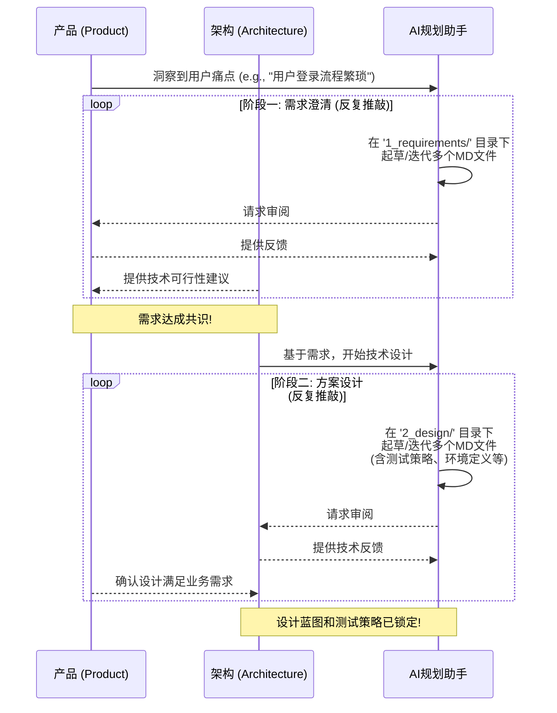
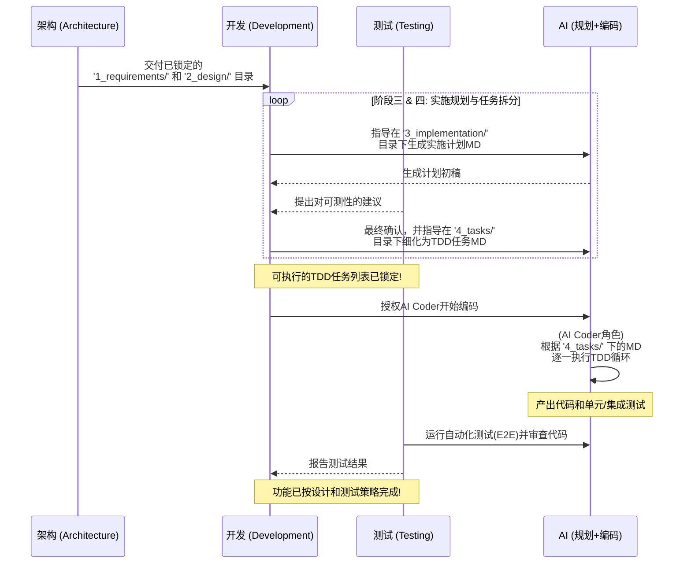

# 面向PPT的角色协作工作流

本文件包含两张独立的时序图，旨在清晰、简洁地展示AI赋能的四阶段开发流程中，不同职能角色（产品、架构、开发、测试）的协作关系。这两张图信息密度适中，非常适合用于PPT演示。

---

## 图一：从用户痛点到设计蓝图 (需求与设计)

**核心阶段**: 1 (需求) & 2 (设计)
**主要角色**: 产品 (Product), 架构 (Architecture)
**核心目标**: 将模糊的用户痛点，系统化地转化为一份清晰、可执行、并经过技术与业务双重评审的设计蓝图及测试策略。

#### 重点与关注 (Key Points & Focus):
*   **价值驱动 (Value-Driven):** 此阶段的核心是确保技术方案与用户价值和业务目标紧密对齐。“为什么做”和“做什么”同等重要。
*   **可行性前置 (Feasibility First):** 架构师的早期介入至关重要，可以及时评估技术可行性，避免团队在无法实现的需求上浪费时间，确保方案从一开始就脚踏实地。
*   **设计即测试 (Design for Testability):** 测试策略是设计的有机组成部分，而非事后补充。这确保了系统的可测试性被内建于架构之中，为后续的TDD和自动化测试奠定基础。
*   **AI是加速器 (AI as an Accelerator):** AI规划助手负责快速生成和迭代文档，提供备选方案，检查清单，将产品和架构师从繁琐的文档工作中解放出来，专注于战略思考和决策。

#### 注意事项 (Cautions):
*   **防止过度设计 (Avoid Over-Engineering):** 设计应与当前要解决的问题相匹配。警惕为了应对“未来可能的需求”而进行不必要的复杂化设计。
*   **沟通大于一切 (Communication is King):** 图中的“循环 (loop)”代表了持续、高频的沟通。此阶段的任何误解，在后续修复的成本都是最高的。
*   **明确范围边界 (Define Scope Boundaries):** 虽然鼓励反馈和迭代，但必须在“需求达成共识”时明确当前迭代的范围边界，以防止需求无休止地蔓延和变更。

---

## 图二：从设计蓝图到合格代码 (实施与交付)

**核心阶段**: 3 (实施) & 4 (任务) -> 最终交付
**主要角色**: 开发 (Development), 测试 (Testing), 架构 (Architecture)
**核心目标**: 将已确定的设计蓝图，通过严谨的TDD任务拆解，最终由AI高效、高质量地转化为一份经过完整验证的、可交付的代码。

#### 重点与关注 (Key Points & Focus):
*   **蓝图的忠实执行 (Faithful Blueprint Execution):** 此阶段的核心是将已经锁定的设计蓝图 (`2_design/`) 无偏差地转化为代码。开发和测试人员必须严格遵循设计文档，任何必要的变更都应先与架构师沟通。
*   **质量内建 (Quality is Built-in, Not Added Later):** 测试人员在任务拆分阶段的早期介入，确保了每个TDD任务都是“可测试的”。代码和测试同步产出，质量从第一行代码开始就被构建进去，而不是等到最后才进行检验。
*   **AI作为高效执行者 (AI as an Efficient Executor):** AI的角色从“规划助手”转变为“编码执行器”。它擅长处理确定性的、重复性的TDD循环，将开发人员从基础编码中解放出来，使其能更专注于解决复杂的逻辑和代码审查。
*   **持续验证 (Continuous Verification):** 自动化测试（单元、集成、E2E）是此阶段的脉搏。每一次代码提交都应该自动触发测试，确保新功能没有破坏现有功能，实现真正的持续集成。

#### 注意事项 (Cautions):
*   **警惕偏离轨道 (Beware of "Scope Creep"):** 开发人员应专注于执行 `tasks.md` 中定义的任务。任何在编码过程中想到的新功能或“优化”，都应该被记录下来，并返回到第一阶段进行评估，而不是擅自加入当前迭代。
*   **信任但要验证 (Trust, but Verify):** AI生成的代码虽然高效，但仍需人类（开发和测试人员）的审查。审查的重点是代码的可读性、可维护性以及是否完美契合了业务场景的微妙之处。
*   **TDD任务的粒度 (Granularity of TDD Tasks):** `tasks.md` 的质量直接决定了AI编码的成功率。任务拆分过粗会导致AI难以理解，过细则会增加管理成本。找到合适的任务粒度是开发人员在此阶段的关键技能。

