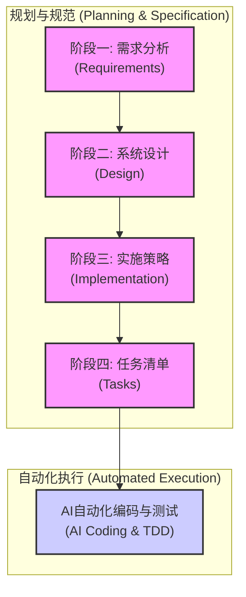
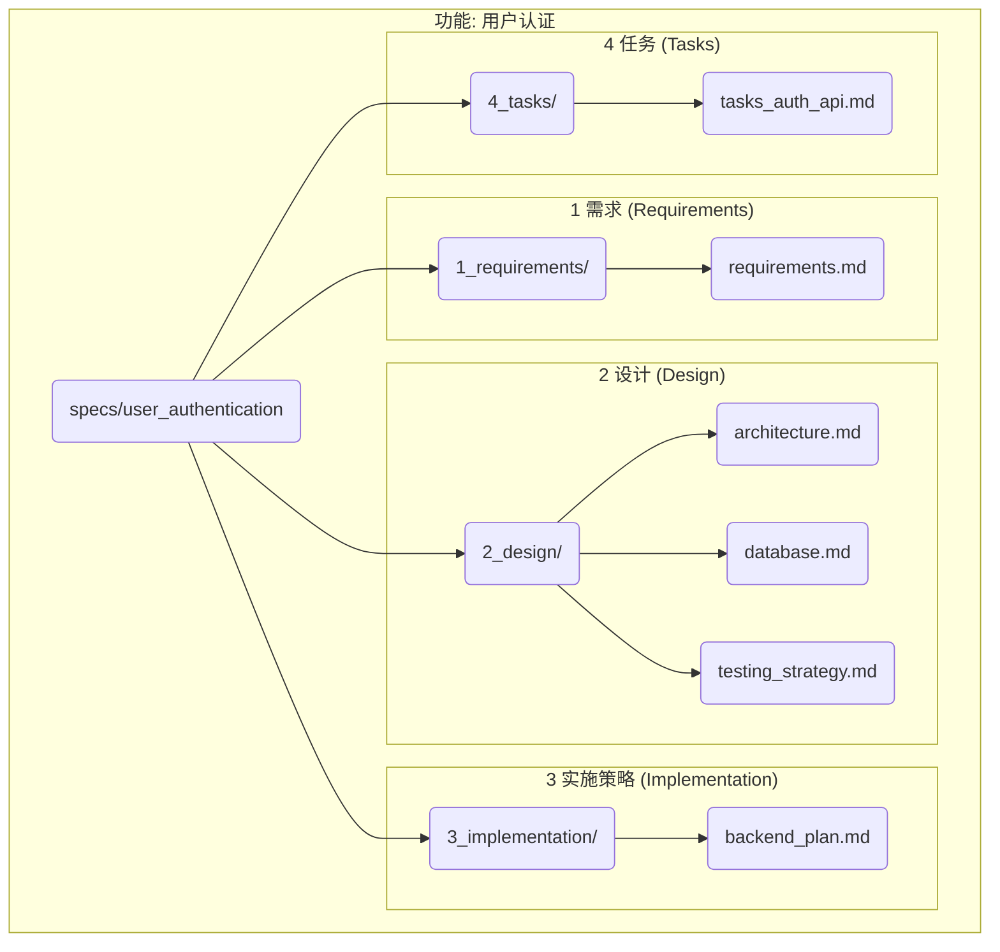

# AI驱动的结构化软件开发工作流

本文档详细阐述了一种以 AI 赋能为核心、高度结构化的四阶段软件开发工作流。该流程旨在通过严谨的规划、设计和任务拆解，最大化地提升复杂工程的开发效率、可控性和代码质量，最终实现由 AI 自动执行编码任务的目标。

其核心思想是将软件开发过程分解为四个独立的、前后衔接的阶段。每个阶段都以生成易于人类理解和审阅的 Markdown 文档为产出，从而方便团队协作、反馈和迭代。只有在前一阶段得到充分确认后，流程才会进入下一阶段。

---

## 核心流程概览

整个工作流遵循“**需求 -> 设计 -> 实施策略 -> 任务清单**”的顺序，步步为营，层层递进。

---

## 阶段详解

### 阶段一：需求 (Requirements)

*   **目标**: 明确“**做什么 (What)**”。这是所有工作的起点和唯一依据。
*   **核心产出**: 位于 `1_requirements/` 目录下的一个或多个 `.md` 文件。
*   **内容要点**:
    *   **用户故事 (User Stories)**: 以 "作为 [角色], 我想要 [功能], 以便 [达成某种价值]" 的格式清晰描述用户需求。
    *   **验收标准 (Acceptance Criteria)**: 使用 EARS (Easy Approach to Requirements Syntax) 等精确、无歧义的格式，定义功能完成的标准。
    *   **范围边界**: 明确哪些功能包含在内，哪些功能被排除在外。
    *   **业务规则与约束**: 描述必须遵守的业务逻辑和限制条件。
*   **特点**: 高度聚焦业务价值，使用通俗易懂的语言，确保产品、业务和技术团队对目标的认知完全一致。

### 阶段二：设计 (Design)

*   **目标**: 规划“**怎么做 (How)**”的宏观技术蓝图。
*   **核心产出**: 位于 `2_design/` 目录下的多个关注点分离的 `.md` 文件。
*   **内容要点**:
    *   **架构设计 (`design_architecture.md`)**: 定义系统的整体结构、技术选型、关键组件及其交互关系。可使用 Mermaid 图表辅助说明。
    *   **数据模型 (`design_database.md`)**: 设计数据库表结构、字段、关系和约束。
    *   **组件与接口 (`design_components_api.md`)**: 划分核心功能模块，并定义模块之间以及对外的 API 接口。
    *   **测试策略 (`design_testing_strategy.md`)**: 这是保障质量的关键。必须详细规划**单元测试、集成测试、端到端（E2E）测试**的方案和覆盖范围。
    *   **研发环境 (`design_environment.md`)**: 明确开发、测试所需的所有环境依赖，如编程语言版本、框架、数据库、中间件等，为后续开发提供一个一致的标准。
*   **特点**: 技术性强，是连接需求和具体实现的关键桥梁。将设计拆分为多个文档有助于并行设计和专项评审。

### 阶段三：实施策略 (Implementation)

*   **目标**: 制定“**如何分步实现 (How to Implement Step-by-Step)**”的路线图。
*   **核心产出**: 位于 `3_implementation/` 目录下的一个或多个叙事性的 `.md` 文件。
*   **内容要点**:
    *   **开发顺序**: 描述实现功能的先后次序，例如“第一步：搭建项目骨架 -> 第二步：实现用户认证模块 -> 第三步：构建商品展示API...”。
    *   **里程碑**: 定义关键的开发节点和交付物。
    *   **依赖关系**: 阐明不同模块或任务之间的依赖关系。
    *   **风险识别**: 提前识别潜在的技术难点或风险点。
*   **特点**: 这是从“设计蓝图”到“施工计划”的过渡。它使用**自然语言**进行描述，主要面向团队成员，确保所有人对实现路径有清晰的共识，避免在编码阶段出现方向性偏差。

### 阶段四：任务清单 (Tasks)

*   **目标**: 生成“**给 AI 执行的具体指令 (Actionable Instructions for AI)**”。
*   **核心产出**: 位于 `4_tasks/` 目录下的，按模块或功能划分的 `.md` 文件。
*   **内容要点**:
    *   **TDD驱动**: 严格遵循测试驱动开发（Test-Driven Development）的模式，将每个功能点拆分为“**写一个失败的测试 -> 写代码让测试通过 -> 重构**”的原子任务。
    *   **极度细粒度**: 每个任务都应是单一、明确、可立即执行的编码动作。
    *   **可操作性**: 指令必须清晰无误，包含需要修改的文件、函数/方法名等关键信息，让 AI可以直接理解并执行。
    *   **示例**:
        *   `[ ] 1.1: 在 'user.test.js' 中，为 'createUser' 函数添加一个测试用例，验证当缺少'email'参数时，函数应抛出错误。`
        *   `[ ] 1.2: 修改 'user.js' 中的 'createUser' 函数，实现对'email'参数的校验，使测试1.1通过。`
        *   `[ ] 1.3: 重构 'createUser' 函数，优化代码结构，并确保所有相关测试仍然通过。`
*   **特点**: 这是整个流程的最终交付物，其质量直接决定了AI自动化编码的成败。它是一份给**机器（AI）**看的、无懈可击的“施工图纸”。

---

## 目录结构示例

为了支持这种模块化和可扩展的工作方式，推荐使用以下目录结构来组织所有规范文档：

这种结构确保了所有文档都按阶段和功能进行组织，具备极高的清晰度、可维护性和可扩展性，能够有效支撑大型复杂项目的开发。
