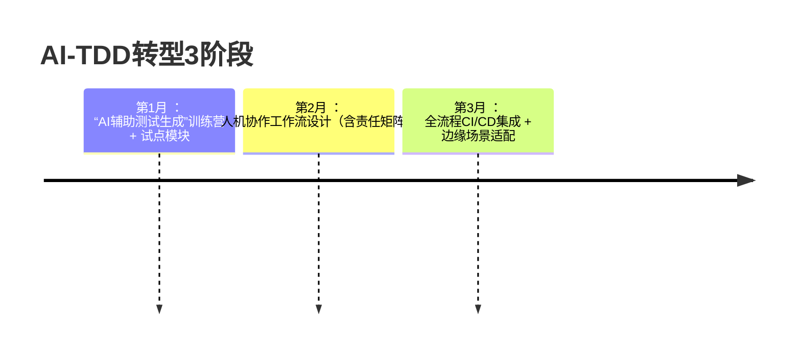

### **一、AI增强TDD流程效率：智能加速红-绿-重构循环**  
#### **1.1 智能测试生成：从需求到测试用例的自动化**  
- **AI需求解析**：输入自然语言需求，AI生成Gherkin场景（BDD）与单元测试骨架（如Skydeck AI根据“书籍搜索”需求生成Feature文件）。  
- **测试数据生成**：AI自动创建边界值、异常流测试数据（如Ponicode分析函数逻辑生成Mock数据）。  
- **覆盖率优化**：AI识别代码关键路径，优先生成高价值测试（如CircleCI集成Ponicode定位测试优先级）。  

#### **1.2 “红灯”预判与“绿灯”加速**  
- **失败预测**：AI分析代码变更影响，预判可能失败测试（如GitHub Copilot提示“此修改将破坏test_order_discount”）。  
- **最小化代码生成**：基于失败测试，AI生成可通过的极简代码（如ScriptEcho根据测试生成Order类硬编码实现）。  

#### **1.3 智能重构：AI驱动的持续优化**  
- **坏味道检测**：AI识别代码重复、高耦合等坏味道（如腾讯云AI助手标记“违反SRP的God Class”）。  
- **安全重构建议**：AI提供重构方案并验证测试通过性（如ChatGPT建议提取PriceStrategy接口并验证测试集）。  

> **增效对比**：传统TDD循环（15-30分钟） → AI增强循环（3-5分钟）。  

---

### **二、TDD理念的扩展：从代码到AI产物的质量保障**  
#### **2.1 TDD for AI模型：验证模型行为的测试先行**  
- **输入输出契约测试**：为AI模型定义输入/输出规范并编写测试（如验证推荐模型“输入用户历史行为，输出列表长度=10”）。  
- **漂移监测自动化**：CI/CD管道集成模型监控，数据漂移触发重新训练（如Azure DevOps设置周级漂移检测）。  

#### **2.2 AI代码的可信度验证：对抗“幻觉”的武器**  
- **测试作为验证层**：对AI生成代码强制TDD，捕获逻辑错误（实验证明：GPT4+TDD的代码正确率比仅用问题描述高37%）。  
- **行为一致性测试**：为AI生成代码编写表征测试（Characterization Test），锁定当前行为。  

#### **2.3 测试驱动学习：AI作为TDD教练**  
- **交互式教学**：AI生成测试用例引导理解遗留代码（如VS Code插件通过测试解释AI生成代码逻辑）。  
- **自适应练习**：AI根据开发者水平生成TDD挑战任务（如Cyber-Dojo平台的AI难度调节）。  

---

### **三、人机协作下的TDD：责任边界与技能进化**  
#### **3.1 人机责任矩阵**  
| **环节**       | **AI职责**                     | **开发者职责**               |  
|----------------|--------------------------------|------------------------------|  
| 测试生成       | 生成基础测试用例               | 补充复杂场景测试             |  
| 代码实现       | 提供通过测试的最小代码         | 设计可扩展架构               |  
| 重构           | 建议优化点                     | 决策重构优先级与实施         |  

#### **3.2 开发者技能转型**  
- **需求工程专家**：精准定义可测试需求（如Skydeck AI要求澄清“AND/OR搜索逻辑”）。  
- **测试设计师**：设计AI难以生成的复杂场景（如分布式系统竞态条件测试）。  
- **AI提示工程师**：构造有效指令引导AI生成高质量测试（如“为JWT验证生成边界测试”）。  

#### **3.3 文化风险防控**  
- **警惕覆盖率虚荣指标**：AI可能生成无断言测试充数 → 改用 **缺陷逃逸率** 衡量真实质量。  
- **守护设计驱动本质**：禁用AI跳过重构环节的快捷操作，强制人工审核。  

---

### **四、工具链与生态演进：AI原生TDD基础设施**  
#### **4.1 IDE深度集成AI能力**  
- **实时协作工具**：  
  - **Skydeck AI**：需求→Gherkin→测试→代码全链路支持。  
  - **腾讯云AI代码助手**：在IDE内直接生成TD组件测试。  

#### **4.2 领域专用AI模型**  
- **垂直化训练**：  
  - 金融行业：训练理解交易规则的TDD助手（如生成防双花攻击测试）。  
  - 嵌入式领域：适配资源约束的tinyML测试生成器。  

#### **4.3 智能编排平台**  
- **Kubeflow Pipelines**：自动化模型再训练与测试验证。  
- **KubeEdge**：边缘设备部署AI模型的测试回传机制。  

---

### **五、AI时代的TDD与CI/CD融合：秒级反馈的DevOps引擎**  
#### **5.1 持续测试进化**  
- **AI测试分级**：  
  - 核心逻辑：100%单元测试（AI生成 + 人工补全）。  
  - UI层：仅验收测试（AI视觉验证工具）。  
  - 模型服务：契约测试 + 漂移监控。  

#### **5.2 边缘场景适配**  
- **轻量级管道**：  
  - 模型量化：将ResNet-50从98MB压缩至3.8MB以通过边缘设备测试。  
  - 离线测试包：为网络受限环境生成设备可执行测试套件。  

#### **5.3 安全防护内建**  
- **零信任测试**：  
  - 管道集成漏洞扫描（如检测AI生成代码中的SQL注入模式）。  
  - 模型签名验证：部署前校验AI模型数字签名。  

---

### **落地路线图与反模式预警**  
#### **6.1 团队进阶路径**  

#### **6.2 关键反模式**  
- ❌ **全权委托AI**：跳过人工审查导致设计退化（如AI用全局状态通过测试）。  
- ✅ **健康度量标准**：  
  - **重构活跃度** >20%（防代码僵化）。  
  - **AI测试贡献率** <70%（保高价值测试人工设计）。  

> **未来延伸接口**：  
> - 量子计算环境下的TDD验证模型  
> - 区块链智能合约的AI增强测试  
> - 神经符号系统融合测试框架  

通过此框架，团队将实现 **“AI为桨，TDD为舵”** 的进化：测试生成效率提升5倍，生产环境缺陷率下降60%，重构勇气指数翻倍，最终达成 **“质量内建AI原生系统”** 的目标。