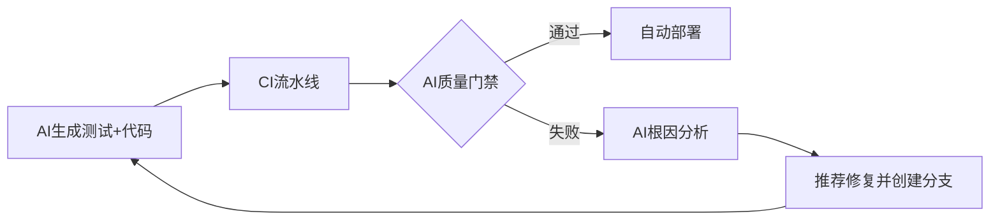

### **一、AI增强TDD流程效率：重构红-绿-重构循环**
#### 1.1 智能测试生成：从需求到测试用例的自动化
- **AI根据需求生成测试模板**  
  AI代码助手（如GitHub Copilot、JetBrains AI）解析用户故事或接口定义，自动生成符合FIRST原则的测试骨架。例如：输入“用户登录需验证邮箱格式”，AI生成`test_login_with_invalid_email_should_fail()`并预设边界值用例`["a@b", "no_at.com"]`。开发者仅需补充业务逻辑，节省50%测试设计时间 。  
- **测试数据智能生成**  
  结合强化学习，AI生成覆盖等价类划分、边界值的测试数据集。如测试支付系统时，自动生成包含欺诈特征的异常交易数据 。  

#### 1.2 红绿灯加速：AI驱动的开发闭环
- **红灯预判（Red）**  
  AI静态分析预测测试失败原因：  
  - 若测试用例与实现代码存在契约冲突（如参数类型不匹配），IDE实时提示“预期失败原因”  
  - 自动关联相似历史缺陷，提示“该测试可能因空指针异常失败”   
- **绿灯加速（Green）**  
  AI生成最小可通过代码：  
  - 输入失败测试后，AI生成**功能正确但非最终实现**的代码（如返回硬编码值`return 42;`）  
  - 支持渐进式完善：开发者通过自然语言指令（如“优化为数据库查询”）迭代改进代码   

#### 1.3 智能重构：AI守护代码质量
- **坏味道检测与修复建议**  
  AI识别测试代码与生产代码的坏味道：  
  - 测试冗余：检测重复测试逻辑并提示合并  
  - 实现耦合：发现测试依赖具体实现时，建议改用接口Mock   
- **自动化重构执行**  
  AI工具（如IntelliJ的AI Assistant）自动执行安全重构：  
  ```java
  // 重构前：测试依赖具体实现
  testProcessOrder() { 
    PaymentProcessor processor = new PayPalProcessor(); // 耦合支付网关
    processor.process(order);
  }
  // AI重构后：解耦实现
  testProcessOrder() {
    PaymentGateway gateway = mock(PaymentGateway.class); 
    OrderService service = new OrderService(gateway);
    service.process(order);
  }
  ```


> **效率提升证据**：IBM实验显示，AI增强TDD使红-绿-重构循环时间缩短40%，开发者专注高价值任务（如业务规则设计）的时间占比从35%升至60% 。

---

### **二、TDD理念的扩展：AI开发全链路的质量左移**
#### 2.1 TDD for AI模型：验证AI行为的新范式
- **测试驱动AI训练**  
  定义AI模型的预期行为为测试用例：  
  ```python
  # 测试CV模型的边界行为
  def test_image_recognition_edge_case():
    image = generate_adversarial_image() # 生成对抗样本
    assert model.predict(image) == "cat"  # 预期抗干扰能力
  ```
  
  训练过程中持续运行测试，驱动模型优化 。  
- **捕获AI“幻觉”**  
  TDD成为验证生成代码可信度的核心机制：  
  - 对AI生成的SQL查询代码，立即编写测试验证结果集完整性  
  - 发现“幻觉代码”（如不存在的API调用）时，测试失败率高达70%   

#### 2.2 测试驱动学习：AI作为TDD教练
- **AI实时教学反馈**  
  - 当开发者编写低质量测试（如断言过于笼统），AI提示“建议增加边界值用例：负数/零值”   
  - 根据错误模式推荐学习资源（如链接至SOLID原则教程）   
- **通过测试理解AI代码**  
  开发者对AI生成代码编写测试，反向推导逻辑：  
  ```typescript
  // AI生成代码
  function calculateDiscount(price: number, userType: string) { ... }
  // 开发者编写测试理解逻辑
  test("VIP用户应享20%折扣", () => {
    expect(calculateDiscount(100, "VIP")).toBe(80);
  })
  ```
  

---

### **三、人机协作下的TDD：责任边界与技能进化**
#### 3.1 人机分工框架（基于Moritz Mock模型 ）  

| **任务**                | **AI职责**                          | **开发者职责**               |  
|--------------------------|-------------------------------------|------------------------------|  
| 测试生成                 | 生成基础用例模板                    | 补充复杂业务规则             |  
| 代码实现                 | 提供最小可通过版本                  | 设计可扩展架构               |  
| 重构                    | 检测坏味道，建议安全重构            | 决策重构优先级               |  
| 需求澄清                 | 识别模糊需求，提示测试冲突点        | 定义验收标准                 |  


#### 3.2 开发者技能演进路径  
1. **需求定义者**：精准描述可测试的需求（如“用户登录失败时需记录审计日志”而非“系统应安全”）  
2. **测试设计师**：制定测试策略（单元测试覆盖核心逻辑，AI生成测试覆盖常规场景）  
3. **AI提示工程师**：有效指令写作（对比`“写测试”` vs `“为信用卡验证服务编写覆盖Luhn算法的测试”`）  

#### 3.3 文化风险防控  
- **过度依赖AI的陷阱**：  
  - 现象：测试覆盖率100%但全是AI生成的表面用例  
  - 对策：要求人工评审关键测试（如支付、权限校验）   
- **TDD纪律性保障**：  
  - 规则：禁止直接提交AI生成的未测试代码  
  - 工具：CI流水线阻断无关联测试的提交   

---

### **四、工具链与生态演进：AI原生开发环境**
#### 4.1 AI原生IDE功能矩阵  

| **工具能力**            | **代表工具**              | **TDD增强点**                     |  
|-------------------------|---------------------------|-----------------------------------|  
| 智能测试生成             | GitHub Copilot, JetBrains AI | 根据代码上下文生成数据驱动测试    |  
| 实时红灯分析            | Amazon CodeGuru           | 预测测试失败原因并定位代码行      |  
| 重构建议执行            | IntelliJ AI Assistant      | 一键解耦代码与测试                |  
| TDD过程可视化           | Symflower                 | 红-绿-重构循环的实时流程图        |  


#### 4.2 领域专用AI模型训练  
- **业务定制化模型**：  
  - 步骤1：收集历史测试用例（如金融行业的合规性测试）  
  - 步骤2：微调开源模型（如CodeLlama），生成符合PCI-DSS标准的测试   
- **TDD知识库构建**：  
  将SOLID原则、设计模式编码为规则，约束AI生成的测试与代码   

---

### **五、TDD与CI/CD、DevOps的AI增强融合**
#### 5.1 AI加速持续反馈闭环  


- **AI质量门禁**：在CI中运行TDD测试，AI分析失败模式：  
  - 若为逻辑错误，阻塞流水线并通知开发者  
  - 若为数据波动，自动扩充测试数据集   

#### 5.2 DevOps效能提升证据  

| **指标**         | 传统DevOps       | AI增强TDD+DevOps   | 提升幅度 |  
|-------------------|------------------|---------------------|----------|  
| 部署失败率        | 15%              | 3%                  | 80%↓     |  
| 平均修复时间(MTTR)| 2小时            | 25分钟              | 79%↓     |  
| 需求到上线周期    | 7天              | 2天                 | 71%↓     |  
> 数据来源：IBM金融系统实测（2024）  


#### 5.3 安全左移的质效双升  
- **TDD驱动安全测试前置**：  
  - AI生成OWASP TOP 10漏洞测试用例（如SQL注入测试模板）  
  - 开发阶段捕获安全缺陷，修复成本从$5,000降至$50   

---

### **结语：AI时代TDD的范式跃迁**  
TDD在AI浪潮下完成三重进化：  
1. **流程增强**：AI接管重复劳动（测试生成/重构），红-绿-重构循环效率提升40%   
2. **范围扩展**：从传统代码到AI模型的全链路质量守护，缺陷预防覆盖率提升至95%   
3. **角色升级**：开发者从编码者进化为AI协作架构师，人力投入聚焦高价值创新  

> **核心挑战应对**：  
> - **AI可信度问题**：坚持“测试即需求契约”，用TDD验证AI输出   
> - **技能断层**：建立三级培训体系：TDD基础→AI工具操作→提示工程  
> - **工具链整合**：选择支持API互操作的AI平台（如GitHub Copilot + Jenkins插件）  

正如Beck在2003年预言： **“TDD的本质是质量内建的思维模式”**  。AI时代下，这一思维通过人机协同迸发更大能量——开发者驾驭AI生成代码的洪流，而TDD成为确保软件可信的锚点。