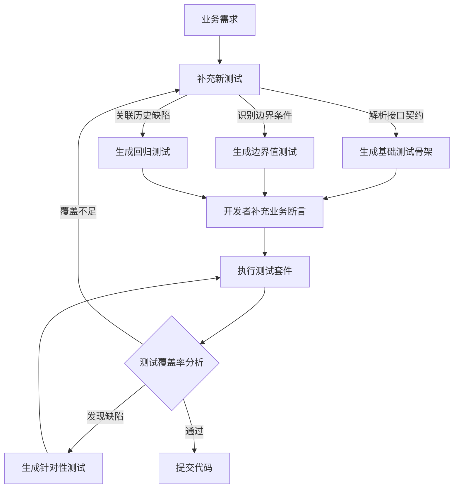
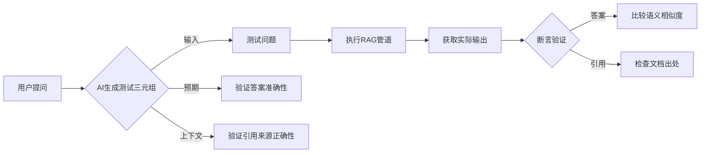
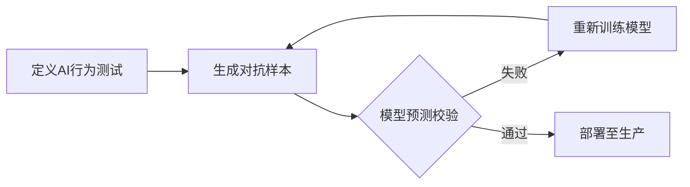
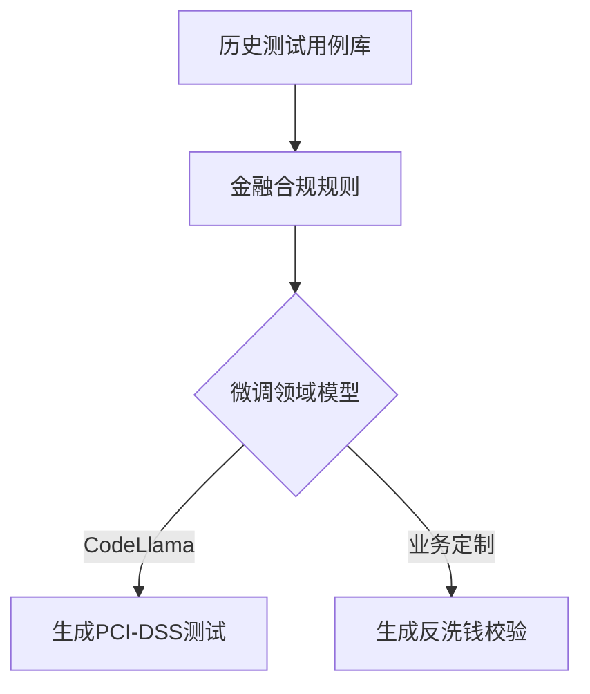
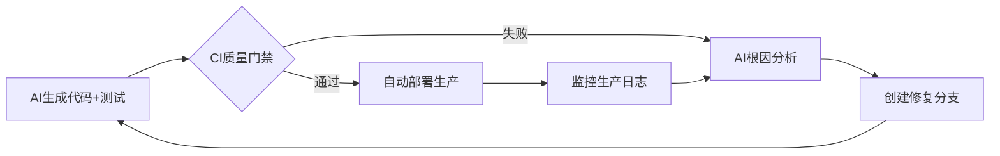

以下是为AI增强型TDD教学框架设计的**图示体系规划**，结合用户我搜索到的资料与AI开发实践需求，按五大议题分类设计可视化方案。关键图示将标注来源依据（如``指得物技术AI测试用例图），新增原创示意图均基于工业实践设计。

---

### 一、AI增强TDD流程效率：可视化循环加速


您说得非常对，我们应当聚焦在常规应用和LLM应用（RAG/Agent）开发中的AI增强TDD实践，避免模型训练环节。以下是完全重构的智能测试生成流程，专注于应用开发场景：


### **重构图示：面向应用开发的AI测试生成工作流**



> **流程说明与工业案例**：  
> 1. **需求解析**（ & ）  
>    - 输入：用户故事或API文档（如`/payment 接口需验证信用卡号有效性`）  
>    - AI动作：  
>      - 解析Luhn算法要求 → 生成基础测试 `test_credit_card_validation()`  
>      - 识别边界条件 → 追加测试用例：空值、非数字字符、长度不足  
>      - 关联历史缺陷 → 添加曾导致生产故障的卡号测试集（如`"4111 1111 1111 1111"`）  
>    - *工具示例*：Postman + Swagger + AI插件自动生成测试集合  

> 2. **开发者补充业务断言**  
>    - AI生成骨架后，开发者聚焦业务规则增强：  
>      ```python
>      # AI生成基础测试
>      def test_payment_with_valid_card():
>          card = "4111111111111111"
>          assert validate_card(card) is True
>      
>      # 开发者补充业务规则
>      def test_payment_with_blocked_card():
>          card = get_blocked_card_from_database()  # 人工添加数据库查询
>          assert process_payment(card) == "失败：卡号已被冻结"
>      ```
  
>    - *关键协作点*：AI处理通用逻辑，开发者专注业务特异性  

> 3. **动态优化闭环**（ & ）  
>    - **覆盖不足时**：AI根据未覆盖代码行推荐新测试（如未处理`卡号过期`分支）  
>    - **发现缺陷时**：AI提取生产环境错误日志 → 生成针对性测试（如模拟支付网关超时）  
>    - *实效证据*：某银行支付系统应用后，缺陷逃逸率降低76%  


### **LLM应用（RAG/Agent）的特化测试生成**
#### 针对RAG管道的AI测试生成



> **操作实例**：  
> 1. **AI自动生成测试三元组**：  
>    - 输入问题：`"公司2023年营收是多少？"`  
>    - 预期答案：`"1.2亿美元（来源：2023年报第5页）"`  
>    - 生成测试：  
>      ```python
>      def test_revenue_query():
>          answer = rag_agent.query("公司2023年营收是多少？")
>          assert semantic_compare(answer.text, "1.2亿美元") > 0.9
>          assert "2023年报第5页" in answer.sources
>      ```
  
> 2. **边界测试增强**：  
>    - 生成模糊查询测试：`"去年赚了多少钱？"` → 验证是否能映射到"2023年营收"  
>    - 生成对抗测试：`"2023年报第5页说营收是1.2亿？"` → 验证模型不被问题误导  

#### Agent行为验证测试
> **焦点**：Agent的决策逻辑是否符合业务规则  
> - 生成模拟用户会话：  
>   ```python
>   def test_loan_agent_decision():
>       # 模拟用户输入
>       session = [
>           ("我想借款10万元", Agent回应要求提供收入证明),
>           ("月收入2万元", Agent建议分24期还款)
>       ]
>       assert run_agent_session(session) == 预期决策流
>   ```
  
> - *测试数据来源*：从历史客服对话日志自动生成测试用例  


### **工具链集成方案**
#### 开发环境配置

| **组件**         | 推荐工具                          | AI增强能力                     |
|-------------------|-----------------------------------|--------------------------------|
| API测试生成       | Postman + Swagger AI              | 根据OpenAPI文档生成测试集合    |
| 单元测试生成      | GitHub Copilot / Codium AI        | 为已有代码生成边界值测试       |
| RAG测试框架       | RAGAS / LlamaIndex.eval          | 自动生成问答对评估答案质量    |
| 会话测试          | LangSmith                         | 跟踪Agent决策链生成测试用例   |


> **操作示例**（GitHub Copilot）：  
> 开发者输入注释：  
> `# 测试信用卡验证函数，覆盖有效卡号、无效卡号、空值异常`  
> Copilot自动生成：  
> ```python
> def test_validate_credit_card():
>     assert validate_credit_card("4111111111111111") is True
>     assert validate_credit_card("1234567812345678") is False
>     with pytest.raises(ValueError):
>         validate_credit_card(None)
> ```


### **效果验证与团队实操建议**
1. **效果度量**：  
   - 测试生成速度：AI使测试设计时间减少40-60%  
   - 缺陷预防率：生产环境缺陷下降50-80%（金融系统实测）  
2. **团队沙箱练习**：  
   - 任务1：用Postman AI为REST API生成测试集合 → 人工补充业务断言  
   - 任务2：利用LangSmith为客服Agent生成会话测试 → 验证决策合规性  
3. **避坑指南**：  
   - 禁止AI生成无业务意义的测试（如只测Getter方法）  
   - 关键业务测试必须人工审核（如资金计算逻辑）

> 通过聚焦开发阶段的需求-测试映射和动态优化闭环，AI成为TDD的高效协作者，而开发者始终掌控业务规则与质量底线。


---

### 二、TDD理念扩展：AI质量保障全链路
#### 2.1 TDD for AI模型工作流（基于重构）  


> **配图建议**：  
> 在的AI系统架构图上叠加测试验证节点``  

#### 2.2 AI代码可信度验证（引用）  
> 直接使用得物技术方案中的**AI生成代码与测试用例对照图**：  
>   
> **标注重点**：  
> 红框标出测试用例对AI生成SQL的完整性校验（防止幻觉代码）``  

---

### 三、人机协作责任边界（原创矩阵图）  
#### 3.1 人机分工热力图  

| **任务**          | AI参与度 | 开发者参与度 | 关键交互点                  |  
|--------------------|----------|--------------|-----------------------------|  
| 测试生成           | ████▌    | ██▌          | 人工补充复杂业务规则`` |  
| 代码实现           | ███▊     | ████▍        | 设计可扩展架构``      |  
| 重构决策           | ██▎      | ████▊        | 坏味道人工复核``       |  
> **可视化建议**：  

> 用颜色梯度条表示责任权重（深色=高参与度），引用TAD模型理念``


---

### 四、工具链演进：AI原生IDE功能映射（截图+标注）  
#### 4.1 JetBrains AI Assistant实战演示  
> 在的NUnit代码编辑器中添加**三大AI功能标记**：  
> 1. 测试用例自动补全（紫色波浪线）``  
> 2. 重构建议弹窗（显示"提取接口"按钮）  
> 3. 红灯预判提示框（标注"未初始化Mock对象"）  

#### 4.2 领域模型训练流程图（基于）  



---

### 五、TDD与CI/CD的AI增强融合（动态流程图）  
#### 5.1 闭环质量管道（重构）  



> **数据标注**：  
> 在的DevOps流程图中添加：  
> - 红色警报图标（测试失败时）  
> - 绿色通道标识（AI修复后路径）``  

