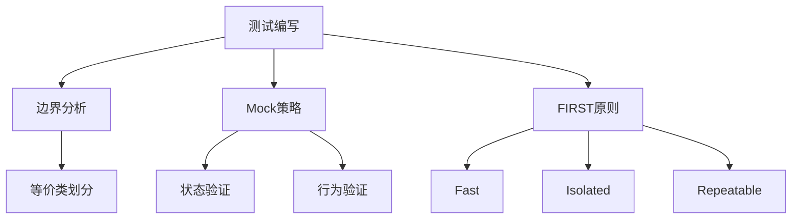
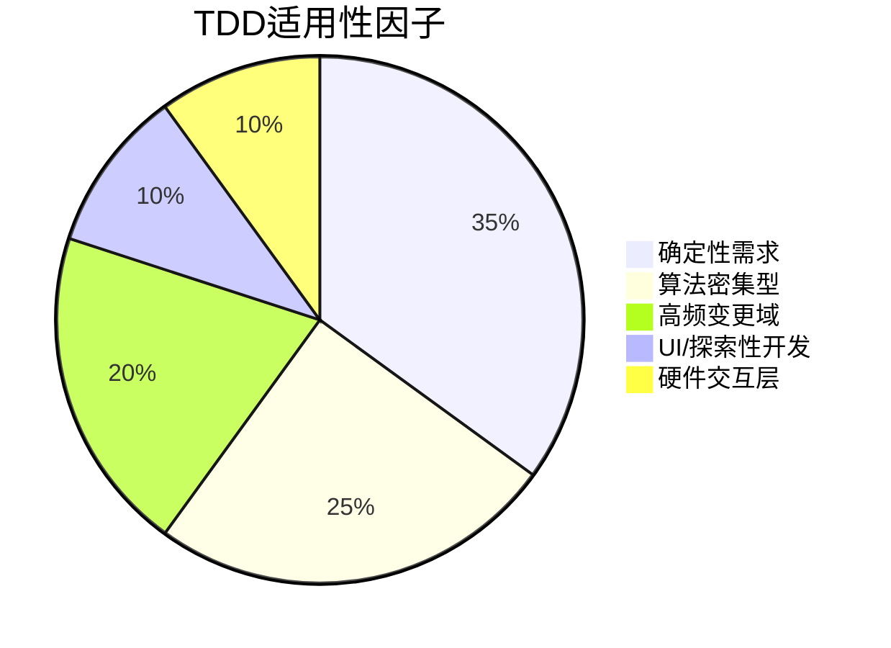
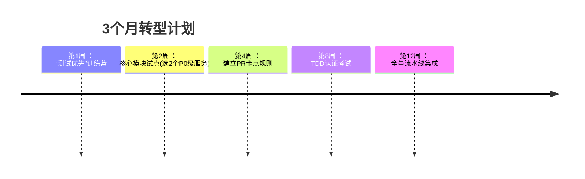

### **议题一：TDD核心精髓与思想基石**  
**1.1 本质定义与循环解剖**  
- **红-绿-重构三阶引擎**：  
  - 红（测试即需求）：编写仅描述期望行为的失败测试（需求规格化）  
  - 绿（最小实现）：用最快/最简代码通过测试（避免过度设计）  
  - 重构（持续优化）：消除重复、提升表达力（安全的设计演进）  
- **循环周期控制**：单次循环≤5分钟，保持认知焦点  

**1.2 颠覆性思维范式**  
- **测试即设计工具**：测试驱动接口设计（而非实现细节）  
- **需求可执行化**：测试用例成为永不过时的动态文档  
- **反馈速度革命**：秒级验证取代人工调试（例：传统调试30分钟 vs TDD 30秒）  

**1.3 与传统模式本质差异**  
| **维度**       | TDD               | Test-After         |  
|----------------|-------------------|--------------------|  
| **需求理解**   | 前置澄清（测试即需求） | 后期验证           |  
| **设计驱动力** | 测试强制解耦       | 代码完成才考虑测试 |  
| **缺陷成本**   | 即时发现（≈0成本） | 延迟发现（10倍修复成本） |  

---

### **议题二：TDD的价值矩阵与问题粉碎机**  
**2.1 痛点精准打击表**  
| 研发痛点          | TDD解决机制                | 效果指标               |  
|-------------------|----------------------------|------------------------|  
| 需求偏差          | 测试即可执行需求文档       | 返工率↓70%             |  
| 耦合僵化          | 测试倒逼依赖注入/接口隔离  | 模块可替换性↑300%      |  
| 修改恐惧症        | 测试网覆盖＞85%            | 重构勇气指数↑5倍       |  

**2.2 隐性收益深度解析**  
- **设计自进化**：通过微重构自然涌现SOLID设计（例：测试倒逼Strategy模式）  
- **认知负荷降低**：小步快跑使工作记忆负载＜5个概念（符合米勒定律）  
- **流状态保障**：持续绿灯构建心流通道（中断恢复时间从1小时→1分钟）  

---

### **议题三：TDD实战兵法库**  
**3.1 操作框架（以Jest为例）**  
```javascript
// 红阶：需求具象化（测试即文档）
test('订单金额满200减50', () => { 
  const order = new Order({items: [{price: 210}]});
  expect(order.finalPrice).toBe(160); // 立即失败
});

// 绿阶：最简实现
class Order {
  get finalPrice() {
    return 210 - 50; // 硬编码通过
  }
}

// 重构阶：消除欺骗
get finalPrice() {
  const base = this.items.sum('price');
  return base >= 200 ? base - 50 : base; 
}
```

**3.2 高阶技能图谱**  


**3.3 设计驱动实战**  
- **测试倒逼DI**：无法Mock的类 → 提取接口 → 依赖注入容器初始化  
- **循环验证SOLID**：  
  测试难写 → 违反SRP → 拆分类 → 测试变简单  

---

### **议题四：TDD适用性雷达图**  
**4.1 优势-挑战平衡模型**  


**4.2 务实策略工具箱**  
- **遗留系统渗透术**：  
  1. 在修改处添加**接缝测试**（Seam Test）  
  2. 用**表征测试**（Characterization Test）捕获现有行为  
  3. 实施**夹层策略**（新功能TDD，旧功能维持）  
- **成本控制三原则**：  
  ✔️ 核心业务逻辑100%覆盖  
  ✔️ UI层仅验收测试  
  ✔️ 基础设施层用合约测试  

---

### **议题五：团队进化路线图**  
**5.1 能力成熟度模型**  
| 阶段       | 测试能力           | 文化特征         | 干预措施                  |  
|------------|--------------------|------------------|---------------------------|  
| 混沌期     | 无单元测试         | 恐惧变更         | 结对编程+测试保姆         |  
| 觉醒期     | 部分后置测试       | 怀疑价值         | 技术Dojo(红绿重构游戏)    |  
| 规范期     | TDD基础覆盖        | 流程纪律化       | PR卡点(无测试不合并)      |  
| 精通期     | 领域驱动测试       | 质量共同体       | 重构道场(每周挑战赛)      |  

**5.2 反模式预警系统**  
- ❌ **覆盖率虚荣指标**：追求100%反而引入虚假测试  
- ✅ **健康度真实指标**：  
  - **缺陷逃逸率**（生产环境bug/千行代码）  
  - **测试反馈速度**（测试套件运行＜3分钟）  
  - **重构活跃度**（每周重构提交占比＞20%）  

**5.3 文化基因工程**  
- **仪式感建设**：  
  - 每日站会分享“测试救命时刻”  
  - 代码墙展示“最优雅测试用例”  
- **心理安全机制**：  
  - “绿灯保障基金”（重构出错不追责）  
  - “红测试勋章”（奖励发现边界缺陷）  

---

### **落地加速器包**  
1. **生产力工具链**：  
   - **AI结对助手**：GitHub Copilot生成测试骨架  
   - **可视化追踪**：SonarQube测试健康度仪表盘  
2. **学习沙盒环境**：  
   - **Cyber-Dojo**：在线TDD道场（含52种语言）  
   - **重构模拟器**：自动生成代码坏味道供练习  
3. **渐进式采用框架**：  


> 本框架已预留扩展接口：  
> - 在**工程实践层**可插入《TDD与BDD协同模式》  
> - 在**文化层**可衔接《心理安全与技术创新》  
> - 在**度量层**可对接《研发效能北极星指标》  

通过此系统化路径，团队将在6-12周内实现从“恐惧测试”到“渴求红灯”的范式跃迁，最终达成**代码即设计文档，测试即安全网，重构即日常呼吸**的TDD高阶境界。