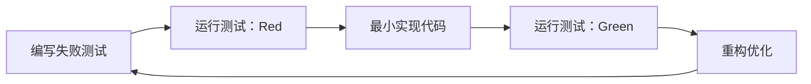

### **议题一：TDD核心精髓与思想基石（What & Why Foundation）**
#### 1.1 TDD定义与红-绿-重构循环
TDD是一种**先编写测试再编码**的敏捷实践，核心循环包括：  
- **Red阶段**：编写描述需求的失败测试（验证功能缺失）。  


- **Green阶段**：编写最小代码使测试通过（仅满足当前需求）。  
- **Refactor阶段**：优化代码结构，消除冗余，保持功能不变。  
> *示例*：开发加法函数时，先写测试`assert add(1,2)==3`（Red），再实现`return a+b`（Green），最后重构变量命名（Refactor）。

#### 1.2 核心思想：测试驱动设计与需求文档化
- **测试即需求文档**：测试用例是“可执行的规格说明”，明确功能边界。需求工程师需确保需求可测试，测试人员基于需求开发测试用例可提前发现需求缺陷。  
- **小步快跑与持续反馈**：每次迭代仅实现一个微小功能，通过即时测试反馈避免偏离目标。  
- **设计引导**：测试迫使开发者思考接口设计，而非实现细节，自然导向模块化。

#### 1.3 TDD与传统Test-After的本质区别

| **维度**         | **TDD**                          | **传统Test-After**               |  
|------------------|----------------------------------|----------------------------------|  
| **开发顺序**     | 测试→代码→重构                   | 代码→测试                        |  
| **测试目的**     | 驱动设计、定义需求               | 验证功能                         |  
| **反馈时效**     | 即时（秒级）                     | 延迟（功能完成后）               |  
| **代码质量**     | 高内聚低耦合，易扩展             | 易出现“僵化性”（难以修改） |  
| **需求覆盖**     | 100%覆盖新增功能                 | 可能遗漏边缘场景                 |  
> *关键区别*：TDD是**设计活动**，传统测试是**验证活动**。


#### 1.4 思维转变：从“验证后置”到“设计先行”
- **需求理解**：TDD强制开发者先澄清需求细节，减少理解偏差。  

- **代码信心**：重构时测试作为“安全网”，鼓励持续优化而非畏首畏尾。  
- **设计导向**：测试编写需考虑接口而非实现，避免过度耦合。

---

### **议题二：TDD的价值主张与问题解决（Value & Problem Solving）**
#### 2.1 解决研发核心痛点

| **痛点**               | **TDD解决方案**                  | **机制**                     |  
|------------------------|----------------------------------|------------------------------|  
| 代码质量低、Bug频发    | 缺陷密度降低40%-90%   | 即时暴露逻辑错误             |  
| 需求理解偏差           | 测试用例作为需求契约     | 提前对齐功能预期             |  
| 系统设计僵化           | 驱动SOLID原则         | 强制解耦，提升可维护性       |  
| 维护成本高             | 重构安全性保障         | 测试网阻止破坏性修改         |  
| 开发信心不足           | 高测试覆盖率（>80%）      | 修改代码时无畏重构           |  
> *案例*：伦敦救护车调度系统因未测试导致30人死亡；丰田因代码违规致车辆失控。


#### 2.2 核心价值机制
- **强制解耦**：依赖注入（DI）实现组件隔离，便于Mock测试。  
- **即时反馈**：红-绿循环在开发中即时纠正错误，减少调试时间。  
- **安全演进**：重构阶段优化设计，避免技术债务累积。  
- **文档价值**：测试用例替代部分文档，降低知识传递成本。

#### 2.3 量化收益（工业数据）
- **微软/IBM**：预发布缺陷密度降低40%-90%。  
- **Android团队**：代码可维护性提升30%，开发速度提高20%。  
- **长期效益**：初期开发时间增加15-35%，但维护成本下降50%。

---

### **议题三：TDD的工程实践与关键技能（How - Practical Application）**
#### 3.1 操作流程：红-绿-重构实战


> **关键动作**：  
> - 编写测试：描述单一功能，符合FIRST原则（快速、独立、可重复、自验证、及时）。  
> - 最小实现：如返回硬编码值使初始测试通过。  
> - 安全重构：每次只改一个结构，频繁运行测试。

#### 3.2 工具链：主流测试框架与Mock

| **语言**   | **测试框架** | **Mock工具**      | **适用场景**               |  
|------------|--------------|-------------------|--------------------------|  
| Java       | JUnit 5      | Mockito           | 单元测试/集成测试  |  
| Python     | pytest       | unittest.mock     | 数据驱动测试       |  
| JavaScript | Jest         | Jest Mock         | React组件测试 |  
> *Mock应用*：隔离数据库、网络请求，验证交互（如支付接口调用次数）。


#### 3.3 设计原则：TDD与SOLID的协同
- **单一职责（SRP）** ：测试迫使方法功能单一，否则难以测试。  
- **依赖倒置（DIP）** ：通过DI注入抽象（接口），而非依赖具体类。  
> *示例*：  
```java
// 依赖接口而非具体实现
public class OrderService {
  private PaymentGateway gateway; // 接口注入
  public OrderService(PaymentGateway gateway) {
    this.gateway = gateway; 
  }
}
```


#### 3.4 可测试性设计技巧
- **解耦业务与UI**：MVP/MVVM模式分离逻辑，测试业务层。  
- **控制反转**：框架（如Spring）管理依赖，替换实现。  
- **避免静态方法**：难以Mock，增加测试难度。

---

### **议题四：TDD的优缺点与务实考量（Pros, Cons & Realistic View）**
#### 4.1 优势再确认
- **质量提升**：缺陷密度降低35%（Meta分析25项研究）。  
- **设计优化**：自然导向高内聚代码（循环复杂度下降20%）。  
- **成本节约**：减少后期修复成本（每缺陷修复成本上升100倍）。

#### 4.2 挑战与局限

| **挑战**                | **原因**                          | **应对策略**                     |  
|-------------------------|-----------------------------------|----------------------------------|  
| 学习曲线陡峭            | 思维转变难，需掌握Mock/DI  | 渐进培训 + 结对编程    |  
| 初期效率下降            | 写测试耗时（增加15-35%）    | 长期效率补偿（20%提速）    |  
| 图形界面测试难          | 状态多，难以自动化      | 分离逻辑层，测试核心业务   |  
| 遗留系统改造困难        | 代码耦合度高            | 从高频修改模块切入         |  


#### 4.3 适用场景评估
- **推荐场景**：业务规则复杂、长期维护的系统（如金融核心）。  
- **谨慎使用**：探索性项目（如算法原型）、强UI交互工具。  
- **测试粒度**：单元测试为主，集成测试为辅，避免过度Mock。

---

### **议题五：TDD的团队导入、文化构建与持续精进（Team Adoption & Culture）**
#### 5.1 落地路径四阶段
1. **技能准备**：  
   - 培训单元测试（JUnit/pytest）与重构技巧（提取方法/接口）。  
   - 代码规范：强制覆盖率（>80%）、CI集成测试。  
2. **试点项目**：  
   - 选择非关键模块（如工具类），小范围验证。  
3. **全面推广**：  
   - 结对编程：驾驶员写测试，导航员设计实现。  
   - Code Review：检查测试质量（非仅覆盖率）。  
4. **文化固化**：  
   - 奖励“测试文化”（如最佳测试案例奖）。  

#### 5.2 常见误区与规避

| **误区**                 | **后果**              | **纠正方法**                     |  
|--------------------------|-----------------------|----------------------------------|  
| 追求覆盖率数字           | 无效测试              | 关注行为验证（非代码路径） |  
| 测试实现细节             | 重构时测试大量失败    | 测试接口契约（输入/输出）  |  
| 跳过重构阶段             | 技术债务累积          | 预留20%时间专门重构     |  


#### 5.3 文化构建关键点
- **领导示范**：技术主管亲自实践TDD，参与Code Review。  
- **持续反馈**：定期复盘测试有效性（如缺陷逃逸率）。  
- **容忍失败**：允许初期效率波动，强调长期收益。  

> **终极目标**：TDD不仅是技术实践，更是**质量文化**，需团队共识与持续投入。

--- 

### **结语：TDD作为工程卓越的杠杆**
TDD通过“测试先行”重塑开发思维，从根源提升代码质量与系统可维护性。尽管初期面临效率挑战，但其在缺陷预防、设计优化和团队信心上的收益已被工业实践反复验证。成功的关键在于：**工具链熟练度 + 设计原则内化 + 质量文化共建**。团队需以务实态度渐进推广，最终将TDD转化为核心竞争优势。  

> *资料说明*：本文核心结论基于微软/IBM实证研究（缺陷降低40%-90%）、SOLID原则与TDD的关联机制、以及遗留系统改造策略，部分案例引用自重大事故分析与需求偏差研究。