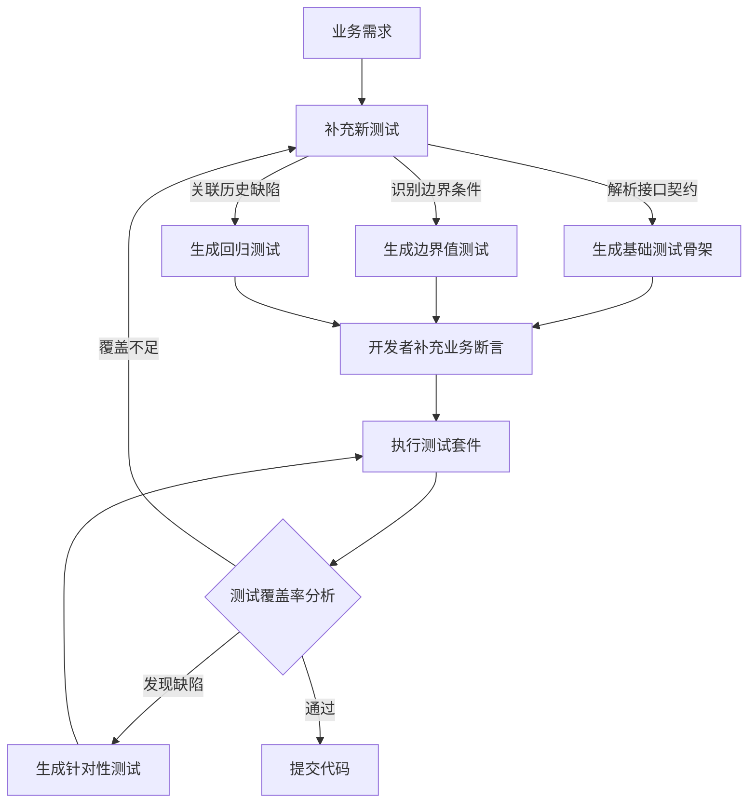
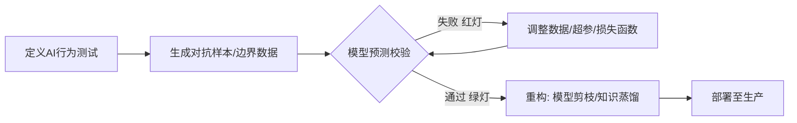
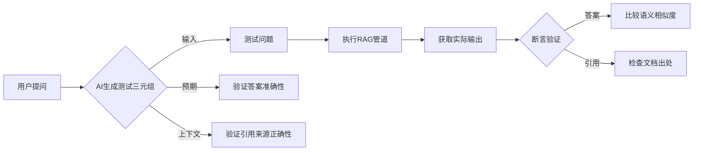
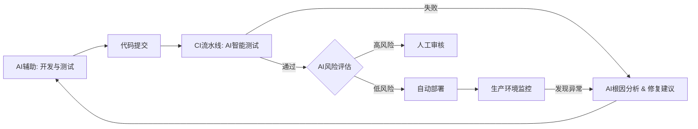
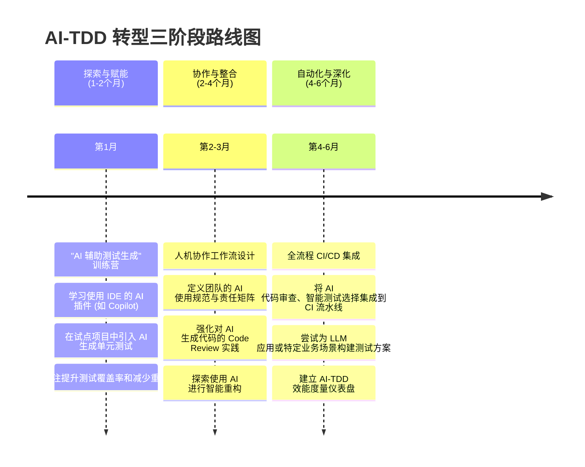

# 零、前言与引论 

## 0.1 TDD 的历史演进：从 "红-绿-重构" 到 "AI 辅助"

二十一世纪初，Kent Beck 在其著作《测试驱动开发》中正式定义了"红→绿→重构"这一经典循环，它不仅是一种开发实践，更是一种强调"质量内建"和"可演进设计"的思维模式。TDD 通过强制开发者在编写功能代码前先编写失败的测试，驱动出简洁、可用且耦合度低的设计，为软件质量提供了坚实的基础。

二十年后的今天，生成式AI，特别是大型语言模型（LLM）的崛起，正以前所未有的深度和广度重塑软件工程的每一个环节。以 GitHub Copilot、JetBrains AI Assistant、Qodo(CodiumAI)、Diffblue Cover 等为代表的 AI 编程工具，能够实现秒级的测试补全和代码生成。软件工程界正迅速迈入一个全新的 **AI-TDD 时代**：机器高效率地协助生成测试、实现代码、执行重构，而人类开发者则能将更多精力聚焦于需求澄清、架构决策和复杂的业务逻辑设计。

## 0.2 AI 时代下 TDD 的新价值与核心挑战

AI 并非 TDD 的终结者，而是其**价值放大的催化剂**和**实践进化的加速器**。在 AI 时代，TDD 的核心思想——"测试先行"的思维模式、"红-绿-重构"的纪律节奏、以及对设计和反馈的持续追求——不仅没有过时，反而因为 AI 引入的复杂性和不确定性（如 AI 生成代码的"幻觉"）而变得愈发重要。TDD 为我们提供了一套在智能时代驾驭代码质量、确保系统行为符合预期的强大方法论。

TDD 在 AI 浪潮下完成了**三重进化**：
1.  **流程增强**：AI 接管了大量重复性劳动（如测试生成与重构），使得"红-绿-重构"循环效率得到革命性提升。
2.  **范围扩展**：TDD 的思想从验证传统代码，扩展至守护 AI 模型本身和 AI 生成产物的全链路质量，成为抵御"幻觉代码"的核心安全网。
3.  **角色升级**：开发者从"键盘工"的角色中进一步解放，进化为**需求/质量的策展人**和**AI 协作架构师**，将宝贵的人力投入到更高价值的创新活动中。

然而，这一转型也带来了新的挑战：如何构建高效、负责任的人机协作模式？如何避免过度依赖 AI 导致的设计能力退化？如何维系 TDD 的纪律性与文化？这些都是我们需要在新的实践中探索和回答的核心问题。

## 0.3 报告结构与核心议题概览

本报告旨在系统性地梳理 AI 时代下的测试驱动开发新范式，为研发团队提供一份从认知到实践的全链路转型指南。我们将深入探讨以下核心议题：
-   **AI 赋能核心 TDD 循环**：详述 AI 如何加速"红-绿-重构"的每一个环节。
-   **TDD 理念的扩展**：阐述 TDD 如何应用于 AI 模型开发和 AI 生成代码的验证。
-   **人机协作新范式**：剖析开发者角色的演变与团队文化的维系。
-   **工具链与生态系统**：盘点支撑 AI-TDD 的现代开发工具与平台。
-   **落地路线图与实践策略**：提供可操作的团队采纳路径、关键反模式预警与成效度量方法。

愿此指南为你和你的团队，在 AI 驱动的新代码世界里，点亮一盏持续绿色的指示灯。 

---
# 一、AI 赋能核心 TDD 循环：效率与智能的革命  

传统的 TDD "红-绿-重构"循环虽然经典有效，但在某些环节（如编写大量模板化测试、初步代码实现）可能耗时较多。AI 技术的引入，旨在让 TDD 循环更快、更智能，让开发者能将更多精力投入到更具创造性和战略性的工作中，如复杂业务逻辑的测试设计、架构决策和深度重构。研究表明，AI 增强的 TDD 可将开发循环时间缩短40%-70%，部分场景下甚至能将15-30分钟的循环压缩至3-5分钟。

## 1.1 智能测试生成：自动化 "红灯" 的第一步

单元测试的编写是 TDD 的起点，也是工作量较大的部分。AI 在此扮演着不知疲倦的测试编写助手角色，显著减少了重复劳动。

### 1.1.1 基于需求的测试骨架生成 (BDD, Gherkin)

当产品经理提供一份用户故事或需求规格说明时，AI 工具能够解析这些自然语言需求，自动生成初步的单元测试骨架。这包括符合 Gherkin 语法的 BDD 场景、测试方法名、Arrange-Act-Assert (AAA) 结构，甚至是一些明显的边界条件和预期输出的占位符。

**示例：**
*   **需求：** "用户登录功能：用户输入正确的用户名和密码后，应成功登录并返回欢迎信息；输入错误的用户名或密码，应提示错误。"
*   **AI 可能生成的测试骨架 (伪代码):**
    ```java
    // For successful login
    @Test
    public void should_returnWelcomeMessage_when_credentialsAreCorrect() {
        // Arrange: Setup user with correct credentials
        // Act: Call login method
        // Assert: Verify welcome message and login status
    }

    @Test
    public void should_returnErrorMessage_when_usernameIsIncorrect() {
        // Arrange: Setup user with incorrect username
        // Act: Call login method
        // Assert: Verify error message and login status
    }
    ```
*   **人类角色：** 审查AI生成的测试骨架是否全面覆盖了需求的关键点，补充AI可能遗漏的复杂场景或特定业务规则，并编写精确的断言逻辑。

### 1.1.2 基于代码的测试用例补全与建议

对于已有的代码（尤其是缺乏测试的遗留代码），AI 可以分析其结构、分支、循环和外部依赖，建议需要添加的测试用例，甚至生成这些测试的部分代码。这有助于快速提升遗留代码的测试覆盖率，或在快速编码后弥补测试。

### 1.1.3 智能测试数据合成（边界值、等价类、异常数据）

构造有效的测试数据往往需要仔细思考。AI 可以根据被测方法的参数类型、约束（如注解 `@NotNull`, `@Size`）以及上下文逻辑，生成多样化的测试输入数据。

**示例：**
对于一个接受年龄参数的方法，AI可能自动生成 `0, 17, 18, 65, 100, -1, null` 等测试数据。对于字符串，可能生成空字符串、超长字符串、包含特殊字符的字符串等。对于更复杂的场景，如测试支付系统，AI 甚至能生成包含欺诈特征的异常交易数据。

### AI 测试生成工作流

下图清晰地展示了 AI 在应用开发中生成测试的完整闭环工作流：



## 1.2 加速"红"到"绿"：AI 驱动的代码实现

TDD的核心是"红-绿"循环，AI可以在这两个阶段都提供助力。

### 1.2.1 失败测试的意图理解与"红灯"预判

在开发者编写测试时，AI 就可以分析代码变更的影响，预判可能失败的测试，从而帮助开发者聚焦问题区域。例如，AI 工具可识别代码中的潜在逻辑错误（如参数类型不匹配、空指针风险），提示开发者调整测试或代码。

### 1.2.2 基于失败测试的最小化代码生成

当一个清晰的失败测试（Red）被编写出来后，AI 可以分析这个失败的测试（特别是断言部分和被测方法的调用），尝试自动生成一段最少量的、恰好能让这个测试通过（Green）的功能代码。这正是 TDD 所倡导的"假实现"或"最小化实现"策略的自动化体现。

**示例：**
*   **测试：**
    ```java
    @Test
    public void should_returnZero_when_listIsEmpty() {
        Calculator calculator = new Calculator();
        List<Integer> numbers = Collections.emptyList();
        assertEquals(0, calculator.sum(numbers));
    }
    ```
*   **AI 可能生成的代码：**
    ```java
    public class Calculator {
        public int sum(List<Integer> numbers) {
            if (numbers.isEmpty()) { // AI根据测试推断出这个条件
                return 0;
            }
            // 可能是其他能让其他潜在测试失败的值
            // 或者是一个待实现的TODO
            return -1;
        }
    }
    ```
*   **人类角色：** 审查AI生成的代码，确保其只是"最小化"实现，没有引入不必要的逻辑。警惕AI为通过测试而"过度拟合"的硬编码式解决方案，并准备通过下一个测试来驱动更通用的实现。

## 1.3 智能重构：守护代码质量与设计

重构是 TDD 中至关重要的一步，AI 在此可以提供强大的支持，帮助提升功能代码和测试代码的质量。

### 1.3.1 上下文感知的代码坏味道识别

传统的静态分析工具也能检测代码坏味道，但 AI 可以做得更智能、更上下文感知。AI 不仅能识别重复代码、长方法、大类等常见坏味道，还能理解代码的业务语境，给出更精准的重构建议。例如，AI 发现一段复杂的条件逻辑，可能不仅仅建议"提取方法"，还会根据上下文推断这个方法应该命名为什么，或者建议使用策略模式。

### 1.3.2 自动化重构执行与即时验证

对于一些模式化的重构（如提取方法、重命名、封装字段），AI 不仅可以给出建议，还可以在开发者确认后自动执行这些重构操作。关键在于，AI 执行重构后，能自动触发相关测试的运行，确保重构没有破坏现有行为，形成了安全的自动化重构闭环。

### 1.3.3 面向可测试性的设计改进建议

有时代码难以测试是因为其设计不良（如硬编码依赖、方法副作用过多）。AI 可以分析代码的可测试性瓶颈，并提出专门为了提高可测试性的重构建议。

**示例：** AI 检测到一个类在其构造函数中直接 `new` 了一个依赖对象，导致难以 Mock。AI 可能建议将该依赖通过构造函数参数注入（依赖注入），从而解耦。
```java
// 重构前：测试依赖具体实现
testProcessOrder() { 
  PaymentProcessor processor = new PayPalProcessor(); // 耦合支付网关
  processor.process(order);
}
// AI重构后：解耦实现
testProcessOrder() {
  PaymentGateway gateway = mock(PaymentGateway.class); 
  OrderService service = new OrderService(gateway);
  service.process(order);
}
```

### 本章价值与风险总结

| 加速面 | 效果 | 风险 | 对策 |
| --- | --- | --- | --- |
| 测试编写 | 5-10倍人效提升 | 误生成伪需求、过度Mock | 由业务专家审核首轮生成 |
| 代码实现 | 快速通关绿灯 | 片面过拟合测试数据 | 先写高质量断言，严控行为覆盖 |
| 自动重构 | 保持代码整洁 | 改动跨度大难审计 | 分步提交PR、每步必须全绿 | 


---
# 二、TDD 理念的扩展：为 AI 系统构建质量内建的基石  

TDD的核心思想——"测试先行"、"行为驱动"、"小步迭代"——不仅适用于传统的软件开发。在AI时代，这些思想被扩展和应用到新的领域，特别是AI模型本身的开发以及与AI生成代码的交互中，为充满不确定性的AI系统构建了质量内建的基石。

## 2.1 TDD for AI Models：为"黑箱"注入确定性

AI模型（尤其是深度学习模型）常被视为"黑箱"，其行为难以完全预测和解释。将TDD的理念应用于AI模型的开发和迭代，有助于提升模型的可靠性、鲁棒性和可信度。

### 2.1.1 AI 模型的行为契约与测试用例定义

挑战在于如何像测试传统软件函数那样，为AI模型的行为定义清晰、可测试的预期。这催生了多种新型测试：
-   **功能性测试**：针对模型的核心功能，定义输入和期望输出的配对。例如，对于一个图像分类模型，给定一张猫的图片，期望其输出"猫"的标签。
-   **鲁棒性测试**：测试模型在输入发生微小扰动（如图片加噪声、文本中同义词替换）时的行为稳定性。
-   **公平性与偏见测试**：针对不同受保护群体的输入，测试模型输出是否存在显著差异或偏见。
-   **安全性测试（对抗性测试）**：主动构造"对抗性样本"（精心设计的、对人类看似无害但能误导模型的输入），测试模型的防御能力。
-   **性能测试**：测试模型的推理速度、资源消耗等是否在预期范围内。

### 2.1.2 应用 TDD 循环迭代 AI 模型（数据、训练、调优）

TDD的"红-绿-重构"循环同样适用于AI模型迭代，为"调参炼丹"过程引入了更强的目标导向性和系统性。



-   **红（Red）**：定义一个模型当前不满足的行为测试。例如，模型在某个特定类别的图片上准确率低于阈值。
-   **绿（Green）**：通过调整模型结构、训练数据、训练策略等，使模型通过这个"红灯"测试。
-   **重构（Refactor）**：在模型行为达标后，审视模型是否过于复杂、是否存在过拟合风险、训练过程是否高效等，进行优化。

### 2.1.3 针对 RAG/Agent 等 LLM 应用的特化测试

对于基于大型语言模型（LLM）的应用，测试的重点转向了验证其信息处理和决策逻辑的正确性。

#### 针对RAG管道的AI测试生成


**操作实例**：AI可以自动生成"问题-预期答案-来源"的三元组，并转化为可执行的测试用例，验证RAG系统在知识检索和回答上的准确性与忠实度。

#### Agent行为验证测试
对于Agent应用，测试的焦点是其决策逻辑是否符合业务规则。测试用例通常以模拟用户会话的形式出现，验证Agent在多轮交互中的反应和最终决策是否符合预期。这些测试数据可以从历史客服对话日志中自动生成。

## 2.2 AI 生成代码的可信度验证：TDD 成为质量防火墙

当AI大规模生成代码时，如何确保其质量、安全性和正确性成为核心问题。TDD在此扮演了至关重要的"质量守门员"角色。

### 2.2.1 "测试先行"作为人机协作的黄金准则

在准备使用AI生成某段功能代码之前，开发者应首先编写一个或多个描述该功能预期行为的单元测试。这些测试为AI提供了清晰、无歧义的"目标"，指导AI生成符合预期的代码，并能即时验证其正确性。即使代码由AI生成，其行为标准仍由人类开发者通过测试来定义和掌控。

### 2.2.2 捕获 AI"幻觉"与逻辑错误的"安全网"

AI有时会生成看似合理但实际上包含逻辑错误、不符合事实或引入安全漏洞的代码，这种现象被称为"AI幻觉"。精心设计的测试用例（特别是覆盖边界条件、异常情况和安全关注点的测试）能够有效地捕捉到这些由AI引入的错误。

**实验证明，采用测试先行策略，GPT-4生成的代码正确率比仅用问题描述高出37%。**

下图直观地展示了测试用例如何对AI生成的SQL代码进行完整性校验，有效防止了"幻觉代码"的产生。


## 2.3 测试驱动学习 (TDL)：用测试的视角理解和驾驭 AI

TDD不仅是开发方法，也是一种强大的学习工具。

### 2.3.1 AI 作为 TDD 教练与陪练

对于初学TDD的开发者，AI工具可以扮演教练角色，引导其遵循"红-绿-重构"的流程，并对不符合FIRST原则的测试或非最小化实现的代码给出即时反馈。AI还可以作为"编码道场"（Coding Dojo）的伙伴，出题并评估开发者的TDE实践过程。

### 2.3.2 通过为 AI 生成代码编写测试来深化理解

当AI生成了一段开发者并不完全理解的复杂代码时（例如，使用了一种不熟悉的API或算法），为其编写单元测试是一个非常高效的学习方式。为了编写测试，开发者必须深入研究AI生成的代码，思考其输入、输出、边界情况和可能的异常，从而将"黑箱"代码通过测试"白箱化"，深化对代码的理解。
**示例：**
```typescript
// AI生成了一段复杂的折扣计算逻辑
function calculateDiscount(price: number, userType: string) { /* ...复杂实现... */ }

// 开发者通过编写测试来反向推导和验证其行为
test("VIP用户应享有20%折扣", () => {
  expect(calculateDiscount(100, "VIP")).toBe(80);
});

test("普通用户满200减15", () => {
  expect(calculateDiscount(250, "Normal")).toBe(235);
});
```
这种主动的、探索式的学习，远比单纯阅读代码更有效。 


---
# 三、人机协作新范式：重塑开发者角色与团队文化  

AI Coding 的引入，并非简单地用机器替代人力，而是构建一种全新的人机协作关系。在这种关系下，TDD 的实践模式、开发者的角色定位以及团队文化都将面临深刻的调整和挑战。成功的关键在于清晰的职责划分，开发者技能的与时俱进，以及 TDD 核心文化的坚守与创新性发展。

## 3.1 人机责任矩阵：谁掌舵，谁划桨？

在 AI 辅助的 TDD 流程中，清晰地界定人和 AI 的职责边界至关重要。这并非要绘制一条僵化的、一成不变的界线，而是一个动态的、需要团队持续磨合的协作框架。

### 3.1.1 AI 与开发者的职责边界与分工

我们可以通过一个责任矩阵来理解各自的核心职责：

| **任务/环节** | **AI 职责 (主要负责)** | **开发者职责 (主要负责)** | **关键协作点/备注** |
|---|---|---|---|
| **需求澄清** | 识别模糊需求，提示测试冲突点 | **定义验收标准**，把握隐性需求和长期战略 | 人类进行最终的业务决策 |
| **测试生成** | 生成基础用例、边界值、模板代码 | **补充复杂业务规则**，设计核心场景与集成测试 | 人工评审AI生成的关键测试（如支付、权限） |
| **代码实现** | 提供通过测试的最小化、模式化代码 | **设计可扩展、可维护的架构** | 人类掌控整体设计，避免AI引入技术债 |
| **代码重构** | 检测代码坏味道，建议并执行安全重构 | **决策重构的优先级与时机**，进行复杂的架构级重构 | 任何AI重构必须由测试套件完全验证 |

### 3.1.2 最终责任归属与伦理考量

**核心原则：** 最终对软件产品质量、安全和伦理影响负责的，**永远是人类开发者和开发团队**。AI 工具是辅助，不是责任主体。
-   **代码审查**：在 Code Review 中，应明确标注由 AI 生成的部分，并对其进行更严格的审视。
-   **隐私与版权**：向 AI 发送代码前需进行脱敏处理，或使用本地私有化部署的模型。同时需关注模型训练数据的许可证问题，避免引入版权风险。
-   **责任追溯**：当因 AI 辅助产生错误时，追溯的重点不应是“惩罚AI”，而是改进人机协作流程、提升开发者审查能力、或调整AI工具的配置和使用方式。

## 3.2 开发者技能演进：从代码工匠到 AI 时代的软件工程师

随着 AI 承担越来越多的基础编码工作，开发者的核心价值从"编码实现者"转向更高层次的活动，这对技能栈提出了新的要求。

### 3.2.1 需求工程与测试设计能力的提升

开发者需要将更多精力投入到更上游的活动：
-   **精确的需求工程**：如何清晰、无歧义地向AI（以及团队成员）描述需求，使其能够生成正确的代码和测试。这要求开发者成为更优秀的"需求定义者"。
-   **高超的测试设计能力**：AI 可以生成常规测试，但无法替代人类设计能够揭示深层逻辑错误和复杂交互问题的测试。开发者必须精通等价类划分、边界值分析、因果图等高级测试设计方法，成为真正的"测试设计师"。

### 3.2.2 面向 TDD 的提示工程 (Prompt Engineering)

与 AI 高效协作的关键在于如何给出高质量的提示（Prompt）。开发者需要学习：
-   如何组织 Prompt 的上下文信息（如代码片段、需求描述、已有的测试）。
-   如何使用明确的指令和约束来引导 AI 的行为（例如，对比"写测试" vs "为信用卡验证服务编写覆盖Luhn算法的边界值和异常场景测试"）。
-   如何通过迭代式的 Prompt 调整来优化 AI 的输出结果，使其更符合 TDD 的要求（如生成最小化代码、符合特定测试风格）。

### 3.2.3 驾驭和调试 AI 辅助系统的能力

开发者不能将 AI 视为一个绝对可靠的"神谕"，而需要具备：
-   **理解AI行为模式**：了解所用 AI 工具的优势、局限性以及常见的"行为癖好"。
-   **评估AI输出的质量和风险**：快速判断 AI 生成内容是否可信、是否存在潜在风险。
-   **调试AI辅助问题**：当 AI 生成的代码不符合预期或引入错误时，能够有效地诊断问题来源。

## 3.3 维系 TDD 文化：在智能浪潮中坚守工程纪律

TDD 不仅仅是一套技术实践，更是一种强调质量、反馈、协作和持续改进的文化。在 AI 的强大助力下，维系和发展这种文化，避免其核心价值被稀释，是至关重要的挑战。

### 3.3.1 防范过度依赖与批判性思维的丧失

-   **风险**：过度依赖 AI 可能导致开发者满足于 AI 给出的"表面正确"的答案，而忽略了深层设计思考和质量把控，甚至丧失独立解决问题的能力。
-   **应对策略**：
    -   **强调"AI是副驾驶，你是机长"**：最终的决策权和责任在人。
    -   **鼓励对 AI 输出的质疑和验证**：将对 AI 生成代码的审查作为标准流程。
    -   **定期进行"无AI编码练习"**：确保团队成员的核心编码和设计能力不退化。

### 3.3.2 守护 TDD 的"设计驱动"本质

-   **风险**：如果开发者跳过编写测试的思考阶段，直接让AI生成大量代码，TDD 通过测试驱动良好设计（如高内聚、低耦合、可测试性）的价值就可能丧失。
-   **应对策略**：
    -   **严格执行"测试先行"**：无论功能代码由谁编写（人或AI），测试必须先行。这个顺序是保证设计思考的关键。
    -   **在重构阶段充分利用人类智慧**：AI可以辅助重构，但对于复杂的、涉及架构层面的设计改进，人类的洞察和经验更为重要。

### 3.3.3 促进知识共享与团队共同成长

-   **风险**：AI 可能会加速个体开发者的效率，但也可能导致知识"孤岛化"（如果每个人都只和自己的AI助手交互）。
-   **应对策略**：
    -   **强化结对编程**：人与人，或人与 AI "结对"并由另一人观察的模式，有助于相互监督、审查 AI 输出并分享经验。研究表明，TDD 与结对编程的结合可减少 AI 生成代码中约 50% 的错误。
    -   **分享AI协作经验**：定期组织团队分享会，讨论使用 AI 辅助 TDD 的经验、技巧和"坑"。 


---
# 四、工具链与生态系统：构筑 AI-TDD 的智能基建  

AI 辅助 TDD 的潜力能否充分释放，很大程度上依赖于相关工具链和生态系统的成熟度。未来的开发工具将不再仅仅是代码编辑器和编译器，而会成为深度集成 AI 能力的智能协作平台，为 TDD 的每个环节提供无缝、智能的支持。

## 4.1 AI 原生开发工具：IDE 与测试框架的智能化升级

### 4.1.1 深度集成 AI 的 IDE 功能矩阵

现代 IDE 正在从"集成开发环境"向"智能开发伙伴"演进。以 GitHub Copilot、JetBrains AI Assistant、VS Code 内置的 AI 功能等为代表的工具，已经将 AI 能力深度嵌入到开发工作流中。

| 工具/能力 | TDD 增强点 | 典型用法 |
|---|---|---|
| **智能测试生成** | 根据代码上下文、函数签名或注释，自动生成单元测试、边界值测试和数据驱动测试。 | 右键点击函数 -> "生成测试"；或通过注释描述测试意图，AI 自动补全。 |
| **实时红灯分析** | 在编码阶段实时分析，预测即将编写或修改的代码可能导致的测试失败，并提示原因。 | `Amazon CodeGuru` 等工具可在 IDE 中高亮潜在的逻辑冲突。 |
| **智能重构** | 一键执行复杂的代码和测试解耦、提取接口、消除坏味道等重构操作，并同步更新测试用例。 | 在代码坏味道处 `Alt+Enter` -> "AI 建议重构..." |
| **TDD 过程可视化** | 将"红-绿-重构"循环以实时流程图的方式展现，帮助开发者保持节奏和纪律。 | `Symflower` 等新兴工具提供了此类可视化能力。 |

### 4.1.2 内置 AI 能力的测试框架与库

现有的测试框架（如 JUnit, PyTest, Jest）正通过扩展或新版本，原生支持 AI 辅助功能。
-   **智能测试数据生成器**：框架内置更强大的测试数据生成能力，能够根据被测代码的类型、约束和语义，自动生成高质量的、覆盖广泛的测试数据。
-   **AI 驱动的 Mocking/Stubbing 建议**：当测试需要 Mock 依赖时，AI 能够分析依赖接口和被测代码的交互，自动建议 Mock 行为的设置（如 `when(...).thenReturn(...)`）。
-   **自动化测试用例维护**：当被测代码的接口发生变化时，AI 辅助更新相关的测试用例，减少因 API 变更导致的测试维护成本。

## 4.2 CI/CD 与 DevOps 的融合进化

TDD 本身就是 DevOps 文化中"质量左移"和"快速反馈"理念的绝佳体现。AI 的全面介入，将进一步放大和深化 TDD 在持续集成与持续部署（CI/CD）体系中的价值。

### 4.2.1 智能化的持续集成（测试选择、失败分析）

-   **智能测试选择 (Test Impact Analysis)**：AI 可以分析每次代码提交实际影响了哪些模块，从而在 CI 流程中只运行最相关的测试子集，而不是每次都全量运行。这能大幅缩短 CI 的反馈时间（节省约 70% 的测试执行时间），同时保证足够的信心。
-   **AI 根因分析**：当 CI 构建因测试失败而变红时，AI 可以辅助分析失败原因（例如，通过分析堆栈信息、关联相关代码变更），甚至提出修复建议或自动生成修复代码的初稿，从而缩短修复时间。

### 4.2.2 AI 增强的持续部署（风险评估、自动回滚）

-   **更可靠的自动化部署决策**：AI 辅助生成的更全面的测试，使得 CD 流水线中"测试通过即可部署"的决策更加可靠。
-   **AI 辅助的风险评估**：在执行蓝绿部署、金丝雀发布等渐进式部署策略时，AI 可以分析新版本的遥测数据，更智能地判断新版本是否稳定、是否可以逐步扩大发布范围，或者是否需要快速回滚。

### 4.2.3 构建分钟级快速反馈闭环

AI 增强的 TDD 与 CI/CD 深度融合，构建了一个从开发到生产的、前所未有的快速反馈闭环。



这个闭环将质量的构建和验证推到了开发流程的最前端，并在每个环节都得到了快速、智能的反馈和验证，是敏捷和 DevOps 追求的终极目标。 


---
# 五、落地路线图与实践策略 

将 AI 融入 TDD 流程并非一蹴而就，它需要一个清晰的路线图、对潜在风险的认知以及一套行之有效的度量体系。本章旨在为团队提供可操作的采纳路径、反模式预警和效果评估方法。

## 5.1 团队采纳 AI-TDD 的分阶段路线图

一个循序渐进的采纳策略可以帮助团队平稳过渡，并逐步释放 AI-TDD 的潜力。



## 5.2 关键反模式预警与应对策略

在拥抱 AI 带来的便利时，必须警惕可能侵蚀 TDD 核心价值的"反模式"。

### 5.2.1 警惕"虚荣的覆盖率"与"盲目的绿灯"

-   **反模式描述**：团队过度关注由 AI 刷高的测试覆盖率数字，而忽略了测试的有效性。AI 可能生成大量只覆盖简单路径或无断言的"空洞"测试。同时，开发者可能在没有充分断言的情况下，让 AI "胡补代码"以求快速"变绿"，导致伪通过。
-   **应对策略**：
    -   **质量重于数量**：引入**变异测试 (Mutation Testing)** 来评估测试套件的健壮性，即其"杀死"代码中微小错误的能力。
    -   **人工审查关键路径**：强制要求对核心业务逻辑（如支付、权限、算法）的测试用例进行人工深度审查。
    -   **先写高质量断言**：在让 AI 生成实现代码前，确保测试用例中的断言是明确、具体且有意义的。

### 5.2.2 避免"设计退化"与"过度 Mock"

-   **反模式描述**：开发者完全委托 AI 生成代码，跳过人工思考和重构环节，导致 AI 可能采用糟糕的设计（如使用全局状态、违反单一职责原则）来"走捷径"通过测试。此外，AI 可能会过度使用 Mock 来隔离被测单元，掩盖了真实的集成问题，这种现象被称为"模拟地堡（Mocking Bunker）"。
-   **应对策略**：
    -   **守护设计驱动本质**：坚持 TDD 的重构环节不可跳过。代码评审应重点关注 AI 生成代码的设计质量，而不仅仅是功能正确性。
    -   **控制 AI 测试贡献率**：设定一个健康的度量标准，例如"AI 测试贡献率"应低于某个阈值（如 70%），以确保高价值的、需要深度思考的测试由人工设计。
    -   **平衡单元测试与集成测试**：确保测试策略中包含足够比例的集成测试，以验证组件间的真实交互。

## 5.3 度量与评估：如何衡量 AI-TDD 的成效

为了客观评估 AI-TDD 的引入效果并持续改进，团队需要建立一套覆盖效率和质量的度量体系。

| 度量维度 | 关键指标 | 描述与目标 |
|---|---|---|
| **效率指标** | **开发循环时间 (Cycle Time)** | 从编写第一个失败测试到重构完成的时间。**目标：缩短 40% 以上**。 |
| | **需求到上线周期 (Lead Time)** | 从需求提出到功能部署的端到端时间。**目标：显著缩短**。 |
| | **AI 建议采纳率** | 开发者采纳 AI 生成的测试/代码/重构建议的比例。用于评估 AI 工具的有效性。 |
| **质量指标** | **缺陷逃逸率 (Defect Escape Rate)** | 逃逸到生产环境的缺陷数量。**目标：持续降低**，是衡量 TDD 成效的最终标准。 |
| | **重构活跃度** | 代码库中重构相关的提交占比。**目标：保持在健康水平（如 >20%）**，以防止代码僵化。 |
| | **测试套件健壮性** | 通过变异测试得分来衡量。**目标：稳步提升**。 |
| | **部署失败率 (Deployment Failure Rate)** | 因质量问题导致部署失败的频率。**目标：显著降低**。 |
| | **平均修复时间 (MTTR)** | 从发现缺陷到修复完成的平均时间。**目标：显著缩短**。 |

通过持续追踪这些指标，团队可以数据驱动地优化其 AI-TDD 实践，确保技术转型带来真实的工程价值。 


---
# 六、结语：驭 AI 之智，行 TDD 之道 

## 6.1 AI-TDD 的核心价值再总结

我们共同探讨了 AI Coding 时代下测试驱动开发的全新面貌。从 AI 如何为传统 TDD 流程提效，到 TDD 理念如何赋能 AI 自身的开发；从人机协作的新模式与挑战，到支撑这一切的工具生态演进；再到 TDD 在 AI 加持下如何更强力地驱动 DevOps 和 CI/CD。我们可以清晰地看到：**AI 不是 TDD 的终结者，而是其进化和价值放大的催化剂。**

TDD 的核心价值在 AI 时代被赋予了新的、更深刻的内涵：
-   **测试不再只是代码的验证**，而是**人与 AI 对话的契约**。它为 AI 提供了清晰、可验证的目标，成为驾驭 AI 输出、防止"幻觉"的最有力工具。
-   **"红-绿-重构"不再只是开发循环**，而是**以分钟为刻度的实时反馈网络**。AI 将这个循环的效率提升了数倍，使"质量内建"的理念以史无前例的速度贯穿于开发全过程。
-   **开发者不再只是代码的生产者**，而是**系统行为的设计者、质量的策展人**。通过将重复性工作交给 AI，开发者能更专注于创造性的架构设计和复杂的业务问题解决。

## 6.2 未来展望：从 AI 辅助到 Agentic DevOps

AI-TDD 的演进并未止步。我们可以预见，未来的发展将进一步深化自动化与智能化的融合：
-   **从 AI 辅助到 Agentic DevOps**：未来的开发流程可能会由 AI Agent 主导，它们能自主地根据需求创建 Jira Ticket、编写测试、生成代码、修复缺陷、执行部署并监控生产。TDD 产生的测试套件将成为这些 Agent 执行任务和验证结果的核心依据。
-   **更深度的领域融合**：除了金融、医疗等领域，TDD 的思想将借助 AI 渗透到更复杂的系统中，如量子计算环境下的验证模型、区块链智能合约的增强测试、以及神经符号系统的融合测试框架。
-   **自我进化的测试系统**：未来的测试系统将具备自我学习和进化的能力。它们能通过分析生产环境的日志和用户行为，自动生成新的测试用例，并将其并入回归测试套件，形成一个能自动发现未知风险并"免疫"的闭环系统。

## 6.3 给开发团队的最终建议

未来的软件开发，必然是人与 AI 深度协作的图景。在这个图景中，掌握 AI 辅助下的 TDD 新范式，将是我们研发团队的核心竞争力之一。为此，我们建议：
1.  **保持开放心态，勇于尝试**：积极拥抱新工具、新方法，鼓励团队在试点项目中探索 AI-TDD 的最佳实践。
2.  **持续学习，提升核心技能**：将学习重点从基础编码转向需求分析、测试设计、架构能力和 AI 协作（提示工程）。
3.  **坚守工程纪律，不忘初心**：不因 AI 的便利而牺牲 TDD 的核心原则。始终坚持"测试先行"，将代码评审和重构视为不可或缺的环节。
4.  **团队协作，共建新文化**：共同探索和分享 AI-TDD 的实践经验、技巧和"坑"，构建适应 AI 时代的、强调质量与协作的工程文化。

拥抱 AI-TDD，既要乘上自动化与智能化的东风，也要坚守 TDD 的初心：**以测试驱动清晰设计，以反馈累积可演进质量**。通过此框架，团队将实现 **"AI为桨，TDD为舵"** 的进化，最终达成 **"质量内建于AI原生系统"** 的目标。 