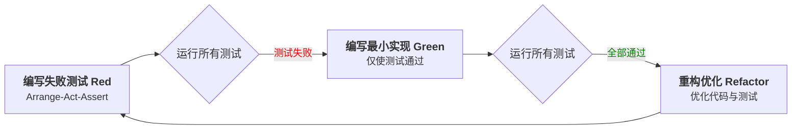
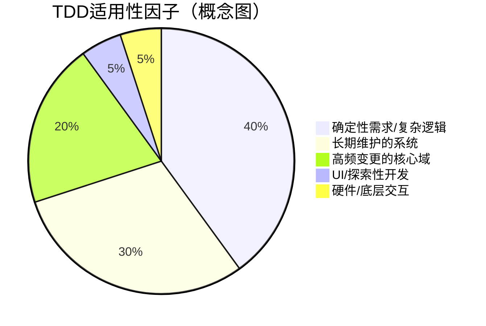
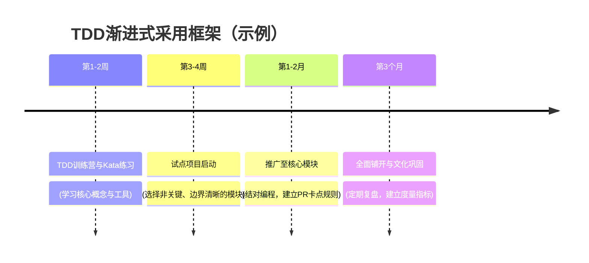

## 第1章：TDD核心精髓与思想基石 (What & Why Foundation)

### 1.1 TDD的定义与核心理念

测试驱动开发（Test-Driven Development，简称TDD）是一种演进式的软件开发过程与设计方法论，其核心思想是在编写任何功能代码之前，首先编写一个用于验证该功能的自动化测试用例。开发过程由测试驱动，从而确保代码的正确性、可靠性，并将需求分析、设计和质量控制量化为一个持续迭代的精炼过程。

TDD的本质可以概括为以下关键特征：

*   **测试先行 (Test-First):** 这是TDD最显著的特征和颠覆性思维范式。测试不再是开发后期的一个验证阶段，而是驱动整个开发过程的起点和设计工具。
*   **短迭代循环 (Short Cycles):** 开发工作在一个极短的、重复的"红-绿-重构"循环中进行，通常每次迭代仅耗时几分钟。
*   **演进式设计 (Emergent Design):** 软件设计不是预先进行宏大规划的，而是在TDD的迭代过程中，通过持续重构逐步浮现、优化和演进出来的。

### 1.2 "红-绿-重构"迭代循环详解

"红-绿-重构"循环是TDD实践的具象化体现，如同开发过程中的心跳，以极短的反馈周期驱动着代码的健康成长。


#### 1.2.1 红（Red）：编写失败的测试

*   **目的：** 明确并量化需求，定义"完成"的标准。在没有任何功能代码的情况下，这个测试必须失败。如果它意外通过了，说明测试本身可能有问题，或测试了已存在的功能。
*   **动作：**
    1.  思考接下来要实现的最小功能点。
    2.  编写一个清晰、简洁、只关注一个行为的单元测试。
    3.  运行所有测试，确认新添加的测试如预期般失败（红色标记）。
*   **意义：** "红灯"是系统当前缺失期望功能的明确信号，也是一个安全检查，确保我们编写的测试确实能捕捉到想要验证的行为。

#### 1.2.2 绿（Green）：最简代码通过测试

*   **目的：** 快速实现功能，满足测试的期望。此时，目标是"让灯变绿"，而不是追求完美的代码或优雅的设计。
*   **动作：**
    1.  编写最少量的、足以让刚刚失败的测试通过的功能代码。允许使用"硬编码"或最简单直接的实现。
    2.  再次运行所有测试，确认新测试通过（绿色标记），且所有其他测试也保持通过。
*   **意义：** "绿灯"代表我们已成功实现了当前定义的一小块功能，这种快速的成功反馈能极大提升开发者的信心和动力，并避免过度设计。

#### 1.2.3 重构（Refactor）：优化代码设计

*   **目的：** 在功能正确（所有测试通过）的前提下，提升代码的内部质量，消除重复、提升表达力与可维护性。
*   **动作：**
    1.  审视刚刚编写的功能代码和测试代码，寻找"代码坏味道"（Code Smells）。
    2.  在测试作为"安全网"的保护下，大胆地进行重构。
    3.  每次小的重构后，都应立即运行测试，确保所有测试仍然通过。
*   **意义：** 重构是TDD保持代码库健康、可维护和可演进的关键。它确保了代码在不断迭代的过程中不会腐化。没有重构的TDD是不完整的。

### 1.3 根本思想：从源头保障质量

#### 1.3.1 测试即"活的"需求文档

TDD中的单元测试，用代码精确地描述了系统各个单元在特定输入下的预期行为。这些测试集合构成了一份"活的文档"或"可执行的规范"。

*   **精确性与清晰度**：测试是对需求最精确的可执行描述，它迫使开发者在编码前深入思考"系统应当做什么"，将模糊的需求转化为无歧义的、可执行的例子。
*   **与代码同步**：传统文字需求文档容易与实际代码实现脱节，而TDD的测试用例与功能代码紧密绑定，永远保持最新。
*   **知识传递**：团队新成员或未来的维护者可以通过阅读测试代码，快速、准确地理解模块功能和使用方式。

#### 1.3.2 测试驱动设计（Test-Driven Design）

TDD首先是一种设计活动，其次才是一种测试活动。"如何测试这段代码？"这个问题在编写功能代码之前被提出，会深刻地影响代码的设计。为了让代码可测试，开发者会自然地倾向于：

*   **小巧的类和方法**：大块头的代码难以测试，TDD促使我们将复杂问题分解成小而专注的单元。
*   **明确的职责 (单一职责原则)**：一个单元如果承担过多职责，其测试也会变得复杂。
*   **低耦合 (松耦合)**：单元之间的紧密耦合使得隔离测试变得困难。TDD鼓励使用接口、依赖注入等方式降低耦合度。
*   **高内聚**：相关的行为被组织在一起，使得测试的焦点更集中。

因此，TDD不是"为代码写测试"，而是"用测试来塑造代码的设计"。

#### 1.3.3 小步快跑与持续反馈

TDD的红-绿-重构循环非常短（通常只有几分钟），这种极短的反馈周期让开发者能够：

*   **快速验证**：及时知道自己的代码是否按预期工作。
*   **降低心智负担**：每次只关注一小块功能，符合米勒定律（工作记忆负载<5个概念），避免一次性处理过多复杂性。
*   **安全前行**：每一步都有测试保护，即使犯错也能快速回溯到上一个稳定状态，减少了因长时间编码后发现方向错误而带来的巨大浪费。

### 1.4 TDD与传统开发模式的本质区别

TDD的"测试先行"模式与传统的"先编码后测试"（Test-After）模式在流程、目的和结果上有着根本性的差异。

| 特性 | TDD (测试驱动开发) | 传统 Test-After (先编码后测试) |
| :--- | :--- | :--- |
| **测试时机** | 编码前 (Test First) | 编码后 (Test Last) |
| **测试目的** | **驱动设计**、定义行为、验证功能、防止回归 | **验证功能**、发现Bug |
| **设计影响** | 强烈影响并改进设计，促进高内聚、低耦合、可测试性 | 对初始设计影响较小，可能难以补写高质量的单元测试 |
| **代码可测试性** | 天然倾向于高可测试性 | 可测试性取决于开发者意识，可能较差 |
| **反馈循环** | 极短 (分钟级) | 较长 (小时、天，甚至更久) |
| **需求理解** | 通过编写测试将需求转化为精确的可执行规范 | 依赖对文字需求的解读，可能存在理解偏差 |
| **代码覆盖率** | 趋向于高覆盖率，且覆盖的是实际被"驱动"出来的代码 | 依赖测试补充的努力，可能存在为覆盖率而写的低效测试 |
| **缺陷成本** | 即时发现（成本接近于0） | 延迟发现（修复成本呈指数级增长） |
| **设计过程** | 演进式、涌现式设计 | 倾向于预先设计 (Big Design Up Front) 或随意设计 |

### 1.5 TDD带来的思维模式转变

采纳TDD不仅仅是改变工作流程，更是一场深刻的思维模式变革：

1.  **从"实现者"到"设计者"与"验证者"的统一**：在编写测试时，开发者扮演"API使用者"的角色，思考"我期望模块如何工作？"；在编写功能代码时是"实现者"；在重构时是"架构师"。这种角色的快速切换促进了更全面的思考。

2.  **从"代码能跑通就行"到"代码优雅且健壮"**：通过"绿灯"确保功能跑通只是第一步。"重构"阶段作为不可或缺的一环，强制开发者持续关注代码的质量、可读性与可维护性。

3.  **从"害怕变更"到"拥抱变更"**：全面的测试套件提供了强大的信心安全网。当需求变更或需要重构时，测试能够快速反馈修改是否破坏了原有功能，使得变更不再可怕。

4.  **从"模糊的需求"到"精确的定义"**：编写测试的过程，就是将模糊的需求转化为精确的、可执行的、无歧义的"代码化规范"的过程。如果对需求有疑问，就无法编写出清晰的测试。
    

5.  **从"一次性完成大模块"到"小步迭代，持续集成"**：TDD强制以非常小的增量进行开发，每个小增量都经过测试验证，这与敏捷开发的持续集成思想高度契合。 

---
## 第2章：TDD的价值主张与问题解决 (Value & Problem Solving)

TDD的实践并非没有成本，它需要学习曲线和初期看似稍慢的开发节奏，但其带来的长期价值和对研发痛点的精准打击，使得这种投入是完全值得的。本章将聚焦于TDD如何系统性地解决软件研发生命周期中的常见难题，并阐明其核心价值机制。

### 2.1 TDD精准解决的研发痛点

软件开发过程中普遍面临着质量、需求、设计、维护和信心等方面的挑战，TDD为这些问题提供了有效的、内建于流程的解决方案。

| 典型痛点 | TDD 解决方案与机制 | 价值成果 |
| :--- | :--- | :--- |
| **代码质量低下、Bug频出** | - **设计改进**：测试驱动设计天然倾向于编写更小、更专注、低耦合的单元。<br>- **即时错误捕获**：Bug在萌芽状态即被"红灯"消灭，而非在集成或QA阶段才暴露。 | 实证研究表明，预发布缺陷密度可系统性降低40%–90%。 |
| **需求理解偏差** | - **测试即需求澄清**：编写测试的过程就是将抽象需求转化为具体、可执行例子的过程，迫使开发者与产品方在开发前就细节达成一致。<br>- **可执行的规范**：测试代码成为需求的精确描述，比文字文档更不易产生歧义。 | 需求返工率显著下降，确保功能意图与实现一致。 |
| **系统设计僵化、难以变更** | - **促进模块化和解耦**：为了可测试性，TDD鼓励将大系统分解为独立的、可单独测试的模块。<br>- **持续重构**：重构步骤确保代码结构不断优化，保持设计的灵活性，避免技术债过度累积。 | 驱动出符合SOLID原则的松耦合设计，系统可维护性、可扩展性大幅提升。 |
| **维护成本高昂** | - **提升代码可读性**：重构阶段关注代码清晰度，测试代码本身也作为示例，展示了功能代码如何被使用。<br>- **减少调试时间**：全面的测试使得问题定位更快，显著降低对传统"断点调试"的依赖。 | 长期维护成本可下降超过50%，新人上手更快。 |
| **对修改代码缺乏信心（修改恐惧症）** | - **强大的安全网**：覆盖全面的自动化测试套件是TDD提供的最重要资产之一，为任何修改提供信心保障。<br>- **鼓励重构**：有了安全网，开发者更有勇气去进行必要的重构，持续改进代码质量。 | 团队重构意愿和活跃度提升，代码库得以持续健康演进。 |

> *案例佐证*：伦敦救护车调度系统因缺乏充分测试导致严重事故，丰田汽车也因未经严格测试的代码缺陷导致车辆失控，这些都反面印证了测试作为安全保障的重要性。

### 2.2 TDD的核心价值与机制

通过解决上述痛点，TDD为项目和团队带来了多方面的核心价值，这些价值通过其内在机制得以实现。

#### 2.2.1 强制解耦与清晰设计

TDD的核心机制在于通过"测试先行"来**强制实现接口与实现的分离**。为了能够独立测试一个单元，开发者必须思考如何将其与依赖项（如数据库、外部API等）隔离开，这自然而然地导向了**依赖注入（DI）** 和**面向接口编程**。这个过程不仅提升了代码的可测试性，更重要的是，它从根本上促进了**高内聚、低耦合**的模块化设计。设计不再是一次性的预先规划，而是在测试驱动下逐步浮现和完善的（**涌现式设计**），使得代码更清晰、更符合SOLID等优秀设计原则。

#### 2.2.2 即时反馈循环

TDD的"红-绿-重构"循环提供了一个**分钟级的、极速的反馈回路**。开发者在几分钟内就能知道自己的代码是否正确工作，是否破坏了其他部分。这种快速反馈：
*   **显著减少了调试时间**：问题在引入的瞬间就被发现和定位。
*   **提高了开发效率**：虽然初期编写测试需要时间，但长期来看，由于节省了大量的后期调试和Bug修复时间，总开发时间是缩短的。
*   **保障了开发者的心流状态**：平稳、可控的开发节奏让开发者能够持续保持专注。

#### 2.2.3 可靠的回归安全网

每一个由TDD驱动开发的功能点都有对应的自动化测试。这个持续积累的、全面的测试套件构成了一个**坚不可摧的回归安全网**。
*   **保障重构安全**：它是开发者敢于进行大胆重构的信心来源。
*   **支持持续集成/持续部署（CI/CD）**：它是CI/CD流程能够自动化、可靠运行的基石。每当代码发生变更，可以快速运行所有测试，确保没有破坏现有功能。
*   **增强项目稳健性**：对于大型、长期维护以及频繁迭代的项目，这个安全网的价值尤其巨大，它能显著降低在生产环境中发现错误的风险。

### 2.3 TDD的投资回报（ROI）分析

采纳TDD是一种投资行为，它在项目初期需要额外的时间投入，但在软件的整个生命周期中会带来显著的回报。

*   **初期投入**：研究表明，采用TDD的团队初期开发时长会增加约**15-35%**。这部分时间主要用于编写测试、思考设计以及适应新的工作流程。
*   **长期回报**：
    *   **缺陷显著减少**：微软、IBM等公司的内部研究和多项学术研究一致表明，TDD能够将预发布缺陷密度降低**40%到90%**。
    *   **维护成本大幅降低**：由于代码质量更高、设计更清晰、有安全网保护，后期维护和新增功能的成本显著下降。对于生命周期超过一年的产品，TDD带来的长期ROI通常会转正并持续增加。
    *   **开发效率提升**：Android团队的研究发现，长期实践TDD可以使代码可维护性提升30%，综合开发速度提高约20%。

总结而言，TDD不仅仅是测试技术，更是一种投资于未来的开发策略。它通过构建坚实的质量基础和灵活的架构，有效降低了软件全生命周期的总拥有成本（TCO）。 


### **2.4 TDD：DevOps文化与CI/CD流程的关键引擎**
TDD不仅是编码实践，更是**实现DevOps目标的核心技术杠杆**。通过提供自动化测试基础和"质量左移"（Shift-Left）机制，TDD与CI/CD形成闭环，驱动DevOps文化从理念落地为可衡量的工程成果。

#### **2.4.1 为持续集成（CI）提供“持续”的信心**  
- **测试即安全网**：TDD生成的单元测试套件是CI流水线的核心质量关卡。每次代码提交触发自动化构建时，TDD测试率先运行并提供即时反馈，确保新增代码不破坏既有功能。**统计显示，集成阶段70%的冲突源于接口不一致**，而TDD通过前置接口设计规避此问题。  
- **加速反馈循环**：传统开发中，集成测试周期可能长达数小时，而TDD驱动的单元测试在秒级完成。例如Netflix通过TDD+CI将代码验证时间从2小时压缩至8分钟，使开发者可快速迭代。  
- **降低合并风险**：TDD强制模块化解耦，使多分支并行开发成为可能。结合Git的Pull Request机制，TDD测试作为代码合并的自动化守门员，显著减少"集成地狱"。  

> *技术协同*：  
> ```mermaid  
> graph LR  
>   A[TDD生成单元测试] --> B[CI自动运行测试]  
>   B --> C{测试通过？}  
>   C -->|是| D[自动构建部署]  
>   C -->|否| E[即时告警开发者]  
> ```


#### **2.4.2 加速持续交付/部署（CD）的“安全阀”**  
- **可信的部署包**：TDD确保每个功能单元均被验证，使CD流水线能够自动将经过充分测试的代码部署至生产环境。全球电商案例表明，采用TDD后部署失败率下降80%，回滚率降低至5%以下。  
- **解耦部署与发布**：通过TDD构建的"测试安全网"，团队可采用蓝绿部署等高级策略。例如金融系统在部署新版本时，旧版本仍在线运行，TDD测试验证无误后再切换流量。  
- **安全性与合规性左移**：TDD驱动开发者编写可测试的安全代码（如输入验证），结合DevSecOps工具（SAST/DAST）在CD早期发现漏洞，避免生产环境安全事件。微软数据显示，此实践使漏洞修复成本降低90%。  

#### **2.4.3 内化DevOps理念：质量左移与快速反馈**  
- **文化契合点1：打破协作壁垒**  
  TDD的"测试即需求文档"特性使开发、测试、运维团队共享可执行的需求定义。例如Pega仓库通过规则集版本化，将TDD测试用例作为跨团队契约，减少需求理解偏差。  
- **文化契合点2：质量全民化**  
  DevOps强调"开发者对生产质量负责"，而TDD通过强制开发者编写测试，将质量保障责任前移至编码阶段。丰田实践表明，此举使运维团队介入延迟降低60%。  
- **文化契合点3：持续改进引擎**  
  TDD红-绿-重构循环与DevOps回顾会（Retrospective）形成双重反馈机制：  
  - **技术层面**：测试失败驱动代码优化  
  - **流程层面**：逃逸缺陷分析驱动测试用例增强  
  如Android团队通过TDD缺陷分析，每月优化15%的测试用例覆盖率规则。  

> **三者关系本质**：  
> ```  
> TDD → 提供自动化测试资产 → 支撑CI/CD流水线自动化 → 实现DevOps快速交付目标  
>          ↑                                      ↑  
>          └───── 文化协同：质量左移、协作透明化 ───┘  
> ```


---

### **结语：TDD在DevOps中的战略定位**  
TDD是**DevOps文化落地的技术载体**和**CI/CD流水线的质量基石**。其价值不仅体现在缺陷预防（降低40%-90%），更在于通过"测试先行"重塑开发思维，使质量内建（Built-in Quality）成为团队本能。成功实践的关键在于：  
1. **工具链整合**：将TDD框架（JUnit/pytest）嵌入CI/CD工具（Jenkins/GitLab CI），实现"提交即验证"；  
2. **度量驱动**：跟踪TDD测试的**失效捕获率**（而非单纯覆盖率），确保测试有效性；  
3. **文化适配**：在DevOps转型中，通过结对编程使TDD成为跨团队协作语言，最终实现"质量是所有人的需求，而非测试人员的责任"。  

> *工业界共识*：正如E. H. Vihovde的研究指出，**TDD与CI/CD的深度集成是提升软件可靠性的黄金组合**，其收益已在教育领域反哺人才培养，成为软件工程课程的核心范式。


---
## 第3章：TDD的工程实践与关键技能 (How - Practical Application)

理解了TDD的"是什么"和"为什么"之后，本章将深入探讨"怎么做"。我们将详细介绍TDD的具体操作流程、将理论转化为实践的必备工具链，以及编写高质量测试和驱动出优秀设计的关键技能。

### 3.1 TDD具体操作流程

TDD的实践艺术在于精通并严格遵守"红-绿-重构"的循环。


#### 3.1.1 编写有效的失败测试（Arrange-Act-Assert）

这是TDD的起点，目标是编写一个清晰描述期望行为、且当前一定会失败的测试。

*   **测试命名：** 测试方法的名称应清晰描述其测试的行为和预期结果，例如 `test_deposit_increases_balance_by_amount()`。
*   **测试结构 (Arrange-Act-Assert / Given-When-Then):** 这是组织测试逻辑的黄金标准。
    *   **Arrange (组织/准备):** 设置测试所需的前提条件，如创建对象实例、初始化变量、准备Mock对象等。
    *   **Act (行动):** 执行被测试的操作或调用被测试的方法。这是测试的核心步骤。
    *   **Assert (断言):** 验证被测试方法的行为是否符合预期。检查返回值、对象状态变化、方法调用情况等。
*   **编写要点：**
    *   **单一关注点：** 一次只测试一个具体的行为点。
    *   **确保失败：** 运行测试，看到预期的红色。如果它通过了，说明测试有误或该功能已存在。
    *   **测试接口而非实现：** 关注"它做了什么"，而不是"它如何做的"。

#### 3.1.2 最小化实现代码

此阶段的目标是**用最少的代码、最快的速度让红灯变绿**。

*   **编写要点：**
    *   **只写必要的代码：** 此时不追求完美，甚至可以使用"假实现"（Fake It 'Til You Make It），如直接返回测试期望的硬编码值。
    *   **快速实现：** 目标是尽快通过测试以获得反馈。
    *   **不添加额外功能：** 严格抵制实现测试未覆盖到的其他逻辑的诱惑。

#### 3.1.3 安全地进行重构

当所有测试通过（绿灯亮起）后，就进入了至关重要的重构阶段。

*   **范围：** 包括刚刚编写的功能代码和测试代码。测试代码和生产代码同等重要，也需要保持高质量。
*   **重构目标：**
    *   **消除重复 (DRY - Don't Repeat Yourself):** 在功能代码或测试代码中寻找重复模式，并提取到公共方法或类中。
    *   **提高可读性：** 改进命名，简化复杂逻辑。好的代码本身就是最好的注释。
    *   **改进设计：** 应用设计原则，移除代码坏味道，优化类结构和方法职责。
*   **安全保证：** 每次小的重构动作后，都应**立即运行测试**。这是安全重构的基石。如果测试失败，应能轻松回滚到重构前的状态。重构阶段不应改变代码的外部行为。

### 3.2 关键工具链

选择合适的工具是高效实践TDD的前提。

#### 3.2.1 主流单元测试框架

单元测试框架提供编写和运行测试的基础结构，包括测试发现、执行、断言库和结果报告。

| 语言/环境 | 主流框架 | 特点 |
| :--- | :--- | :--- |
| **Java** | JUnit 5, TestNG | JUnit是最流行的标准；TestNG功能更丰富。 |
| **Python** | PyTest, `unittest` | PyTest更简洁、功能强大、社区活跃；`unittest`是标准库。 |
| **JavaScript** | Jest, Vitest, Mocha | Jest功能全面、零配置；Vitest是现代化的新选择；Mocha灵活。 |
| **C#/.NET** | NUnit, xUnit.net, MSTest | NUnit是经典选择；xUnit.net更现代、社区驱动。 |
| **Go** | `testing` (标准库) | Go语言内置，简洁高效。 |

#### 3.2.2 Mock、Stub等测试替身工具

**测试替身（Test Doubles）** 是TDD中实现单元测试"隔离性"的关键。当被测单元依赖于其他复杂组件（如数据库、外部API）时，我们用测试替身来替换这些真实依赖。

| 类型 | 目的与特点 |
| :--- | :--- |
| **Stub (桩)** | 提供测试所需的**固定返回值或行为**。例如，一个Stub化的用户服务在调用`getUser`时总是返回一个预设的用户对象，而不实际查询数据库。主要用于**状态验证**。 |
| **Mock (模拟对象)** | 关注**行为验证**。不仅能像Stub一样提供预设行为，还能记录对其方法的调用情况（如调用次数、参数），并在测试结束时验证这些交互是否符合预期。 |
| **Spy (间谍)** | 包裹真实对象，**记录真实对象的行为**但允许真实逻辑执行，也可以部分替换其行为。 |
| **Fake (伪对象)** | 拥有**实际功能的轻量级实现**，但不适用于生产环境（例如，内存数据库代替真实数据库）。 |

**主流Mock工具：**

| 语言 | Mock工具 |
| :--- | :--- |
| **Java** | Mockito, EasyMock |
| **Python** | `unittest.mock`, `pytest-mock` |
| **JavaScript** | Jest内置Mock, Sinon.JS |
| **C#/.NET** | Moq, NSubstitute |

### 3.3 高质量测试代码的FIRST原则

编写好的测试与编写好的功能代码同样重要。FIRST原则是衡量单元测试质量的黄金标准：

*   **F - Fast (快速):** 测试应该运行得非常快（毫秒级）。缓慢的测试会拖慢开发节奏，开发者会不愿意频繁运行它们。
*   **I - Independent/Isolated (独立/隔离):** 测试之间不应该有任何依赖关系。每个测试都应该可以独立、并以任何顺序运行。
*   **R - Repeatable (可重复):** 测试在任何环境（开发机、CI服务器）、任何时间运行都应该得到相同的结果。避免依赖外部易变环境因素。
*   **S - Self-Validating (自我验证):** 测试应该能自动判断其是否通过，不需要人工检查输出。测试结果必须是明确的布尔值：通过或失败。
*   **T - Timely/Thorough (及时/全面):**
    *   **及时 (Timely):** 测试应该在编写功能代码之前编写。
    *   **全面 (Thorough):** 测试应该覆盖重要的行为路径，包括正常情况、边界条件和错误情况。但"全面"不等于追求100%的代码行覆盖率。

### 3.4 TDD如何驱动出优秀设计

TDD不仅保障质量，更是塑造优秀设计的强大引擎。

#### 3.4.1 与SOLID原则的自然融合

TDD的实践过程会不自觉地引导开发者向SOLID原则靠拢：

*   **S - 单一职责原则 (SRP):** 当一个类承担了太多职责，你会发现测试难以编写和维护。这会促使你将类的职责拆分，使每个类更专注、更容易测试。
*   **O - 开放封闭原则 (OCP):** "红-绿-重构"循环天然支持OCP。添加新功能时（红-绿），我们不修改现有已通过测试的代码。在"重构"阶段，我们会寻找扩展点，使得系统在不修改旧代码核心逻辑的情况下易于扩展。
*   **L - 里氏替换原则 (LSP):** 如果子类破坏了基类的行为约定，那么基类的测试会在子类实例上失败，TDD会立即通过失败的测试暴露这个问题。
*   **I - 接口隔离原则 (ISP):** 为了方便Mock依赖，你会倾向于定义一个更小、更专注的接口（只包含客户端需要的方法），而不是让客户端依赖一个庞大臃肿的接口。
*   **D - 依赖倒置原则 (DIP):** 这是TDD驱动设计最直接的体现。为了能够用测试替身替换真实依赖，代码必须依赖于抽象（接口），而非具体实现。

#### 3.4.2 依赖注入（DI）的关键作用

**依赖注入是一种允许对象的依赖关系在外部被提供（注入）的设计模式，而不是由对象自身创建。**

*   **为何DI对TDD至关重要？**
    *   **实现隔离**：DI使得在测试时，可以轻松地将真实的依赖（如数据库连接）替换为Mock或Stub对象。没有DI，被测对象会硬编码其依赖的创建，导致无法隔离测试。
*   **常见的DI方式：**
    *   **构造函数注入 (Constructor Injection):** 依赖通过类的构造函数传入。这是最推荐的方式，因为它确保了对象在创建时就处于有效状态。
    *   **Setter方法注入 (Setter Injection):** 依赖通过公开的setter方法传入。
    *   **接口注入 (Interface Injection):** 类实现一个特定接口，该接口定义了注入依赖的方法。 


---
## 第4章：TDD的优缺点与务实考量 (Pros, Cons & Realistic View)

TDD并非万能的"银弹"，它有其显著优势，但也存在挑战和局限性。一个成熟的团队应该能够客观评估TDD，并根据项目特性、团队能力和代码现状，务实地、有策略地应用它，而不是将其作为僵化的教条。

### 4.1 TDD的核心优势回顾

我们在前述章节已经探讨了TDD带来的诸多价值，在此简要回顾其核心优势：

*   **更高的代码质量**：通过测试先行和持续重构，系统性地减少Bug数量，产出更健壮、更可靠的代码。
*   **更好的软件设计**：自然驱动出模块化、低耦合、高内聚的代码结构，易于理解和维护。
*   **可靠的回归安全网**：使团队能信心十足地进行重构、添加功能和快速迭代，是CI/CD的基石。
*   **"活的"技术文档**：测试用例作为代码行为的精确描述，降低了沟通和维护成本。
*   **提升长期开发效率**：虽然初期投入时间编写测试，但显著减少了后期调试、Bug修复和维护的时间。
*   **增强开发者信心与团队协作**：减少对修改代码的恐惧，测试代码成为团队沟通的桥梁。

### 4.2 TDD面临的挑战与局限性

| 挑战与局限性 | 核心原因 | 应对策略 |
| :--- | :--- | :--- |
| **陡峭的学习曲线** | - **思维转变困难**：从"先实现再验证"到"先定义行为再实现"的转变需要时间适应。<br>- **技能要求**：需要掌握测试框架、Mock/Stub工具和重构手法。 | - **系统性培训**：组织内外部培训、编码道场（Coding Dojo）。<br>- **渐进式实践**：从小型或非核心项目开始试点，结对编程，导师辅导。 |
| **初期开发效率感知下降** | - **额外工作量**：编写测试本身需要时间，初期会感觉开发速度变慢（约增加15-35%）。 | - **强调长期回报**：让团队看到后期调试和Bug修复时间的大幅减少。<br>- **提升熟练度**：通过练习，编写测试的速度会显著加快。 |
| **测试代码的维护成本** | - **测试也是代码**：测试代码也需要维护，写得不好的测试（如与实现细节过度耦合）会成为负担。 | - **遵循FIRST原则**：编写高质量、行为驱动的测试。<br>- **重构测试代码**：将测试代码与生产代码同等对待，定期评审和重构。 |
| **组织层面的认知障碍** | - **管理层不理解**：管理层可能认为编写测试是在浪费时间，单纯考核短期功能交付速度。 | - **量化价值**：通过缺陷率、维护成本等数据展示TDD的长期ROI。<br>- **建立质量文化**：争取管理层对"质量优先"理念的认同和支持。 |

### 4.3 TDD的适用性探讨

TDD并非适用于所有开发场景。关键在于理解其优势领域，并在不适合的场景中灵活调整。



#### 4.3.1 复杂业务逻辑 vs. 探索性开发

*   **推荐场景 (高适用性)**：
    *   **业务规则复杂、需求明确的领域**：如金融核心、交易系统、算法实现等。TDD能确保这些关键逻辑的正确性和健壮性。
    *   **长期维护的系统**：TDD构建的安全网对于这类系统的健康演进至关重要。
*   **谨慎使用场景 (低适用性)**：
    *   **探索性编程或原型开发**：当需求极不明确，需要快速尝试不同方案以探索可能性时，严格的TDD可能会束缚探索的自由度和速度。
    *   **应对策略**：在非常早期的原型验证阶段，可以暂时放宽TDD要求。一旦某个方向被证明可行，准备将其转化为正式功能时，应立即开始补写测试并转向TDD。

#### 4.3.2 GUI与外部系统依赖的处理

*   **图形界面 (GUI) 开发**：
    *   **挑战**：GUI的测试往往涉及用户交互、视觉呈现，传统的单元测试难以覆盖。端到端的UI自动化测试通常较慢且脆弱。
    *   **务实策略**：采用**MVVM, MVP, MVC**等模式，将UI的"视图"与"逻辑"（ViewModel/Presenter/Controller）分离。**对不依赖具体UI框架的逻辑层进行TDD**，UI本身则通过少量、高价值的E2E测试或手动探索性测试来覆盖。
*   **复杂的外部系统依赖**：
    *   **挑战**：如复杂的第三方硬件、专有API等，Mock的成本可能非常高，或者Mock无法完全模拟真实行为。
    *   **务实策略**：围绕这些难以测试的部分建立清晰的**防腐层 (Anti-Corruption Layer)**。对防腐层本身和防腐层之外的业务逻辑进行TDD。与这些外部系统的交互可以通过更高层次的**集成测试**来重点覆盖。

#### 4.3.3 遗留系统的TDD渗透策略

在没有测试的遗留代码（Legacy Code）上直接应用TDD非常困难。需要采用渐进式的渗透策略。

1.  **目标不是一步到位**：不要期望立即对整个遗留系统应用TDD。
2.  **从新功能或Bug修复开始**：当需要在遗留代码中添加新特性或修复Bug时，是引入TDD的绝佳机会。
3.  **建立测试安全网**：
    *   **特征化测试 (Characterization Tests)**：在修改任何代码之前，为即将修改的部分编写测试，以描述并"锁定"其当前行为（即使行为是错误的）。
    *   **寻找接缝 (Seams)**：找到代码中可以改变行为而无需修改那部分代码的地方（如通过子类化、参数化等），利用接缝来引入测试点或替换依赖。
4.  **小范围重构以提高可测试性**：在测试的保护下，进行一些小型的、安全的重构（如提取方法、分离关注点），使得代码更容易被测试。
5.  **绞杀者模式 (Strangler Fig Pattern)**：对于大型遗留系统，可以逐步用遵循TDD开发的新服务替换旧系统的功能模块。

### 4.4 平衡测试的粒度与成本

避免过度测试或测试不足，是务实应用TDD的关键。

#### 4.4.1 测试金字塔模型

测试金字塔是一个经典的测试策略模型，强调不同粒度测试的比例关系。

*   **单元测试 (Unit Tests)**：位于金字塔底部，数量最多。TDD主要聚焦于此。它们快速、稳定，用于测试独立的类或模块。
*   **集成测试 (Integration Tests)**：位于中间层，数量次之。用于测试模块间的协作，如服务层与数据访问层的交互。
*   **端到端测试 (E2E Tests)**：位于塔尖，数量最少。模拟用户操作，验证整个系统的完整流程。它们最慢、最脆弱，但能覆盖核心用户场景。

#### 4.4.2 避免过度测试与测试不足

*   **避免过度测试**：
    *   **不测试第三方库或语言特性**：信任它们是可靠的。
    *   **不测试简单的getter/setter**（除非它们包含逻辑）。
    *   **不直接测试私有方法**：私有方法是实现细节，应通过测试类的公共接口来间接覆盖其逻辑。如果一个私有方法复杂到需要单独测试，这通常是需要重构的信号（如提取到一个新的协作类中）。
    *   **不过度追求100%覆盖率**：高覆盖率不一定意味着高质量测试，应用它来发现未经测试的代码区域，而不是作为唯一目标。
*   **避免测试不足**：
    *   **覆盖核心业务逻辑**：对复杂或关键的业务规则，应有充分的测试。
    *   **考虑边界条件**：`null`输入、空集合、最大/最小值、有效/无效数据等。
    *   **测试异常路径和错误处理**：系统在非正常情况下的行为也需要验证。

总之，理性看待TDD，意味着理解其价值，承认其挑战，并学会在不同的项目阶段和代码状况下，灵活、务实地运用其原则和实践。 


---
## 第5章：TDD的团队导入、文化构建与持续精进 (Team Adoption & Culture)

TDD的成功落地，50%依赖于技术，另外50%则取决于文化。它不仅仅是个体技能的掌握，更需要团队层面的共同努力、文化支持和持续改进的机制。本章将探讨如何在团队中有效导入TDD，构建支持TDD的文化，并确保实践能够持续精进。

### 5.1 成功导入TDD的前置条件

在团队中推行TDD之前，必须确保在技能、心态和组织层面做好了充分的准备。

#### 5.1.1 团队技能准备

*   **扎实的单元测试能力**：团队成员需要熟练掌握所用语言的单元测试框架（如JUnit, PyTest, Jest等）和断言库。
*   **基本的重构能力**：了解常见的代码坏味道和重构手法（如提取方法、移动类等）。
*   **Mock/Stub工具的使用**：能够熟练使用Mock框架（如Mockito, Sinon.js）来隔离依赖。
*   **理解设计原则**：对SOLID等设计原则有一定了解，能理解TDD如何促进良好设计。

#### 5.1.2 必备的心态转变

*   **拥抱反馈，视"红灯"为机遇**：将测试失败视为有价值的反馈和进步的信号，而非挫败。
*   **坚持纪律性**：严格遵守"红-绿-重构"的循环，不跳过任何步骤，尤其是重构。TDD需要自律。
*   **耐心与坚持**：认识到TDD的学习和习惯养成需要时间，愿意为长期收益而接受初期的不适或效率波动。
*   **对质量的共同承诺**：团队成员需认同高质量代码的重要性，并将TDD视为实现这一目标的内建手段。

#### 5.1.3 组织与管理层的支持

*   **管理层理解与支持**：管理层需要理解TDD的长期价值，并愿意为初期的学习成本提供支持（例如，不单纯以短期功能交付速度作为唯一考核标准）。
*   **鼓励实验与容错**：营造一个允许团队在学习TDD过程中犯错并从中学习的心理安全环境。
*   **提供时间与资源保障**：给予团队成员学习、练习（如编码道场）和讨论TDD的时间，并提供必要的培训资源或外部教练支持。

### 5.2 有效的TDD引入策略

强制性地、一刀切地推行TDD往往会失败。一个渐进、务实的引入策略至关重要。



*   **试点项目 (Pilot Project)**：选择一个风险较低、规模适中、团队成员有兴趣的新项目或模块作为试点。从试点中收集经验教训，总结出适合团队的最佳实践，然后再逐步推广。
*   **结对编程 (Pair Programming) / Mob编程**：这是学习和推广TDD的极佳方式。两个人（或多人）一起思考测试、编写代码、重构，可以相互学习，保证TDD流程的执行，并即时反馈。一个有经验的TDD实践者与一个初学者结对，能起到很好的传帮带作用。
*   **内部培训 & 编码道场 (Coding Dojo)**：由团队内有经验的成员或技术专家组织分享会、工作坊。定期举行编码道场，通过练习经典的TDD Kata（如FizzBuzz、保龄球计分等）来固化肌肉记忆。
*   **代码评审 (Code Reviews) 中关注测试**：将测试代码作为代码评审的重点之一。评审测试的质量（是否遵循FIRST原则）、覆盖的行为、可读性等，而非仅仅关注覆盖率数字。
*   **制定团队规范与共识 (Team Norms)**：团队共同讨论并制定关于TDD实践的基本规范，例如：将"通过所有相关测试"纳入"完成的定义"（Definition of Done），CI中强制测试全绿才可合并等。

### 5.3 TDD实践中的常见误区与规避

| 常见误区 | 后果与表现 | 规避与纠偏方法 |
| :--- | :--- | :--- |
| **为覆盖率而测试 (Testing for Coverage Sake)** | 过于追求100%的代码覆盖率，编写大量低价值、只为"覆盖那一行"的脆弱测试。 | **关注行为验证，而非代码行。** 使用覆盖率工具作为发现未测试区域的辅助，而不是终极目标。聚焦核心业务逻辑、边界条件和错误处理。 |
| **测试实现细节而非行为 (Testing Implementation Details)** | 测试私有方法、测试一个方法内部调用了哪些其他方法。这类测试非常脆弱，一旦实现细节改变（即使外部行为不变），测试就会失败。 | **始终从"黑盒"视角思考，测试类的公共API所暴露的行为。** 如果感觉某个内部逻辑太复杂需要单独测试，考虑是否可以将其提取到一个新的类中，然后测试那个新类的公共接口。 |
| **跳过重构步骤 (Skipping the Refactor Step)** | 只满足于"红-绿"，代码能工作就行，忽略了重构。导致技术债累积，代码质量逐渐下降，最终TDD的很多好处会丧失。 | **将重构视为与Red/Green同等重要的一等公民。** 代码评审时应特别关注是否有重构。在估时中为重构预留时间（如20%）。 |
| **测试写得太大或太慢 (Tests are Too Big or Too Slow)** | 一个测试验证了太多行为，或者测试依赖真实数据库/网络，运行缓慢，导致开发者不愿意频繁运行。 | **严格遵循FIRST原则。** 将大测试分解为多个小而专注的测试。积极使用Mock/Stub隔离外部依赖，确保单元测试快速。 |
| **过度Mock (Over-Mocking)** | Mock了过多的依赖，甚至Mock了值对象等不应被Mock的对象。导致测试与真实运行环境的行为差异过大，测试变得难以理解和维护。 | **只Mock那些代表外部系统、有副作用或难以控制的依赖。** 对于简单的内部协作对象，若其行为稳定，直接使用真实实例可能更好。谨慎评估每次Mock的必要性。 |

### 5.4 构建持续精进的TDD文化

TDD的最终成功，在于将其内化为团队的DNA，成为一种追求卓越工程的文化。

| 能力成熟度模型（示例） | 测试能力 | 文化特征 | 关键干预措施 |
| :--- | :--- | :--- | :--- |
| **混沌期** | 无单元测试 | 恐惧变更 | 引入结对编程 + 基础单元测试培训 |
| **觉醒期** | 部分后置测试 | 怀疑价值 | 技术Dojo（如红绿重构游戏），分享成功案例 |
| **规范期** | TDD基础覆盖 | 流程纪律化 | PR卡点（无测试不合并），建立CI/CD门禁 |
| **精通期** | 领域驱动测试 | 质量共同体 | 定期重构道场，关注缺陷逃逸率等健康度指标 |

#### 5.4.1 TDD不仅是技术，更是文化

*   它关乎**质量承诺、持续学习、团队协作和专业纪律**。
*   需要建立一种**心理安全**的文化，让成员敢于提问、分享经验、承认错误，并在实践中共同成长。可以设立"绿灯保障基金"（重构出错不追责）等机制来鼓励大胆优化。

#### 5.4.2 建立持续改进的反馈循环

*   **定期回顾 (Retrospectives)**：团队定期（例如，每个迭代结束）回顾TDD实践情况：哪些做得好？哪些遇到了问题？如何改进？
*   **度量与可视化**：用CI看板展示测试通过率、运行时间、代码覆盖率趋势、缺陷逃逸率等健康度指标，在数据中营造成就感并发现问题。
*   **知识共享**：常态化组织技术分享会、案例研究，共同学习TDD的高级技巧和模式，保持实践的活力。 


---
## 第6章：结论 (Conclusion)

经过对测试驱动开发（TDD）从核心理念、价值主张、工程实践、务实考量到团队文化构建的全方位探讨，我们可以得出结论：TDD远不止是一种测试技术，它是一套完整的、将质量内建于开发过程始终的、高度纪律性的专业软件开发哲学与实践方法论。

### 6.1 TDD核心价值总结

TDD的核心价值可以凝练为以下几点：

*   **信心的基石**：TDD所构建的全面自动化测试套件是其最宝贵的产出。它为开发者提供了敢于重构、乐于迭代的"安全网"，从而让代码库能够持续健康地演进，而非随着时间推移而僵化腐烂。
*   **设计的驱动力**：通过"测试先行"和对可测试性的追求，TDD自然而然地引导开发者编写出更简单、更解耦、更符合SOLID原则的高质量代码。它将设计从一个独立的、前置的宏大阶段，分解为持续的、演进式的微观决策过程。
*   **需求的澄清器**：编写测试的过程，就是将抽象、模糊的需求转化为具体、可执行的例子的过程。TDD迫使开发者和产品负责人进行更深入的沟通，确保"正确地构建产品"与"构建正确的产品"同步进行。
*   **效率的催化剂**：尽管TDD在初期需要额外的学习和实践投入，但它通过极大地压缩后期调试、缺陷修复和维护的时间，显著提升了软件整个生命周期的总开发效率，实现了真正意义上的"欲速则达"。

### 6.2 迈向工程卓越的TDD实践之路

要成功地从TDD中获益，团队和个人需要认识到，这不仅仅是学习一个新工具或新流程，而是一场思维模式的转变和一场对工程文化的投资。

*   **这不是一条捷径，而是一条更稳健的路**：TDD的道路需要耐心、纪律和对专业的敬畏。它要求我们从追求"快速写完代码"，转变为追求"快速写出高质量、可维护的代码"。
*   **务实而非教条**：理解TDD的适用边界，在探索性开发、遗留系统改造等不同场景下采取灵活的策略，是成熟实践者的标志。关键在于掌握其精神实质——快速反馈和持续改进——而非僵化地遵守每一个仪式。
*   **文化是成功的土壤**：没有管理层的理解、团队成员的共识以及对持续学习和改进的鼓励，任何技术实践都难以生根发芽。TTDD的成功最终依赖于一种将质量视为集体责任的工程文化。

最终，TDD不仅仅是关于编写测试，它是关于构建卓越的软件。它是一种让我们能够自信、从容地面对复杂性和变化，并持续交付价值的强大武器。通过**代码即设计文档，测试即安全网，重构即日常呼吸**的实践，TDD为我们铺就了一条通往更高代码质量、更可持续的软件开发以及更高专业成就感的工程卓越之路。 