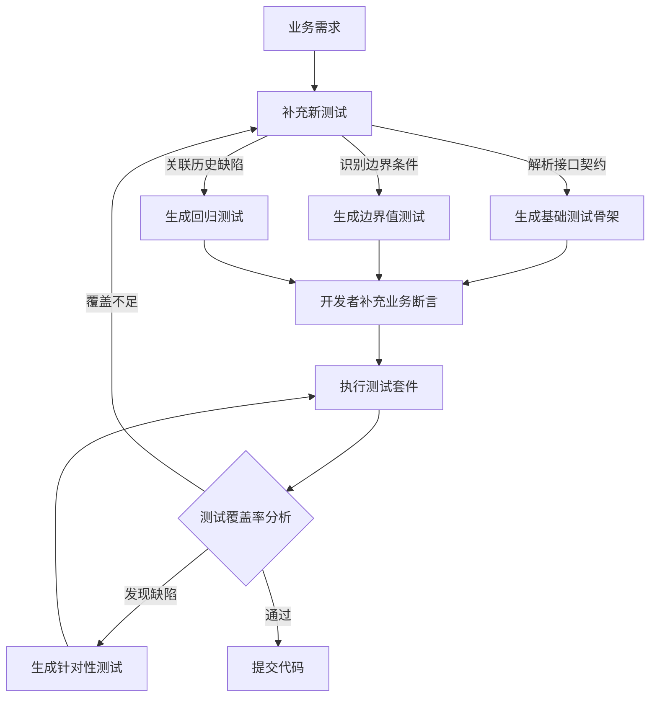

# 一、AI 赋能核心 TDD 循环：效率与智能的革命  

传统的 TDD "红-绿-重构"循环虽然经典有效，但在某些环节（如编写大量模板化测试、初步代码实现）可能耗时较多。AI 技术的引入，旨在让 TDD 循环更快、更智能，让开发者能将更多精力投入到更具创造性和战略性的工作中，如复杂业务逻辑的测试设计、架构决策和深度重构。研究表明，AI 增强的 TDD 可将开发循环时间缩短40%-70%，部分场景下甚至能将15-30分钟的循环压缩至3-5分钟。

## 1.1 智能测试生成：自动化 "红灯" 的第一步

单元测试的编写是 TDD 的起点，也是工作量较大的部分。AI 在此扮演着不知疲倦的测试编写助手角色，显著减少了重复劳动。

### 1.1.1 基于需求的测试骨架生成 (BDD, Gherkin)

当产品经理提供一份用户故事或需求规格说明时，AI 工具能够解析这些自然语言需求，自动生成初步的单元测试骨架。这包括符合 Gherkin 语法的 BDD 场景、测试方法名、Arrange-Act-Assert (AAA) 结构，甚至是一些明显的边界条件和预期输出的占位符。

**示例：**
*   **需求：** "用户登录功能：用户输入正确的用户名和密码后，应成功登录并返回欢迎信息；输入错误的用户名或密码，应提示错误。"
*   **AI 可能生成的测试骨架 (伪代码):**
    ```java
    // For successful login
    @Test
    public void should_returnWelcomeMessage_when_credentialsAreCorrect() {
        // Arrange: Setup user with correct credentials
        // Act: Call login method
        // Assert: Verify welcome message and login status
    }

    @Test
    public void should_returnErrorMessage_when_usernameIsIncorrect() {
        // Arrange: Setup user with incorrect username
        // Act: Call login method
        // Assert: Verify error message and login status
    }
    ```
*   **人类角色：** 审查AI生成的测试骨架是否全面覆盖了需求的关键点，补充AI可能遗漏的复杂场景或特定业务规则，并编写精确的断言逻辑。

### 1.1.2 基于代码的测试用例补全与建议

对于已有的代码（尤其是缺乏测试的遗留代码），AI 可以分析其结构、分支、循环和外部依赖，建议需要添加的测试用例，甚至生成这些测试的部分代码。这有助于快速提升遗留代码的测试覆盖率，或在快速编码后弥补测试。

### 1.1.3 智能测试数据合成（边界值、等价类、异常数据）

构造有效的测试数据往往需要仔细思考。AI 可以根据被测方法的参数类型、约束（如注解 `@NotNull`, `@Size`）以及上下文逻辑，生成多样化的测试输入数据。

**示例：**
对于一个接受年龄参数的方法，AI可能自动生成 `0, 17, 18, 65, 100, -1, null` 等测试数据。对于字符串，可能生成空字符串、超长字符串、包含特殊字符的字符串等。对于更复杂的场景，如测试支付系统，AI 甚至能生成包含欺诈特征的异常交易数据。

### AI 测试生成工作流

下图清晰地展示了 AI 在应用开发中生成测试的完整闭环工作流：



## 1.2 加速"红"到"绿"：AI 驱动的代码实现

TDD的核心是"红-绿"循环，AI可以在这两个阶段都提供助力。

### 1.2.1 失败测试的意图理解与"红灯"预判

在开发者编写测试时，AI 就可以分析代码变更的影响，预判可能失败的测试，从而帮助开发者聚焦问题区域。例如，AI 工具可识别代码中的潜在逻辑错误（如参数类型不匹配、空指针风险），提示开发者调整测试或代码。

### 1.2.2 基于失败测试的最小化代码生成

当一个清晰的失败测试（Red）被编写出来后，AI 可以分析这个失败的测试（特别是断言部分和被测方法的调用），尝试自动生成一段最少量的、恰好能让这个测试通过（Green）的功能代码。这正是 TDD 所倡导的"假实现"或"最小化实现"策略的自动化体现。

**示例：**
*   **测试：**
    ```java
    @Test
    public void should_returnZero_when_listIsEmpty() {
        Calculator calculator = new Calculator();
        List<Integer> numbers = Collections.emptyList();
        assertEquals(0, calculator.sum(numbers));
    }
    ```
*   **AI 可能生成的代码：**
    ```java
    public class Calculator {
        public int sum(List<Integer> numbers) {
            if (numbers.isEmpty()) { // AI根据测试推断出这个条件
                return 0;
            }
            // 可能是其他能让其他潜在测试失败的值
            // 或者是一个待实现的TODO
            return -1;
        }
    }
    ```
*   **人类角色：** 审查AI生成的代码，确保其只是"最小化"实现，没有引入不必要的逻辑。警惕AI为通过测试而"过度拟合"的硬编码式解决方案，并准备通过下一个测试来驱动更通用的实现。

## 1.3 智能重构：守护代码质量与设计

重构是 TDD 中至关重要的一步，AI 在此可以提供强大的支持，帮助提升功能代码和测试代码的质量。

### 1.3.1 上下文感知的代码坏味道识别

传统的静态分析工具也能检测代码坏味道，但 AI 可以做得更智能、更上下文感知。AI 不仅能识别重复代码、长方法、大类等常见坏味道，还能理解代码的业务语境，给出更精准的重构建议。例如，AI 发现一段复杂的条件逻辑，可能不仅仅建议"提取方法"，还会根据上下文推断这个方法应该命名为什么，或者建议使用策略模式。

### 1.3.2 自动化重构执行与即时验证

对于一些模式化的重构（如提取方法、重命名、封装字段），AI 不仅可以给出建议，还可以在开发者确认后自动执行这些重构操作。关键在于，AI 执行重构后，能自动触发相关测试的运行，确保重构没有破坏现有行为，形成了安全的自动化重构闭环。

### 1.3.3 面向可测试性的设计改进建议

有时代码难以测试是因为其设计不良（如硬编码依赖、方法副作用过多）。AI 可以分析代码的可测试性瓶颈，并提出专门为了提高可测试性的重构建议。

**示例：** AI 检测到一个类在其构造函数中直接 `new` 了一个依赖对象，导致难以 Mock。AI 可能建议将该依赖通过构造函数参数注入（依赖注入），从而解耦。
```java
// 重构前：测试依赖具体实现
testProcessOrder() { 
  PaymentProcessor processor = new PayPalProcessor(); // 耦合支付网关
  processor.process(order);
}
// AI重构后：解耦实现
testProcessOrder() {
  PaymentGateway gateway = mock(PaymentGateway.class); 
  OrderService service = new OrderService(gateway);
  service.process(order);
}
```

### 本章价值与风险总结

| 加速面 | 效果 | 风险 | 对策 |
| --- | --- | --- | --- |
| 测试编写 | 5-10倍人效提升 | 误生成伪需求、过度Mock | 由业务专家审核首轮生成 |
| 代码实现 | 快速通关绿灯 | 片面过拟合测试数据 | 先写高质量断言，严控行为覆盖 |
| 自动重构 | 保持代码整洁 | 改动跨度大难审计 | 分步提交PR、每步必须全绿 | 


---
