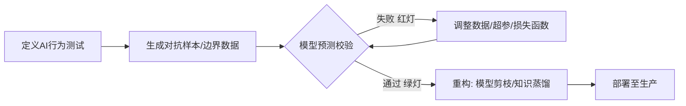
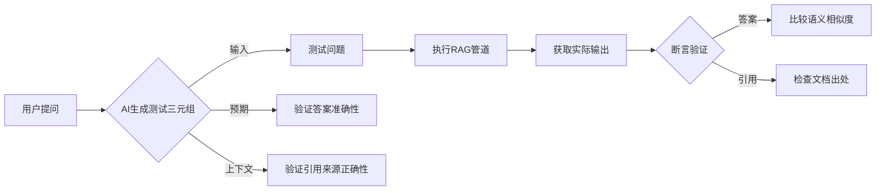

# 二、TDD 理念的扩展：为 AI 系统构建质量内建的基石  

TDD的核心思想——"测试先行"、"行为驱动"、"小步迭代"——不仅适用于传统的软件开发。在AI时代，这些思想被扩展和应用到新的领域，特别是AI模型本身的开发以及与AI生成代码的交互中，为充满不确定性的AI系统构建了质量内建的基石。

## 2.1 TDD for AI Models：为"黑箱"注入确定性

AI模型（尤其是深度学习模型）常被视为"黑箱"，其行为难以完全预测和解释。将TDD的理念应用于AI模型的开发和迭代，有助于提升模型的可靠性、鲁棒性和可信度。

### 2.1.1 AI 模型的行为契约与测试用例定义

挑战在于如何像测试传统软件函数那样，为AI模型的行为定义清晰、可测试的预期。这催生了多种新型测试：
-   **功能性测试**：针对模型的核心功能，定义输入和期望输出的配对。例如，对于一个图像分类模型，给定一张猫的图片，期望其输出"猫"的标签。
-   **鲁棒性测试**：测试模型在输入发生微小扰动（如图片加噪声、文本中同义词替换）时的行为稳定性。
-   **公平性与偏见测试**：针对不同受保护群体的输入，测试模型输出是否存在显著差异或偏见。
-   **安全性测试（对抗性测试）**：主动构造"对抗性样本"（精心设计的、对人类看似无害但能误导模型的输入），测试模型的防御能力。
-   **性能测试**：测试模型的推理速度、资源消耗等是否在预期范围内。

### 2.1.2 应用 TDD 循环迭代 AI 模型（数据、训练、调优）

TDD的"红-绿-重构"循环同样适用于AI模型迭代，为"调参炼丹"过程引入了更强的目标导向性和系统性。



-   **红（Red）**：定义一个模型当前不满足的行为测试。例如，模型在某个特定类别的图片上准确率低于阈值。
-   **绿（Green）**：通过调整模型结构、训练数据、训练策略等，使模型通过这个"红灯"测试。
-   **重构（Refactor）**：在模型行为达标后，审视模型是否过于复杂、是否存在过拟合风险、训练过程是否高效等，进行优化。

### 2.1.3 针对 RAG/Agent 等 LLM 应用的特化测试

对于基于大型语言模型（LLM）的应用，测试的重点转向了验证其信息处理和决策逻辑的正确性。

#### 针对RAG管道的AI测试生成


**操作实例**：AI可以自动生成"问题-预期答案-来源"的三元组，并转化为可执行的测试用例，验证RAG系统在知识检索和回答上的准确性与忠实度。

#### Agent行为验证测试
对于Agent应用，测试的焦点是其决策逻辑是否符合业务规则。测试用例通常以模拟用户会话的形式出现，验证Agent在多轮交互中的反应和最终决策是否符合预期。这些测试数据可以从历史客服对话日志中自动生成。

## 2.2 AI 生成代码的可信度验证：TDD 成为质量防火墙

当AI大规模生成代码时，如何确保其质量、安全性和正确性成为核心问题。TDD在此扮演了至关重要的"质量守门员"角色。

### 2.2.1 "测试先行"作为人机协作的黄金准则

在准备使用AI生成某段功能代码之前，开发者应首先编写一个或多个描述该功能预期行为的单元测试。这些测试为AI提供了清晰、无歧义的"目标"，指导AI生成符合预期的代码，并能即时验证其正确性。即使代码由AI生成，其行为标准仍由人类开发者通过测试来定义和掌控。

### 2.2.2 捕获 AI"幻觉"与逻辑错误的"安全网"

AI有时会生成看似合理但实际上包含逻辑错误、不符合事实或引入安全漏洞的代码，这种现象被称为"AI幻觉"。精心设计的测试用例（特别是覆盖边界条件、异常情况和安全关注点的测试）能够有效地捕捉到这些由AI引入的错误。

**实验证明，采用测试先行策略，GPT-4生成的代码正确率比仅用问题描述高出37%。**

下图直观地展示了测试用例如何对AI生成的SQL代码进行完整性校验，有效防止了"幻觉代码"的产生。


## 2.3 测试驱动学习 (TDL)：用测试的视角理解和驾驭 AI

TDD不仅是开发方法，也是一种强大的学习工具。

### 2.3.1 AI 作为 TDD 教练与陪练

对于初学TDD的开发者，AI工具可以扮演教练角色，引导其遵循"红-绿-重构"的流程，并对不符合FIRST原则的测试或非最小化实现的代码给出即时反馈。AI还可以作为"编码道场"（Coding Dojo）的伙伴，出题并评估开发者的TDE实践过程。

### 2.3.2 通过为 AI 生成代码编写测试来深化理解

当AI生成了一段开发者并不完全理解的复杂代码时（例如，使用了一种不熟悉的API或算法），为其编写单元测试是一个非常高效的学习方式。为了编写测试，开发者必须深入研究AI生成的代码，思考其输入、输出、边界情况和可能的异常，从而将"黑箱"代码通过测试"白箱化"，深化对代码的理解。
**示例：**
```typescript
// AI生成了一段复杂的折扣计算逻辑
function calculateDiscount(price: number, userType: string) { /* ...复杂实现... */ }

// 开发者通过编写测试来反向推导和验证其行为
test("VIP用户应享有20%折扣", () => {
  expect(calculateDiscount(100, "VIP")).toBe(80);
});

test("普通用户满200减15", () => {
  expect(calculateDiscount(250, "Normal")).toBe(235);
});
```
这种主动的、探索式的学习，远比单纯阅读代码更有效。 


---
