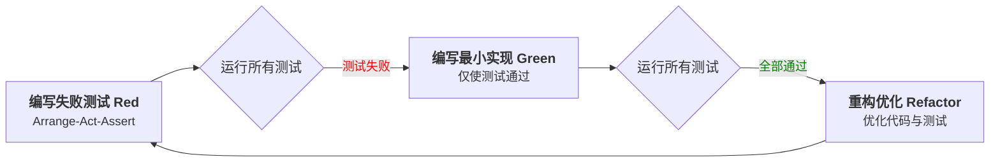

## 第3章：TDD的工程实践与关键技能 (How - Practical Application)

理解了TDD的"是什么"和"为什么"之后，本章将深入探讨"怎么做"。我们将详细介绍TDD的具体操作流程、将理论转化为实践的必备工具链，以及编写高质量测试和驱动出优秀设计的关键技能。

### 3.1 TDD具体操作流程

TDD的实践艺术在于精通并严格遵守"红-绿-重构"的循环。

#### 3.1.1 编写有效的失败测试（Arrange-Act-Assert）

这是TDD的起点，目标是编写一个清晰描述期望行为、且当前一定会失败的测试。

*   **测试命名：** 测试方法的名称应清晰描述其测试的行为和预期结果，例如 `test_deposit_increases_balance_by_amount()`。
*   **测试结构 (Arrange-Act-Assert / Given-When-Then):** 这是组织测试逻辑的黄金标准。
    *   **Arrange (组织/准备):** 设置测试所需的前提条件，如创建对象实例、初始化变量、准备Mock对象等。
    *   **Act (行动):** 执行被测试的操作或调用被测试的方法。这是测试的核心步骤。
    *   **Assert (断言):** 验证被测试方法的行为是否符合预期。检查返回值、对象状态变化、方法调用情况等。
*   **编写要点：**
    *   **单一关注点：** 一次只测试一个具体的行为点。
    *   **确保失败：** 运行测试，看到预期的红色。如果它通过了，说明测试有误或该功能已存在。
    *   **测试接口而非实现：** 关注"它做了什么"，而不是"它如何做的"。

#### 3.1.2 最小化实现代码

此阶段的目标是**用最少的代码、最快的速度让红灯变绿**。

*   **编写要点：**
    *   **只写必要的代码：** 此时不追求完美，甚至可以使用"假实现"（Fake It 'Til You Make It），如直接返回测试期望的硬编码值。
    *   **快速实现：** 目标是尽快通过测试以获得反馈。
    *   **不添加额外功能：** 严格抵制实现测试未覆盖到的其他逻辑的诱惑。

#### 3.1.3 安全地进行重构

当所有测试通过（绿灯亮起）后，就进入了至关重要的重构阶段。

*   **范围：** 包括刚刚编写的功能代码和测试代码。测试代码和生产代码同等重要，也需要保持高质量。
*   **重构目标：**
    *   **消除重复 (DRY - Don't Repeat Yourself):** 在功能代码或测试代码中寻找重复模式，并提取到公共方法或类中。
    *   **提高可读性：** 改进命名，简化复杂逻辑。好的代码本身就是最好的注释。
    *   **改进设计：** 应用设计原则，移除代码坏味道，优化类结构和方法职责。
*   **安全保证：** 每次小的重构动作后，都应**立即运行测试**。这是安全重构的基石。如果测试失败，应能轻松回滚到重构前的状态。重构阶段不应改变代码的外部行为。

### 3.2 关键工具链

选择合适的工具是高效实践TDD的前提。

#### 3.2.1 主流单元测试框架

单元测试框架提供编写和运行测试的基础结构，包括测试发现、执行、断言库和结果报告。

| 语言/环境 | 主流框架 | 特点 |
| :--- | :--- | :--- |
| **Java** | JUnit 5, TestNG | JUnit是最流行的标准；TestNG功能更丰富。 |
| **Python** | PyTest, `unittest` | PyTest更简洁、功能强大、社区活跃；`unittest`是标准库。 |
| **JavaScript** | Jest, Vitest, Mocha | Jest功能全面、零配置；Vitest是现代化的新选择；Mocha灵活。 |
| **C#/.NET** | NUnit, xUnit.net, MSTest | NUnit是经典选择；xUnit.net更现代、社区驱动。 |
| **Go** | `testing` (标准库) | Go语言内置，简洁高效。 |

#### 3.2.2 Mock、Stub等测试替身工具

**测试替身（Test Doubles）** 是TDD中实现单元测试"隔离性"的关键。当被测单元依赖于其他复杂组件（如数据库、外部API）时，我们用测试替身来替换这些真实依赖。

| 类型 | 目的与特点 |
| :--- | :--- |
| **Stub (桩)** | 提供测试所需的**固定返回值或行为**。例如，一个Stub化的用户服务在调用`getUser`时总是返回一个预设的用户对象，而不实际查询数据库。主要用于**状态验证**。 |
| **Mock (模拟对象)** | 关注**行为验证**。不仅能像Stub一样提供预设行为，还能记录对其方法的调用情况（如调用次数、参数），并在测试结束时验证这些交互是否符合预期。 |
| **Spy (间谍)** | 包裹真实对象，**记录真实对象的行为**但允许真实逻辑执行，也可以部分替换其行为。 |
| **Fake (伪对象)** | 拥有**实际功能的轻量级实现**，但不适用于生产环境（例如，内存数据库代替真实数据库）。 |

**主流Mock工具：**

| 语言 | Mock工具 |
| :--- | :--- |
| **Java** | Mockito, EasyMock |
| **Python** | `unittest.mock`, `pytest-mock` |
| **JavaScript** | Jest内置Mock, Sinon.JS |
| **C#/.NET** | Moq, NSubstitute |

### 3.3 高质量测试代码的FIRST原则

编写好的测试与编写好的功能代码同样重要。FIRST原则是衡量单元测试质量的黄金标准：

*   **F - Fast (快速):** 测试应该运行得非常快（毫秒级）。缓慢的测试会拖慢开发节奏，开发者会不愿意频繁运行它们。
*   **I - Independent/Isolated (独立/隔离):** 测试之间不应该有任何依赖关系。每个测试都应该可以独立、并以任何顺序运行。
*   **R - Repeatable (可重复):** 测试在任何环境（开发机、CI服务器）、任何时间运行都应该得到相同的结果。避免依赖外部易变环境因素。
*   **S - Self-Validating (自我验证):** 测试应该能自动判断其是否通过，不需要人工检查输出。测试结果必须是明确的布尔值：通过或失败。
*   **T - Timely/Thorough (及时/全面):**
    *   **及时 (Timely):** 测试应该在编写功能代码之前编写。
    *   **全面 (Thorough):** 测试应该覆盖重要的行为路径，包括正常情况、边界条件和错误情况。但"全面"不等于追求100%的代码行覆盖率。

### 3.4 TDD如何驱动出优秀设计

TDD不仅保障质量，更是塑造优秀设计的强大引擎。

#### 3.4.1 与SOLID原则的自然融合

TDD的实践过程会不自觉地引导开发者向SOLID原则靠拢：

*   **S - 单一职责原则 (SRP):** 当一个类承担了太多职责，你会发现测试难以编写和维护。这会促使你将类的职责拆分，使每个类更专注、更容易测试。
*   **O - 开放封闭原则 (OCP):** "红-绿-重构"循环天然支持OCP。添加新功能时（红-绿），我们不修改现有已通过测试的代码。在"重构"阶段，我们会寻找扩展点，使得系统在不修改旧代码核心逻辑的情况下易于扩展。
*   **L - 里氏替换原则 (LSP):** 如果子类破坏了基类的行为约定，那么基类的测试会在子类实例上失败，TDD会立即通过失败的测试暴露这个问题。
*   **I - 接口隔离原则 (ISP):** 为了方便Mock依赖，你会倾向于定义一个更小、更专注的接口（只包含客户端需要的方法），而不是让客户端依赖一个庞大臃肿的接口。
*   **D - 依赖倒置原则 (DIP):** 这是TDD驱动设计最直接的体现。为了能够用测试替身替换真实依赖，代码必须依赖于抽象（接口），而非具体实现。

#### 3.4.2 依赖注入（DI）的关键作用

**依赖注入是一种允许对象的依赖关系在外部被提供（注入）的设计模式，而不是由对象自身创建。**

*   **为何DI对TDD至关重要？**
    *   **实现隔离**：DI使得在测试时，可以轻松地将真实的依赖（如数据库连接）替换为Mock或Stub对象。没有DI，被测对象会硬编码其依赖的创建，导致无法隔离测试。
*   **常见的DI方式：**
    *   **构造函数注入 (Constructor Injection):** 依赖通过类的构造函数传入。这是最推荐的方式，因为它确保了对象在创建时就处于有效状态。
    *   **Setter方法注入 (Setter Injection):** 依赖通过公开的setter方法传入。
    *   **接口注入 (Interface Injection):** 类实现一个特定接口，该接口定义了注入依赖的方法。 

---
