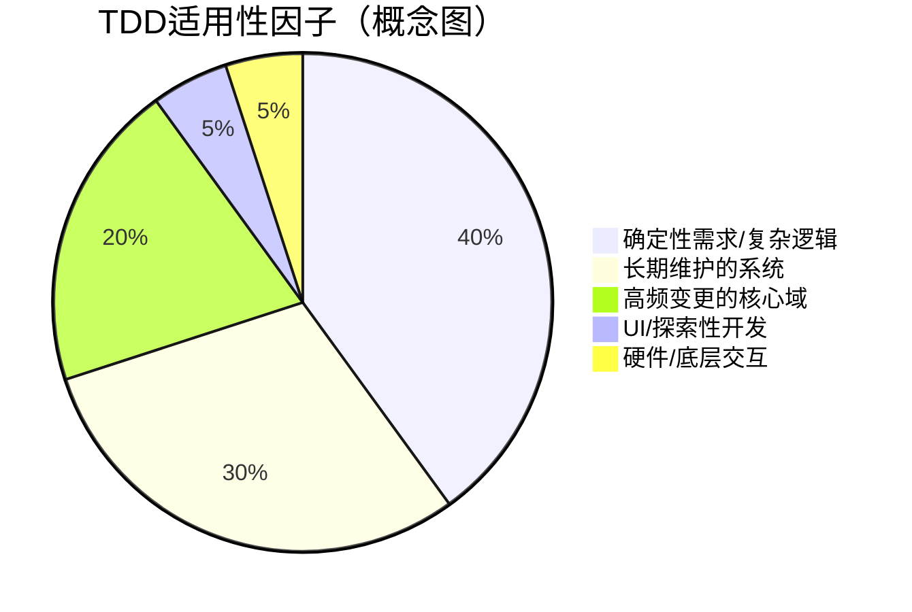

## 第4章：TDD的优缺点与务实考量 (Pros, Cons & Realistic View)

TDD并非万能的"银弹"，它有其显著优势，但也存在挑战和局限性。一个成熟的团队应该能够客观评估TDD，并根据项目特性、团队能力和代码现状，务实地、有策略地应用它，而不是将其作为僵化的教条。

### 4.1 TDD的核心优势回顾

我们在前述章节已经探讨了TDD带来的诸多价值，在此简要回顾其核心优势：

*   **更高的代码质量**：通过测试先行和持续重构，系统性地减少Bug数量，产出更健壮、更可靠的代码。
*   **更好的软件设计**：自然驱动出模块化、低耦合、高内聚的代码结构，易于理解和维护。
*   **可靠的回归安全网**：使团队能信心十足地进行重构、添加功能和快速迭代，是CI/CD的基石。
*   **"活的"技术文档**：测试用例作为代码行为的精确描述，降低了沟通和维护成本。
*   **提升长期开发效率**：虽然初期投入时间编写测试，但显著减少了后期调试、Bug修复和维护的时间。
*   **增强开发者信心与团队协作**：减少对修改代码的恐惧，测试代码成为团队沟通的桥梁。

### 4.2 TDD面临的挑战与局限性

| 挑战与局限性 | 核心原因 | 应对策略 |
| :--- | :--- | :--- |
| **陡峭的学习曲线** | - **思维转变困难**：从"先实现再验证"到"先定义行为再实现"的转变需要时间适应。 - **技能要求**：需要掌握测试框架、Mock/Stub工具和重构手法。 | - **系统性培训**：组织内外部培训、编码道场（Coding Dojo）。 - **渐进式实践**：从小型或非核心项目开始试点，结对编程，导师辅导。 |
| **初期开发效率感知下降** | - **额外工作量**：编写测试本身需要时间，初期会感觉开发速度变慢（约增加15-35%）。 | - **强调长期回报**：让团队看到后期调试和Bug修复时间的大幅减少。 - **提升熟练度**：通过练习，编写测试的速度会显著加快。 |
| **测试代码的维护成本** | - **测试也是代码**：测试代码也需要维护，写得不好的测试（如与实现细节过度耦合）会成为负担。 | - **遵循FIRST原则**：编写高质量、行为驱动的测试。 - **重构测试代码**：将测试代码与生产代码同等对待，定期评审和重构。 |
| **组织层面的认知障碍** | - **管理层不理解**：管理层可能认为编写测试是在浪费时间，单纯考核短期功能交付速度。 | - **量化价值**：通过缺陷率、维护成本等数据展示TDD的长期ROI。 - **建立质量文化**：争取管理层对"质量优先"理念的认同和支持。 |

### 4.3 TDD的适用性探讨

TDD并非适用于所有开发场景。关键在于理解其优势领域，并在不适合的场景中灵活调整。

#### 4.3.1 复杂业务逻辑 vs. 探索性开发

*   **推荐场景 (高适用性)**：
    *   **业务规则复杂、需求明确的领域**：如金融核心、交易系统、算法实现等。TDD能确保这些关键逻辑的正确性和健壮性。
    *   **长期维护的系统**：TDD构建的安全网对于这类系统的健康演进至关重要。
*   **谨慎使用场景 (低适用性)**：
    *   **探索性编程或原型开发**：当需求极不明确，需要快速尝试不同方案以探索可能性时，严格的TDD可能会束缚探索的自由度和速度。
    *   **应对策略**：在非常早期的原型验证阶段，可以暂时放宽TDD要求。一旦某个方向被证明可行，准备将其转化为正式功能时，应立即开始补写测试并转向TDD。

#### 4.3.2 GUI与外部系统依赖的处理

*   **图形界面 (GUI) 开发**：
    *   **挑战**：GUI的测试往往涉及用户交互、视觉呈现，传统的单元测试难以覆盖。端到端的UI自动化测试通常较慢且脆弱。
    *   **务实策略**：采用**MVVM, MVP, MVC**等模式，将UI的"视图"与"逻辑"（ViewModel/Presenter/Controller）分离。**对不依赖具体UI框架的逻辑层进行TDD**，UI本身则通过少量、高价值的E2E测试或手动探索性测试来覆盖。
*   **复杂的外部系统依赖**：
    *   **挑战**：如复杂的第三方硬件、专有API等，Mock的成本可能非常高，或者Mock无法完全模拟真实行为。
    *   **务实策略**：围绕这些难以测试的部分建立清晰的**防腐层 (Anti-Corruption Layer)**。对防腐层本身和防腐层之外的业务逻辑进行TDD。与这些外部系统的交互可以通过更高层次的**集成测试**来重点覆盖。

#### 4.3.3 遗留系统的TDD渗透策略

在没有测试的遗留代码（Legacy Code）上直接应用TDD非常困难。需要采用渐进式的渗透策略。

1.  **目标不是一步到位**：不要期望立即对整个遗留系统应用TDD。
2.  **从新功能或Bug修复开始**：当需要在遗留代码中添加新特性或修复Bug时，是引入TDD的绝佳机会。
3.  **建立测试安全网**：
    *   **特征化测试 (Characterization Tests)**：在修改任何代码之前，为即将修改的部分编写测试，以描述并"锁定"其当前行为（即使行为是错误的）。
    *   **寻找接缝 (Seams)**：找到代码中可以改变行为而无需修改那部分代码的地方（如通过子类化、参数化等），利用接缝来引入测试点或替换依赖。
4.  **小范围重构以提高可测试性**：在测试的保护下，进行一些小型的、安全的重构（如提取方法、分离关注点），使得代码更容易被测试。
5.  **绞杀者模式 (Strangler Fig Pattern)**：对于大型遗留系统，可以逐步用遵循TDD开发的新服务替换旧系统的功能模块。

### 4.4 平衡测试的粒度与成本

避免过度测试或测试不足，是务实应用TDD的关键。

#### 4.4.1 测试金字塔模型

测试金字塔是一个经典的测试策略模型，强调不同粒度测试的比例关系。

*   **单元测试 (Unit Tests)**：位于金字塔底部，数量最多。TDD主要聚焦于此。它们快速、稳定，用于测试独立的类或模块。
*   **集成测试 (Integration Tests)**：位于中间层，数量次之。用于测试模块间的协作，如服务层与数据访问层的交互。
*   **端到端测试 (E2E Tests)**：位于塔尖，数量最少。模拟用户操作，验证整个系统的完整流程。它们最慢、最脆弱，但能覆盖核心用户场景。

#### 4.4.2 避免过度测试与测试不足

*   **避免过度测试**：
    *   **不测试第三方库或语言特性**：信任它们是可靠的。
    *   **不测试简单的getter/setter**（除非它们包含逻辑）。
    *   **不直接测试私有方法**：私有方法是实现细节，应通过测试类的公共接口来间接覆盖其逻辑。如果一个私有方法复杂到需要单独测试，这通常是需要重构的信号（如提取到一个新的协作类中）。
    *   **不过度追求100%覆盖率**：高覆盖率不一定意味着高质量测试，应用它来发现未经测试的代码区域，而不是作为唯一目标。
*   **避免测试不足**：
    *   **覆盖核心业务逻辑**：对复杂或关键的业务规则，应有充分的测试。
    *   **考虑边界条件**：`null`输入、空集合、最大/最小值、有效/无效数据等。
    *   **测试异常路径和错误处理**：系统在非正常情况下的行为也需要验证。

总之，理性看待TDD，意味着理解其价值，承认其挑战，并学会在不同的项目阶段和代码状况下，灵活、务实地运用其原则和实践。 